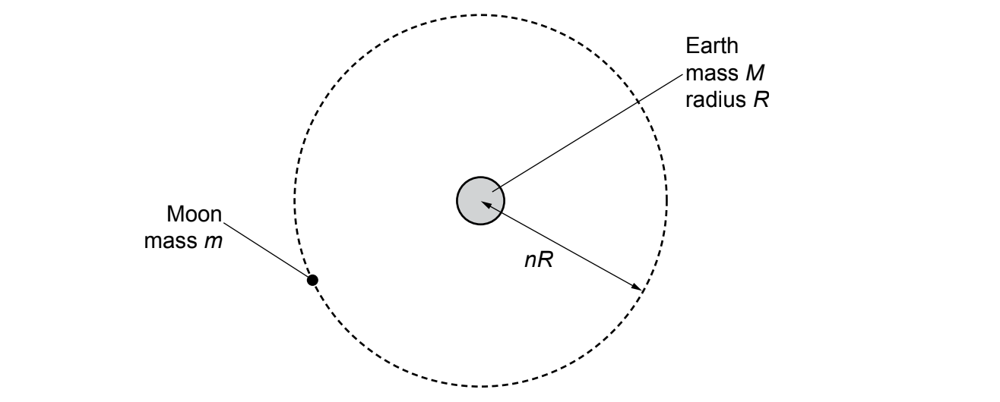
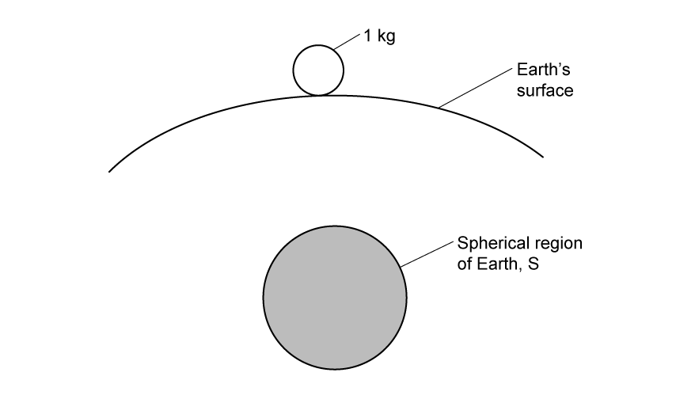
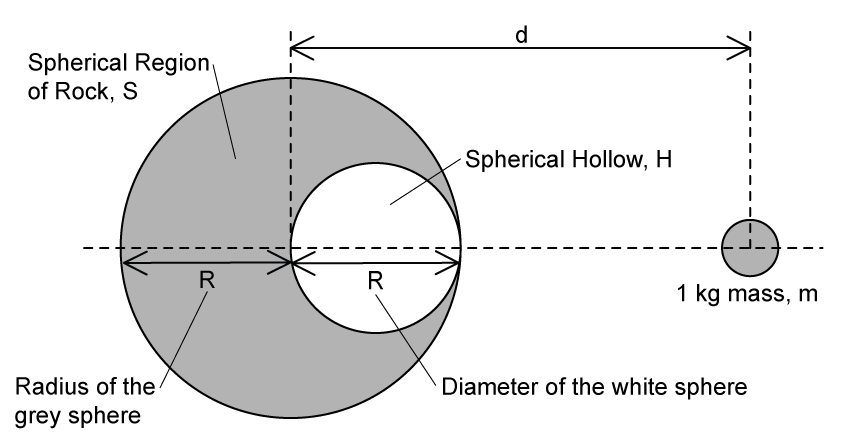

# Exam Questions — Gravitational Force Between Point Masses
**13. Gravitational Fields** · Cambridge (CIE) A-LEVEL physics (9702)
> Source: [https://www.savemyexams.com/a-level/physics/cie/25/topic-questions/](https://www.savemyexams.com/a-level/physics/cie/25/topic-questions/) · 7 questions across 1 sets

## Structured Questions (7 questions)

### Q1 — hard — 12 marks

**Q1** [2 marks]

Scientists want to put a satellite in orbit around planet Venus.

Justify how Newton's law of gravitation can be applied to a satellite orbiting Venus, when neither the satellite, nor the planet are point masses.

*Source: Nov 2018 2 Q8A*

**Q1** [6 marks]

The satellite's orbital time, *T*, and its orbital radius, *R*, are linked by the equation:

*T*2 = *kR*3

Venus has a mass of 4.9 × 1024 kg.

Determine the value of the constant *k*, and give the units in SI base units.

*Source: Nov 2018 2 Q8B*

**Q1** [2 marks]

**Extract:**

Scientists want to put a satellite in orbit around planet Venus.

The satellite's orbital time, T, and its orbital radius, R, are linked by the equation:
T^2 = kR^3

Venus has a mass of 4.9 × 10^24 kg.

k = 1.21 × 10^−13 (with units s^2 m^−3)

One day on Venus is equal to 116 Earth days and 18 Earth hours.

Determine the orbital speed of the satellite in m s−1.

*Source: Nov 2018 2 Q8B*

**Q1** [2 marks]

**Extract:**

R = 9.44 × 10^8^ m

The gravitational potential energy between the satellite and Venus is −2.08 × 108 J.

Calculate the magnitude of the gravitational force keeping the satellite in orbit. Explain your answer.

### Q2 — easy — 8 marks

**Q2** [2 marks]

State Newton's law of gravitation.

**Q2** [2 marks]

Newton's law of gravitation assumes the masses are point masses.

The planets in our Solar System and the Sun are not point masses.

Outline why the law still applies to the planets in our Solar System.

**Q2** [1 mark]

Explain why *g *is approximately constant for small changes in height near the Earth’s surface.

**Q2** [3 marks]

The gravitational force between the Earth and the Sun is 3.52 × 1022 N.

Calculate the radius of the Earth's orbit around the Sun.

Mass of Earth = 6.0 × 1024 kg

Mass of Sun = 2.0 × 1030 kg

### Q3 — medium — 9 marks

**Q3** [2 marks]

Explain how the force(s) on a satellite can result in the satellite being in a circular orbit around a planet.

*Source: Specimen 2022 Paper 4 Q1A*

**Q3** [4 marks]

The Earth and the Moon may be considered to be uniform spheres that are isolated in space. The Earth has mass *M*, radius *R* and mean density *ρ*.

The Moon, mass *m*, is in a circular orbit about the Earth with radius *nR*, as illustrated in Fig. 1.1.

**Fig. 1.1**

The Moon makes one complete orbit of the Earth in time *T*.

Show that the mean density *ρ* of the Earth is given by the expression

$ρ=\frac{3πn^{3}}{GT^{2}}$

where *G* is the gravitational constant.

*Source: Specimen 2022 Paper 4 Q1B*

**Q3** [3 marks]

**Extract:**

The Earth and the Moon may be considered to be uniform spheres that are isolated in space. The Earth has mass M, radius R and mean density ρ. The Moon, mass m, is in a circular orbit about the Earth with radius nR. The Moon makes one complete orbit of the Earth in time T. The mean density ρ of the Earth is given by the expression ρ = 3πn³/(GT²), where G is the gravitational constant.

The radius *R* of the Earth is 6.38 × 106 m and the distance between the centre of the Earth and the centre of the Moon is 3.84 × 108 m.

The period *T* of the orbit of the Moon about the Earth is 27.3 days.

Use the expression in **(b)** to calculate *ρ*.

*ρ* = ................................... kg m–3

*Source: Specimen 2022 Paper 4 Q1C*

### Q4 — medium — 11 marks

**Q4** [3 marks]

One of Jupiter's moons, Europa, has an orbital period of 85 hours and an orbital radius of 670 900 km.

Explain why Europa moves with uniform circular motion.

**Q4** [2 marks]

**Extract:**

One of Jupiter's moons, Europa, has an orbital period of 85 hours and an orbital radius of 670 900 km.

Show that the orbital speed of Europa is 14 km s–1.

**Q4** [3 marks]

**Extract:**

One of Jupiter's moons, Europa, has an orbital period of 85 hours and an orbital radius of 670 900 km.
Show that the orbital speed of Europa is 14 km s^–1^: Orbital speed v = 13.8 km s^–1^ (3 s.f).

Determine the mass of Jupiter.

**Q4** [3 marks]

**Extract:**

One of Jupiter's moons, Europa, has an orbital period of 85 hours and an orbital radius of 670 900 km.

Ganymede is the largest of Jupiter’s Moons. It has an orbital period of 7.15 days and an orbital speed of 10.880 km s–1.

Calculate the ratio

$\frac{\mathrm{orbital} \mathrm{radius} \mathrm{of} \mathrm{Europa}}{\mathrm{orbital} \mathrm{radius} \mathrm{of} \mathrm{Ganymede}}$

### Q5 — easy — 11 marks

**Q5** [3 marks]

Explain what is meant by a *geostationary orbit*.

**Q5** [2 marks]

A satellite of mass *m* is in a circular orbit around a planet of mass *M *with linear speed *v*.

Show that *M* is given by the expression:

$M=\frac{v^{2}r}{G}$

**Q5** [2 marks]

**Extract:**

A satellite of mass m is in a circular orbit around a planet of mass M with linear speed v. Show that M is given by the expression: M = v²r/G

Show that the mass *M* can also be written in terms of the time period of the satellite *T* as

$M=\frac{4π^{2}r^{3}}{T^{2}G}$

**Q5** [4 marks]

**Extract:**

Show that the mass *M* can also be written in terms of the time period of the satellite *T* as M = 4π²r³/(T²G)

Calculate the radius of a geostationary orbit around Earth.

Mass of Earth = 6.0 × 1024 kg

### Q6 — hard — 10 marks

**Q6** [3 marks]

A kilogram mass rests on the surface of the Earth as shown in Fig. 1.1. A spherical rock S, whose centre of mass is underneath the Earth's surface at a distance *d* of 3.5 km, has a radius of 2 km. The density of the rock is 2500 kg m–3.

**Fig. 1.1**

Determine the size of the force exerted on the kilogram mass by the rock S, justifying any approximations.

**Q6** [4 marks]

**Extract:**

A kilogram mass rests on the surface of the Earth as shown in Fig. 1.1. A spherical rock S, whose centre of mass is underneath the Earth's surface at a distance *d* of 3.5 km, has a radius of 2 km. The density of the rock is 2500 kg m^–3^. Determine the size of the force exerted on the kilogram mass by the rock S, justifying any approximations.

The spherical region of rock, S, is now replaced with a different type of rock and there is a hollow, H, made in the sphere such that its diameter is equal to the radius of S, as shown in Fig. 1.2.

The mass of sphere S with the new rock and the hollow is equal to the mass of sphere S in part (a) and is represented by *M*.

The centre of the 1 kg mass *m* still sits at a distance 3.5 km from the centre of S.

**Fig. 1.2**

One student assumes that the force *F *between the mass *m *and sphere S is equal, despite the presence of the hollow H.

Explain why the student is incorrect in their assumption.

**Q6** [3 marks]

**Extract:**

A kilogram mass rests on the surface of the Earth as shown in Fig. 1.1. A spherical rock S, whose centre of mass is underneath the Earth's surface at a distance d of 3.5 km, has a radius of 2 km. The density of the rock is 2500 kg m^–3^. Determine the size of the force exerted on the kilogram mass by the rock S.

The spherical region of rock, S, is now replaced with a different type of rock and there is a hollow, H, made in the sphere such that its diameter is equal to the radius of S. The mass of sphere S with the new rock and the hollow is equal to the mass of sphere S in part (a) and is represented by M. The centre of the 1 kg mass m still sits at a distance 3.5 km from the centre of S. One student assumes that the force F between the mass m and sphere S is equal, despite the presence of the hollow H.

The new *F *between S and *m *with hollow H* *is $\frac{49}{64}$ times the previous *F *without hollow H.

Calculate the distance between the new centre of mass of S and the geometric centre of the new shape of S.

### Q7 — medium — 14 marks

**Q7** [5 marks]

Explain

(i) What is meant by a *geostationary orbit*.

[3]

(ii) Why it is preferable to have a satellite in this orbit for TV and telephone signals.

[2]

**Q7** [4 marks]

A satellite of mass *m* is in orbit around a planet.

The mass *M *of the planet may be considered to be concentrated at its centre.

Show that the time period *T* of the orbit of the satellite is given by the expression

`T squared space equals space open parentheses fraction numerator 4 pi squared R cubed over denominator G M end fraction close parentheses`

where *R* is the radius of the orbit of the satellite and *G* is the gravitational constant.

Explain your working.

**Q7** [2 marks]

**Extract:**

Show that the time period T of the orbit of the satellite is given by the expression T^2 = (4 π^2 R^3)/(G M) where R is the radius of the orbit of the satellite and G is the gravitational constant.

The radius of a geostationary orbit from the centre of the Earth is 4.2 × 107 m.

Calculate the mass of the Earth.

**Q7** [3 marks]

**Extract:**

The radius of a geostationary orbit from the centre of the Earth is 4.2 × 10^7 m.

The radius of the Earth is 6400 km.

Determine the ratio

$\frac{\mathrm{gravitational} \mathrm{field} \mathrm{strength} \mathrm{of} \mathrm{satellite} \mathrm{on} \mathrm{the} \mathrm{Earth}'s\mathrm{surface}}{\mathrm{gravitational} \mathrm{field} \mathrm{strength} \mathrm{of} \mathrm{the} \mathrm{satellite} \mathrm{at} \mathrm{the} \mathrm{geostationary} \mathrm{orbit}}$
