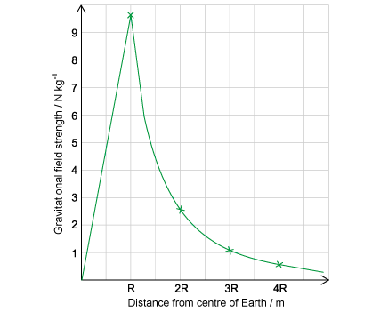
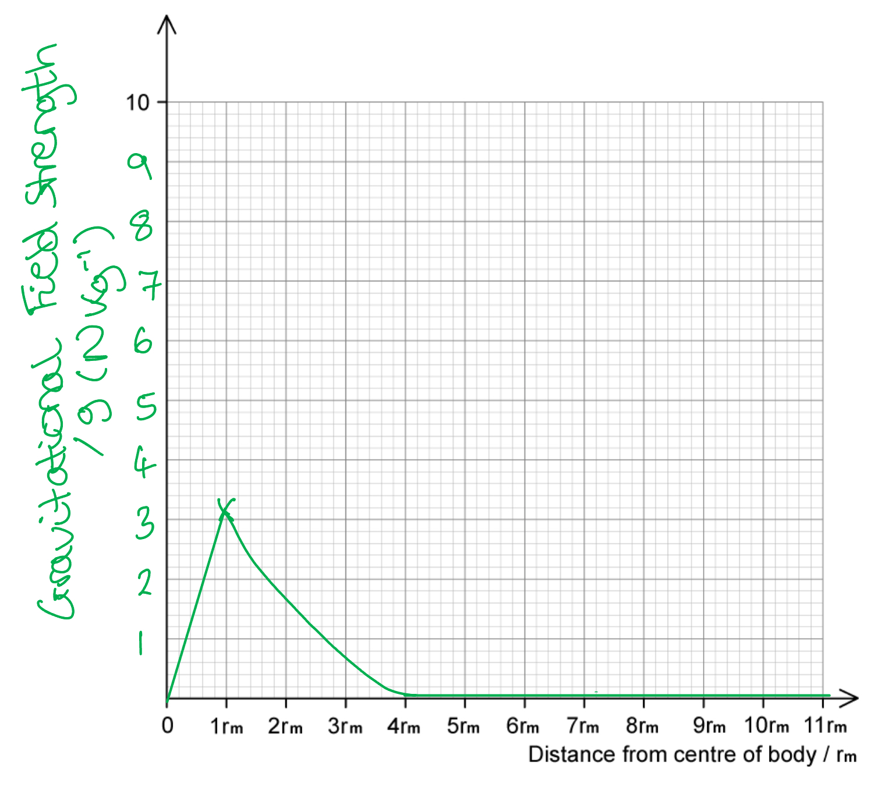
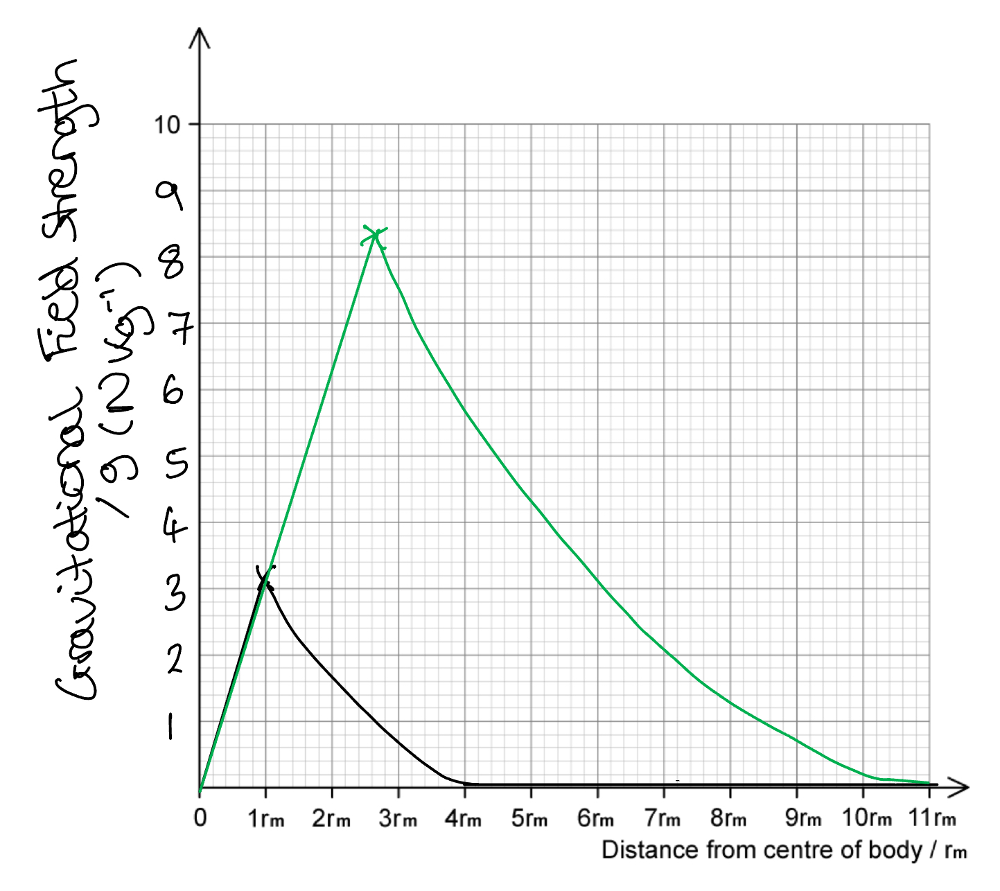
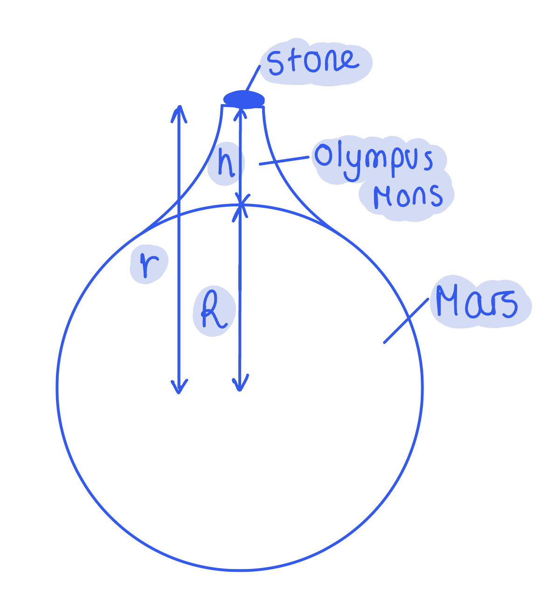
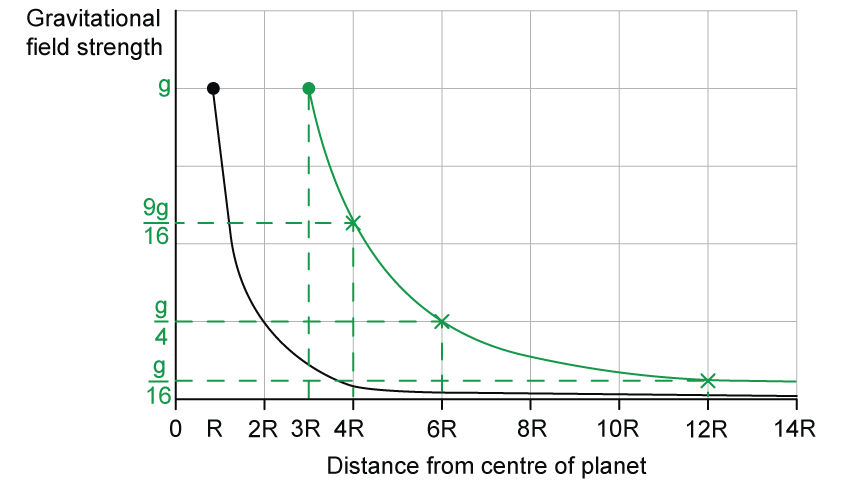
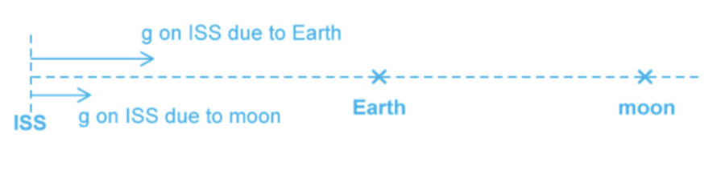

# Mark Schemes — Gravitational Field of a Point Mass
**13. Gravitational Fields** · Cambridge (CIE) A-LEVEL physics (9702)

## Structured Questions (7 questions)

### Q1
Gravitational field strength is:

State:

- A vector (quantity); **[1 mark]**

Reason:

- It has both magnitude and direction **OR**
- It is the force per unit mass **AND** force is a vector; **[1 mark]**** **

**[Total: 2 marks]**
State how the value of the gravitational field strength changes if the radial distance from the Earth’s centre *doubles*:

- The value of the gravitational field strength decreases by a factor of 4 / quarters / falls to 25% of its initial value; **[1 mark]**

Explanation:

- This is because the gravitational field strength is <u>inversely proportional to the radial distance squared</u> **OR**
- Gravitational field strength follows an inverse square law (with radial distance); **[1 mark]**

**[Total: 2 marks]**
A graph that would score 4 marks would look like:

(i) Gravitational field strength between the centre of the Earth and the surface of the Earth, *r* = *R:*

- Straight line; **[1 mark]**
- From (0,0) to (*R*, 9.81); **[1 mark]**

(ii) Gravitational field strength between the surface of the Earth and a distance 4*R* from the centre of the Earth:

- Points from Table 1.1** **plotted correctly; **[1 mark]**
- Smooth curve through points; **[1 mark] **

**[Total: 4 marks]**

### Q2
List the known quantities:

- *g* on the surface of the moon, *g*m = 3.2 N kg–1
- diameter of planet = 2.6 × diameter of moon, *d**p* = 2.6*d**m*

Determine the mass of the moon *m*m in terms of its density:

- Recall volume of a sphere, $V=\frac{4}{3}πr^{3}$
- Density $ρ=\frac{mass}{volume}=\frac{m_{m}}{V_{m}}=\frac{m_{m}}{\frac{4}{3}πr_{m}^{3}}$* *where *r*m is the radius of the moon
- Therefore, $m_{m}=\frac{4}{3}πρr_{m}^{3}$ **[1 mark]**

Substitute *m*m into the equation for gravitational field strength at the surface of the moon:

- Recall: $g=G\frac{M}{r^{2}}$
- So, $g_{m}=\frac{Gm_{m}}{r_{m}^{2}}$
- $3.2=\frac{Gm_{m}}{r_{m}^{2}}$
- $3.2 = \frac{G \times ( \frac{4}{3} pi \text{rho} r_{m} ^{3} ) }{r_{m} ^{2} } = G \times \frac{4}{3} pi \text{rho} r_{m}$ **[1 mark]**

Determine the mass of the planet, *m*p in terms of its density:

- Following similar lines as above, $m_{p}=\frac{4}{3}πρr_{p}^{3}$
- However, since *d**p* = 2.6*d**m *then *r*p = 2.6*r*m, so $m_{p} = \frac{4}{3} \pi \\rho ( 2.6 r_{m} )^{3}$** [1 mark]**

Substitute *m*p into the equation for gravitational field strength at the surface of the planet:

- $g_{p}=\frac{Gm_{p}}{r_{p}^{2}}$
- $g_{p} = \frac{G \times ( \frac{4}{3} pi \text{rho} ( 2.6 r_{m} ) ^{3} ) }{( 2.6 r_{m} ) ^{2} }$
- $g_{p} = G \times \frac{4}{3} \pi \\rho ( 2.6 r_{m} )$ **[1 mark]**

Determine *g*p in terms of the gravitational field strength at the surface of the moon:

- $g_{p}=2.6\timesG\times\frac{4}{3}πρr_{m}$
- However, $G\times\frac{4}{3}πρr_{m}=g_{m}=3.2$
- Therefore:

  - $g_{p}=2.6\times3.2$ = 8.32 N kg–1 **[1 mark]**

**[Total: 5 marks]**

> *Unless told otherwise, you can assume that planets, stars and moons are uniform spheres. You must remember the equation for the volume of a sphere from your GCSE Maths course.*
A correctly labelled and sketched graph that would score 3 marks should look like this:

- Vertical / y-axis labelled as gravitational field strength / *g *(N kg−1) **AND** numbers on vertical axis completed in multiples of 10; **[1 mark]**
- A straight line with increasing gradient is drawn from the origin at (0, 0) to the gravitational field strength of the moon at the surface (*r**m*, 3.2); **[1 mark]**
- A curved line is drawn from the peak at (*r**m*, 3.2) and becomes an asymptote to the horizontal axis at 4*r**m*; **[1 mark]**

**[Total: 3 marks]**
List the known quantities:

- Gravitational field strength of planet, *g**p* = 8.32 N kg−1
- Radius of planet = 2.6 × radius of moon, *r**p* = 2.6*r**m*

Calculate the radius of the planet in terms of *r**m *for *g**p*:

- *r**p* = 2.6*r**m* at *g**p*
- So, for 4*r**m* = *r**p* = 4 × 2.6*r**m* = 10.4*r**m*

A correctly sketched graph that would score 2 marks should look like this:

- Straight line with increasing gradient is drawn from origin at (0, 0) to the gravitational field strength of the planet at the surface (2.6*r**m*, 8.32); **[1 mark]**
- Curved line drawn from the peak at (2.6*r**m*, 8.32) and becomes an asymptote to the horizontal axis at 10.4*r**m*; **[1 mark]**

**[Total: 2 marks]**
List the known quantities:

- $m_{p} = \frac{4}{3} \pi \\rho ( 2.6 r_{m} )^{3}$ (From part a))

Determine the relationship between the gravitational field strengths at the neutral point, *R*:

- *g**m* = *g**p* **[1 mark]**

Combine the equations for the gravitational field strength to obtain the ratio of distances:

- Recall: $g=G\frac{M}{r^{2}}$
- $\frac{Gm_{m}}{R_{m}^{2}}=\frac{Gm_{p}}{R_{p}^{2}}$
- $\frac{m_{m}}{R_{m}^{2}}=\frac{2.6^{3}m_{m}}{R_{p}^{2}}$
- $\frac{R_{p}^{2}}{R_{m}^{2}}=2.6^{3}$
- $\frac{R_{p}}{R_{m}}=\sqrt{2.6^{3}}$ **[1 mark]**

Calculate the value of the ratio:

- $\frac{R_{p}}{R_{m}}=4.19$ **[1 mark]**

**[Total: 3 marks]**** **

> *The neutral point (the point where there is no resultant gravitational field) will be closer to the moon because planet P is 2.6 times the mass of the moon **m**. Therefore, it will attract masses **with the same force (per unit of mass)** from a much greater distance compared to the moon.  *

> *It can be hard to spot the relationship between the mass of the planet and the mass of the moon.*

> *From part a) we know *$m_{p} = \frac{4}{3} \pi \\rho ( 2.6 r_{m} )^{3}$* and *$m_{m} = \frac{4}{3} \pi \\rho ( r_{m} )^{3}$* so *$m_{p}=2.6^{3}m_{m}$*.*

### Q3
Calculate *M*

List the known quantities:

- Mass of stone, *m* = 3.67 kg
- Radius of Mars, *R* = 3400 km = 3400 × 103 m
- Height of Olympus Mons, *h *= 25 km = 25 × 103 m
- Gravitational force, *F* = 13.3 N

Use Newton's law of gravitation to determine an equation for *M*:

- $F = \frac{G M_{1} M_{2} }{r^{2}} = \frac{G M m }{( R + h )^{2}}$
- $M = \frac{F ( R + h )^{2} }{G m}$

Substitute values into the mass equation:

- $M = \frac{13.3 \times ( ( 3400 + 25 ) \times 10^{3} )^{2} }{( 6.67 \times 10^{- 11} ) \times 3.67}$ **[1 mark]**
- $M=6.374\times10^{23}=6.4\times10^{23}\mathrm{kg}$ **[1 mark]**

**[Total: 2 marks]**

> *Remember that **r** is the separation between the **centre** of both the masses. In this case, since the stone is on top of Olympus Mons, we need to take the height of the volcano as well.*

The force required to maintain the stone in its circular path is:

List the known quantities:

- Mass of stone, *m* = 3.67 kg
- Radius of Mars, *R* = 3400 km = 3400 × 103 m
- Height of Olympus Mons, *h *= 25 km = 25 × 103 m
- Time period of the stone,* T* = 1 day and 37 mins

Calculate the time period *T* in seconds:

- 1 day and 37 mins = (24 × 60 × 60) + (37 × 60) = 88620 s **[1 mark]**

Determine the equation for the centripetal force equation, *F*:

- $F=\frac{mv^{2}}{r}$ **AND **$v=ωr=\frac{2πr}{T}$** ****[1 mark]**
- $F = \frac{ m ( \frac{2 \pi r}{T} )^{2}}{r} = \frac{m \times 4 \pi ^{2} r }{T^{2}}$** **

Substitute in the values for *F*:

- $F = \frac{3.67 \times 4 \pi ^{2} \times ( ( 3400 \times 10^{3} ) + ( 25 \times 10^{3} ) ) }{( 88620 )^{2}} = 6.3 \times 10^{- 2} \mathrm{N}$ **[1 mark]**

**[Total: 3 marks]**
Derive the equation $g=\frac{GM}{r^{2}}$

Determine the relevant equations:

- Newton's law of gravitational states that $F=\frac{GM_{1}M_{2}}{r^{2}}=\frac{GMm}{r^{2}}$

**AND**

- The gravitational field strength is defined as $g=\frac{F}{m}$ **[1 mark]**

Combine the equations:

- $g=\frac{\frac{GMm}{r^{2}}}{m}=\frac{GMm}{r^{2}m}=\frac{GM}{r^{2}}$ **[1 mark]**

**[Total: 2 marks]**

> *The difference between **M** and **m** is very important! **M** is the mass of the object creating the gravitational field whilst **m** is the mass of the object you are calculating the field strength of at that point. Therefore, *$g=\frac{F}{M}$* would be incorrect.*
Calculate the acceleration due to gravity of the stone if it was thrown upwards to twice the height of Olympus Mons

List the known quantities:

- Mass of stone, *m* = 3.67 kg
- Radius of Mars, *R* = 3400 km = 3400 × 103 m
- Height of Olympus Mons, *h *= 25 km = 25 × 103 m
- Mass of Mars, *M* = 6.374 × 1023 kg (from part a)

Calculate the gravitational field strength (acceleration due to gravity), *g*:

- $g = \frac{ G M}{r^{2}} = \frac{( 6.67 \times 10^{- 11} ) \times ( 6.374 \times 10^{23} ) }{( ( 3400 \times 10^{3} ) + ( 50 \times 10^{3} ) )^{2}}$ **[1 mark]**
- $g=a=3.57N\mathrm{kg}^{-1}=3.5ms^{-2}$ **[1 mark]**

**[Total: 2 marks]**

> *Acceleration due to gravity and the gravitational field strength is the **same thing**. This means that **g** can either be written in units of N kg**–1** or m s**–2**.*

### Q4
Write an expression for the mean density of the Moon:

List the relevant equations:

- Density:  $ρ=\frac{M}{V}$
- Volume of a sphere: $V=\frac{4}{3}πr^{3}$
- Gravitational field strength:  $g=\frac{GM}{r^{2}}$

Rearrange the field strength equation for mass:

- Rearrange: * *$g=\frac{GM}{r^{2}}\RightarrowM=\frac{r^{2}g}{G}$ **[1 mark]**

Substitute volume and mass into the density equation:

- Substitute:  $\\rho = \frac{M}{V} = \frac{r^{2} g}{G} \times ( \frac{3}{4 \mathrm{\pi } r^{3}} )$ **[1 mark]**
- Simplify: $ρ=\frac{3r^{2}g}{4πr^{3}G}$
- Mean density of Moon: $ρ=\frac{3g}{4πGr}$ **[1 mark]**** **

**[Total: 3 marks]**
Show that the gravitational field strength on the Moon is about 1.6 N kg–1:

List the known quantities:

- Mean density of the Moon, $ρ$ = 3.34 g cm–3 = 3340 kg m–3
- Radius of the Moon, *r* = 1700 km = 1700 × 103 m** **
- Gravitational constant, *G* = 6.67 × 10–11 N m2 kg–2** **(from the data page)

Rearrange the expression from (a) for field strength:

- Mean density:  $ρ=\frac{3g}{4πGr}\Rightarrowg=\frac{4πGrρ}{3}$* * **[1 mark]**

Substitute values into the equation for field strength:

- Substitute:*  *$g = \frac{4 \mathrm{\pi } \times ( 6.67 \times 10^{- 11} ) ( 1700 \times 10^{3} ) ( 3340 )}{3}$ = 1.59 N kg–1 **[1 mark]**** **

**[Total: 2 marks]**

*Make sure you're confident with unit conversions*. I*n this question, we need to convert density from g cm**–3** to kg m**–3**:*

- *g → kg:  3.34 g = 3.34 × 10**–3** kg*
- *cm**3** → m**3**:  1 cm**3** = (1 × 10**–2**)**3** m**3** = 1 × 10**–6** m**3*
- *g cm**–3** → kg m**–3**:  *$\frac{3.34\times10^{-3}\mathrm{kg}}{1\times10^{-6}m^{3}}$* = 3340 kg m**–3*
Show the mass of the planet is 9 times greater than the mass of the Moon:

List the known quantities:

- Radius of the Moon = *R*
- Mass of the Moon = *M*
- Radius of the planet = 3*R*
- Mass of the planet = *M*P
- Gravitational field strength of the Moon and planet =* g*

Equate the gravitational field strengths of the Moon and planet:

- Gravitational field strength on the Moon:  $g=\frac{GM}{R^{2}}$
- Gravitational field strength on the planet:  $g = \frac{G M_{P} }{( 3 R )^{2}} = \frac{G M_{P} }{9 R^{2}}$
- Equate:  $\frac{GM}{R^{2}}=\frac{GM_{P}}{9R^{2}}$ **[1 mark]**

Rearrange for the mass of the planet:

- Rearrange:*  *$M_{P}=\frac{9R^{2}}{G}\times\frac{GM}{R^{2}}$
- Simplify:  $M_{P}=9M$ **[1 mark]**** **

**[Total: 2 marks]**
Sketch the variation of distance with gravitational field strength for the planet in** **(c):

- Curve starts at $( 3 R , g )$; **[1 mark]**
- Curve goes through correct points e.g. $( 4 R , \frac{9 g}{16} )$, $( 6 R , \frac{g}{4} )$ and $( 12 R , \frac{g}{16} )$; **[1 mark]**
- Single smooth line curve with decreasing negative gradient (inverse square law relationship); **[1 mark]**** **

**[Total: 3 marks]**** **

> *Make sure you understand how an inverse square law works; it means that when **R** **doubles**, **g** **decreases** by a factor of 2**2** = **4**, i.e. *$g\propto\frac{1}{R^{2}}$*, so as radius increases from *$3R\overset{\times2}{\rightarrow}6R$*, field strength decreases from *$g\overset{\div4}{\rightarrow}\frac{g}{4}$

> *The most common mistake is to plot an inversely proportional relationship, which would give points such as *$( 6 R , \frac{g}{2} )$* and *$( 12 R , \frac{g}{4} )$

### Q5
(i) Calculate the mass of the moon

List the known quantities:

- Gravitational field strength at the moon's surface *g*M = 1.63 N kg–1
- Diameter of the moon = 3480 km = 3480 × 103 m
- Gravitational constant *G* = 6.67 × 10–11 N m2 kg–2

Calculate the distance *r*  to the moon's surface:

- Recall:* *$g=G\frac{M}{r^{2}}$
- The distance from the centre of mass to the moon's surface is half its diameter
- Hence, *r*  = $\frac{3480\times10^{3}}{2}$ = 1.74 × 106 m **[1 mark]**

Rearrange the equation for field strength and substitute in values:

- $g_{M}=\frac{GM_{M}}{r^{2}}$where *M*M* *is the moon's mass and *r* is the distance to its surface from the centre of mass
- Therefore:

  - $M_{M}=\frac{g_{M}r^{2}}{G}=\frac{1.63\times(1.74\times10^{6})^{2}}{6.67\times10^{-11}}$**[1 mark]**

Calculate *M*M:

- *M*M* *= 7.40 × 1022 kg **[1 mark]**

(ii) State the assumption required for part (i):

- It must be assumed that the moon is a <u>uniform</u> sphere **OR** that the moon's mass is <u>uniformly</u> distributed; **[1 mark]**

**[Total: 3 marks]**
List the known quantities:

- Separation distance between Earth and Moon, $r_{E\rightarrowM}$= 3.80 × 108 m
- Mass of the Moon, *M*M = 7.40 × 1022 kg (from part a)
- Orbital height of the ISS, *r*orbit* *= 408 km
- Gravitational constant, *G* = 6.67 × 10–11 N m2 kg–2
- Mass of the Earth, *M*E = 5.97 × 1024 kg
- Radius of the Earth, *r*E = 6.37 × 106 m

Determine the separation between the ISS and the centre of Earth:

- $r_{ISS\rightarrowE}$ = *r*orbit + *r*E
- $r_{ISS\rightarrowE}$= (408 × 103) + (6.37 × 106)
- $r_{ISS\rightarrowE}$= 6.78 × 106 m **[1 mark]**

Determine the separation between the ISS and the centre of the Moon:

- If the ISS and the moon are on the same straight line as the Earth, then $r_{ISS\rightarrowM}$= $r_{ISS\rightarrowE}+r_{E\rightarrowM}$
- Hence, $r_{ISS\rightarrowM}$= (6.78 × 106) + (3.80 × 108)
- $r_{ISS\rightarrowM}$ = 3.87 × 108 m **[1 mark]**

Determine the equation for the maximum gravitational field strength experienced by the ISS, *g*ISS:

- The maximum gravitational field strength will be when the field strength due to the earth *M*E and the field strength due to the Moon, *M*M combine
- Recall* *$g=G\frac{M}{r^{2}}$
- This is written as $g_{ISS}=\frac{GM_{E}}{r_{ISS\rightarrowE}^{2}}+\frac{GM_{M}}{r_{ISS\rightarrowM}^{2}}$
- Hence, $g_{ISS}=\frac{(6.67\times10^{-11})\times(5.97\times10^{24})}{(6.78\times10^{6})^{2}}+\frac{(6.67\times10^{-11})\times(7.40\times10^{22})}{(3.87\times10^{8})^{2}}$**[1 mark]**
- $g_{ISS}$ = 8.66 N kg–1 **[1 mark]**

**[Total: 4 marks]**

> *Remember that the separation distance **r** between objects is taken to be the distance between the **centres of mass** of each object. This means the **radius** of the object needs to be considered. *

> *You also need to demonstrate that you understand the maximum gravitational field strength will occur when the Earth and the Moon are positioned on the same straight line as the ISS and that they will be aligned on the same side, as shown below: *

> *When the Earth and the Moon are on the same side, then the gravitational field strength exerted on the ISS are in the same direction; hence, the equation used must show the gravitational fields being added in order to work out the **maximum** **resultant**. *
Rearrange the field strength equation for planetary mass *M*:

- Recall: $g=G\frac{M}{r^{2}}$
- $M=\frac{gr^{2}}{G}$

Substitute equations for planetary mass *M* and volume *V * into the equation for density:

- The density *ρ *= $\frac{M}{V}$ and the volume $V=\frac{4}{3}πr^{3}$
- Hence,

  - $\\rho = \frac{( \frac{g r^{2}}{G} )}{( \frac{4}{3} \pi r^{3} )} = \frac{3 g r^{2}}{4 G \pi r^{3}}$
  - $ρ=\frac{3g}{4Gπr}$ **[1 mark]**

Rearrange the density equation for gravitational field strength *g*:

- $g=\frac{4}{3}Gπrρ$ **[1 mark]**

Conclude proportionality to *r*  and *ρ*:

- Hence, the gravitational field strength *g * is proportional to radius *r* and density *ρ  *(as *G *and π are constant); **[1 mark]**

**[Total: 3 marks]**

> *Since the question explicitly asks you to demonstrate a proportionality, make sure you include a statement following your mathematical work, clearly relating **g** to **r** and **ρ **in this case. *
List the known quantities:

- Density of X = *ρ*
- Density of Y = 3*ρ*
- Gravitational field strength of X = *g*
- Gravitational field strength of Y = 9*g*
- From part (c) $g=\frac{4}{3}Gπrρ$

Determine the ratio of radii for planets X and Y:

- `g _ Y / g _ X = (9 g)/(g) = (4 / 3 G pi r _ Y ( 3 rho ))/(4 / 3 G pi r _ X rho)` **[1 mark]**
- $9=\frac{3r_{Y}}{r_{X}}$
- $r_{Y}=3r_{X}$ **[1 mark]**

Find the ratio of volumes:

- $V\proptor^{3}$
- $V_{Y} = ( 3 r_{X} )^{3}$
- $V_{Y}=27V_{X}$ **[1 mark]**

Use the density equation to find the ratio of masses:

- $ρ=\frac{m}{V}$
- `rho _ Y / rho _ X = (( m _ Y / V _ Y ))/(( m _ X / V _ X )) = m _ Y / m _ X x V _ X / V _ Y`
- $\frac{3ρ}{ρ}=\frac{m_{Y}}{m_{X}}\times\frac{V_{X}}{27V_{X}}$
- $\frac{m_{Y}}{m_{X}}=3\times27$ **[1 mark]**
- $m_{Y}=81m_{X}$

**[Total: 4 marks]**

### Q6
Calculate the gravitational force between the Sun and the Earth:

List the known quantities:

- Earth−Sun distance, $r$ = 1.47 × 1011 m
- Mass of the Earth, $M_{E}$* *= 5.97 × 1024 kg
- Mass of the Sun, $M_{S}$* *= 3.33 × 105 $M_{E}$
- Gravitational constant, *G *= 6.67 × 10–11 N m2 kg–2 (from the data page)

Substitute the values into Newton's gravitation equation:

- Newton's law of gravitation: * *$F=\frac{GM_{S}M_{E}}{r^{2}}$
- Substitute:  $F = \frac{( 6.67 \times 10^{- 11} ) \times ( 3.33 \times 10^{5} ) \times ( 5.97 \times 10^{24} )^{2}}{( 1.47 \times 10^{11} )^{2}}$ **[1 mark]**
- Gravitational force:  *F *= 3.66 × 1022 N **[1 mark]**

**[Total: 2 marks]**

> *All the values in the question have been given to 3 significant figures, so make sure you quote your answer to 3 s.f. too*
Compare the gravitational field strength on Mars and the Earth:

List the known quantities:

- Radius of the Earth, $R_{E}=1.7R_{M}$
- Mars−Sun distance, $d_{M}=1.5d_{E}$
- Earth−Sun gravitational force, $F_{E}$ = 3.66 × 1022 N (from part (a))
- Mars−Sun gravitational force, $F_{M}$ = 1.64 × 1021 N

Determine the ratio of the gravitational forces of Mars and Earth:

- Newton's law of gravitation:  $F=\frac{GMm}{d^{2}}$
- $\frac{F_{M}}{F_{E}}=\frac{GM_{M}M_{S}}{d_{M}^{2}}\times\frac{d_{E}^{2}}{GM_{E}M_{S}}$
- `F _ M / F _ E = M _ M / M _ E ( d _ E / d _ M ) ^2` **[1 mark]**

Rearrange for the ratio of the masses of Mars and Earth:

- `M _ M / M _ E = F _ M / F _ E ( d _ M / d _ E ) ^2`

Determine the ratio of the gravitational field strengths of Mars and Earth:

- Gravitational field strength:  $g=\frac{GM}{R^{2}}$
- $\frac{g_{M}}{g_{E}}=\frac{GM_{M}}{R_{M}^{2}}\times\frac{R_{E}^{2}}{GM_{E}}$
- `g _ M / g _ E = M _ M / M _ E ( R _ E / R _ M ) ^2` **[1 mark]**

Substitute in the ratio of the masses of Mars and Earth and evaluate:

- Substitute:  `g _ M / g _ E = F _ M / F _ E ( d _ M / d _ E ) ^2 ( R _ E / R _ M ) ^2`
- Evaluate:  `g _ M / g _ E = (1.64 x 10 ^ 21)/(3.66 x 10 ^ 22) ( 1.5 ) ^2 ( 1.7 ) ^2`
- $\frac{g_{M}}{g_{E}}=0.29$ **[1 mark]**

**[Total: 3 marks]**

> *Here, the distance between Earth / Mars and the Sun has been denoted by **d** and the radii of Earth / Mars have been denoted by **R** to avoid confusion as both quantities tend to be denoted by **r** - make sure you can distinguish between these quantities to avoid making a mistake in an exam question!*
The value of *g* close to a planet's surface is constant because:

**EITHER**

- Near the surface (of a planet), height is much smaller than radius (*R* >> *h*); **[1 mark]**
- Therefore, the radius is approximately constant (*R* + *h* ≈ *R*) hence, field strength is approximately constant $( g \propto \frac{1}{( R + h )^{2}} \approx \frac{1}{R^{2}} )$; **[1 mark]**

**OR**

- Near the surface (of a planet), the (radial) field lines are approximately parallel; **[1 mark]**
- Parallel lines indicate the gravitational field is uniform hence, field strength is approximately constant; **[1 mark]**

**[Total: 2 marks]**
Suggest and explain the variation of field strength with depth:

- The (gravitational) field strength at the Mariana Trench will be <u>less than</u> *g */ 9.81 N kg−1; **[1 mark]**

**Final answer:** **Any**** two**** from:**

- The highest value for (gravitational) field strength *g* is at the surface of Earth; **[1 mark]**
- Beneath the Earth's surface, the gravitational field strength decreases (according to $g\proptor$); **[1 mark]**
- As depth increases, the effective radius / mass of the Earth decreases (hence *g* decreases); **[1 mark]**

**[Total: 3 marks]**

### Q7
The terms and associated units are:

- *g* = gravitational field strength  **AND  **units = N kg−1; **[1 mark]**
- *G* = (Newton's) gravitational constant ** AND**  units = N m2 kg−2; **[1 mark]**
- *M* = mass of the body producing the gravitational field  **AND**  units = kg; **[1 mark]**
- *r *= distance (between point source and position in field)  **AND**  units = m; **[1 mark]**

**[Total: 4 marks]**

> *The gravitational constant is given on the data page in the exam, so you do not need to memorise the units.*
The gravitational field strength equation (from part (a)) is derived from:

- Newton's law of gravitation;** [1 mark]**

**[Total: 1 mark]**

> *You would gain the marks here for writing out the equation.*

> *You will be expected to be able to derive the equation for gravitational field strength from Newton's law of gravitation.*
To derive $g=\frac{GM}{r^{2}}$:

Recall Newton's law of gravitation:

- $F_{G}=\frac{GMm}{r^{2}}$** [1 mark]**

Combine the equations for  $F_{G}$ and gravitational field strength $F_{g}$:

- Recall the equation for gravitational field strength as force per unit mass and rearrange to make force the subject

  - $g=\frac{F_{g}}{m}\rightarrowF_{g}=mg$
- Equate the two forces

  - $F_{g}=F_{G}$
  - Therefore, $mg=\frac{GMm}{r^{2}}$ **[1 mark]**
- Cancel out *m* on both sides

  - $\cancel{m} g = \frac{ G M \cancel{m} }{r^{2}}$
  - $g=\frac{GM}{r^{2}}$ **[1 mark]**

**[Total: 3 marks]**
To calculate *g* at the surface of Saturn:

List the known quantities:

- Mass of Saturn, *M* = 5.68×1026 kg
- Radius of Saturn, *r* =  5.82×107 m
- Gravitational constant, G = 6.67×10−11 N m2 kg−2 (from the data page)

Using the equation for *g* derived in part (c):

- $g=\frac{GM}{r^{2}}$
- $g = \frac{6.67 \times 10^{- 11} \times 5.68 \times 10^{26} }{( 5.82 \times 10^{7} )^{2}}$** [1 mark]**
- $g=11.2N\mathrm{kg}^{-1}$ (3 s.f.) **[1 mark]**

**[Total: 2 marks]**
