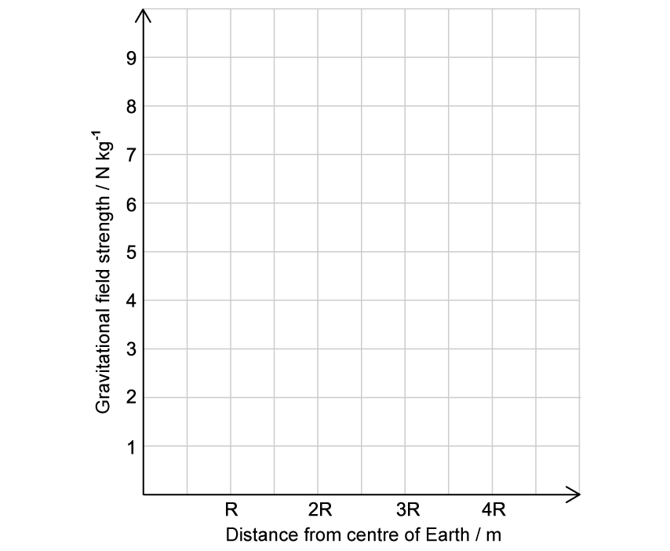
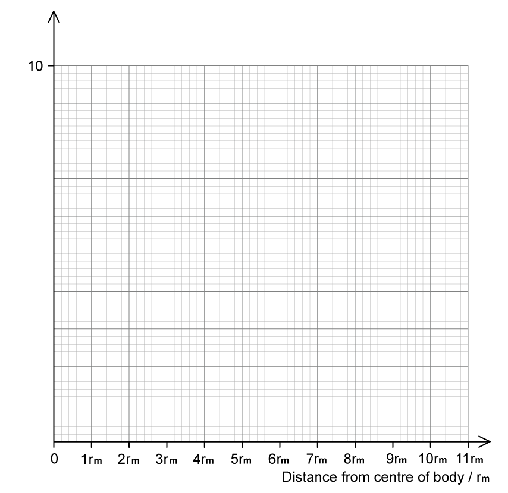
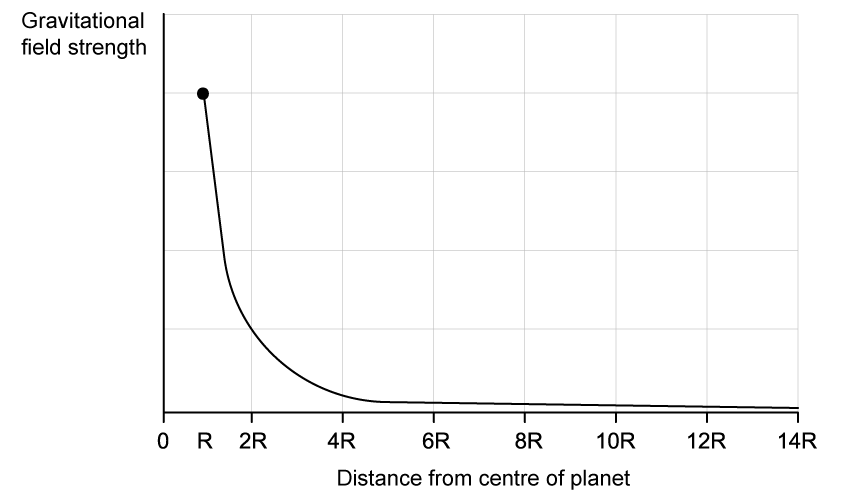
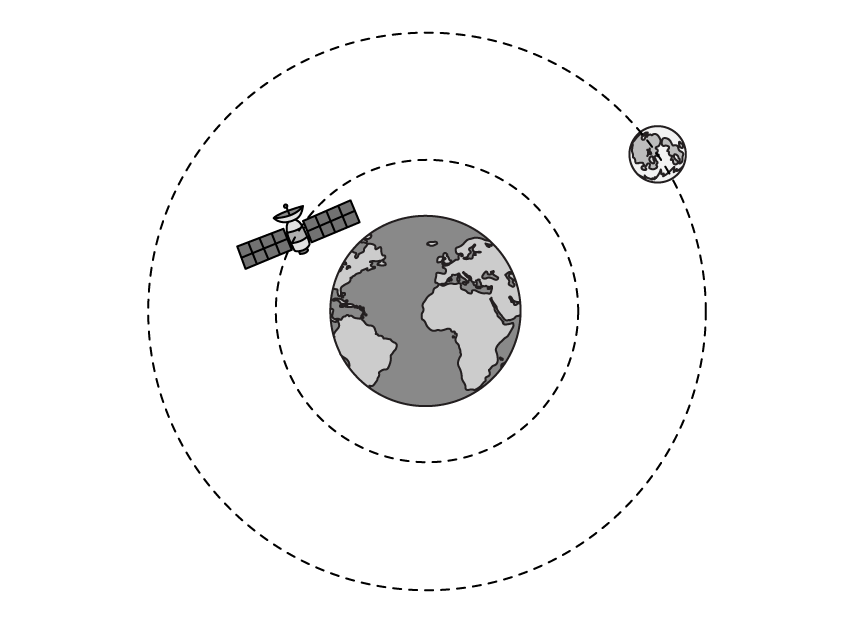

# Exam Questions — Gravitational Field of a Point Mass
**13. Gravitational Fields** · Cambridge (CIE) A-LEVEL physics (9702)
> Source: [https://www.savemyexams.com/a-level/physics/cie/25/topic-questions/](https://www.savemyexams.com/a-level/physics/cie/25/topic-questions/) · 7 questions across 1 sets

## Structured Questions (7 questions)

### Q1 — easy — 8 marks

**Q1** [2 marks]

State whether gravitational field strength is a scalar or vector quantity.

Give a reason for your answer.

**Q1** [2 marks]

Table 1.1** **gives values for the gravitational field strength, *g*, at different distances from the centre of the Earth, where:

- *r* is the distance from the centre of the Earth
- *R* is the radius of the Earth

The gravitational field strength, *g*, at the Earth’s surface, *r* = *R*, is 9.81 N kg–1.

**Table 1.1**

| *g*/N kg–1 | 9.81 | 2.45 | 1.09 | 0.61 |
|---|---|---|---|---|
| *r*/ m | R | 2R | 3R | 4R |

State and explain how the value of the gravitational field strength changes if the radial distance from the Earth’s centre *doubles*.

**Q1** [4 marks]

**Extract:**

Table 1.1 gives values for the gravitational field strength, g, at different distances from the centre of the Earth, where: r is the distance from the centre of the Earth; R is the radius of the Earth. The gravitational field strength, g, at the Earth's surface, r = R, is 9.81 N kg^–1. Table 1.1: g/N kg^–1: 9.81, 2.45, 1.09, 0.61; r/ m: R, 2R, 3R, 4R

On Fig. 1.1:

(i) Show how the gravitational field strength varies between the centre of the Earth and the surface of the Earth, *r* = *R.  *The gravitational field strength at the Earth’s surface is 9.81 N kg–1.

[2]

(ii) Use the values in** **Table 1.1** **to show how the gravitational field strength varies between the surface of the Earth and a distance 4*R* from the centre of the Earth.

[2]

**Fig. 1.1**

### Q2 — hard — 13 marks

**Q2** [5 marks]

The gravitational field strength on the surface of a particular moon is 3.2 N kg–1. The moon orbits a planet of similar density, but the diameter of the planet is 2.6 times greater than the moon.

Calculate the gravitational field strength at the surface of the planet when the effect of each body on the other is negligible.

**Q2** [3 marks]

**Extract:**

The gravitational field strength on the surface of a particular moon is 3.2 N kg^–1^. The moon orbits a planet of similar density, but the diameter of the planet is 2.6 times greater than the moon.

Fig. 1.1 shows a graph with a horizontal axis representing the distance from the centre of a celestial body in terms of the moon's radius *r**m*.

**Fig. 1.1**

Complete and label the vertical axis values and sketch the graph to show gravitational field strength against distance from the centre for the moon in part a) in Fig. 1.1.** **

**Q2** [2 marks]

**Extract:**

The gravitational field strength on the surface of a particular moon is 3.2 N kg^–1. The moon orbits a planet of similar density, but the diameter of the planet is 2.6 times greater than the moon. Calculate the gravitational field strength at the surface of the planet... g_p = 2.6 × 3.2 = 8.32 N kg^–1

Fig. 1.1 shows a graph with a horizontal axis representing the distance from the centre of a celestial body in terms of the moon's radius r_m. Fig. 1.1. Complete and label the vertical axis values and sketch the graph to show gravitational field strength against distance from the centre for the moon in part a) in Fig. 1.1.

Sketch the graph of gravitational field strength against distance from the centre of the planet on Fig. 1.1.

**Q2** [3 marks]

**Extract:**

The gravitational field strength on the surface of a particular moon is 3.2 N kg^–1^. The moon orbits a planet of similar density, but the diameter of the planet is 2.6 times greater than the moon.

Fig. 1.2 shows the relative positions of the planet P and the moon m.

**Fig. 1.2**

Find a ratio of the distance from the neutral point to the planet's centre and the distance from the neutral point to the moon's centre.

### Q3 — medium — 9 marks

**Q3** [2 marks]

Mars may be considered to be a uniform sphere of radius 3400 km with its mass *M* concentrated at its centre. A stone of mass 3.67 kg rests on top of Olympus Mons, the largest volcano on Mars, which is 25 km high.

The gravitational force on the stone is 13.3 N.

Mars spins on its axis with a period of 1 day and 37 mins.

Calculate *M*.

**Q3** [3 marks]

**Extract:**

Mars may be considered to be a uniform sphere of radius 3400 km with its mass M concentrated at its centre. A stone of mass 3.67 kg rests on top of Olympus Mons, the largest volcano on Mars, which is 25 km high. The gravitational force on the stone is 13.3 N. Mars spins on its axis with a period of 1 day and 37 mins.

Determine the force required to maintain the stone in its circular path.

**Q3** [2 marks]

Derive the equation

$g=\frac{GM}{r^{2}}$

where *G* is Newton's gravitational constant, *M *is the mass and *r* is the distance from the mass for the gravitational field strength due to a point mass. Use the equations for Newton's law of gravitation and the gravitational field strength.

**Q3** [2 marks]

**Extract:**

Mars may be considered to be a uniform sphere of radius 3400 km with its mass M concentrated at its centre. A stone of mass 3.67 kg rests on top of Olympus Mons, the largest volcano on Mars, which is 25 km high. The gravitational force on the stone is 13.3 N. Calculate M. M = 6.374 × 10^23 = 6.4 × 10^23 kg

Olympus Mons is an active volcano. Consider the stone from part (a) as a point mass in Mars' gravitational field.

Calculate the acceleration due to gravity of the stone if it was thrown upwards to twice the height of Olympus Mons.

*a* = ..................................... m s–2

### Q4 — medium — 10 marks

**Q4** [3 marks]

The Moon can be assumed to be a uniform sphere of radius *r*.

Write an expression for the mean density of the Moon in terms of *r*, *G* and *g*.

**Q4** [2 marks]

**Extract:**

The Moon can be assumed to be a uniform sphere of radius r. Write an expression for the mean density of the Moon in terms of r, G and g.

Mean density of Moon: ρ = 3g/(4πGr)

The Moon has a radius of 1700 km and a mean density of 3.34 g cm–3.

Show that the gravitational field strength on the Moon is about 1.6 N kg–1.

**Q4** [2 marks]

Show that a planet with the same gravitational field strength at its surface and a radius 3 times greater than that of the Moon must be 9 times more massive.

**Q4** [3 marks]

**Extract:**

Show that a planet with the same gravitational field strength at its surface and a radius 3 times greater than that of the Moon must be 9 times more massive.

Radius of the Moon = R; Mass of the Moon = M; Radius of the planet = 3R; Mass of the planet = M_P; Gravitational field strength of the Moon and planet = g. M_P = 9M.

Fig. 1.1 shows how the gravitational field strength above the surface of the Moon** **varies with distance from its centre.

**Fig. 1.1**

On Fig. 1.1, sketch the variation of distance with gravitational field strength for the planet in (c).

### Q5 — hard — 14 marks

**Q5** [3 marks]

The gravitational field strength on the moon's surface is 1.63 N kg–1. It has a diameter of 3480 km.

(i) Calculate the mass of the moon

[2]

(ii) State the assumption necessary for part (i)

[1]

**Q5** [4 marks]

**Extract:**

The gravitational field strength on the moon's surface is 1.63 N kg^–1^. It has a diameter of 3480 km. (i) Calculate the mass of the moon. Mass of the moon M_M = 7.40 × 10^22 kg

The ISS orbits the Earth at an average distance of 408 km from the surface of the Earth as shown in Fig. 1.1.

**Fig. 1.1**

The following data are available:

- Average distance between the centre of the Earth and the centre of the Moon = 3.80 × 108 m
- Mass of the Earth = 5.97 × 1024 kg
- Radius of the Earth = 6.37 × 106 m

Calculate the maximum gravitational field strength *g*  experienced by the ISS. Assume that both the Moon and the ISS can be positioned at any point on their orbital path.

**Q5** [3 marks]

Show that the gravitational field strength *g * is proportional to the radius of a planet *r*  and its density *ρ. *

**Q5** [4 marks]

**Extract:**

Show that the gravitational field strength g is proportional to the radius of a planet r and its density ρ.
From part (c): g = (4/3) G π r ρ

Two planets X and Y are being compared by a group of astronomers. They have different masses.

Planet X has a density *ρ* and the gravitational field strength on its surface is *g*. The density of planet Y is three times that of planet X and the gravitational field strength on its surface is 9 times that of planet X.

Use the equation you derived in part (c) to show that the mass of planet Y is roughly 80 times larger than the mass of planet X.

### Q6 — medium — 10 marks

**Q6** [2 marks]

The mass of the Sun is 3.33 × 105 times greater than the mass of the Earth.

Calculate the gravitational force between the Sun and the Earth.

Use the following data:

- Distance between the Earth and the Sun = 1.47 × 1011 m
- Mass of the Earth = 5.97 × 1024 kg

**Q6** [3 marks]

**Extract:**

The mass of the Sun is 3.33 × 10^5 times greater than the mass of the Earth. Calculate the gravitational force between the Sun and the Earth. Use the following data: Distance between the Earth and the Sun = 1.47 × 10^11 m; Mass of the Earth = 5.97 × 10^24 kg. Gravitational force: F = 3.66 × 10^22 N

The Earth is 1.7 times larger in diameter than Mars and is 1.5 times closer to the Sun.

The average gravitational force between Mars and the Sun is 1.64 × 1021 N.

Determine the ratio

$\frac{gravitationalfieldstrengthonMars}{gravitationalfieldstrengthonEarth}$

**Q6** [2 marks]

**Extract:**

Determine the ratio (gravitational field strength on Mars)/(gravitational field strength on Earth). The Earth is 1.7 times larger in diameter than Mars and is 1.5 times closer to the Sun. The average gravitational force between Mars and the Sun is 1.64 × 10^21 N.

Suggest why, for small changes in height near the surfaces of Earth and Mars, the ratio in (b) would remain approximately constant.

**Q6** [3 marks]

The Mariana Trench is the deepest known point on the Earth's surface. It is thought to be at a depth of 11 km below sea level.

Suggest and explain whether the gravitational field strength at the Mariana Trench would be greater than, or less than, the gravitational field strength at sea level.

### Q7 — easy — 10 marks

**Q7** [4 marks]

The gravitational field strength of any point within a radial field can be described by the equation:

$g=\frac{GM}{r^{2}}$

Define each term given in the equation and give the associated units for each.

**Q7** [1 mark]

**Extract:**

The gravitational field strength of any point within a radial field can be described by the equation: g = GM/r^2

The equation shown in part (a) is derived from another equation.

State the name of the equation that the gravitational field strength equation is derived from.

**Q7** [3 marks]

**Extract:**

The gravitational field strength of any point within a radial field can be described by the equation: g = GM/r²
The gravitational field strength equation (from part (a)) is derived from: Newton's law of gravitation.

Show how the equation for gravitational field strength from part (a) is derived from your answer to part (b).

**Q7** [2 marks]

**Extract:**

The gravitational field strength of any point within a radial field can be described by the equation: g = GM/r²

The mass of Saturn is 5.68×1026 kg and its radius is 5.82×107 m.

Calculate the gravitational field strength at the surface of Saturn.
