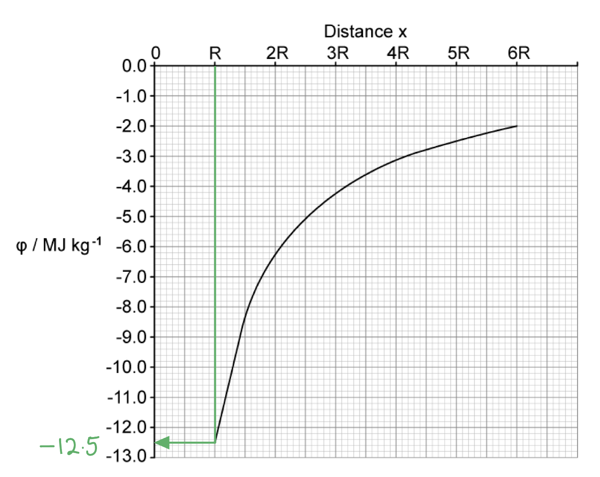
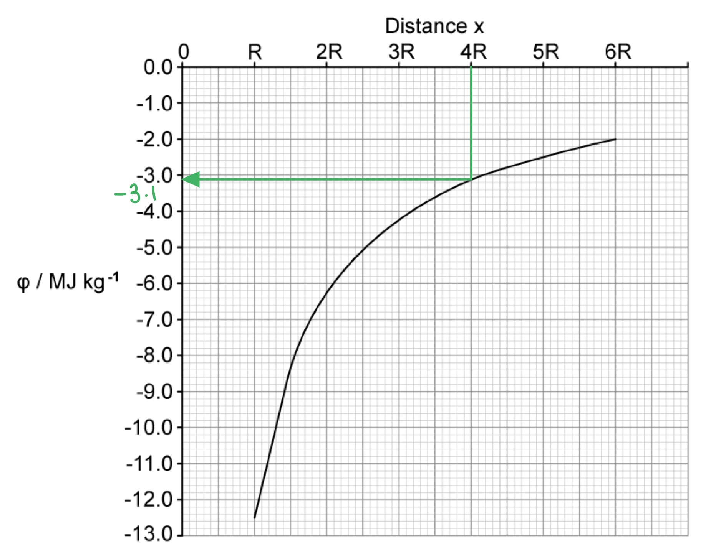
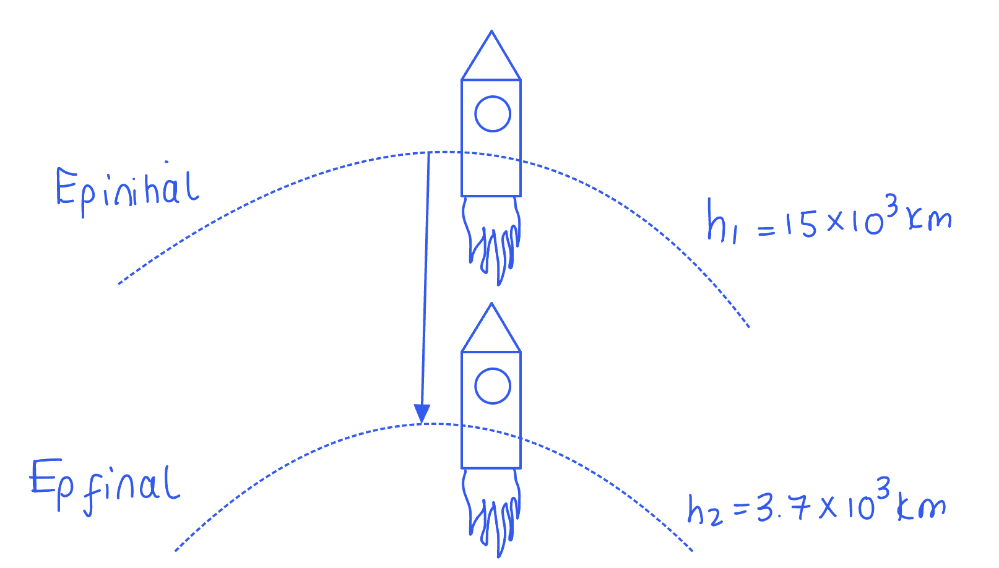
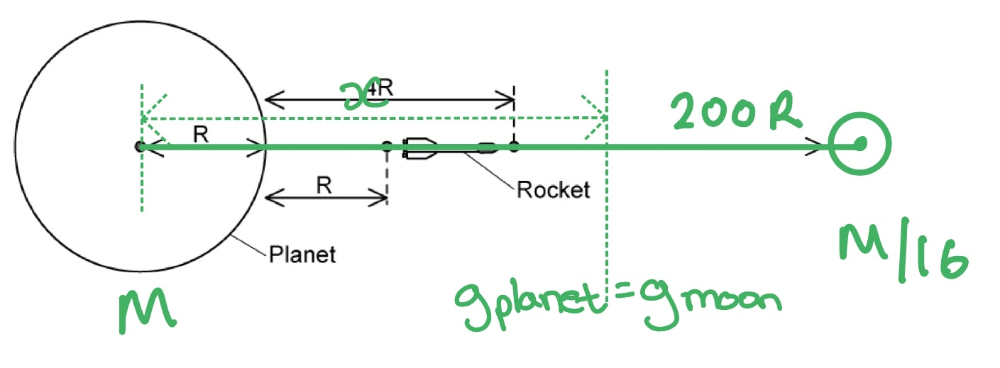
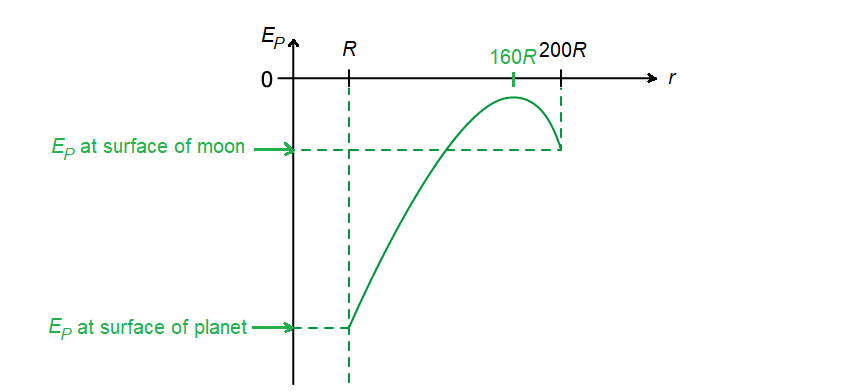
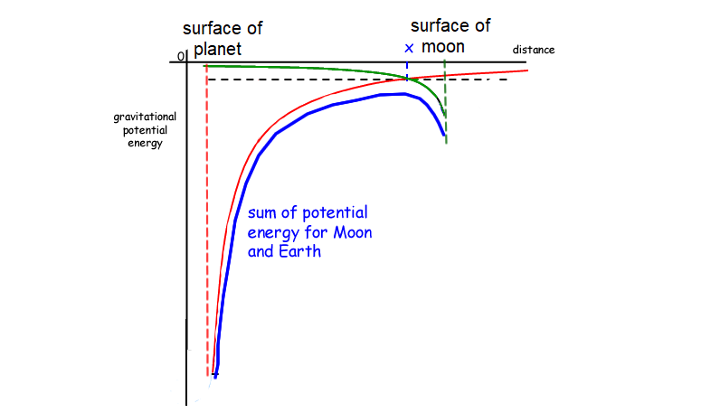

# Mark Schemes — Gravitational Potential
**13. Gravitational Fields** · Cambridge (CIE) A-LEVEL physics (9702)

## Structured Questions (9 questions)

### Q1
Calculate the work done by the rocket during the first 155 seconds after launch:

List the known quantities:

- Mass of space shuttle, *m*s = 3.00 × 106 kg
- Mass of the moon, *M*M =  7.35 × 1022 kg
- Mean radius of the moon, *r*m = 1740 km = 1.74 × 106 m
- Gravitational constant, *G *= 6.67 × 10−11 N m2 kg−2
- Acceleration of space shuttle, *a* = 2.3 m s–2
- Time thrust is applied for, *t* = 155 s
- Initial velocity of the space shuttle, *u* = 0 m s–1

Calculate the height of the space shuttle after 155 s:

- Uniform acceleration:  $s=ut+\frac{1}{2}at^{2}$
- $s=0+\frac{2.3\times155^{2}}{2}$
- $s=27629=2.763\times10^{4}m$ **[1 mark]**

Write expressions for the initial and final gravitational potential:

- Gravitational potential:  $φ=-\frac{GM}{r}$
- $φ_{initial}=-\frac{GM_{M}}{r_{m}}$
- $\phi_{f i n a l} = - \frac{G M_{M} }{( s + r_{m} )}$

Calculate the gravitational potential difference, *Δφ*, in the first 155 s:

- $\Deltaφ=φ_{final}-φ_{initial}$
- $\Delta \\phi = ( - \frac{G M_{M} }{s + r_{m} } ) - ( - \frac{G M_{M} }{r_{m} } )$
- $\Delta \\phi = G M_{M} ( \frac{1}{r} _{m} - \frac{1 }{( s + r_{m} )} )$
- $\Delta \\phi = ( 6.67 \times 10^{- 11} ) \times ( 7.35 \times 10^{22} ) \times ( \frac{1}{1.74 \times 10^{6} } - \frac{1}{( 2.763 \times 10^{4} ) + ( 1.74 \times 10^{6} )} )$
- $\Deltaφ=4.4\times10^{4}J\mathrm{kg}^{-1}$ **[1 mark]**

Calculate the work done by the space shuttle in the first 155 s:

- $E_{p}=φ\timesm\RightarrowW=\Deltaφ\timesm_{s}$
- $W = ( 4.4 \times 10^{4} ) \times ( 3 \times 10^{6} )$
- $W=1.32\times10^{11}J$** [1 mark]**

**[Total: 3 marks]**
Calculate the gravitational potential at the surface of the Earth:

List the known quantities

- Radius of the Earth, *r**E** *= 0.27 *r**m*
- Mass of the Earth, *M**E** * = 0.013 *M**m*
- Mass of the moon, *M*M =  7.35 × 1022 kg
- Mean radius of the moon, *r*m = 1740 km = 1.74 × 106 m (from **(a)**)
- Gravitational constant, G = 6.67 × 10–11 N m2 kg–2 (from **(a)**)

Determine an expression for the gravitational potential on the Earth’s surface:

- $r_{M} = 0 . 27 r_{E} \Rightarrow r_{E} = 3 . 7 r_{M}$
- $M_{M} = 0 . 013 M_{E} \Rightarrow M_{E} = 76 . 9 M_{M}$ **[1 mark]**
- Gravitational potential:  $φ = - \frac{GM}{r}$
- `\varphi_{E} = - \frac{G M_{E}}{r_{E}} = - \frac{G \times \left(76 . 9 M_{M}\right)}{3 . 7 r_{M}}` **[1 mark]**

Write $φ_{E}$ in terms of the gravitational potential on the surface of the moon:

- Gravitational potential on the moon’s surface, $φ_{M} = - \frac{GM_{M}}{r_{M}}$
- Divide $φ_{E}$ by $φ_{M}$:   `\frac{\varphi_{E}}{\varphi_{M}} = \left(- \frac{G \left(76 . 9 M_{M}\right)}{3 . 7 r_{M}}\right) \times \left(- \frac{r_{M}}{G M_{M}}\right)`
- Simplify:  $\frac{φ_{E}}{φ_{M}} = \frac{76.9}{3.7} = 20 . 76 \approx 21$ **[1 mark]**
- Therefore $φ_{E} = 20 . 76 φ_{M} \approx 21 φ_{M}$

**[Total: 3 marks]**

> *Read the question **carefully**! You have been given the information the **wrong way around**. You need to express the surface of the Earth in terms of the surface of the moon. So **swap** your values for radius and mass around! *

> *You can also complete this question by calculating the values of **φ**E** and** φ**M **if you know the mass and radius of the Earth*

> *Working this question out **algebraically** is** less prone** to calculator error.*

### Q2
The correct equation for gravitational potential energy is:

| **Equation** |   |
|---|---|
| $φ=-\frac{GM}{r}$ |   |
| $E_{p}=-\frac{GMm}{r}$ | **Final answer:** **✓** |
| $E_{p}=mgh$ |   |
| $g=\frac{GM}{r^{2}}$ |   |

- Tick placed next to $E_{p}=-\frac{GMm}{r}$ **[1 mark]**

**[Total: 1 mark]**
The satellite with the highest gravitational potential energy is:

- Satellite *m**2*; **[1 mark]**

**[Total: 1 mark]**

> *Objects **further away** from the **surface** of the moon have a **greater gravitational potential** because they have the potential to **fall further** and **gain more energy** as they move towards the Earth. *
Calculate the gravitational potential energy of the satellite:

List the known quantities:

- Mass of satellite, *m**1* = 300 kg
- Radius of orbit,  *r**1* = 500 m
- Mass of moon, *M* = 7 × 1022 kg
- Newton's gravitational constant, *G *= 6.67 × 10−11 N m2 kg−2

Substitute the known quantities into the equation from part (a):

- $E_{p}=-\frac{GMm_{1}}{r_{1}}$
- $E_{p} = - \frac{( 6.67 \times 10^{- 11} ) \times ( 7 \times 10^{22} ) \times ( 300 )}{( 500 )}$ **[1 mark]**
- $E_{p}=-2.8\times10^{12}J$ **[1 mark]**

**[Total: 2 marks]**
Values for gravitational potential energy are negative because:

- Gravitational potential at infinity is defined as being zero; **[1 mark]**
- Gravitational forces are <u>always</u> attractive; **[1 mark]**
- So potential energy decreases as the masses are brought closer together; **[1 mark]**

**[Total: 3 marks]**

### Q3
Derive an expression for its total energy in terms of *G, M, m, h**1** *and R:

- Radius of the satellite's orbit:  $r = ( R + h_{1} )$

Obtain an expression for the linear speed *v *of the satellite:

- Centripetal force = gravitational force
- $F=\frac{mv^{2}}{r}=\frac{GMm}{r^{2}}$
- Speed of the satellite:  $v=\sqrt{\frac{GM}{r}}$** [1 mark]**

Write an expression for kinetic energy:

- Kinetic energy:  $KE=\frac{1}{2}mv^{2}$
- $K E = 1 \frac{1}{2} m ( \sqrt{ \frac{G M}{r} } )^{2} = 1 \frac{1}{2} m ( \frac{G M}{r} )$
- $KE=\frac{GMm}{2r}$ **[1 mark]**

Write an expression for the kinetic energy + gravitational potential energy:

- Gravitational potential energy:  $E_{p}=-\frac{GMm}{r}$
- Total energy:  $E_{T}=KE+E_{p}$
- $E_{T} = ( \frac{G M m}{2 r} ) + ( - \frac{G M m}{r} )$ **[1 mark]**
- $E_{T} = ( \frac{G M m}{2 r} ) - ( \frac{2 G M m}{2 r} ) = - \frac{G M m}{2 r}$
- $E_{T} = - \frac{G M m}{2 ( R + h_{1} )}$** [1 mark]**

**[Total: 4 marks]**

> *Even though the final expression must be in terms of **h**1** **and **R**, it's much easier to keep the distance as **r** until the very end to avoid errors!*
Write an expression for the change in gravitational potential energy:

- Initial orbital radius:  $r_{1} = ( R + h_{1} )$
- Final orbital radius:  $r_{2} = ( R + h_{2} )$
- Initial $E_{p} = - \frac{G M m}{r_{1} } = - \frac{G M m}{( R + h_{1} )}$
- Final $E_{p} = - \frac{G M m}{r_{2} } = - \frac{G M m}{( R + h_{2} )}$

Obtain an expression for the change in gravitational potential energy between the two points:

- $\DeltaE_{p}=FinalE_{p}-InitialE_{p}$ **[1 mark]**
- $\Delta E_{p} = ( - \frac{G M m}{r_{2} } ) - ( - \frac{G M m}{r_{1} } ) = \frac{G M m}{r_{1} } - \frac{G M m}{r_{2} }$
- $\Delta E_{p} = G M m ( \frac{1}{r} _{1} - \frac{1}{r} _{2} )$
- $\Delta E_{p} = G M m ( \frac{1}{R + h_{1} } - \frac{1}{R + h_{2} } )$** [1 mark]**

**[Total: 2 marks]**
Calculate how far the satellite will have drifted at the point wherethe magnitude of its gravitational potential energy has decreased by 20%:

List the known quantities:

- Radius of Earth, *R* = 6.38 × 106 m
- Height, *h**1** *= 2.23 × 106 m
- Height, *h**2** *= 3.05 × 106 m
- Distance drifted out of orbit = $x$

Obtain an expression linking gravitational potential energy and orbital radius:

- *G*, *M* and *m* remain constant, hence:  $E_{p}=-\frac{GMm}{r}\RightarrowE_{p}\propto-\frac{1}{r}$
- Initial distance from centre of Earth:  $r_{i} = ( R + h_{1} ) = ( 6.38 + 2.23 ) \times 10^{6} = 8.61 \times 10^{6} \mathrm{m}$
- Final distance from centre of Earth:  $r_{f} = x + ( R + h_{2} ) = x + ( 6.38 + 3.05 ) \times 10^{6} = x + ( 9.43 \times 10^{6} ) \mathrm{m}$
- Initial GPE:  $E_{p ( i )} \propto - \frac{1}{r} _{i}$  **AND** final GPE:  $E_{p ( f )} \propto - \frac{1}{r} _{f}$** [1 mark]**

Obtain an expression linking the orbital radius before and after drifting:

- When the satellite moves from $r_{i}$ to $r_{f}$, the magnitude of the GPE **decreases** by 20%:  $E_{p ( f )} = 0.8 E_{p ( i )}$
- Hence, $E_{p ( f )} = 0.8 E_{p ( i )} \propto - \frac{1}{r} _{f} = 0.8 ( - \frac{1}{r} _{f} )$
- Therefore, $r_{f}=\frac{r_{i}}{0.8}=1.25r_{i}$ **[1 mark]**

Calculate the drift distance of the satellite, *x*:

- $x + 9.43 \times 10^{6} = 1.25 ( 8.61 \times 10^{6} )$
- $x = 1.25 ( 8.61 \times 10^{6} ) - ( 9.43 \times 10^{6} )$** [1 mark]**
- $x=1.33\times10^{6}m$ **[1 mark]**

**[Total: 4 marks]**

> *It takes longer but will get you the same answer if you:*

- *First, calculate the **initial GPE*

$E_{p ( i )} = - \frac{( 6.67 \times 10^{- 11} ) ( 5.97 \times 10^{24} ) ( 1720 )}{( 6.38 + 2.23 ) \times 10^{6} }$

$E_{p ( i )} = - 7.955 \times 10^{10} \mathrm{J}$

- *Then, calculate the **change in GPE **(you can ignore the minus signs!)*

$\Delta E_{p = E_{p} ( f )} - E_{p ( i )}$

$\Delta E_{p} = 0.8 \times ( - 7.955 \times 10^{10} ) - ( - 7.955 \times 10^{10} )$

$\DeltaE_{p}=1.591\times10^{10}J$

- *Finally, **rearrange** the change in GPE equation to calculate *$x$

$\Delta E_{p} = G M m ( \frac{1}{r} _{i} - \frac{1}{r} _{f} )$

$\frac{\DeltaE_{p}}{GMm}=\frac{1}{r_{i}}-\frac{1}{r_{f}}\Rightarrow\frac{1}{r_{f}}=\frac{1}{r_{i}}-\frac{\DeltaE_{p}}{GMm}$

$\frac{1}{r} _{f} = \frac{1}{r} _{i} - \frac{( 1.591 \times 10^{10 )}{( 6.67 \times 10^{-11} } ) ( 5.97 \times 10^{24} ) ( 1720 )}$

$\frac{1}{r} _{f} = \frac{1}{( 6.38 + 2.23 ) \times 10^{6} - \frac{( 1.591 \times 10^{10} )}{( 6.67 \times 10^{-11} } ) ( 5.97 \times 10^{24} ) ( 1720 )}$

$\frac{1}{r_{f}}=9.291\times10^{-8}\Rightarrowr_{f}=1.076\times10^{7}m$

$r_{f} = ( 1.076 \times 10^{7} ) = x + ( 6.38 + 3.05 ) \times 10^{6}$

$x = ( 1.076 \times 10^{7} ) - ( 6.38 + 3.05 ) \times 10^{6}$

$x=1.33\times10^{6}m$

### Q4
This is the definition for:

- Gravitational potential <u>energy</u>; **[1 mark]**

**[Total: 1 mark]**

> *Make sure you understand the difference between **gravitational potential** and **gravitational potential energy*
Gravitational potential is defined as:

- The work done per unit mass;** [1 mark]**
- In bringing a test mass from infinity (to the point); **[1 mark]**

**[Total: 2 marks]**
(i) The quantities in the equation are as follows:

- *G *= Newton's gravitational constant (6.67 × 10−11 N m2 kg−2); **[1 mark]**
- *M *= mass of the body (producing the gravitational field); **[1 mark]**
- *r *= distance from the centre of mass to the point mass; **[1 mark]**

(ii) The negative sign shows that:

- The gravitational force is (always) attractive; **[1 mark]**
- As *r* decreases, *M* does work **OR** work is done by the masses as they come together; **[1 mark]**

**[Total: 5 marks]**
The object experiencing the largest gravitational potential is:

- The satellite; **[1 mark]**

**[Total: 1 mark]**

> *Consider the **equation** for gravitational potential: *

$φ\uparrow=-\frac{GM}{r\downarrow}$

> *As** **r **decreases** **φ **increases*

### Q5
The values for *φ *on Fig 1.1. are negative because:

- The gravitational potential (*φ*) is defined as 0 at infinity (∞);** [1 mark]**
- (The gravitational force is attractive so) the work is done by the field, so the potential at all points less than infinity is negative **OR **so the work must be done (on a mass) to reach infinity; **[1 mark]**

**[Total: 2 marks]**
By considering the gravitational potential at Mars' surface, the mass of Mars is:

List the known quantities:

- Radius of Mars, *r* = 3400 km = 3400 × 103 m
- gravitational constant, *G* = 6.67 × 10–11 N m2 kg–2

Determine the potential at *R*, *φ*:

- *φ *= –12.5 MJ kg–1 = –12.5 × 106 J kg–1 **[1 mark]**

Rearrange the gravitational potential equation for mass, *M*:

- $φ=-\frac{GM}{r}\RightarrowM=-\frac{rφ}{G}$
- $M = - \frac{( 3400 \times 10^{3} ) \times ( - 12.5 \times 10^{6 ) }{6.67 \times 10^{-11} } }$ **[1 mark]**
- $M=6.4\times10^{23}\mathrm{kg}$ **[1 mark]**

**[Total: 3 marks]**
The speed of the meteorite when it is at a distance of 3R above Mars' surface is:

List the known quantities:

- Distance of meteorite from centre of Mars = R + 3R = 4R
- Mass of Mars, *M* = 6.4 × 1023 kg (from part b)

- Determine gravitational potential at *r* = 4R:

- *φ *= –3.1 MJ kg–1 = –3.1 × 106 J kg–1 **[1 mark]**

- Apply energy conservation

  - The meteorite starts from rest at infinity, where the gravitational potential is zero, therefore
- Loss in gravitational potential energy = gain in kinetic energy

**OR**

- $\DeltaE_{p}=E_{k}$ **[1 mark]**

- Determine an expression for $\DeltaE_{p}$

  - At infinity, $φ_{\infty}=0$
  - At distance $r$, $\phi_{r} = - \left| \\phi \right|$
- `\Delta E _ p = m ( phi _ r - phi _ inf ) = m ( - | phi | - 0 ) = - m | phi |`

- Therefore
- $- m \left| \\phi \right| = 1 \frac{1}{2} m v^{2}$

- Cancel *m*
- $φ=\frac{1}{2}v^{2}$

- Rearrange for the speed

$v=\sqrt{-2φ}$

Substitute in the values:

- $v = \sqrt{- 2 \times ( - 3.1 \times 10^{6} )}$ **[1 mark]**
- $v=2.5\times10^{3}ms^{-1}$ **[1 mark]**

**[Total: 4 marks]**

> *Read the question carefully - it states we need to calculate the speed at the distance '3**R** above Mars' surface'. **R** is the distance to Mars' surface, so 3**R** above that is 4**R**. This is the distance at which we need to read the potential from Fig 1.1.*
The work done to move a satellite of 210 kg from the orbit of Deimos to the orbit of Phobos is:

List the known quantities:

- Mass of the satellite, *m* = 210 kg
- Mass of Mars, *M* = 6.4 × 1023 kg (from part b)
- Orbital radius of Phobos, *r*p =  9400 km = 9400 × 103 m
- Orbital radius of Deimos, *r*d = 2.3 × 104 km = 2.3 × 107 m
- gravitational constant, *G* = 6.67 × 10–11 N m2 kg–2

Calculate the change in gravitational potential energy:

- $E_{p}=-\frac{GMm}{r}$
- $\Delta E_{p} = - \frac{G M m}{r_{p} } - ( - \frac{G M m}{r_{d} } ) = \frac{G M m}{r_{d} } - \frac{G M m}{r_{p} }$ **[1 mark]**
- $\Delta E_{p} = G M m ( \frac{1}{r} _{d} - \frac{ 1}{r_{p} } )$

Substitute in the values:

- $\Delta E_{p} = ( 6.67 \times 10^{- 11} ) \times ( 6.4 \times 10^{23} ) \times 210 ( \frac{1}{2.3 \times 10^{7} } - \frac{ 1}{9400 \times 10^{3}} )$ **[1 mark]**
- $\DeltaE_{p}=-563.9\times10^{6}=-560\mathrm{MJ}$ **[1 mark]**

**[Total: 3 marks]**

> *The work done is negative, which is what is expected. From moving a satellite from the higher to lower orbit (as seen in Fig 1.2), work is done by the gravitational field, since there is an attractive force already towards Mars. This means the work done is **negative**, the satellite doesn't need to put work into the system to do this, it is already done for us! *

> *If the satellite was to move from the orbit of Phobos to Deimos however, it would be moving away from Mars and away from the gravitational attractive force. Therefore, the work done would be **positive**.*

### Q6
Gravitational potential is always negative because:

- Gravitational potential is equal to 0 at infinity; **[1 mark]**

**Final answer:** **Any ****one ****from:**

- (The gravitational force is attractive) so work must be done (on a mass) to reach infinity; **[1 mark]**
- Potential energy decreases as a body moves from infinity towards the Earth;** [1 mark]**

**[Total: 2 marks]**
Calculate the change in gravitational potential as the satellite moves from orbit X to orbit Y:

List the known quantities:

- Potential of X, *φ**X*  = −3.56 MJ kg−1
- Potential of Y, *φ**Y*  = −1.23 MJ kg−1

Calculate the gravitational potential difference between orbits X and Y:

- $\Deltaφ=φ_{Y}-φ_{X}$ **[1 mark]**
- $\Delta \\phi = ( - 1.23 ) - ( - 3.56 )$** [1 mark]**
- $\Deltaφ=2.33\mathrm{MJ} \mathrm{kg}^{-1}$** [1 mark]**

**[Total: 3 marks]**
Definitions of each of the terms in the equation are as follows:

- *G *= Newton's universal gravitational constant; **[1 mark]**
- *M *= the mass of the body producing the gravitational field; **[1 mark]**
- *m *= the mass of the object in the gravitational field; **[1 mark]**
- *r *= the distance from the centre of mass to the centre of the point mass; **[1 mark]**

**[Total: 4 marks]**

### Q7
The equation *Mg*Δ*h *cannot be used to calculate the gravitational potential energy because:

- The object is projected too far away from the surface of Venus

**OR**

- The acceleration due to gravity (*g*) is not constant (at this altitude); **[1 mark]**

**[Total: 1 mark]**
The radius of orbit of this object is:

List the known quantities:

- Change in gravitational potential, Δ*φ* = 4.2 MJ kg–1 = 4.2 × 106 J kg–1
- Mass of Venus, *M* = 4.9 × 1024 kg
- Radius of Venus, *R *= 6100 km = 6100 × 103 m
- Gravitational constant, G = 6.67 × 10–11 N m2 kg–2

State the equation for the change in potential and rearrange for the radius of orbit, *r*:

- $\Delta \\phi = - \frac{G M}{r} - ( - \frac{ G M}{R} ) = G M ( \frac{1}{R} - \frac{ 1}{r} )$ ** [1 mark]**

Rearrange the equation for the radius of orbit, *r*:

- $\frac{\Delta \\phi }{G M} = ( \frac{1}{R} - \frac{ 1}{r} )$
- $\frac{\Deltaφ}{GM}+\frac{1}{r}=\frac{1}{R}$
- $\frac{1}{r}=\frac{1}{R}-\frac{\Deltaφ}{GM}$
- $1 = ( \frac{1}{R} - \frac{\Delta \\phi }{G M} ) r$
- $r=\frac{1}{\frac{1}{R}-\frac{\Deltaφ}{GM}}$

Substitute in the known values:

- $r = \frac{1}{\frac{1}{( 6100 \times 10^{3} )} - \frac{4.2 \times 10^{6 }{( 6.67 \times 10^{-11} } ) \times ( 4.9 \times 10^{24} )}}$ ** [1 mark]**
- $r=6.6\times10^{6}m$** [1 mark]**

**[Total: 3 marks]**
The change in work done per unit mass of the object is:

List the known quantities:

- Mass of Venus, *M* = 4.9 × 1024 kg
- Radius of Venus, *R *= 6100 km = 6100 × 103 m
- Gravitational constant, *G* = 6.67 × 10–11 N m2 kg–2
- Altitude, *h* = 7.2 × 104 km = 7.2 × 107 m

Determine the equation for the change in gravitational potential energy (equal to the work done) of the object, Δ*φ*:

- $\Delta \\phi = - \frac{G M}{R + h} - ( - \frac{G M}{R} ) = G M ( \frac{1}{R} - \frac{ 1}{R + h} )$

Substitute in the values:

- $\Delta \\phi = ( 6.67 \times 10^{- 11} ) \times ( 4.9 \times 10^{24} ) ( \frac{1}{6100 \times 10^{3}} - \frac{ 1}{( 6100 \times 10^{3} ) + ( 7.2 \times 10^{7} )} )$ ** [1 mark]**
- $\Deltaφ=4.94\times10^{7}J\mathrm{kg}^{-1}=49.4\mathrm{MJ} \mathrm{kg}^{-1}$** [1 mark]**

**[Total: 2 marks]**

> *Remember the 'work done per unit mass' is another way of saving 'gravitational potential'. The exam question may not always ask this straight forwardly, so you should be familiar with the **definition** of all key terms in Physics.*
Show that the initial speed of the object in **(a)** is 9.9 km s–1

List the known quantities:

- Change in gravitational potential, Δ*φ* = 4.94 × 107 J kg–1 (from part c)

Equate the gravitational potential energy, *E**p* and kinetic energy and rearrange for the speed, *v*:

- Where, $\Deltaφ=-\frac{GM}{r}$
- So, $E_{p}=-\frac{GMm}{r}=\Deltaφ\timesm$
- $\frac{1}{2}mv^{2}=m\Deltaφ$ **[1 mark]**
- $\frac{1}{2}v^{2}=\Deltaφ$
- $v=\sqrt{2\times\Deltaφ}$

Substitute in the values:

- $v = \sqrt{2 \times ( 4.94 \times 10^{7} )}$ = 9.94 × 103 m s–1 = 9.94 km s–1 **[1 mark]**

**[Total: 2 marks]**

> *Energy is always conserved. When an object is launched vertically in the air, its initial kinetic energy is all transferred into gravitational potential energy. You should notice that when you do this, the mass of the object, **m**, always cancels out, which means we don't need this value to calculate its initial speed!*

### Q8
The point further away from the planet is:

- point A (is further away);** [1 mark]**

Because:

**Final answer:** **Any ****one**** from:**

- The potential increases as the distance from the planet increases (or vice versa);** [1 mark]**
- The potential is zero at infinity and at point A it is closer to zero;** [1 mark]**
- Potential $\propto\frac{1}{r}$ and at point A it is less negative / more positive;** [1 mark]**

**[Total: 2 marks]**
Show that the mass *M* of Mercury is given by the expression $M = \frac{\Delta E_{p} }{G m ( \frac{1}{R + h_{1} } - \frac{ 1}{R + h_{2} } ) }$:

State the equation for the change in gravitational potential:

- $E_{p}=-\frac{GMm}{r}$
- $\Delta E_{p} = - \frac{ G M m}{R + h_{2} } - ( - \frac{G M m}{R + h_{1} } ) = - \frac{ G M m}{R + h_{2} } + \frac{G M m}{R + h_{1} }$ ** [1 mark]**
- $\Delta E_{p} = \frac{G M m}{R + h_{1} } - \frac{ G M m}{R + h_{2} } = G M m ( \frac{1}{R + h_{1} } - \frac{1}{R + h_{2} } )$ ** [1 mark]**

Rearrange for the mass of Mercury, *M*:

- $M = \frac{\Delta E_{p} }{G m ( \frac{1}{R + h_{1} } - \frac{ 1}{R + h_{2} } ) }$** [1 mark]**

**[Total: 3 marks]**

> *Remember that the **r** in the equation for gravitational potential energy is the distance from the **centre** of the planet creating the gravitational field. Therefore, the distance of the rocket from the centre is **R** + height.*

> *The change in **E**p** is always the final **E**p **– initial **E**p**. Since the rocket is **landing** on Mercury, it is going from **h**1** (the higher altitude) to **h**2** (the lower altitude). This means the final **E**p** is at **h**2**. Drawing a sketch can help to visualise this:*

An expression for the change in kinetic energy is:

- $1 \frac{1}{2} m ( v_{2}^{2} - v_{1}^{2} )$ **[1 mark]**

**[Total: 1 mark]**

> *The important thing to note is what is going on in this scenario. Since the rocket is landing, the change in kinetic energy is the **final **kinetic energy – **initial** kinetic energy.*

### Q9
Derive an expression for the change in gravitational potential energy:

List the known quantities:

- Initial distance = *R *+ *R *= 2*R *
- Final distance = *R *+ 4*R *= 5*R*
- Mass of planet = *M*
- Mass of rocket = *m*

Write expressions for the initial and final gravitational potential energy:

- $E_{p}=-\frac{GMm}{r}$
- $InitialGPE=-\frac{GMm}{2R}$ **AND**
- $FinalGPE=-\frac{GMm}{5R}$ **[1 mark]**

Consider the change in gravitational potential energy of the rocket:

- $\DeltaE_{p}=FinalGPE-InitialGPE$
- $\Delta E_{p} = ( - \frac{G M m}{5 R} ) - ( - \frac{G M m}{2 R} )$ **[1 mark]**
- $\Delta E_{p} = ( \frac{G M m}{2 R} ) - ( \frac{G M m}{5 R} ) \Leftrightarrow ( \frac{5 G M m}{10 R} ) - ( \frac{2 G M m}{10 R} )$
- $\DeltaE_{p}=\frac{3GMm}{10R}$
- Hence** **$x=\frac{3}{10}$ **[1 mark]**

**[Total: 3 marks]**
Derive the expression for the thermal energy lost to the atmosphere of the planet:

List the known quantities:

- Initial velocity of rocket = 2*v*
- Final velocity of rocket = *v *

Obtain an expression for the change in kinetic energy of the rocket:

- $\DeltaKE=FinalKE-InitialKE$
- $\Delta K E = 1 \frac{1}{2} m v^{2} - 1 \frac{1}{2} m ( 2 v )^{2} = m v^{2} ( 1 \frac{1}{2} - \frac{4}{2} )$
- $\DeltaKE=-\frac{3}{2}mv^{2}$ **[1 mark]**

Consider the conservation of energy:

- $\DeltaE_{p}+\DeltaKE+\DeltaQ=0$ **[1 mark]**

Substitute the known expressions and rearrange to make $\DeltaQ$ the subject:

- Change in GPE:  $\DeltaE_{p}=\frac{3GMm}{10R}$ (from **(a)**)
- $\DeltaQ=-\DeltaE_{p}-\DeltaKE$
- $\Delta Q = - \frac{3 G M m}{10 R} - ( - \frac{3 m v^{2}}{2} )$ **[1 mark]**
- $\DeltaQ=\frac{3mv^{2}}{2}-\frac{3GMm}{10R}$
- $\Delta Q = \frac{3 m}{2} ( v^{2} - \frac{G M}{5 R} )$** [1 mark]**

**[Total: 4 marks]**
Calculate the distance from the planet's surface where the resultant gravitational field strength is zero:

List the known quantities:

- Mass of planet = *M *
- Mass of moon = $\frac{M}{16}$
- Radius of planet = *R*
- Distance from centre of planet to centre of moon = 200*R*
- Distance from the surface of the planet to point where resultant gravitational field strength is zero = *x*

Write expressions for the gravitational field strength of the rocket and the moon:

- Gravitational field strength is equal to the gradient of the potential-distance graph i.e. $g=\frac{\DeltaE_{P}}{\Deltar}$
- Hence, the point where $\frac{\DeltaE_{P}}{\Deltar}=0$ is where $g_{planet}=-g_{moon}$
- Field strength due to planet:  $g_{P}=\frac{GM}{x^{2}}$ **[1 mark]**
- Field strength due to moon:  $g_{M} = \frac{G ( \frac{M}{16} ) }{ ( 200 R - x ) ^{2} }$ **[1 mark]**

Equate the expressions for gravitational field strength to obtain a value for *x*:

- $g_{P}=-g_{M}$
- $\frac{G M}{x^{2}} = - \frac{G M}{16 ( 200 R - x )^{2}}$ **[1 mark]**
- $x^{2} = 16 ( 200 R - x )^{2} \Leftrightarrow \sqrt{x^{2}} = \sqrt{16 ( 200 R - x )^{2}}$
- $x = 4 ( 200 R - x ) = 800 R - 4 x$
- $x=\frac{800}{5}R=160R$ **[1 mark]**

**[Total: 4 marks]**
The variation of gravitational potential with distance between the planet and moon is as follows:

- Curve drawn starting at *R* (surface of planet) at maximum (negative) value of *E**P*; **[1 mark]**
- Peak at 160*R* at maximum (least negative) value of *E**P* close to (but below) zero; **[1 mark]**
- Curve drawn finishing at 200*R* (surface of moon) slightly below peak; **[1 mark]**

**[Total: 3 marks]**

> *Since both the moon and the planet create a gravitational field, points between them have a gravitational potential influenced by both bodies. The gravitational potential increases away from a body (the planet), however, decreases again closer to another body which creates a gravitational field, which is the moon. Therefore, the graph you need to sketch is a combination of the gravitational potential curves for the planet and the moon.*

> *In the graph you have to sketch, the (negative) value of the combined curve at any point measures the amount of energy you would need to get away from that place in space to infinity where you would be free of the influence of both masses. Each point will therefore be the sum of the two curves:*

> *The peak of your graph will be at the place, somewhere between the two, where you require the least amount of energy to escape the planet-moon system. This is the point where*

> $g_{moon}=-g_{planet}$* *

> *Remember the 'potential gradient' is equal to*

$g=\frac{\DeltaE_{p}}{\Deltar}$

> *Therefore, the two values of **g** will cancel when the gradient of the gravitational potential graph is zero - this is at the distance you calculated in part (c).*

> *Make sure you understand that the gravitational potential energy doesn't cancel out at this point of zero force as you will always need energy to escape to infinity from the combined force of attraction from the two masses. That amount of energy is the difference between the top of the curve and the axis, therefore if you draw your curve to zero you will miss out on a mark, if you have a mean examiner you might even be given a 0 for the question!*
