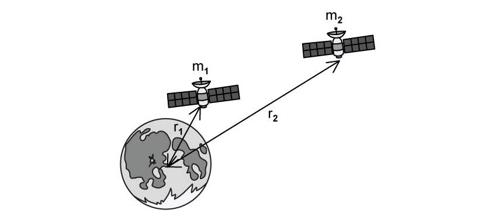
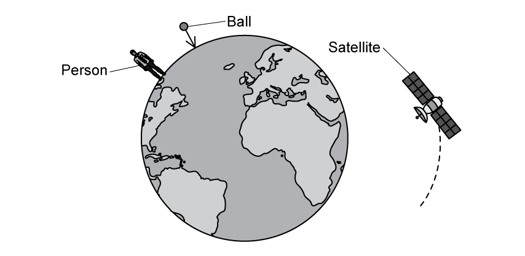
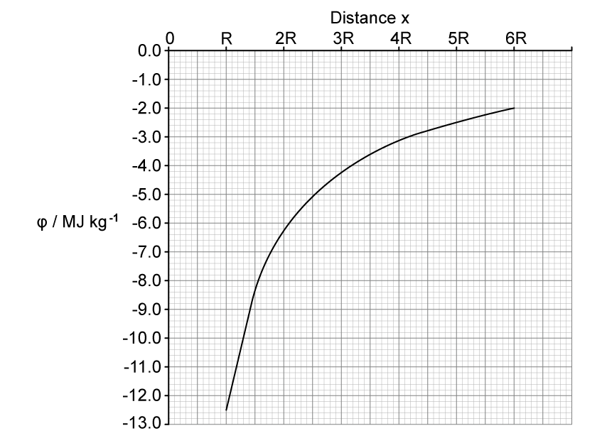
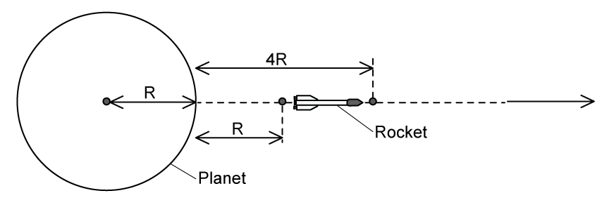

# Exam Questions — Gravitational Potential
**13. Gravitational Fields** · Cambridge (CIE) A-LEVEL physics (9702)
> Source: [https://www.savemyexams.com/a-level/physics/cie/25/topic-questions/](https://www.savemyexams.com/a-level/physics/cie/25/topic-questions/) · 9 questions across 1 sets

## Structured Questions (9 questions)

### Q1 — hard — 6 marks

**Q1** [3 marks]

A space shuttle of mass 3 × 106 kg is travelling from the moon back to Earth. It accelerates uniformly from launch at 2.3 m s−2. It has enough propellant to provide thrust for the first 155 seconds.

The mass of the moon is 7.35 × 1022 kg and the mean radius is 1740 km.

Calculate the work done by the rocket during the first 155 seconds after launch. State any assumptions you have made.

**Q1** [3 marks]

**Extract:**

The mass of the moon is 7.35 × 10^22 kg and the mean radius is 1740 km. Gravitational constant, G = 6.67 × 10^−11 N m^2 kg^−2

The Moon has a radius of approximately 27% that of the Earth, and a mass of 1.3% that of the Earth.

Show that the gravitational potential at the surface of the Earth is about 21 times greater than the gravitational potential at the surface of the moon.

### Q2 — easy — 7 marks

**Q2** [1 mark]

Place a tick (**✓**) next to the equation in Table 1.1 which represents the gravitational potential energy of two point masses *m* and* M* separated by a distance *r. *

**Table 1.1**

| **Equation** |   |
|---|---|
| $φ=-\frac{GM}{r}$ |   |
| $E_{p}=-\frac{GMm}{r}$ |   |
| $E_{p}=mgh$ |   |
| $g=\frac{GM}{r^{2}}$ |   |

**Q2** [1 mark]

The diagram in Fig. 1.2 shows two satellites *m**1* and *m**2* in orbit around the moon.

**Fig. 1.2**

Satellite *m**1* is in orbit at a distance of *r**1* from the centre of the moon and satellite *m**2* is in orbit at a distance of *r**2* from the centre of the moon.

State which of the satellites has the higher gravitational potential energy.

**Q2** [2 marks]

**Extract:**

Place a tick next to the equation in Table 1.1 which represents the gravitational potential energy of two point masses m and M separated by a distance r. The correct equation is \$\$E_{p} = - \frac{G M m}{r}\$\$

Satellite *m**1* has a mass of 300 kg and orbits above the centre of the moon at a radius *r**1* of 500 m.

The mass of the moon is 7 × 1022 kg.

Calculate the gravitational potential energy of the satellite in this position. Newton's gravitational constant, *G *= 6.67 × 10−11 N m2 kg−2

**Q2** [3 marks]

**Extract:**

Part (a): The correct equation for gravitational potential energy is \$\$E_{p} = - \frac{G M m}{r}\$\$

Part (c): Calculate the gravitational potential energy of the satellite. \$\$E_{p} = - \frac{G M m_{1}}{r_{1}}\$\$, giving \$\$E_{p} = - 2 . 8 \times 10^{12} J\$\$

State why the equation for gravitational potential energy in **(a)** has a negative sign and why your answer to **(c) **is negative.

### Q3 — hard — 10 marks

**Q3** [4 marks]

The Earth may be assumed to be a uniform sphere of radius *R* = 6.38 × 106 m, with its mass *M* concentrated at its centre.

A satellite of mass *m *orbits the Earth at a height *h**1** *above the Earth's surface.

Derive an expression for the total energy of the satellite in terms of *G, M, m, h**1** *and *R.*

**Q3** [2 marks]

**Extract:**

The Earth may be assumed to be a uniform sphere of radius R = 6.38 × 10^6 m, with its mass M concentrated at its centre. A satellite of mass m orbits the Earth at a height h1 above the Earth's surface.

The satellite moves to a distance *h**2** *away from the surface of the Earth.

Derive an expression for the change in gravitational potential energy as the satellite moves from *h**1** *to *h**2*.

**Q3** [4 marks]

**Extract:**

The Earth may be assumed to be a uniform sphere of radius *R* = 6.38 × 10^6^ m, with its mass *M* concentrated at its centre.

When the satellite reaches a height *h**2* above the surface of the Earth, it begins to drift out of its orbit.

Determine the distance moved by the satellite once it has drifted to the point where the magnitude of its gravitational potential energy has decreased by 20% of its initial value at *h*1.

Assume that the satellite moves along the same line connecting points *h*1, *h*2 and the centre of the Earth.

Mass of the Earth = 5.97 × 1024 kg

Mass of the satellite = 1720 kg

Height *h*1 = 2.23 × 106 m

Height *h*2 = 3.05 × 106 m

### Q4 — easy — 9 marks

**Q4** [1 mark]

State the physical quantity defined as* the energy possessed by an object due to its position in a gravitational field*.

**Q4** [2 marks]

Define *gravitational potential* at a point.

**Q4** [5 marks]

Gravitational potential, *φ,* is also defined by the equation

$φ=-\frac{GM}{r}$

(i) Identify each quantity in the equation.

[3]

(ii) State the significance of the negative sign in the equation.

[2]

**Q4** [1 mark]

Fig. 1.1 shows a person on the surface of the Earth, a ball falling towards the centre of the Earth and a satellite in orbit around the Earth.

**Fig. 1.1**

Identify the object which experiences the largest gravitational potential.

### Q5 — medium — 12 marks

**Q5** [2 marks]

Mars is considered to be an isolated sphere of radius *R* with its mass concentrated at its centre.

The variation of the gravitational potential *φ *with distance *x* from the centre of Mars is shown in Fig 1.1.

**Fig 1.1**

** **Explain why the values for *φ *in Fig 1.1. are negative.

**Q5** [3 marks]

**Extract:**

Mars is considered to be an isolated sphere of radius *R* with its mass concentrated at its centre. The variation of the gravitational potential *φ *with distance *x* from the centre of Mars is shown in Fig 1.1. [Graph shows φ / MJ kg^-1 against distance x. At x = R, φ = -12.5 MJ kg^-1]

The radius *R* of Mars is 3400 km.

By considering the gravitational potential at Mars' surface, determine a value for its mass.

**Q5** [4 marks]

**Extract:**

Mars is considered to be an isolated sphere of radius R with its mass concentrated at its centre. The variation of the gravitational potential φ with distance x from the centre of Mars is shown in Fig 1.1. [Fig 1.1 shows φ / MJ kg⁻¹ against distance x, with x marked in units of R up to 6R. At x = 4R, φ ≈ -3.1 MJ kg⁻¹; at x = R (surface), φ ≈ -12.5 MJ kg⁻¹.]
The radius R of Mars is 3400 km.

A meteorite is at rest at infinity. The meteorite travels from infinity towards Mars.

Calculate the speed of the meteorite when it is at a distance of 3*R* above Mars' surface. Explain your working.

**Q5** [3 marks]

**Extract:**

The radius R of Mars is 3400 km. By considering the gravitational potential at Mars' surface, determine a value for its mass. [Result: M = 6.4 × 10^23 kg]

Mars has two moons, Phobos and Deimos, as shown in Fig 1.2.

**Fig 1.2**

Calculate the work done to move a satellite of 210 kg from the orbit of Deimos to the orbit of Phobos.

Orbital radius of Phobos = 9400 km

Orbital radius of Deimos = 2.3 × 104 km

Work done = ............................. MJ

### Q6 — easy — 9 marks

**Q6** [2 marks]

Explain why gravitational potential is always negative.

**Q6** [3 marks]

Fig. 1.1 shows a satellite orbiting Mars, M. The satellite is moves from orbit X to orbit Y.

**Fig. 1.1**

** **The gravitational potential due to Mars in each of these orbits is:

Orbit X: −3.56 MJ kg−1

Orbit Y: −1.23 MJ kg−1

Calculate the gravitational potential difference as the satellite moves from orbit X to orbit Y.

**Q6** [4 marks]

The gravitational potential energy at a particular point is given by the equation:

$E_{p}=-\frac{GMm}{r}$

Define each of the terms in the equation.

### Q7 — medium — 8 marks

**Q7** [1 mark]

Venus may be assumed to be an isolated sphere of radius 6100 km with its mass, *M,* at 4.9 × 1024 kg concentrated at its centre.

An object is projected vertically from the surface of Venus so that it reaches an altitude of 7.2 × 104 km.

Explain why the equation *Mg*Δ*h* where *g* is the gravitational field strength of Venus and Δ*h* is the height of the object, cannot be used to calculate the object's gravitational potential energy.

**Q7** [3 marks]

**Extract:**

Venus may be assumed to be an isolated sphere of radius 6100 km with its mass, M, at 4.9 × 10^24 kg concentrated at its centre.

The change in the gravitational potential of a different object is 4.2 MJ kg–1. This object ends up in orbit around Venus.

Calculate the radius of orbit of this object.

**Q7** [2 marks]

**Extract:**

Venus may be assumed to be an isolated sphere of radius 6100 km with its mass, M, at 4.9 × 10^24 kg concentrated at its centre. An object is projected vertically from the surface of Venus so that it reaches an altitude of 7.2 × 10^4 km.

Calculate the change in work done per unit mass of the object projected vertically in part** (a)**.

Change in work done per unit mass = .................... MJ kg–1

**Q7** [2 marks]

**Extract:**

Calculate the change in work done per unit mass of the object projected vertically in part (a).
Δφ = 4.94 × 10^7 J kg^–1 = 49.4 MJ kg^–1

Show that the initial speed of the object in **(a)** is 9.9 km s–1, assuming air resistance is negligible.

### Q8 — medium — 6 marks

**Q8** [2 marks]

The gravitational potential at a point A about the surface of a planet is –7.2 MJ kg–1.

For a point B above the surface of the planet, the gravitational potential is –9.1 MJ kg–1.

State, with a reason, whether point A or B is further away from the planet.

**Q8** [3 marks]

A rocket is landing onto the surface of Mercury.

Table 1.1 gives data for the speed of the rocket at two heights about the surface of Mercury, after the rocket engine has been switched off.

**Table 1.1**

| height / km | speed / m s–1 |
|---|---|
| *h*1 = 15 × 103 | *v*1 = 7215 |
| *h*2 = 3.7 × 103 | *v*2 = 7020 |

Mercury may be assumed to be a uniform sphere of radius *R, *with its mass *M* concentrated at its centre. The rocket, after the engine has been switched off, has mass *m*. The change in gravitational potential energy of the rocket between the two heights is Δ*E*p.

Show that the mass *M* of Mercury is given by the expression

`M space equals fraction numerator increment E subscript p over denominator G m open parentheses fraction numerator 1 over denominator R plus h subscript 1 end fraction space minus fraction numerator space 1 over denominator R plus h subscript 2 end fraction close parentheses space end fraction`

**Q8** [1 mark]

**Extract:**

A rocket is landing onto the surface of Mercury. Table 1.1 gives data for the speed of the rocket at two heights about the surface of Mercury, after the rocket engine has been switched off. Table 1.1: height h1 = 15 × 10^3 km, speed v1 = 7215 m s^–1; height h2 = 3.7 × 10^3 km, speed v2 = 7020 m s^–1. The rocket, after the engine has been switched off, has mass m.

Write an expression, in terms of *m*, *v**1* and *v**2* for the change in kinetic energy of the rocket.

### Q9 — hard — 14 marks

**Q9** [3 marks]

A spherical planet has a mass *M *and radius *R*. The planet may be considered to have all its mass concentrated at its centre.

A rocket, of mass *m* is launched from the surface of the planet.

The rocket engines are stopped when the rocket is at a height *R *above the surface of the planet, as shown in Fig 1.1.

**Fig. 1.1**

The change in gravitational potential energy of the rocket as it travels from a height *R *to a height 4*R* above the planet's surface is equal to

`increment E subscript p space equals space x open parentheses fraction numerator G M m over denominator R end fraction close parentheses`

Determine the value of *x*

**Q9** [4 marks]

**Extract:**

A spherical planet has a mass M and radius R. The planet may be considered to have all its mass concentrated at its centre. A rocket, of mass m is launched from the surface of the planet. The rocket engines are stopped when the rocket is at a height R above the surface of the planet. The change in gravitational potential energy of the rocket as it travels from a height R to a height 4R above the planet's surface is equal to ΔE_p = x(GMm/R). Determine the value of x. [Answer: ΔE_p = 3GMm/10R, hence x = 3/10]

At a distance *R *away from the surface of the planet the rocket has a velocity 2*v *and at a distance of 4*R *away from the planet a velocity *v*.

Show that the expression for the thermal energy lost $\DeltaQ$ to the atmosphere of the planet as the rocket moves from *R *to 4*R* is given by

`increment Q space equals space fraction numerator 3 m over denominator 2 end fraction open parentheses v squared space minus space fraction numerator G M over denominator 5 R end fraction close parentheses`

**Q9** [4 marks]

**Extract:**

A spherical planet has a mass M and radius R. The planet may be considered to have all its mass concentrated at its centre.

The rocket travels towards a moon orbiting the planet

The distance from the centre of the planet to the centre of the moon is 200*R*. The moon has a mass $\frac{M}{16}$ where *M *is the mass of the planet.

Determine the distance, in terms of *R*, from the centre of the planet at which

$\frac{\DeltaE_{P}}{\Deltar}=0$

Give your answer to the nearest whole number.

**Q9** [3 marks]

**Extract:**

A spherical planet has a mass M and radius R.

The rocket travels towards a moon orbiting the planet. The distance from the centre of the planet to the centre of the moon is 200R. The moon has a mass M/16 where M is the mass of the planet.

Determine the distance, in terms of R, from the centre of the planet at which ΔE_P/Δr = 0. [Answer: x = 160R]

On the axes of Fig. 1.2, sketch a graph to show the variation of the gravitational potential with distance along a line between the surface of the planet and the surface of the moon.

**Fig. 1.2**
