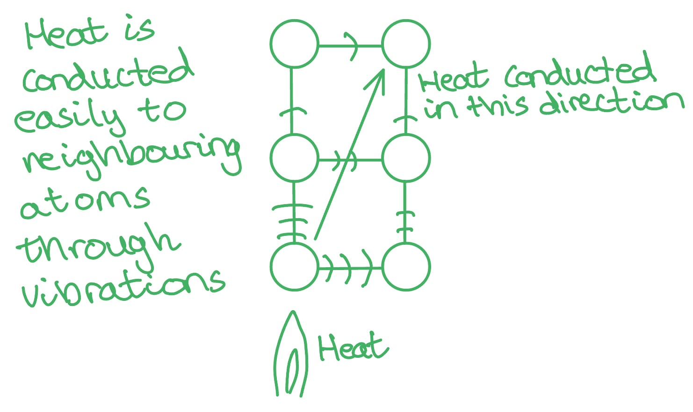
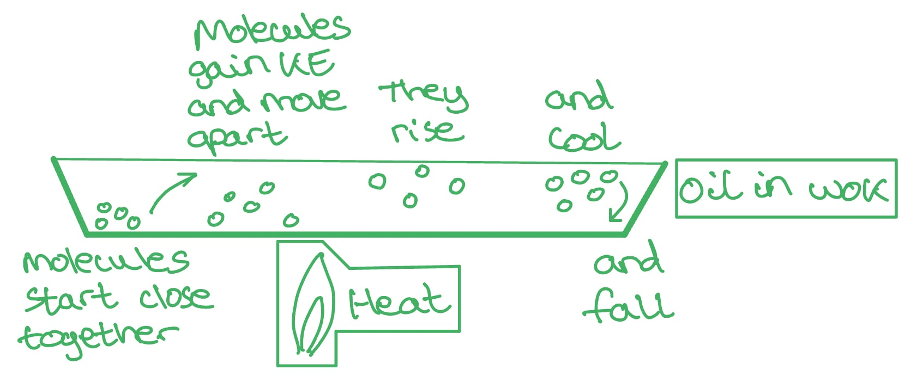
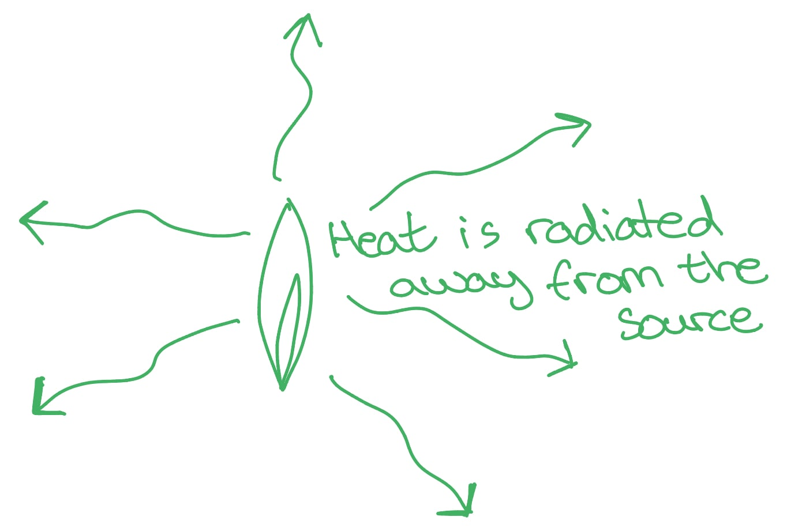
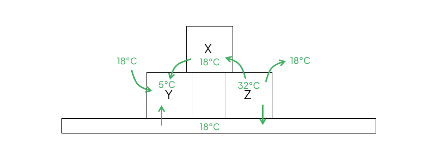
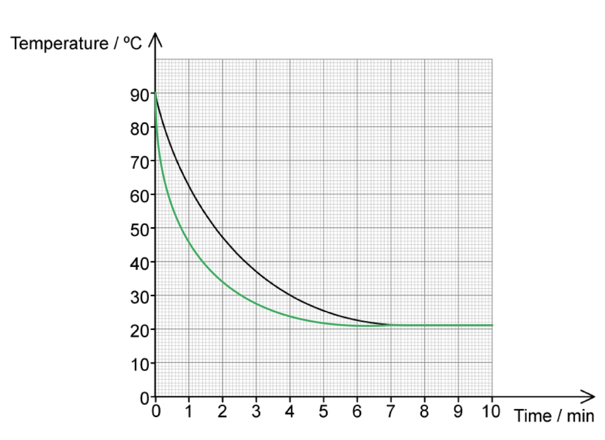
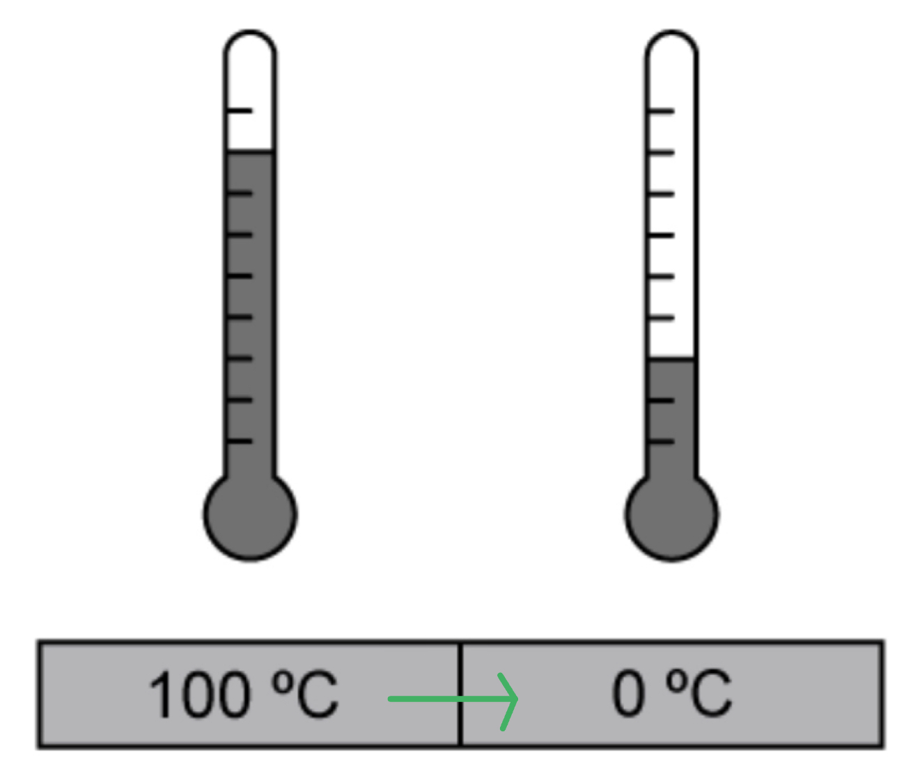

# Mark Schemes — Thermal Equilibrium
**14. Temperature** · Cambridge (CIE) A-LEVEL physics (9702)

## Structured Questions (7 questions)

### Q1
Thermal equilibrium means:

- The temperature of the metal plate is the same / equal at all points; **[1 mark]**
- There is no (net) transfer of energy (within the metal plate); **[1 mark]**

**[Total: 2 marks]**

> *An answer such as 'the temperature is the same at all points' will not get you the mark, as it is too vague. You must state the temperature of **what** is the same at all points, since the questions as asked you to refer to the **context**.*
(i) Convert 450 °C into Kelvin:

- Thermodynamic temperature:  T / K = θ / °C + 273(.15)
- T / K = θ / °C + 273 **[1 mark]**
- T / K = 450 + 273 = 723 K **[1 mark]**

(ii) Determine the temperature rise in Kelvin:

- Change in temperature = 450 − 25 = 425 K **[1 mark]**

**[Total: 3 marks]**

> *Remember - when you calculate a temperature **change** in Kelvin you don't need to add 273! The **difference** between two points on the Celsius or Kelvin scale is the same.*
As the metal plate reaches thermal equilibrium:

**Final answer:** **Any ****two**** from:**

- Energy is transferred through the metal as electrons move; **[1 mark]**
- In the region of high temperature, the particles vibrate more **OR** in the region of low temperature, the particles vibrate less; **[1 mark]**
- The vibrations are passed along the lattice / neighbouring particles; **[1 mark]**
- From (the region of) <u>higher</u> temperature to (the region of) <u>lower</u> temperature until the energy has been distributed evenly; **[1 mark]**

**[Total: 2 marks]**
Observations that show why this statement is incorrect are:

**Final answer:** **Any ****two ****pairs from:**

- Two bodies of different masses can have the same temperature; **[1 mark]**
- But a different amount of heat (energy); **[1 mark]**
- Temperature shows the direction of heat transfer; **[1 mark]**
- From a region of high temperature to low temperature; **[1 mark]**
- When a substance changes state (boils / melts etc); **[1 mark]**
- Heat energy can be put in, but there is no temperature change; **[1 mark]**

**[Total: 4 marks]**

### Q2
The role of conduction, convection and radiation in heating the oil is as follows:

Conduction:

**Final answer:** **Any ****two ****from:**

- Conduction takes place between (neighbouring) atoms through vibrations **[1 mark]**
- (Due to conduction) the wok and oil reach thermal equilibrium; **[1 mark]**
- Metal is a good conductor of heat / the metal wok heats the oil quickly; **[1 mark]**

Convection:

**Final answer:** **Any ****three ****from:**

- Convection takes place between the molecules of the fluid / oil; **[1 mark]**
- The source of the heat is from below (the wok / oil) **OR** the molecules at the bottom (of the oil) are the hottest; **[1 mark]**
- The temperature (of the molecules) ∝ kinetic energy **OR **as the molecules gain kinetic energy they move apart; **[1 mark]**
- The hotter molecules become less dense and rise above the cooler molecules; **[1 mark]**
- The denser molecules cool and fall to the bottom of the oil; **[1 mark]**

Radiation:

**Final answer:** **Any ****one ****from:**

- Radiation is emitted by the gas flame (on the hob); **[1 mark]**
- The gas flame emits infrared radiation and visible light; **[1 mark]**
- Heat is radiated away from the source; **[1 mark]**

**[Total: 6 marks]**
The thermometer can be calibrated as follows:

- Place the bulb of the thermometer in a beaker of pure melting ice at atmospheric pressure; **[1 mark]**
- When the level of the mercury remains constant / does not fluctuate mark this position as 0 °C; **[1 mark]**
- Next, place the bulb of the thermometer in the steam above boiling water at atmospheric pressure; **[1 mark]**
- When the level of the mercury remains constant, mark this position as 100 °C; **[1 mark]**
- Measure the distance on the glass between 0 °C and 100 °C **AND** into 100 divisions with each division representing 1 °C;** [1 mark]**

**[Total: 5 marks]**
The differences between temperature and heat are as follows:

Heat is defined as:

- The amount of energy (in J) in a system / region / substance caused by a temperature difference;** [1 mark]**

The temperature of a substance is:

- A measure of the hotness or coolness (in °C or K) of a substance / a measure of the direction in which (heat) energy will flow (between two regions);** [1 mark]**

Give an example:

- The temperature of water (heated in a pan) can be measured using a thermometer / thermistor / thermocouple **AND**
- The amount of heat (energy) can be measured by knowing the mass, specific heat capacity and change in temperature (of the water) / $\DeltaE=mc\DeltaT$;** [1 mark]**

**[Total: 3 marks]**

### Q3
Thermal energy is transferred:

- From the (warmer) countertop to the (cooler) block; **[1 mark]**
- (And also) from the (warmer) surrounding air to the (cooler) block; **[1 mark]**
- Until the block reaches the same temperature as the countertop and surrounding air **OR **until thermal equilibrium is reached; **[1 mark]**

**[Total: 3 marks]**

> *Whenever you talk about energy transfers, remember to say where the energy is transferred from and where it is transferred to.*
The temperature of block X would be:

- 18°C; **[1 mark]**

**[Total: 1 mark]**

> *Once thermal equilibrium is reached, block X will have reached the same temperature as the surrounding air in the room*
The thermal energy transfers taking place are:

- From the (warmer) countertop / surrounding air to (the cooler) block Y; **[1 mark]**
- From (the warmer) block X to (the cooler) block Y; **[1 mark]**
- From (the warmer) block Z to (the cooler) block X; **[1 mark]**
- From (the warmer) block Z to (the cooler) countertop / surrounding air;** [1 mark]**

**[Total: 4 marks]**
A reasonable estimate for the temperature of the blocks would be:

- 18°C; **[1 mark]**

**[Total: 1 mark]**

> *In part (a), we're told the room is kept at a constant temperature of 18°C, so over time, all objects in the room will reach this temperature in order to be in thermal equilibrium*

### Q4
Thermal energy is:

- The total (vibrational / kinetic) energy possessed by the components / particles of an object (due to an associated temperature); **[1 mark]**

Temperature is:

- A property of a body that determines the direction of thermal energy flow when it is in contact with another body; **[1 mark]**

Thermal energy and temperature are related as:

- Temperature determines the direction of the flow of thermal energy between two objects in thermal contact when there is a <u>temperature difference</u> between them; **[1 mark]**

**[Total: 3 marks]**

> *A common mistake in exams is missing out on stating the 'temperature **difference**' in the transfer of thermal energy.*
The copper and water are in thermal equilibrium when:

- Both reach the <u>same temperature</u>; **[1 mark]**

**[Total: 1 mark]**

> *The direction of energy transfer is always from a hotter object to a colder object. Eventually, thermal equilibrium is reached when the two objects reach the **same** temperature. For example, a cup of tea will cool down until it reaches the temperature of its surroundings. *

> *Remember to refer back to the key words and scenario in the question in your answer. Avoid just writing 'when **they** reach the same temperature' because that is too vague. State specifically the copper** and** the water to confidently gain the mark.*
The water and copper reach thermal equilibrium because:

- Thermal energy (heat) is transferred from the hot region (copper) to the cold region (water); **[1 mark]**
- Until there is no net thermal energy (heat) transfer; **[1 mark]**

**[Total: 2 marks]**
The average kinetic energy of the water molecules:

- Decreases as the temperature cools to 0°C; **[1 mark]**
- Stays constant at 0°C (as ice forms); **[1 mark]**

**[Total: 2 marks]**

> *It is important to remember that a change of state (e.g. freezing, evaporation, condensation etc.) happens at **constant** **temperature**. *

### Q5
Blowing on a hot coffee cools it down faster because:

- The air that comes into contact with the coffee is <u>cooler</u> than the coffee / liquid (itself); **[1 mark]**
- Heat / thermal energy transfers from regions of higher temperature (the coffee) to lower temperature (the surrounding air); **[1 mark]**
- Therefore, (the coffee) reaches thermal equilibrium (with the surroundings) faster; **[1 mark]**

**[Total: 3 marks]**
(i) The temperature of the room is:

- 21 °C **[1 mark]**

(ii) The curve for when the coffee is blown on should look like:

- Curve steeper at the start; **[1 mark]**
- Still plateauing at 21 °C **[1 mark]**

**[Total: 3 marks]**

> *When sketching the graph in part (ii), make sure it still plateaus at room temperature (i.e. the temperature of the coffee has reached thermal equilibrium with the temperature of the room). Blowing on it only changes the **rate **of cooling, not its final temperature, which can only be changed if the temperature of the room changes.*
This statement is:

- Incorrect;** [1 mark]**

This is because:

**Final answer:** **Any ****two**** pairs from:**

- Two objects with different masses would store different amounts of heat;** [1 mark]**
- If they are made from the same material and are at the same temperature;** [1 mark]**

- A temperature difference determines the direction of the heat transfer; **[1 mark]**
- From high to low temperature (regardless of the objects);** [1 mark]**

- When a substance melts / boils;** [1 mark]**
- The heat input causes no temperature change;** [1 mark]**

**[Total: 5 marks]**

### Q6
Energy is transferred from:

- The (warmer) water to the (colder) ice cubes; **[1 mark]**

This cools the water because:

**Final answer:** **Any ****two**** from:**

- The ice cubes melt (into liquid water); **[1 mark]**
- Thermal equilibrium is reached when the glass of water is at a constant temperature; **[1 mark]**
- The new temperature of the water will be less than the initial temperature of the water (and more than the initial temperature of the ice); **[1 mark]**

**[Total: 3 marks]**

> *The question asks for the 'energy transfer' so only the transfer that causes the water to cool needs to be considered here. *
Describe and explain what the thermometer will show:

(i) When the thermometer is initially placed in the glass:

- The temperature reading will quickly fall from 20°C to around 10°C (or less); **[1 mark]**
- Because energy is transferred from the thermometer to the water; **[1 mark]**

(ii) When the energy transfer between the ice and water has stopped:

- The temperature reading will reach a constant value around 0°C < T < 10°C; **[1 mark]**
- Because the water and ice have reached thermal equilibrium; **[1 mark]**

(iii) When the glass has been left on the table for several hours:

- The temperature reading will increase to (approximately) room temperature / 20°C; **[1 mark]**
- Because thermal energy is transferred from the (warmer) surrounding air to the water; **[1 mark]**

**[Total: 6 marks]**
This statement is incorrect because:

- Energy can only be transferred from a region of higher temperature to a region of lower temperature; **[1 mark]**

**[Total: 1 mark]**

### Q7
The correct sentences are:

- Thermal energy is defined as the energy **possessed****;**** ****[1 mark]**
- by an object due to its **temperature****;**** ****[1 mark]**
- Thermal energy is transferred from a region of **higher**;** ****[1 mark]**
- temperature to a region of **lower**** **temperature; **[1 mark]**

**[Total: 4 marks]**
The correct table is as follows:

| **Statements** | **Place a tick (✓) here if correct** |
|---|---|
| The conservation of energy states that energy is never created or destroyed, only transferred from one form to another. | **✓ ****[1 mark]** |
| When a thermometer is placed in a beaker of boiling water, the thermometer reading increases.  This is because the liquid in the thermometer is a lot warmer than the water. |   |
| Temperature tells us the magnitude of energy flow when two regions are in contact. |   |
| The mechanism by which the thermal energy is transferred is by either conduction, convection or radiation. | **✓ ****[1 mark]** |

- The conservation of energy states that energy is never created or destroyed, only transferred from one form to another; **[1 mark]**
- The mechanism by which the thermal energy is transferred is by either conduction, convection or radiation; **[1 mark]**

**[Total: 2 marks]**

> *The second statement is incorrect because:*

> *"The liquid in the thermometer is a lot **cooler (and not warmer)** than the water"*

> *The third statement is incorrect because:*

> *"Temperature tells us the **direction (and not magnitude) **of energy flow when two regions are in contact."*
The correct direction of thermal energy flow is:

- Arrow drawn from left to right, from 100 °C to 0 °C; **[1 mark]**

**[Total: 1 mark]**
The correct order of the statements is:

| **Statements about thermal energy transfer** | **Number the stages of the process** |
|---|---|
| Two regions need to be in contact for thermal energy transfer to occur. | **Final answer:** **1** |
| The final temperature when two regions are in thermal equilibrium depends on the initial temperatures and thermal capacities of both regions. | **Final answer:** **4** |
| Thermal energy is transferred from the hot region to the cold region. | **Final answer:** **2** |
| The hotter region will cool down and the cooler region will heat up until they reach the same temperature. | **Final answer:** **3** |

- **One mark for each statement in the table numbered correctly up to four marks** **OR**
- **One mark for placing**:

  - 'Two regions need to be in contact for thermal energy transfer to occur' **BEFORE** 'Thermal energy is transferred from the hot region to the cold region'; **[1 mark]**

- ** One mark for placing:**

  - 'Thermal energy is transferred from the hot region to the cold region' **BEFORE** 'The hotter region will cool down and the cooler region will heat up until they reach the same temperature'; **[1 mark]**

- ** One mark for placing:**

  - 'The hotter region will cool down and the cooler region will heat up until they reach the same temperature'  **BEFORE** 'The final temperature when two regions are in thermal equilibrium depends on the initial temperatures and thermal capacities of both regions'; **[1 mark]**

**[Total: 4 marks]**
