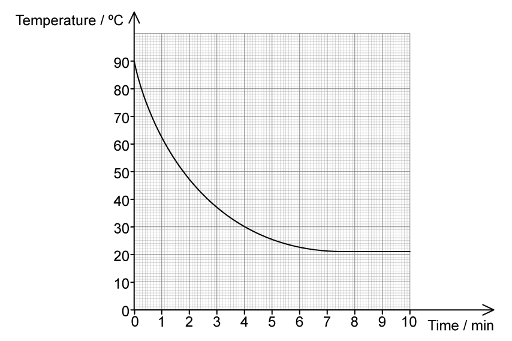
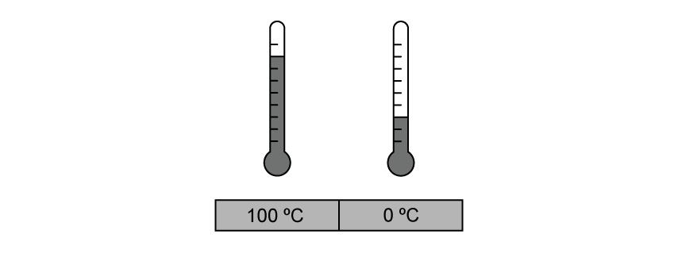

# Exam Questions — Thermal Equilibrium
**14. Temperature** · Cambridge (CIE) A-LEVEL physics (9702)
> Source: [https://www.savemyexams.com/a-level/physics/cie/25/topic-questions/](https://www.savemyexams.com/a-level/physics/cie/25/topic-questions/) · 7 questions across 1 sets

## Structured Questions (7 questions)

### Q1 — medium — 11 marks

**Q1** [2 marks]

A metal plate is heated for a few minutes until it reaches thermal equilibrium.

State and explain what is meant by thermal equilibrium in this context.

**Q1** [3 marks]

The temperature of the metal plate rises from 25 °C to 450 °C.

On the thermodynamic scale of temperature, calculate

(i) the temperature of 450 °C,

[2]

(ii) the temperature rise of the block.

[1]

**Q1** [2 marks]

**Extract:**

A metal plate is heated for a few minutes until it reaches thermal equilibrium.

Describe, in terms of particles, the transfer of energy as the metal plate reaches thermal equilibrium.

**Q1** [4 marks]

A student states, incorrectly, that temperature measures the amount of thermal energy (heat) in a body.

State and explain **two** observations that show why this statement is incorrect.

### Q2 — hard — 14 marks

**Q2** [6 marks]

A metal wok with a wooden handle is placed on a gas hob. The wok contains oil and the hob is switched on. A chef begins to heat the oil.

Explain the role of conduction, convection and radiation in heating the oil. Use diagrams to help explain your answer.

**Q2** [5 marks]

A scientist has come across an unmarked glass thermometer containing mercury.

Describe how the thermometer can be calibrated so it can be used to measure the temperature of objects between 0 °C and 100 °C.

**Q2** [3 marks]

Explain and give examples of the differences between temperature and heat.

### Q3 — easy — 9 marks

**Q3** [3 marks]

Fig. 1.1 shows block X on a countertop. The room is kept at a constant temperature of 18°C. The temperature of block X is 15°C.

**Fig. 1.1**

Describe the thermal energy transfer that takes place.

**Q3** [1 mark]

**Extract:**

Fig. 1.1 shows block X on a countertop. The room is kept at a constant temperature of 18°C. The temperature of block X is 15°C.

Block X is left on the countertop for a couple of hours.

Suggest a reasonable estimate for the temperature of block X after this time.

**Q3** [4 marks]

**Extract:**

Fig. 1.1 shows block X on a countertop. The room is kept at a constant temperature of 18°C. The temperature of block X is 15°C.
Block X is left on the countertop for a couple of hours. Suggest a reasonable estimate for the temperature of block X after this time. The temperature of block X would be: 18°C

Block X is then placed on top of blocks Y and Z, as shown in Fig. 1.2. Block Y is at a temperature of 5°C and block Z is at a temperature of 32°C.

**Fig. 1.2**

Describe the thermal energy transfers that take place.

**Q3** [1 mark]

**Extract:**

Fig. 1.1 shows block X on a countertop. The room is kept at a constant temperature of 18°C. The temperature of block X is 15°C.
Block X is then placed on top of blocks Y and Z, as shown in Fig. 1.2. Block Y is at a temperature of 5°C and block Z is at a temperature of 32°C.

Blocks X, Y and Z are left on the countertop all day and all night.

Suggest a reasonable estimate for the temperature of the blocks the following morning.

### Q4 — medium — 8 marks

**Q4** [3 marks]

Describe what is meant by the terms thermal energy and temperature and explain how they are related.

**Q4** [1 mark]

A hot piece of copper is placed into a container of cold water. After a time, the copper and water reach thermal equilibrium.

Describe how to determine whether the copper and water have reached thermal equilibrium.

**Q4** [2 marks]

**Extract:**

A hot piece of copper is placed into a container of cold water. After a time, the copper and water reach thermal equilibrium.

Describe how the water and copper reach thermal equilibrium in terms of thermal energy.

**Q4** [2 marks]

**Extract:**

A hot piece of copper is placed into a container of cold water. After a time, the copper and water reach thermal equilibrium.

The copper is removed from the water and the beaker of water is placed in a refrigerator at 0°C.

Describe what happens to the average kinetic energy of the water molecules.

### Q5 — medium — 11 marks

**Q5** [3 marks]

Explain, using thermal energy transfer, why blowing on a hot coffee cools it down faster.

**Q5** [3 marks]

Fig 1.1 shows the cooling curve for a hot cup of coffee left standing in a room.

**Fig 1.1**

(i) Determine the temperature of the room.

[1]

(ii) Sketch on Fig 1.1 the curve for when the coffee is blown on.

[2]

**Q5** [5 marks]

A student states that the temperature of the coffee measures the amount of thermal energy, or heat, in it.

Suggest whether this statement is correct. Explain your reasoning using two observations.

### Q6 — easy — 10 marks

**Q6** [3 marks]

Ice cubes are added to a glass of cold water.

Describe the energy transfer taking place, and explain how this cools the water.

**Q6** [6 marks]

**Extract:**

Ice cubes are added to a glass of cold water.

A thermometer initially reads 20°C at room temperature. The thermometer is added to the glass of water at the same time as the ice cubes.

Describe and explain what the thermometer will show when:

(i) the thermometer is initially placed in the glass

[2]

(ii) the energy transfer between the ice and water has stopped

[2]

(iii) the glass has been left on the table for several hours.

[2]

**Q6** [1 mark]

**Extract:**

Ice cubes are added to a glass of cold water. Describe the energy transfer taking place, and explain how this cools the water.

A person comments that the ice cooled the water by transferring 'coldness' from the ice to the water.

Explain why this statement is incorrect.

### Q7 — easy — 11 marks

**Q7** [4 marks]

Use the words in the box to complete the gaps in the definition of thermal energy.

| higher  possessed  lower  gained  temperature  heat  movement |
|---|

Thermal energy is defined as the energy ................................ by an object due to its ................................ .

Thermal energy is transferred from a region of .............................. temperature to a region of ................................ temperature.

**Q7** [2 marks]

Identify, by placing a tick (✓) next to the correct statements in Table 1.1 about energy and thermal energy.

**Table 1.1   **

| **Statements** | **Place a tick (✓) here if correct** |
|---|---|
| The conservation of energy states that energy is never created or destroyed, only transferred from one form to another. |   |
| When a thermometer is placed in a beaker of boiling water, the thermometer reading increases.  This is because the liquid in the thermometer is a lot warmer than the water. |   |
| Temperature tells us the magnitude of energy flow when two regions are in contact. |   |
| The mechanism by which the thermal energy is transferred is by either conduction, convection or radiation. |   |

**Q7** [1 mark]

Add an arrow to Fig. 1.1 to indicate the direction of energy flow between the 100 °C and the 0 °C region.

**Fig. 1.1**

**Q7** [4 marks]

The four statements in Table 1.2 describe the process of thermal energy transfer.

Order the sentences chronologically, by writing numbers 1−4 in the right column, to describe this process.

**Table 1.2 **

| **Statements about thermal energy transfer** | **Number the stages of the process** |
|---|---|
| Two regions need to be in contact for thermal energy transfer to occur. |   |
| The final temperature when two regions are in thermal equilibrium depends on the initial temperatures and thermal capacities of both regions. |   |
| Thermal energy is transferred from the hot region to the cold region. |   |
| The hotter region will cool down and the cooler region will heat up until they reach the same temperature. |   |
