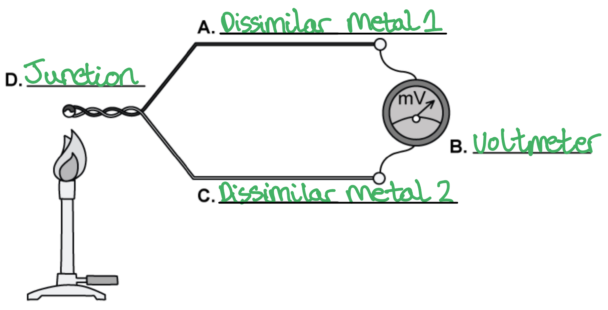
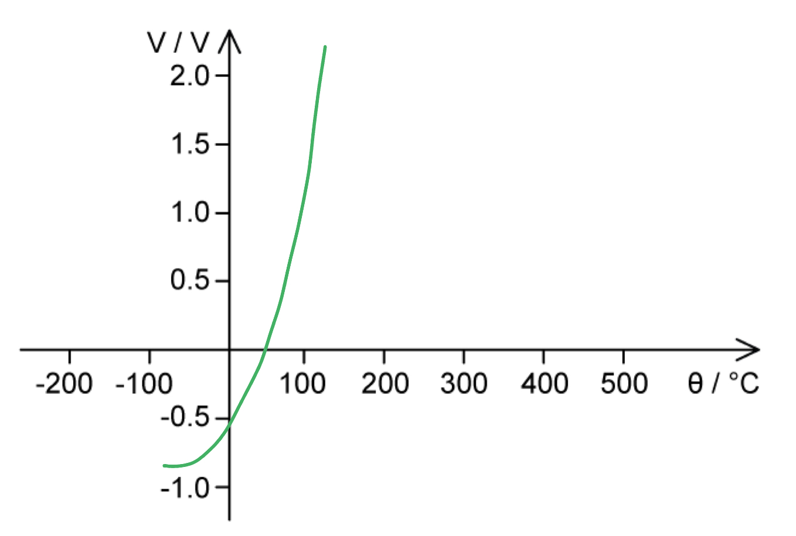
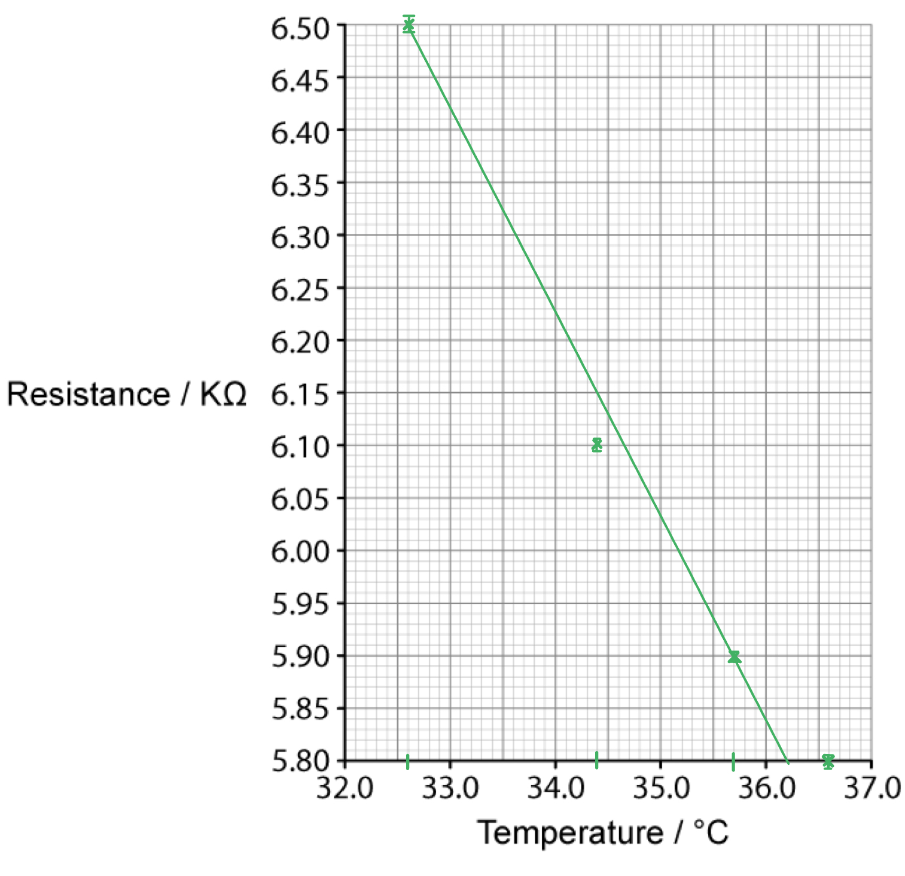
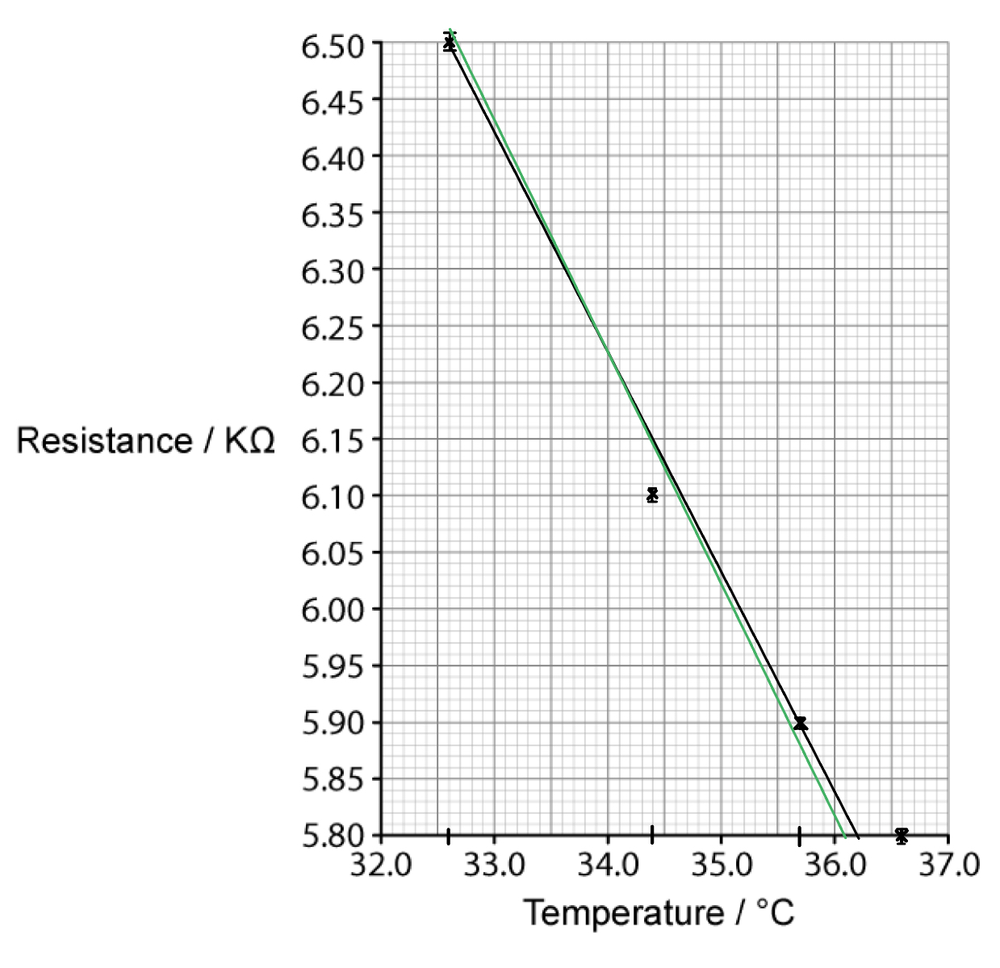
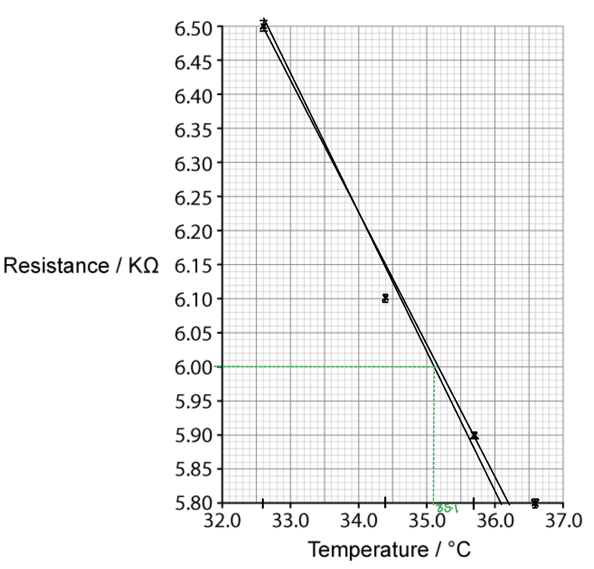
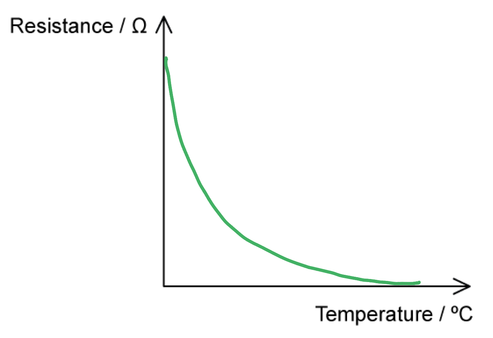

# Mark Schemes — Temperature Scales
**14. Temperature** · Cambridge (CIE) A-LEVEL physics (9702)

## Structured Questions (8 questions)

### Q1
A potential issue with using these calibration points is...

- The melting and boiling points of water vary with pressure changes; **[1 mark]**

**[Total: 1 mark]**
The thermodynamic scale overcomes the issues of scaling temperature because...

- The thermodynamic scale does not depend on the properties of any particular substance; **[1 mark]**

**[Total: 1 mark]**
To convert 20°C to the thermodynamic scale:

- Temperature in K = temperature in °C + 273.15
- *T* = 20 + 273.15 **[1 mark]**
- *T* = 293.15 K **[1 mark]**

**[Total: 2 marks]**
Negative values of temperature are not possible on the thermodynamic scale because...

- Energy is always transferred from a region of higher temperature to a region of lower temperature; **[1 mark]**
- At absolute zero / 0 K atoms have zero kinetic and potential energy; **[1 mark]**
- Therefore, there is no energy to be transferred away from atoms at 0 K, hence this is the lowest possible temperature; **[1 mark]**

**[Total: 3 marks]**

### Q2
The correctly labelled diagram of a thermocouple is as follows:

- A: Dissimilar metal 1; **[1 mark]**
- B: Voltmeter; **[1 mark]**
- C: Dissimilar metal 2; **[1 mark]**
- D: Junction; **[1 mark]**

**[Total: 4 marks]**
The relationship between e.m.f. and temperature of a thermocouple is as follows:

- The line drawn is a curve; **[1 mark]**
- The curve goes from bottom left to top right; **[1 mark]**

**[Total: 2 marks]**
The definition of absolute zero is:

- The lowest temperature possible; **[1 mark]**
- Equal to 0 K or −273.15 °C; **[1 mark]**

**[Total: 2 marks]**
(i) Convert 100 °C into Kelvin:

- Temperature in K = temperature in °C + 273.15 **[1 mark]**
- Temperature in K = 100 + 273.15
- So, 100 °C = 373.15 K **[1 mark]**

(ii) Convert 221 K into °C:

- Temperature in °C = temperature in K − 273.15 **[1 mark]**
- Temperature in °C = 221 − 273.15
- So, 221 K = −52.15 °C **[1 mark]**

**[Total: 4 marks]**

### Q3
In the steel-making process, a temperature sensor must be able to:

**Final answer:** **Any ****two ****from:**

- Detect a wide range of temperatures;** [1 mark]**
- Withstand high temperatures in the furnace, up to 1500°C; **[1 mark]**
- Measure multiple areas of the furnace simultaneously;** [1 mark]**
- Withstand a harsh / hazardous environment;** [1 mark]**

**[Total: 2 marks]**
(i) The working principles of a thermocouple are:

**Final answer:** **Max ****four**** from:**

- Two wires of different metals are joined together at one end (to form a junction); **[1 mark]**
- Temperature is measured at this junction;** [1 mark]**
- The other ends are connected to the terminals of a voltmeter; **[1 mark]**
- When the junction experiences a change in temperature an e.m.f. is produced;** [1 mark]**
- The e.m.f. is then interpreted using thermocouple reference tables to calculate the temperature;** [1 mark]**

(ii) The purpose of the reference junction in a thermocouple is:

**Final answer:** **Max ****two**** from:**

- Thermocouples measure the temperature difference between two junctions **OR** thermocouples do not measure actual temperature; **[1 mark]**
- The hot / sensing junction is where the thermocouple wires are joined together / where the temperature is measured; **[1 mark]**
- The cold junction provides a reference point for the temperature change **OR** the reference junction is set to have a known temperature to measure the temperature at the hot junction against; **[1 mark]**

**[Total: 6 marks]**
Justify the use of a thermocouple to measure the temperature of steel:

- The thermocouple is the only device that can detect temperatures above 1000°C; **[1 mark]**

**Final answer:** **Max ****three**** from:**

- Low accuracy / sensitivity compared to the others, but adequate for the changes in temperature (in the steel-making process); **[1 mark]**
- Long conducting wires mean it can be operated at a distance; **[1 mark]**
- A fast response time is important for monitoring the temperature of steel; **[1 mark]**
- Highest durability / robustness compared to the others; **[1 mark]**

**[Total: 4 marks]**

> *Don't know where to start? This is a **hard question**, so requires you to think **outside the box**. Consider the steel-making **process** and the **properties** of a device that would be needed in this process.*
Some ideal uses of a thermistor compared to a thermocouple are:

**Final answer:** **Any ****two ****from:**

- Measuring temperature in small appliances; **[1 mark]**
- Measuring temperature that is not high / not above 300 °C; **[1 mark]**
- Measuring temperatures with a smaller range; **[1 mark]**

**[Total: 2 marks]**

### Q4
Calculate the temperature of the water:

List the known quantities:

- Resistance at 25°C = 10.0 kΩ
- Resistance at 100°C = 1.0 kΩ
- Resistance at *T* = 2.5 kΩ

Determine the constant of proportionality:

- A linear (directly proportional) relationship means that $\DeltaR=k\DeltaT$ (where k is a constant)
- So, constant of proportionality:  $k=\frac{\DeltaR}{\DeltaT}=\frac{10-1}{100-25}=0.12$ (kΩ/°C) **[1 mark]**

Determine the temperature of the third water bath:

- Change in temperature:  `increment T space equals fraction numerator increment R over denominator k end fraction space equals space fraction numerator open parentheses 10 space minus space 2.5 close parentheses over denominator 0.12 end fraction space equals space 62.5`°C
- The change in temperature here is relative to the known temperature, 25°C
- Hence, the temperature at 2.5 kΩ is `T space equals space open parentheses 62.5 space plus space 25 close parentheses space equals space 87.5`°C **[1 mark]**

**[Total: 2 marks]**
(i) The thermistor does not provide a direct measurement of thermodynamic temperature because:

- Thermodynamic temperature does not depend on any property of a substance **OR**
- The measurement of temperature (using a thermistor) depends on the properties of a real substance; **[1 mark]**

(ii) There is a discrepancy between values because:

- The temperature of the water is 338 − 273.15 = 64.85°C  **OR** the calculated value is 87.5 + 273.15 = 360.65 K; **[1 mark]**
- Hence, the change in resistance (of the thermistor) with temperature is non-linear; **[1 mark]**

**[Total: 3 marks]**
Physical properties of materials that are temperature-dependent:

**Final answer:** **Any ****two ****from:**

- Volume of a gas at constant pressure; **[1 mark]**
- Density of a liquid; **[1 mark]**
- E.m.f. of a thermocouple; **[1 mark]**

**[Total: 2 marks]**

### Q5
(i) Absolute zero is defined as

- The temperature at which atoms have minimum / zero energy; **[1 mark]**

(ii) The thermodynamic scale of temperature:

- Does not depend on the property of a substance; **[1 mark]**

**[Total: 2 marks]**
(i) Calculate the initial temperature of the gas in K:

- Initial temperature = 37.2°C
- To convert from degrees Celsius and Kelvin: *T *(K) = *θ *(°C) + 273.15 **[1 mark]**
- Initial temperature = 37.2 + 273.15 = 310.35 K **[1 mark]**

(ii) Calculate the rise in temperature in K:

- Final temperature = 92.4°C
- For a change in temperature:  Δ*T *(K) = Δ*θ *(°C)
- Rise in temperature = 92.4 − 37.2 = 55.2 K **[1 mark]**

**[Total: 3 marks]**
(i) To measure the temperature rise in (a):

- Gas thermometer; **[1 mark]**
- Uses the volume of a gas at constant pressure; **[1 mark]**

(ii) To measure the temperature of an oven:

- Thermocouple; **[1 mark]**
- Uses the difference in e.m.f. between two types of metal; **[1 mark]**

(iii) To measure the change in temperature of a small crystal sample when heated:

- Thermistor; **[1 mark]**
- Uses the resistance of metal / semiconductors; **[1 mark]**

(iv) To measure the temperature of a water bath without electricity:

- Mercury-in-glass thermometer; **[1 mark]**
- Uses the volume (thermal expansion) of mercury; **[1 mark]**

**[Total: 8 marks]**

### Q6
(i) Two instruments that can be used to measure the temperature of a water bath are:

- A resistance thermometer; **[1 mark]**
- A thermocouple; **[1 mark]**

** **

(ii) They may record different temperatures because:

**Final answer:** **Any ****two**** from:**

- They have not been calibrated; **[1 mark]**
- They are not in (thermal) equilibrium with the water in the bath; **[1 mark]**
- A calibrated temperature scale assumes a linear change of property with temperature; **[1 mark]**
- Neither property varies linearly with temperature; **[1 mark]**

**[Total: 4 marks]**
This thermocouple would not be suitable to measure temperature because:

- After (an e.m.f. of) 0.4 mV; **[1 mark]**
- The variation is non-linear / curved; **[1 mark]**
- So there are two possible temperatures; **[1 mark]**

**[Total: 3 marks]**
Two advantages and two disadvantages of using a resistance thermometer over a thermocouple thermometer to measure the temperature of an object are:

Two advantages:

**Final answer:** **Any ****two**** from:**

- It has a smaller thermal capacity; **[1 mark]**
- It can measure Δ*θ *of a small object; **[1 mark]**
- It is more sensitive; **[1 mark]**
- The readings are taken at a point / are smaller; **[1 mark]**
- It can be used to measure the temperature <u>difference;</u> **[1 mark]**
- No power supply required; **[1 mark]**
- The readings are more accurate / it has more accuracy; **[1 mark]**

Two disadvantages:

**Final answer:** **Any ****two**** from:**

- It is more expensive / a thermocouple is cheaper; **[1 mark]**
- It can measure a smaller range of temperatures (than a thermocouple); **[1 mark]**
- It has a slower reaction time; **[1 mark]**

**[Total: 4 marks]**

### Q7
The value of the resistance shown on the multimeter is:

- 6.50 kΩ** [1 mark]**

The uncertainty of the resistance shown on the multimeter is:

- Resolution = 0.01 kΩ **[1 mark]**
- Resolution uncertainty = 0.005 kΩ **[1 mark]**

**[Total: 3 marks]**
A graph that would score 3 marks would look like this:

- All points plotted correctly on the axis (within ½ of a square or 0.005 kΩ and 0.1 °C); **[1 mark]**
- Error bars drawn correctly for each point (0.005 kΩ or ½ of a square); **[1 mark]**
- A line of best fit drawn correctly i.e. a straight line with a negative gradient; **[1 mark]**

**[Total: 3 marks]**

> *When drawing a line of best fit, always remember to place the line so that there are an equal number of points **above** and **below** the line *
Obtain the minimum temperature of the water at a resistance of 6.00 kΩ:

Draw lines on the graph to obtain the minimum gradient:

- Line of worst fit drawn correctly (from the top of the first error bar through to the bottom of the penultimate error bar); **[1 mark]**

Draw lines on the graph to obtain the minimum temperature of the water at 6.00 kΩ:

- The minimum temperature of the water is about 35.2 °C; **[1 mark]**

**[Total: 2 marks]**

### Q8
The correct table is as follows:

| **Property** | **Place a tick (✓) here** |
|---|---|
| The colour of an object |   |
| The density of a liquid | **✓ ****[1 mark]** |
| The resistance of a metal | **✓**** [1 mark]** |
| The change in position of a solid |   |
| The volume of a gas at constant pressure | **✓ ****[1 mark]** |
| The e.m.f. of a thermocouple | **✓ ****[1 mark]** |

- **One mark for each correct property ticked**

**[Total: 4 marks]**
The correct sentences are:

- A liquid-in-glass thermometer depends on the **volume** change of a liquid; **[1 mark]**
- It consists of a thin glass capillary tube containing a liquid that **expands** with temperature; **[1 mark]**
- A scale along the side of the tube allows the temperature to be **measured**; **[1 mark]**
- based on the **length** of liquid within the tube; **[1 mark]**

**[Total: 4 marks]**
The correct relationship for Charles' Law is:

- Volume is directly proportional to temperature * ***OR***  V *∝ *T*;** [1 mark]**

**[Total: 1 mark]**
The correct resistance-temperature graph for a thermistor is as follows:

- A curve / a non-linear graph is drawn on the axes; **[1 mark]**
- The curve has a high resistance for a zero temperature **AND **a low resistance for a high temperature; **[1 mark]**

**[Total: 2 marks]**
