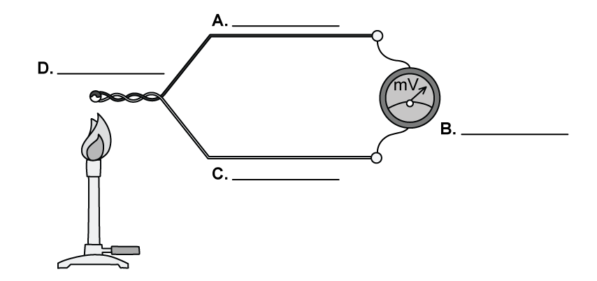
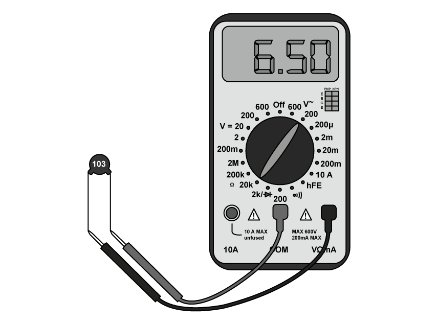

# Exam Questions — Temperature Scales
**14. Temperature** · Cambridge (CIE) A-LEVEL physics (9702)
> Source: [https://www.savemyexams.com/a-level/physics/cie/25/topic-questions/](https://www.savemyexams.com/a-level/physics/cie/25/topic-questions/) · 8 questions across 1 sets

## Structured Questions (8 questions)

### Q1 — easy — 7 marks

**Q1** [1 mark]

The Celsius temperature scale is based on the melting and boiling points of water.

Suggest a potential issue with using these calibration points.

**Q1** [1 mark]

**Extract:**

The Celsius temperature scale is based on the melting and boiling points of water. Suggest a potential issue with using these calibration points. A potential issue with using these calibration points is the melting and boiling points of water vary with pressure changes.

The thermodynamic scale was designed to overcome the issues of scaling temperature.

Explain how the thermodynamic scale achieves this.

**Q1** [2 marks]

20°C is a reasonable estimate for room temperature.

Give this value for room temperature in terms of the thermodynamic scale.

**Q1** [3 marks]

Explain in terms of energy transfer, why negative value of temperature are not permitted on the thermodynamic scale.

### Q2 — easy — 12 marks

**Q2** [4 marks]

A thermocouple is an electrical device used as the sensor of a thermometer.

**Fig. 1.1**

On Fig. 1.1, add the following labels:

- Voltmeter
- Dissimilar metal 1
- Dissimilar metal 2
- Junction

**Q2** [2 marks]

**Extract:**

A thermocouple is an electrical device used as the sensor of a thermometer.

The e.m.f. and temperature are not directly proportional to each other in a thermocouple.

On Fig. 1.2, sketch a curve to show the relationship between e.m.f. and temperature of a thermocouple.

**Fig. 1.2**

**Q2** [2 marks]

Define absolute zero.

**Q2** [4 marks]

Temperature can be measured using both the celsius and Kelvin scales.

(i) Convert 100 °C into Kelvin

[2]

(ii) Convert 221 K into °C.

[2]

### Q3 — hard — 14 marks

**Q3** [2 marks]

A steel manufacturer needs to decide which temperature sensor would be the most appropriate for their manufacturing process.

Fig. 1.1 shows the process of iron and steel manufacturing.

**Fig. 1.1**

Using Fig. 1.1, suggest the requirements of a temperature sensor a steel manufacturer might look for.

**Q3** [6 marks]

Table 1.1 contains information about a resistance temperature detector (RTD), thermocouple and thermistor.

**Table 1.1**

A thermocouple contains two junctions, a hot junction and a cold junction, sometimes referred to as a reference junction.

(i) Describe the working principle of a thermocouple to measure temperature.

[4]

(ii) Explain, using your knowledge of physics, the purpose of the reference junction.

[2]

**Q3** [4 marks]

**Extract:**

A steel manufacturer needs to decide which temperature sensor would be the most appropriate for their manufacturing process. Fig. 1.1 shows the process of iron and steel manufacturing. Using Fig. 1.1, suggest the requirements of a temperature sensor a steel manufacturer might look for. In the steel-making process, a temperature sensor must be able to: Detect a wide range of temperatures; Withstand high temperatures in the furnace, up to 1500°C; Measure multiple areas of the furnace simultaneously; Withstand a harsh / hazardous environment.
Table 1.1 contains information about a resistance temperature detector (RTD), thermocouple and thermistor.

The manufacturer decides the best temperature sensor would be a thermocouple.

Using Table 1.1 and your answers to **(a)** and **(b)**, justify the use of a thermocouple in monitoring the temperature of steel throughout the manufacturing process.

**Q3** [2 marks]

Suggest some ideal uses of a thermistor compared to a thermocouple.

### Q4 — medium — 7 marks

**Q4** [2 marks]

The resistance of a thermistor is measured by placing it in three water baths at different constant temperatures.

In room temperature water (25°C), its resistance is 10.0 kΩ. In 100°C water, the resistance falls to 1.0 kΩ. In the third water bath, its resistance is 2.5 kΩ.

Assuming that the resistance of the thermistor varies linearly with temperature, calculate the temperature of the water in the third water bath.

**Q4** [3 marks]

**Extract:**

The resistance of a thermistor is measured by placing it in three water baths at different constant temperatures. In room temperature water (25°C), its resistance is 10.0 kΩ. In 100°C water, the resistance falls to 1.0 kΩ. In the third water bath, its resistance is 2.5 kΩ. Assuming that the resistance of the thermistor varies linearly with temperature, calculate the temperature of the water in the third water bath.
The calculated temperature at 2.5 kΩ is T = (62.5 + 25) = 87.5°C

The temperature of the water in the third water bath, as measured on the thermodynamic scale of temperature, is 338 K.

Explain why:

(i) the thermistor does not provide a direct measurement of thermodynamic temperature

[1]

(ii) the measured value of temperature is different to your answer in **(a)**.

[2]

**Q4** [2 marks]

Other than resistance, state **two **other physical properties of materials that can be used to measure temperature.

### Q5 — medium — 13 marks

**Q5** [2 marks]

Describe:

(i) the meaning of absolute zero

[1]

(ii) the difference between the thermodynamic scale of temperature and other temperature scales.

[1]

**Q5** [3 marks]

A gas, initially at a temperature of 37.2°C, is heated so that its temperature rises to 92.4°C.

Calculate, to an appropriate number of decimal places:

(i) the initial temperature of the gas, in K

[2]

(ii) the rise in temperature, in K.

[1]

**Q5** [8 marks]

**Extract:**

A gas, initially at a temperature of 37.2\u00b0C, is heated so that its temperature rises to 92.4\u00b0C.
Calculate, to an appropriate number of decimal places: (i) the initial temperature of the gas, in K (ii) the rise in temperature, in K.

Suggest the most suitable type of thermometer, and describe the physical property of the material used in the thermometer, to measure:

(i) the temperature rise in **(a)**

[2]

(ii) the temperature of an oven

[2]

(iii) the change in temperature of a small crystal sample when heated

[2]

(iv) the temperature of a water bath without electricity.

[2]

### Q6 — medium — 11 marks

**Q6** [4 marks]

(i) Suggest two instruments that can be used to measure the temperature of a water bath.

[2]

(ii) State two reasons why they may record different temperatures.

[2]

**Q6** [3 marks]

The e.m.f generated in a thermocouple thermometer may be used for the measurement of temperature.

Fig 1.1 shows the variation with temperature *T* of the e.m.f *E*.

**Fig 1.1**

By reference to Fig 1.1, explain why this thermocouple would not be suitable to measure temperature.

**Q6** [4 marks]

State two advantages and two disadvantages of using a resistance thermometer over a thermocouple thermometer to measure the temperature of an object.

### Q7 — hard — 8 marks

**Q7** [3 marks]

An NTC thermistor is used to measure the temperature of water in an engine. The thermistor and multimeter are shown in Fig. 1.1.

**Fig 1.1**

State the value of the resistance shown on the multimeter. Include the magnitude of the uncertainty in your answer.

**Q7** [3 marks]

**Extract:**

An NTC thermistor is used to measure the temperature of water in an engine. The thermistor and multimeter are shown in Fig. 1.1. State the value of the resistance shown on the multimeter. Include the magnitude of the uncertainty in your answer.
The value of the resistance shown on the multimeter is: 6.50 kΩ. The uncertainty of the resistance shown on the multimeter is: Resolution = 0.01 kΩ; Resolution uncertainty = 0.005 kΩ

Table 1.1 shows the resistance of the thermistor for different temperatures of the water in the engine.

Using this data, plot the variation of temperature with resistance on the axes in Fig. 1.2.

Assume that the resistance of the thermistor varies linearly with temperature.

Include error bars on your graph from the uncertainty of the multimeter.

**Table 1.1**

| **Resistance / kΩ** | **Temperature / °C** |
|---|---|
| 5.80 | 36.6 |
| 5.90 | 35.7 |
| 6.10 | 34.4 |
| 6.50 | 32.6 |

**Fig. 1.2**

**Q7** [2 marks]

**Extract:**

Table 1.1 shows the resistance of the thermistor for different temperatures of the water in the engine. Using this data, plot the variation of temperature with resistance on the axes in Fig. 1.2. Assume that the resistance of the thermistor varies linearly with temperature. Include error bars on your graph from the uncertainty of the multimeter. Table 1.1: Resistance / kΩ | Temperature / °C: 5.80 | 36.6; 5.90 | 35.7; 6.10 | 34.4; 6.50 | 32.6. Fig. 1.2

Use the graph in Fig 1.2 to obtain the minimum possible temperature of the water at a resistance of 6.00 kΩ.

### Q8 — easy — 11 marks

**Q8** [4 marks]

There are several properties that can be used to measure temperature.

Identify, by placing ticks (✓) in Table 1.1, next to the properties that can be used to measure temperature.

**Table 1.1       **

| **Property** | **Place a tick (✓) here** |
|---|---|
| The colour of an object |   |
| The density of a liquid |   |
| The resistance of a metal |   |
| The change in position of a solid |   |
| The volume of a gas at constant pressure |   |
| The e.m.f. of a thermocouple |   |

**Q8** [4 marks]

The density of a liquid can be used to measure the temperature of a fluid.

Use the words in the box below to complete the sentences.

| density | volume | expands | contracts |
|---|---|---|---|
| measured | counted | length | colour |

A liquid-in-glass thermometer depends on the ............................ change of a liquid. It consists of a thin glass capillary tube containing a liquid that .............................. with temperature.

A scale along the side of the tube allows the temperature to be .............................. based on the .............................. of liquid within the tube.

**Q8** [1 mark]

Temperature can be measured by observing the volume of a gas at a constant pressure.

State the correct relationship for Charles Law that shows this.

**Q8** [2 marks]

The resistance of a metal in a device such as a thermistor can be used to measure temperature.

On Fig. 1.1, sketch the correct shape of the resistance-temperature graph for a thermistor.

**Fig. 1.1**
