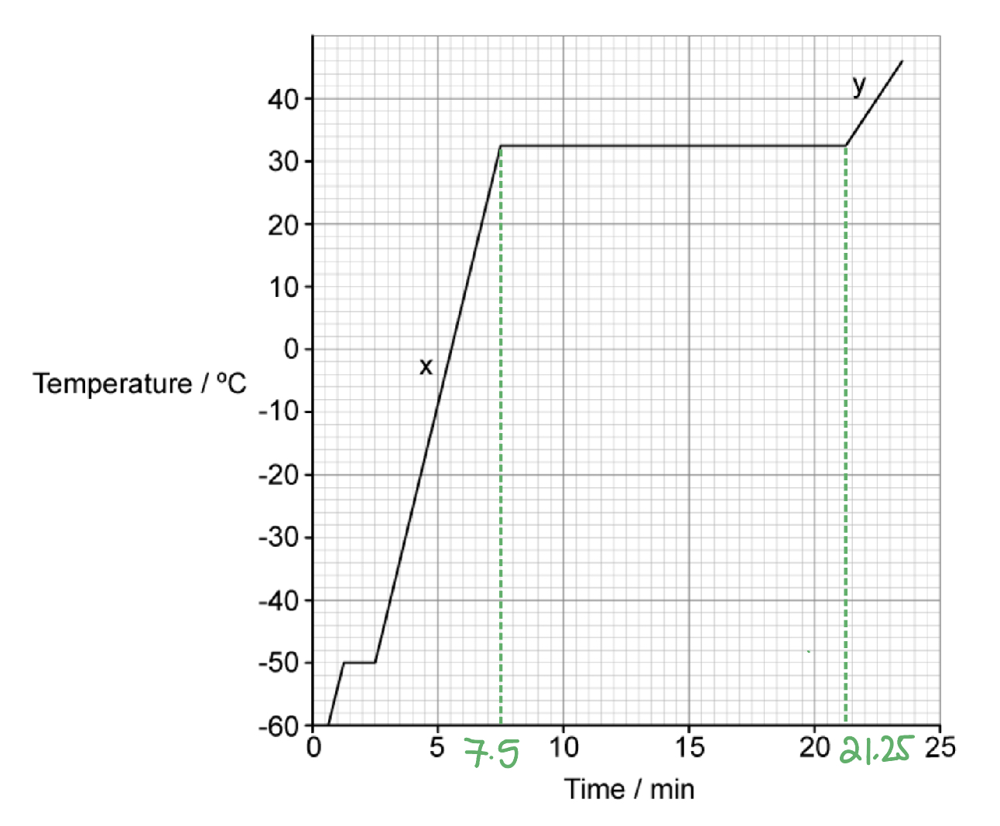
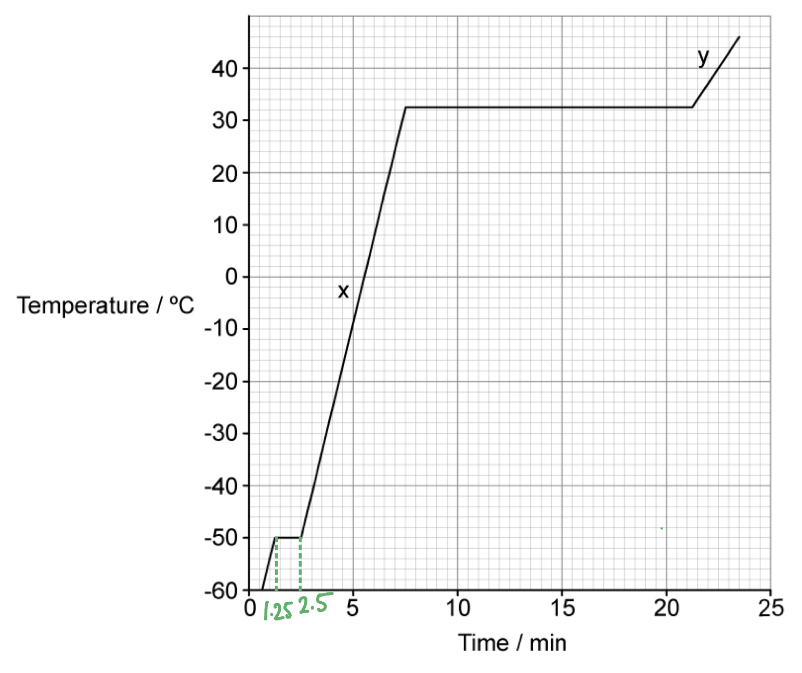
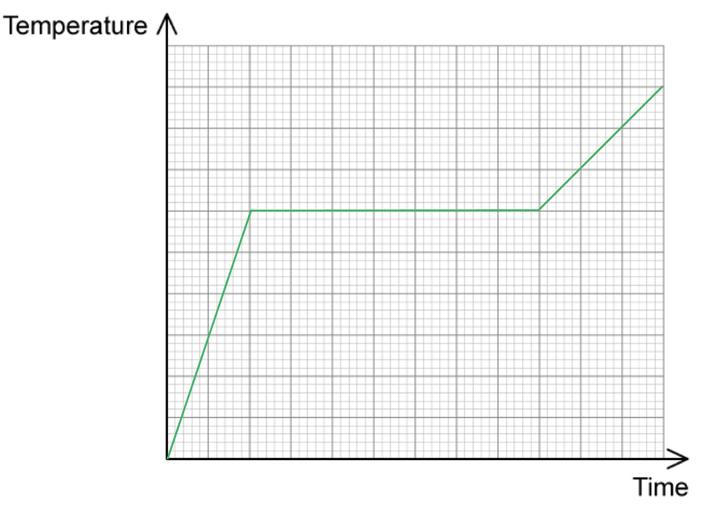
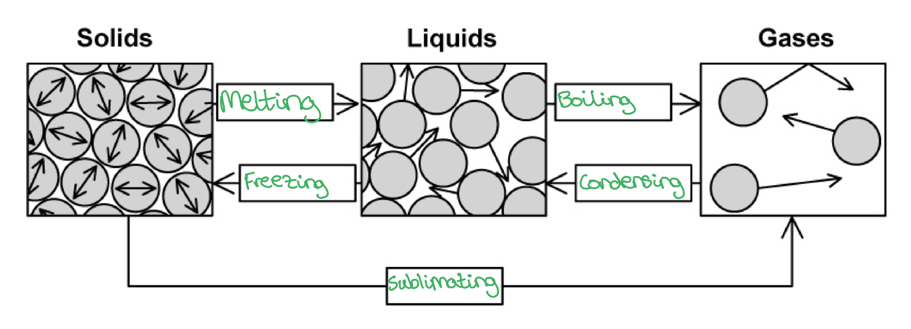
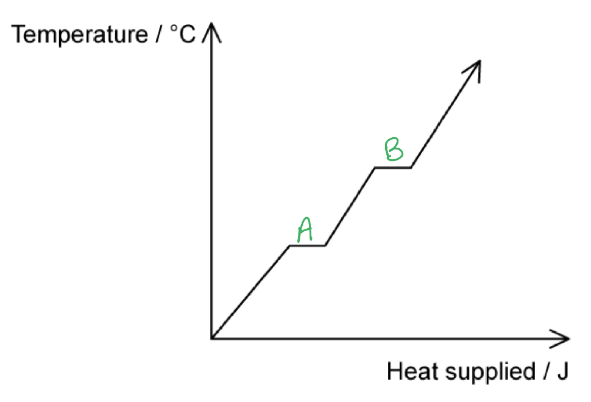

# Mark Schemes — Specific Heat Capacity & Specific Latent Heat
**14. Temperature** · Cambridge (CIE) A-LEVEL physics (9702)

## Structured Questions (11 questions)

### Q1
The energy required to boil water at 100 °C to steam at 100 °C is much greater than the energy required to melt ice at 0 °C to water at 0 °C because:

- There is a much greater <u>increase</u> in spacing of the molecules (for evaporation / vaporisation compared with melting / fusion); **[1 mark]**

**[Total: 1 mark]**
Using data from Fig. 1.1 to calculate, in MJ kg–1, the specific latent heat of vaporisation, *L* of the substance is:

List the known quantities:

- Power of the heater, *P* = 230 W
- Mass of the substance, *m* = 64 g = 64 × 10–3 kg

Calculate the change in time during vaporisation, Δ*t*:

- Δ*t * = 21.25 – 7.5 = 13.75 minutes
- 13.75 × 60 = 825 s **[1 mark] **

Determine equation for the specific latent heat of vaporisation, *L*:

- $\DeltaQ=Pt=mL$
- $L=\frac{Pt}{m}$

Substitute in the values:

- $L=\frac{230\times825}{64\times10^{-3}}$**[1 mark] **
- $L=2.96\times10^{6}=3.0\mathrm{MJ} \mathrm{kg}^{-1}$ **[1 mark] **

**[Total: 3 marks]**

> *If the question asks you to state your final value in a specific unit, make sure to always convert it into this. You may not get the final mark without it, even if the number is technically correct!*
The ratio $\frac{specificlatentheatofvaporisation}{specificlatentheatoffusion}$ is:

List the known quantities:

- Power of the heater, *P* = 230 W
- Mass of the substance, *m* = 64 g = 64 × 10–3 kg
- Specific latent heat of vaporisation, *L*v = 2.96 × 106 J kg–1 (from part b)
- $L=\frac{Pt}{m}$ (from part b)

Calculate the change in time during vaporisation, Δ*t*:

- Δ*t * = 2.5 – 1.25 = 1.25 minutes
- 1.25 × 60 = 75 s **[1 mark] **

Substitute in the values:

- $L_{f}=\frac{Pt}{m}=\frac{230\times75}{64\times10^{-3}}$
- $L_{f}=2.96\times10^{5}=3.0\times10^{5}J\mathrm{kg}^{-1}$ **[1 mark] **

Calculate the ratio:

- $\frac{L_{v}}{L_{f}}=\frac{2.96\times10^{6}}{2.96\times10^{5}}=10$ **[1 mark] **

**[Total: 3 marks]**

> *Make sure you always convert time into **seconds** when using **E** = **Pt** if you want energy **E** in Joules. This is because power in units of W = J s**–1**.*
The deduction from the fact that section **X** on the graph is steeper than section **Y** is:

- Liquid has a lower specific heat capacity (than gas) **OR** gas has a higher specific heat capacity (than liquid); **[1 mark]**

**[Total: 1 mark]**

> *The gradient of the graph in Fig 1.1 is the **change in temperature with time**. At point X, the substance is in a **liquid** form and it takes less time to increase it by a certain temperature than the graph at point Y does (when it's in gas form). *

> *This means **less** energy is required to change the temperature of the liquid compared to gas. Since specific heat capacity is the energy required to change 1 kg of a substance by 1 °C, this means it has a lower specific heat capacity.*

### Q2
The statement *the specific heat capacity of water is *4200 J kg–1 K–1 means:

- The energy required to raise 1 kg of water by 1 K (or 1 °C); **[1 mark]**
- Is 4200 J; **[1 mark]**

**[Total: 2 marks]**** **
Show that 107 g of water is evaporated in this time:

List the known quantities:

- Power of the kettle, *P* = 3.18 kW = 3180 W
- Time, *t* = 1.5 minutes = 1.5 × 60 = 90 s
- Rate of thermal energy lost to surroundings = 500 W
- The specific latent heat of vaporisation of water is 2.26 MJ kg–1 = 2.26 × 106 J kg–1

Calculate the energy supplied by the kettle:

- $E=Pt=3180\times90=286200J$ **[1 mark]**

Determine the equation for the energy required to evaporate the water, *Q*:

- Specific latent heat of vapourisation, $Q = m L$

Determine the equation for the mass of the water evaporated, *m*:

- $\mathrm{thermal} \mathrm{energy} \mathrm{lost} \mathrm{to} \mathrm{surroundings}=E-Q$ **[1 mark]**
- $\mathrm{rate} \mathrm{of} \mathrm{thermal} \mathrm{energy} \mathrm{lost}\timest=E--mL$
- $m = \frac{E - ( \text{rate} of \text{thermal} \text{energy} \text{lost} \times t ) }{L}$

Substitute in the values:

- $m = \frac{286 200 - ( 500 \times 90 )}{2.26 \times 10^{6} }$ = 0.1067 kg = 107 g **[1 mark]**

**[Total: 3 marks]**

> *The wording of this question is what makes it difficult. Remember that power is just 'the rate of transfer of energy'. The equation energy **E** = **Pt** is used a lot in the specific heat capacity exam questions.*

> *The energy transferred from the power provided by the kettle goes to 1. boiling the water (using latent heat of vaporisation) and 2. thermal energy to the surroundings. *
Calculate the specific latent heat of fusion of ice:

List the known quantity:

- Mass of water, *m* = 700 g = 700 × 10–3 kg
- Initial temperature of the ice, *θ*i = 0 °C
- Final temperature of the ice, *θ*f = –4 °C
- Total energy removed from the water, *E*T = 0.23 MJ = 0.23 × 106 J
- Specific heat capacity of ice, *c* = 2.1 kJ kg–1 K–1 = 2.1 × 103 J kg–1 K–1

Determine the equation of the total energy removed from the water:

- Total energy removed = energy to freeze water into ice + energy to cool ice from 0 °C to –4 °C
- Total energy removed = $mL+mc\Deltaθ$ **[1 mark]**

Rearrange the equation for the specific latent heat of ice, *L*:

- $L=\frac{\mathrm{total} \mathrm{energy} \mathrm{removed}--mc\Deltaθ}{m}$

Substitute in the values:

- $L = \frac{( 0.23 \times 10^{6 ) - [ ( 700 \times 10^{-3} } ) \times ( 2.1 \times 10^{3} ) \times ( - 4 - 0 ) ] }{700 \times 10^{- 3} }$ **[1 mark]**
- $L=3.2\times10^{5}J\mathrm{kg}^{-1}$ **[1 mark]**

**[Total: 3 marks]**

> *Make sure to split up the situation into a **change of phase** and** **a** change of temperature**. These require slightly different equations.*
The specific latent heat of fusion of water is much less than the specific latent heat of vaporisation of water because:

**Final answer:** **Any ****two**** from:**

- More energy has to be supplied to separate molecules (liquid to gas) than to break the solid bond between them (solid to liquid); **[1 mark]**
- For vaporisation, work is done against atmospheric pressure; **[1 mark]**
- There is a greater change in potential energy from liquid (water) to gas (water vapour) than from solid (ice) to liquid (water); **[1 mark]**

**[Total: 2 marks]**

> *Although you calculated the latent heat of fusion of ice in part **(b)**, this is the **same** as the latent heat of fusion of water. Although it's named 'fusion' this is the energy required to change 1 kg of liquid into solid **or** solid into liquid as well.*

### Q3
A table that would score 4 marks should look like:

|   | **Equation** | **Definition** |
|---|---|---|
| **Specific Latent Heat Capacity** | $Q=Lm$ **[1 mark]** | **The thermal energy required to change the state of 1 kg of mass of a substance without any change of temperature.**** [1 mark]** |
| **Specific Heat Capacity** | $\DeltaQ=mc\Deltaθ$ **[1 mark]** | **The amount of thermal energy required to raise the temperature of 1 kg of a substance by 1 °C.**** [1 mark]** |

- **One mark for each piece of information in the correct place**

**[Total: 4 marks]**

> *No marks are awarded for the correct definition in the equation column and vice versa. Your answers **must** be in the correct column.*
A table that that would score 2 marks should look like:

| **Statement** | **(✓) here if the statement is correct** |
|---|---|
| All substances have the same specific heat capacity. |   |
| The heavier the material, the more thermal energy is required to raise its temperature. | **✓ ****[1 mark]** |
| The larger the change in temperature, the higher the thermal energy will be required to achieve this change. | **✓ ****[1 mark]** |
| Specific heat capacity is mainly used in gases. |   |

- **One mark awarded for each correct statement ticked**

**[Total: 2 marks]**

> *All substances have **different** specific heat capacities and specific heat capacity is mainly used in **liquids and solids**.*
The explanations that correctly describe latent heat capacity are as follows:

(i) When a substance changes state there is** ****no temperature change**; **[1 mark] **

(ii) There are **two**** **types of specific latent heat; **[1 mark]**

(iii) The specific latent heat of fusion is present during the **melting** of a substance; **[1 mark] **

(iv) The specific latent heat of vapourisation is present during the **boiling** of a substance; **[1 mark]**

**[Total: 4 marks]**
Numbers next to the substances to identify the correct order would look like this:

- Aluminium: **2**** ****[1 mark]**
- Copper: **1**** ****[1 mark]**
- Water: **3**** ****[1 mark]**

**One mark awarded for each substance in the correct position**

**[Total: 3 marks]**

> *A substance with a higher specific heat capacity requires a greater input of thermal energy to achieve the same temperature increase as a substance with a lower specific heat capacity. Since each substance receives the same input of thermal energy, the substance with the smallest temperature increase must have the highest specific heat capacity. *

> *Water has a specific heat capacity of 4200 J kg**−1** °C**−1**, the highest of the three substances, which is why its temperature only increased by 10°C.*

> *The specific heat capacity of aluminium is 910 J kg**−1** °C**−1**, and for copper, it is 390 J kg**−1** °C**−1**. So it makes sense that the temperature of the aluminium increased by 55°C, and the temperature of the copper increased the most, by 130°C.*

### Q4
Calculate the overall increase in the temperature of the brake discs:

List the known quantities:

- Mass of cyclist, mc = 50 kg
- Mass of bike, *m**b* = 5 kg
- Constant speed, *v *= 25 m s−1
- Mass of 1 brake disc, *m**d** *= 250 g = 0.25 kg
- Specific heat capacity or brake fluid, *c* = 1.77 kJ kg−1.= 1.77 × 103 J kg−1

Obtain an equation for the conservation of energy as the cyclist comes to a stop:

- $m=m_{b}+m_{c}=55\mathrm{kg}$
- Kinetic energy lost by cyclist and bike = thermal energy gained by 4 brake discs
- $\frac{1}{2}mv^{2}=4m_{d}c\DeltaT$ **[1 mark]**

Calculate the increase in temperature of the brake discs, Δ*T:*

- $\DeltaT=\frac{mv^{2}}{8m_{d}c}$
- $\Delta T = \frac{55 \times 25^{2}}{8 \times 0.25 \times ( 1.77 \times 10^{3} )}$
- $\DeltaT=9.71^{\circ}C$ **[1 mark]**

**[Total: 2 marks]**
The temperature difference in the brake disc fluid can be reduced by:

**Final answer:** **Any ****two ****from:**

- Reduce the mass of the bike and the cyclist; **[1 mark]**
- Use a fluid with a higher specific heat capacity; **[1 mark]**
- Increase the mass of the brake discs; **[1 mark]**
- Increase the number of brake discs used on the bike; **[1 mark]**
- Increase the surface area of the brake discs; **[1 mark]**

**[Total: 2 marks]**

> *Use the **equation** in **part (a)** and identify the quantities that can be reduced / increased the make the temperature change smaller. *
Explain whether adding water to the mineral oil in the brake fluid will make it safer when it overheats:

List the known quantities:

- Specific heat capacity of mineral oil = 1.77 × 103 J kg−1 (from part (a))
- Boiling point of mineral oil = 300 °C
- Specific heat capacity of water = 4200 J kg−1 °C−1
- Boiling point of water = 100 °C

Explain the effect of adding water on the specific heat capacity:

- Water has a higher specific heat capacity than mineral oil
- So, adding water will mean that the brake fluid requires more energy to increase its temperature; **[1 mark]**

Explain the effect of adding water on the boiling temperature:

- Water has a lower boiling temperature than mineral oil
- So, when the water in the mixture boils the mixture will compress and the brakes will not work; **[1 mark]**

Explain whether adding the water makes using the brakes safer when they overheat:

- Adding the water means that the fluid will heat up slower, some of the fluid will boil at a lower temperature, so the water should not be added; **[1 mark]**

**[Total: 3 marks]**

### Q5
Calculate the temperature of the ball immediately before it hits the water:

List the known quantities:

- Height of fall, *h *= 0.75 m
- Initial velocity of ball, *u *= 20 m s−1
- Acceleration due to free-fall, *g *= 9.81 m s−2
- Initial temperature of ball, *T**i* = −2.1592 °C

Calculate the final velocity of the ball just before it hits the surface of the water, *v*:

- Recall an equation of uniform motion: $v^{2}=u^{2}+2as$
- So, $v = \sqrt{u^{2} + 2 a h} = \sqrt{20^{2} + ( 2 \times 9.81 \times 0.75 )} = 20.36 \mathrm{m} \mathrm{s}^{- 1}$ **[1 mark]**

Consider the energy transfer taking place as the ball falls:

- Initial gravitational potential energy + initial kinetic energy = final gravitational potential energy + final kinetic energy + thermal energy transferred to surroundings
- $mgh+\frac{1}{2}mu^{2}=0+\frac{1}{2}mv^{2}+mc\DeltaT$ **[1 mark]**

Calculate the change in temperature of the ball bearing, Δ*T*:

- $\DeltaT=\frac{2gh+u^{2}-v^{2}}{2c}$
- $\Delta T = \frac{( 2 \times 9.81 \times 0.75 ) + 20^{2} - 20.36^{2} }{( 2 \times 440 )}$
- $\DeltaT=2.1068\times10^{-4}^{\circ}C$ **[1 mark]**

Calculate the temperature of the ball immediately before it hits the water, *T**f*:

- $\DeltaT=T_{f}-T_{i}$
- $T_{f} = \Delta T + T_{i} = ( 2.1068 \times 10^{- 4} ) + ( - 2.1592 ) = - 2.1590^{\circ} \mathrm{C}$** [1 mark]**

**[Total: 4 marks]**
Calculate the final temperature of the ball and the water after impact:

List the known quantities:

- Mass of ball bearing, *m**b* = 33 g = 33 × 10−3 kg (from part (a))
- Volume of pool, *V *= 0.05 × 0.1 × 0.3 = 1.5 × 10−3 m3
- Density of water, *ρ* = 1030 kg m−3
- Specific heat capacity of water, *c**w* = 4300 J kg−1 °C−1
- Specific heat capacity of ball, *c**b* = 440 J kg−1 °C−1 (from part (a))
- Initial temperature of water, *T**w* = 22.5173 °C
- Temperature of ball upon hitting the water, *T**b* = −2.1590 °C (from part (a))

Calculate the mass of the water in the pool, mw:

- Recall the equation for density, $ρ=\frac{m}{V}$ so $m_{w}=ρV$
- $m_{w} = 1030 \times ( 1.5 \times 10^{- 3} ) = 1.545 \text{kg}$ **[1 mark]**

Consider the energy transfer taking place when the ball is in the water:

- Energy gained by ball = energy lost by water
- $m_{b} c_{b} ( T - T_{b} ) = m_{w} c_{w} ( T - T_{w} )$
- $m_{b}c_{b}T-m_{b}c_{b}T_{b}=m_{w}c_{w}T-m_{w}c_{w}T_{w}$

- $( m_{b} c_{b} - m_{w} c_{w} ) T = m_{b} c_{b} T_{b} - m_{w} c_{w} T_{w}$
- $T = \frac{m_{b} c_{b} T_{b} - m_{w} c_{w} T_{w} }{( m_{b} c_{b} - m_{w} c_{w} ) }$ **[1 mark]**

Calculate the final temperature of the ball and the water, *T*:

- $T = \frac{( ( 33 \times 10^{- 3} ) \times 440 \times - 2.1590 ) - ( 1.545 \times 4300 \times 22.5137 )}{( ( 33 \times 10^{- 3} ) \times 440 ) - ( 1.545 \times 4300 )}$
- $T=22.6577^{\circ}C$ **[1 mark]**

**[Total: 3 marks]**

### Q6
List the known quantities:

- Mass of water, *m**w* = 2.5 kg
- Initial temperature of water, *T**i* = 17 °C
- Final temperature of water, *T**f* = 0 °C
- Specific heat capacity of water, *c**w* = 4200 J kg–1 K–1
- Specific latent heat of fusion of ice, *c**i* = 3.4 × 105 J kg–1

Energy released when the water at 17 °C cools to 0 °C:

- $\DeltaQ_{water}=m_{w}c_{w}\Deltaθ_{w}$
- $\DeltaQ_{water}$= 2.5 × 4200 × (17 – 0) **[1 mark]**
- $\DeltaQ_{water}$= 178 500 J **[1 mark]**

Energy released from changing state from liquid (water) to solid (ice):

- $\DeltaQ_{change}=m_{w}l_{i}$
- $\DeltaQ_{change}$= 2.5 × (3.4 × 105) = 850 000 J **[1 mark]**

Total energy released:

- $\DeltaQ_{water}+\DeltaQ_{change}$= 178 500 + 850 000 = 1 028 500 = 1.03 × 106 J **[1 mark]**** **

**[Total: 4 marks]**** **

> *In specific heat capacity questions, it helps to split the scenario into steps.*

> *In this question, the two steps are: water cools to 0 ºC → freezes to form ice. *

> *The thermal energy of a substance changes when it is heated or cooled but also when it changes state.*
It is more effective to cool ice packs in a box full of ice because:

- Ice requires energy / latent heat to melt; **[1 mark]**
- This means it stays at 0 ºC / cooler for longer; **[1 mark]** **OR** This means it extracts <u>more</u> <u>energy</u> from the drink; **[1 mark]**** **

**[Total: 2 marks]**
List the known quantities:

- Mass of plastic, $m$*p* = 0.210 kg
- Mass of silica gel and water solution, $m_{s}$ = 0.450 kg
- Specific heat capacity of plastic, $c$*p** *= 1670 J kg–1 K–1
- Specific heat capacity of gel and water solution, $c_{s}$= 6420 J kg–1 K–1
- Temperature change of plastic, $\Deltaθ$*p* = (19.0 – $T_{f}$) °C
- Temperature change of gel and water solution, $\Deltaθ_{s}$= ( $T_{f}$* *– 2.00) °C

Equate the amount of heat transferred by the plastic and silica gel water solution:

- The solution reaches thermal equilibrium when: Heat supplied by the beaker = heat gained by the solution (since no heat is gained from or lost to the surroundings)
- $\DeltaQ$*p* = $\DeltaQ_{s}$
- $m_{p}c_{p}\Deltaθ_{p}$= $m_{s}c_{s}\Deltaθ_{s}$
- 0.210 × 1670 × (19.0 – $T_{f}$ ) = 0.450 × 6420 × (* *$T_{f}$– 2.00) **[1 mark]**

Rearrange for the final temperature $T_{f}$:

- 350.7 × (19.0 –$T_{f}$) = 2889 × (* *$T_{f}$– 2.00)
- 6663.3 – 350.7 $T_{f}$ = 2889$T_{f}$ – 5778
- 12441.3 = 3239.7 $T_{f}$
- $T_{f}$ = 3.8403 = 3.84°C (3 s.f.) **[1 mark]**** **

**[Total: 2 marks]**** **

> *Although the specific heat capacities have been given in units of [J kg**–1** K**–1**], you do not need to convert the temperatures from ºC to K. This is because the specific heat capacity equation requires the **difference** in temperature (ΔT) which is the same for either unit.*

> *The temperature differences of the solution and the ice is calculated differently because:*

- *Δ**θ **= **T**f** − **T**i** when **T**f** > **T**i*
- *Δ**θ **= **Ti **− **T**f** **when **T**f** < **T**i*
List the known quantities:

- Initial temperature, $T_{f}$ = 3.84°C (from part c)* *
- Mass of plastic beaker, $m$*p* = 0.210 kg
- Mass of silica gel and water solution, $m_{s}$= 0.450 kg
- Specific heat capacity of plastic beaker, $c$*p *= 1670 J kg–1 K–1
- Specific heat capacity of gel and water solution, $c_{s}$= 6420 J kg–1 K–1
- Specific latent heat of fusion of ice, $l_{i}$= 3.34 × 105 J kg–1
- Change in temperature of ice, $\Deltaθ_{i}$= (0.9 – 0) = 0.9°C
- Change in temperature of the solution and plastic, $\Deltaθ_{s}$= $\Deltaθ$*p* = (3.84 – 0.9) = 2.94°C

Calculate the heat gained by the ice:

- Heat gained by ice = heat lost by plastic (due to the ice) + heat lost by solution (whilst the ice is melting)
- $\DeltaQ_{i}=m_{i}c_{w}\Deltaθ_{i}+m_{i}l_{i}$
- $\DeltaQ_{i}=$ [$m_{i}$× 4200 × 0.9] + [$m_{i}$ × (3.34 × 105)] **[1 mark] **
- $\DeltaQ_{i}=$3780 $m_{i}$+ (3.34 × 105)$m_{i}$  = 337 780 $m_{i}$

Calculate the heat lost by the plastic beaker and gel-water solution:

- $\DeltaQ_{p}+\DeltaQ_{s}=m_{p}c_{p}\Deltaθ_{p}+m_{s}c_{s}\Deltaθ_{s}$
- [0.210 × 1670 × 2.94] + [0.450 × 6420 × 2.94] = 9524.19 J **[1 mark]**

Calculate the mass of ice added, $m_{i}$:

- $m_{i}$ × (3.34 × 105) =  9524.19
- $m_{i}$= 0.0285 kg = 28.5 g **[1 mark]**** **

**[Total: 3 marks]**** **

> *This question can also be done by considering the solution returning back to its original (cooler) temperature. Therefore, the heat supplied by the plastic = heat used/gained by the ice.*

### Q7
Comparing freezing and condensation:

- Freezing is from liquid to solid **AND** at a specific / one temperature / at the melting point; **[1 mark]**
- Condensation is vapour to liquid **AND** at all temperatures; **[1 mark]**

**[Total: 2 marks]**
The time taken to heat the food to this temperature is:

List the known quantities:

- Power of the oven, *P* = 1500 W
- Mass of water, *m* = 160 g = 160 × 10–3 kg
- Initial temperature, *θ*i = 15 °C
- Final temperature, *θ*f = 90 °C
- Specific heat capacity of water, *c* = 4200 J kg−1K−1

Determine the equation to calculate the time taken to heat the food:

- $\DeltaQ=Pt=mc\Deltaθ$ **[1 mark]**
- $t=\frac{mc\Deltaθ}{P}$

Substitute in the values:

- $t = \frac{( 160 \times 10^{- 3} ) \times 4200 \times ( 90 - 15 ) }{1500}$ **[1 mark]**
- $t=33.6s$

Convert time into minutes:

- $t=\frac{33.6}{60}=0.56\mathrm{minutes}$ **[1 mark]**

**[Total: 3 marks]**

> *Remember Δ**Q** is the **change in heat energy** which can also be related to **power** and **time**. The combination of these equations appear many times in exam questions.*
A reason for the difference in the specific heat capacity of water is:

**Final answer:** **Any ****one**** from:**

- Energy is lost in its heat store from the oven; **[1 mark]**
- The container containing the food / water is also heated; **[1 mark]**
- Energy in its heat store heats up the oven door / inside the oven too; **[1 mark]** *Any sensible suggestion*

**[Total: 1 mark]**

### Q8
A graph that would score 4 marks should look like this:

List the known quantities:

- Specific heat capacity of ice = 1.9 kJ kg−1 K−1
- Specific heat capacity of water = 5.7 kJ kg−1 K−1

First section:

- After the ice is added to the water, being added to the water, the ice will increase its temperature until its melting point
- This is shown by the positive gradient of the diagonal line; **[1 mark]**

Second section:

- The ice remains at the same temperature whilst melting into a liquid
- This is shown by the horizontal line; **[1 mark]**

Third section:

- After melting the ice will increase its temperature as a liquid
- The specific heat capacity of the ice is one third that of the water, hence, its temperature will increase three times as quickly
- This is shown by the positive gradient of the diagonal line; **[1 mark]**
- With a gradient a third of the value of that in the first section; **[1 mark]**

**[Total: 4 marks]**

> *Use the **information provided** on specific heat capacity to plot the graph, it is provided for a reason. *
Determine the final temperature of the water:

List the known quantities:

- Specific heat capacity of ice, *c**i* = 1.9 kJ kg−1 K−1 = 1.9 × 103 J kg−1 K−1 (from part (a))
- Specific heat capacity of water, *c**w* = 5.7 kJ kg−1 K−1 = 5.7 × 103 J kg−1 K−1 (from part (a))
- Radius of ice sphere, *r *= 20 mm = 20 × 10−3 m
- Density of ice, *ρ* = 870 kg m−3
- Initial temperature of water, *T**w* = 22.2 °C
- Initial temperature of ice, *T**i* = −7.2 °C
- Mass of water, *m**w* = 0.75 kg
- Specific latent heat of fusion, *L* = 442 kJ kg−1 = 442 × 103 J kg−1

Calculate the volume of the 4 ice spheres, *V*:

- Volume of sphere = $\frac{4}{3}πr^{3}$
- Volume of 4 spheres, *V *= $4\times\frac{4}{3}πr^{3}$
- $V = 4 \times \frac{4}{3} \pi ( 20 \times 10^{- 3} )^{3} = 4 \times ( 3.35 \times 10^{- 5} )$
- $V=1.34\times10^{-4}m^{3}$** [1 mark]**

Calculate the mass of the ice spheres, *m**i*:

- Recall the equation for density: $ρ=\frac{m_{i}}{V}$ so $m_{i}=ρV$
- $m_{i} = 870 \times ( 1.34 \times 10^{- 4} )$
- $m_{i}=0.12\mathrm{kg}$ **[1 mark]**

Determine the equation for the energy gained by the ice spheres, *Q**i*:

- Energy gained by ice = energy required to heat ice + energy required to melt ice + energy required to heat water
- Energy gained by ice, $Q_{i = ( m_{i} c_{i} \Delta T_{i} ) + ( m_{i} } L ) + ( m_{i} c_{w} \Delta T_{w} )$
- $Q_{i} = ( 0.12 \times ( 1.9 \times 10^{3} ) \times ( 0 - - 7.2 ) ) + ( 0.12 \times ( 442 \times 10^{3} ) ) + ( 0.12 \times ( 5.7 \times 10^{3} ) T_{f} )$
- $Q_{i}=54681.6+684T_{f}$ **[1 mark]**

Determine an equation for the energy change in the water, *Q**w*:

- Energy lost by water, $Q_{w} = m_{w} c_{w} ( T_{w} - T_{f} )$
- $Q_{w} = 0.75 \times ( 5.7 \times 10^{3} ) \times ( 22.2 - T_{f} )$
- $Q_{w}=94905-4275T_{f}$ **[1 mark]**

Calculate the final temperature of the water, *T**f*:

- Energy gained by ice = energy lost by water
- $54681.6+684T_{f}=94905-4275T_{f}$
- $4959T_{f}=40223.4$
- $T_{f}=8.11^{\circ}C$** [1 mark]**

**[Total: 5 marks]**

> *Energy gained by ice = energy required to heat ice + energy required to melt ice + energy required to heat water*

> *because "energy required to heat water" is the energy lost by the ice on the water*
Determine through calculation whether the final temperature would be obtained quicker when using the cubes instead of the spheres:

List the known quantities:

- Volume of one sphere = 3.35 × 10−5 m3 (from part (b))
- Radius of sphere, *r *= 20 × 10−3 m (from part (b))

Explanation:

- The greater the surface area to volume ratio of the ice pieces then the quicker thermal transfer will take place; ** [1 mark]**

Calculate the surface area to volume ratio of the spheres:

- Surface area of one sphere = $4 \mathrm{\pi } \mathrm{r}^{2} = 4 \mathrm{\pi } \times ( 20 \times 10^{- 3} )^{2} = 5.03 \times 10^{- 3} \mathrm{m}^{2}$
- $\frac{surfacearea}{volume}=\frac{5.03\times10^{-3}}{3.35\times10^{-5}}=150.15m^{-1}$ ** [1 mark]**

Calculate the side length of the cubes:

- Volume of sphere = volume of cube
- Volume of cube = *l**3*
- So, $l = \sqrt[3]{v o l u m e o f s p h e r e} = \sqrt[3]{( 3.35 \times 10^{- 5} )}$
- $l=0.032m$ ** [1 mark]**

Calculate the surface area to volume ratio of the cubes:

- Surface area of one cube = $6 \times ( 0.032 )^{2} = 6.14 \times 10^{- 3} \mathrm{m}^{2}$
- $\frac{surfacearea}{volume}=\frac{6.14\times10^{-3}}{3.35\times10^{-5}}=183.3m^{-1}$** [1 mark]**

Conclusion:

- The ice cubes have a higher surface area to volume ratio, so the final temperature would be obtained quicker;** [1 mark]**

**[Total: 5 marks]**

### Q9
A specific heat capacity of 4200 J kg–1 K–1 represents:

- The energy required to raise 1 kg of water by 1 K (or ºC); **[1 mark]**
- Is 4200 J; **[1 mark]**** **

**[Total: 2 marks]**** **

> *This question is asking about the specific heat capacity definition for water in particular, not just its general definition. At A level, relevant and clear explanations are required for full marks.*
List the known quantities:

- Mass of water, *m* = 0.75 kg
- Specific heat capacity of water, $c_{w}$= 4.2 × 103 J kg–1 K–1
- Specific heat capacity of ice, $c_{i}$= 2.1 × 103 J kg–1 K–1
- Specific latent heat of fusion of ice, $l_{i}$= 3.3 × 105 J kg–1** **

Total energy removed:

- Energy needed to cool water from 15 ºC to 0 ºC + energy needed for water to turn to ice + energy needed to cool ice from 0 ºC to –6 ºC

Energy needed to cool water from 15 ºC to 0 ºC:

- $\DeltaQ_{water}=mc_{w}\Deltaθ$
- $\DeltaQ_{water}$= 0.75 × (4.2 × 103) × (15 – 0) = 47 250 J **[1 mark]**

Energy needed from changing state from liquid (water) to solid (ice):

- $\DeltaQ_{change}=ml_{i}$
- $\DeltaQ_{change}$= 0.75 × (3.3 × 105) = 247 500 J **[1 mark]**

Energy needed to cool ice from 0 ºC to –6 ºC:

- $\DeltaQ_{ice}=mc_{i}\Deltaθ$
- $\DeltaQ_{ice}$= 0.75 × (2.1 × 103) × (0 – (–6)) = 9 450 J **[1 mark]**

Total energy:

- $\DeltaQ_{water}+\DeltaQ_{change}+\DeltaQ_{ice}$= 47 250 + 247 500 + 9 450 = 304 200 J = 0.3 MJ **[1 mark]**** **

**[Total: 4 marks]**** **

> *In specific heat capacity questions, it helps to split the scenario into steps. In this question, the two steps are:*

> *Water cools to 0 ºC → Water freezes to form ice → Ice cools to –6 ºC *

> *Remember there is **no temperature change** **when water is turning to ice (or anything is changing state). However, energy is still required to change state. *
List the known quantities:

- Energy to remove 0.75 kg of water = 304 200 J (from part b)
- Time = 240 s

Calculate the energy to remove 1.25 kg of water:

- Energy to remove 1.25 kg of water = $\frac{1.25}{0.75}$× $\frac{5}{3}$ × 304 200 = 507 000 J **[1 mark]**

Calculate power:

- The rate at which energy must be removed is the power
- Power = $\frac{\mathrm{energy}}{\mathrm{time}}$= $\frac{507000}{240}$ = 2112.5 = 2100 W **[1 mark]**

**[Total: 2 marks]**
Specific latent heat of vaporisation is greater than specific later heat of fusion because:

**Final answer:** **Any ****two**** from:**

- More energy has to be supplied to separate molecules (liquid to gas) than the break the solid bond between them (solid to liquid); **[1 mark]**
- For vaporisation, work is done against the atmospheric pressure; **[1 mark]**
- There is a greater change in potential energy from liquid to gas than from solid to a liquid; **[1 mark]**** **

**[Total: 2 marks]**** **

> *Latent heat of fusion the amount of energy to change the state of 1 kg of liquid to solid **and** also from solid to a liquid. The same goes for latent heat of vaporisation (from liquid to gas or gas to liquid).*

### Q10
A completed diagram with the changes of state added in the correct places that would score 5 marks should look like this:

- One mark for each change of state added in the correct place

**[Total: 5 marks]**
A graph that would score 2 marks should look like this:

- A labelled on the first horizontal line from the start of the graph; **[1 mark]**
- B labelled on the second horizontal line from the start of the graph; **[1 mark]**

**[Total: 2 marks]**
The specific latent heat of vapourisation is defined as:

- The thermal energy required to convert 1 kg of liquid; **[1 mark]**
- To gas with no change in temperature; **[1 mark]**

**[Total: 2 marks]**

> *This is also the thermal energy required to convert 1 kg of **gas** to **liquid** with no temperature as well. Either definition will get you full marks.*
The specific latent heat of fusion is defined as:

- The thermal energy required to convert 1 kg of solid; **[1 mark]**
- To liquid with no change in temperature;** [1 mark]**

**[Total: 2 marks]**

> *This is also the thermal energy required to convert 1 kg of **liquid** to **solid** with no temperature as well. Either definition will get you full marks.*

### Q11
A table that would score 2 marks should look like:

| **Statements** | **(✓) here if the statement is correct** |
|---|---|
| If a substance has a low specific heat capacity it heats up and cools down slowly. |   |
| If a substance has a high specific heat capacity, it heats up and cools down slowly. | **✓ ****[1 mark]** |
| The specific heat capacity of different substances determines how useful they would be for a specific purpose. | **✓ ****[1 mark]** |

- **One mark for each correct tick**

**[Total: 2 marks]**
(i) The correct statement is:

- If a substance has a low specific heat capacity, it heats up and cools down **quickly**; **[1 mark]**

(ii) It can help to know about the specific heat capacities of different materials when:

**Final answer:** **Any ****one ****from:**

- Choosing the best material for appliances / tools / construction; **[1 mark]**
- Determining the material composition of a substance; **[1 mark]**
- Making calculations related to heating / cooling a substance; **[1 mark]**

**Any suitable answer is permitted.**

**[Total: 2 marks]**
Calculate the specific heat capacity of the liquid:

List the known quantities:

- Mass of liquid, *m *= 0.5 kg
- Thermal energy supplied, Δ*Q* = 3000 J
- Temperature change, Δ*θ* = 75 °C

Recall the equation for specific heat capacity:

- $\DeltaQ=mc\Deltaθ$ **[1 mark]**

Use the specific heat capacity equation:

- $c=\frac{\DeltaQ}{m\Deltaθ}$ **[1 mark]**
- $c=\frac{3000}{0.5\times75}$ **[1 mark]**
- $c=80J\mathrm{kg}^{-1}^{\circ}C^{-1}$ **[1 mark]**

**[Total: 4 marks]**
Calculate the specific latent heat of vapourisation of the liquid:

List the known quantities:

- Mass of liquid, *m *= 0.75 kg
- Energy required, *Q *= 60 000 J

State the equation for specific latent heat:

- $Q=mL$ **[1 mark]**

Calculate the specific latent heat of vapourisation of the liquid:

- $L=\frac{Q}{m}$ **[1 mark]**
- $L=\frac{60000}{0.75}$ **[1 mark]**
- $L=80000J\mathrm{kg}^{-1}$ **[1 mark]**

**[Total: 4 marks]**
