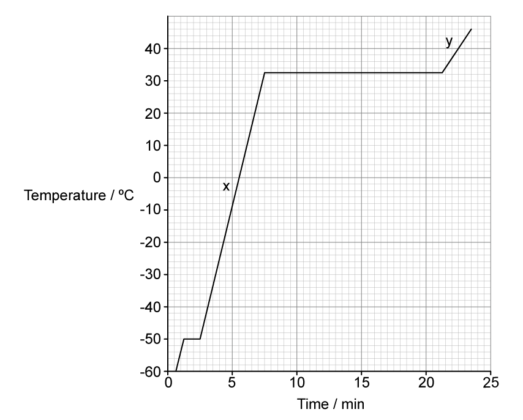
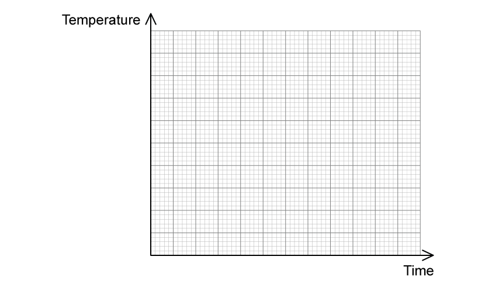

# Exam Questions — Specific Heat Capacity & Specific Latent Heat
**14. Temperature** · Cambridge (CIE) A-LEVEL physics (9702)
> Source: [https://www.savemyexams.com/a-level/physics/cie/25/topic-questions/](https://www.savemyexams.com/a-level/physics/cie/25/topic-questions/) · 11 questions across 1 sets

## Structured Questions (11 questions)

### Q1 — medium — 8 marks

**Q1** [1 mark]

The energy required to boil water at 100 °C to steam at 100 °C is much greater than the energy required to melt ice at 0 °C to water at 0 °C.

Explain this, in terms of the spacing of the molecules.

**Q1** [3 marks]

A heater supplies energy at a constant rate to 64 g of a substance. The variation with time of the temperature of the substance is shown in Fig. 1.1. The substance is perfectly insulated from its surroundings.

**Fig 1.1**

The power of the heater is 230 W.

Use data from Fig. 1.1 to calculate, in MJ kg–1, the specific latent heat of vaporisation, *L* of the substance.

**Q1** [3 marks]

**Extract:**

A heater supplies energy at a constant rate to 64 g of a substance. The variation with time of the temperature of the substance is shown in Fig. 1.1. The substance is perfectly insulated from its surroundings. The power of the heater is 230 W. Use data from Fig. 1.1 to calculate, in MJ kg^–1^, the specific latent heat of vaporisation, L of the substance. [From mark scheme: L = Pt/m, L = 2.96 × 10^6 = 3.0 MJ kg^-1]

Calculate the ratio  $\frac{specificlatentheatofvaporisation}{specificlatentheatoffusion}$.

**Q1** [1 mark]

**Extract:**

A heater supplies energy at a constant rate to 64 g of a substance. The variation with time of the temperature of the substance is shown in Fig. 1.1. The substance is perfectly insulated from its surroundings. **Fig 1.1** The power of the heater is 230 W.

Suggest what can be deduced from the fact that section **X** on the graph is steeper than section **Y** in Fig 1.1.

### Q2 — medium — 10 marks

**Q2** [2 marks]

Explain the statement *the specific heat capacity of water is *4200 J kg–1 K–1.

**Q2** [3 marks]

The heater in an electric kettle has a power of 3.18 kW.

When the water in the kettle is boiling at a steady rate, the mass of evaporated water in 1.5 minutes and the rate of loss of thermal energy to the surroundings is 500 W. The specific latent heat of vaporisation of water is 2.26 MJ kg–1.

Show that 107 g of water is evaporated in this time.

**Q2** [3 marks]

A student places water in an ice cube tray of a freezer to calculate the specific latent heat of fusion of ice.

700 g of water is placed in the ice cube tray at 0 °C and the freezer cools them to –4 °C. A total of 0.23 MJ of energy is removed from the water to turn it into ice at –4 °C.

Specific heat capacity of ice = 2.1 kJ kg–1 K–1.

Calculate the specific latent heat of fusion of ice.

**Q2** [2 marks]

Suggest why the specific latent heat of fusion of water is much less than the specific latent heat of vaporisation of water.

### Q3 — easy — 13 marks

**Q3** [4 marks]

Specific heat capacity and latent heat capacity are described in Table 1.1.

Determine the correct definitions and equations by placing them in the correct boxes in Fig 1.1.

**Table 1.1**

| $\DeltaQ=mc\Deltaθ$ | The thermal energy required to change the state of 1 kg of mass of a substance without any change of temperature. |
|---|---|
| $Q=Lm$ | The amount of thermal energy required to raise the temperature of 1 kg of a substance by 1 °C. |

**Fig 1.1**

|   | **Equation** | **Definition** |
|---|---|---|
| ** **  **Specific Latent Heat Capacity** |   |   |
| ** **  **Specific Heat Capacity** |   |   |

**Q3** [2 marks]

A student is trying to explain specific heat capacity to a friend.

Identify, by placing a tick (✓) next to the correct statements about specific heat capacity.

| **Statement** | ** (✓) here if the statement is correct** |
|---|---|
| All substances have the same specific heat capacity. |   |
| The heavier the material, the more thermal energy is required to raise its temperature. |   |
| The larger the change in temperature, the higher the thermal energy will be required to achieve this change. |   |
| Specific heat capacity is mainly used in gases. |   |

**Q3** [4 marks]

The student is confused about how to explain specific latent heat capacity.

Identify, by circling the best option, the explanations that correctly describe specific latent heat capacity.

(i) When a substance changes state there is **a temperature change /** **no temperature change**

[1]

(ii) There are **two / three **types of specific latent heat

[1]

(iii) The specific latent heat of fusion is present during the **melting / condensing** of a substance

[1]

(iv) The specific latent heat of vapourisation is present during the **freezing / boiling** of a substance.

[1]

**Q3** [3 marks]

The student has three substances of equal mass, aluminium, copper and water set up for an experiment in his laboratory where the room temperature is initially 20°C. 5000 J of thermal energy is transferred to each substance.

The temperature of aluminium increases to 75°C, the temperature of the copper to 150°C and the water to 30°C.

Write the numbers 1, 2 and 3 next to the correct substances, with 1 being the lowest and 3 being the highest specific heat capacity.

- Aluminium ........
- Copper ........
- Water ........

### Q4 — hard — 7 marks

**Q4** [2 marks]

A professional cyclist of mass 50 kg is testing a new hydraulic brake system on his racing bike of mass 5 kg. He is travelling at a constant speed of 25 m s−1 when he has to brake suddenly.

The four brake discs on the bike each have a mass of 250 g, included in the mass of the bike. The specific heat capacity of the mineral oil in the brake system is 1.77 kJ kg−1 °C−1.

Calculate the overall increase in the temperature of the brake discs.

**Q4** [2 marks]

**Extract:**

A professional cyclist of mass 50 kg is testing a new hydraulic brake system on his racing bike of mass 5 kg. He is travelling at a constant speed of 25 m s^−1^ when he has to brake suddenly. The four brake discs on the bike each have a mass of 250 g, included in the mass of the bike. The specific heat capacity of the mineral oil in the brake system is 1.77 kJ kg^−1^ °C^−1^. Calculate the overall increase in the temperature of the brake discs.
Kinetic energy lost by cyclist and bike = thermal energy gained by 4 brake discs: 1/2 m v^2 = 4 m_d c ΔT, giving ΔT = m v^2 / (8 m_d c).

Explain how the temperature difference in the brake disc fluid can be reduced.

**Q4** [3 marks]

**Extract:**

The specific heat capacity of the mineral oil in the brake system is 1.77 kJ kg^−1^ °C^−1^.

Water has a specific heat capacity of 4200 J kg−1 °C−1 and a boiling point of 100 °C. The boiling point of mineral oil is 300 °C.

Explain whether adding water to the mineral oil in the brake fluid will make it safer when it overheats.

### Q5 — hard — 7 marks

**Q5** [4 marks]

As part of a model village pyrotechnics display a 33 g iron ball bearing, cooled to a soecific initial temperature of −2.1592 °C, is dropped into a pool. The ball begins to accelerate uniformly from a height of 0.75 m above the surface of the pool with a velocity of 20 m s−1.

Assume that the ball falls with a constant acceleration due to free fall but a thermal energy transfer takes place between the ball and the air.

The iron ball has a specific heat capacity of 440 J kg−1 °C−1.

Calculate the temperature of the ball immediately before it hits the water.

**Q5** [3 marks]

**Extract:**

As part of a model village pyrotechnics display a 33 g iron ball bearing, cooled to a soecific initial temperature of −2.1592 °C, is dropped into a pool. The ball begins to accelerate uniformly from a height of 0.75 m above the surface of the pool with a velocity of 20 m s^−1^.

The iron ball has a specific heat capacity of 440 J kg^−1^ °C^−1^.

Calculate the temperature of the ball immediately before it hits the water.

Temperature of the ball immediately before it hits the water, T_f = ΔT + T_i = (2.1068 × 10^−4) + (−2.1592) = −2.1590 °C

The iron ball bearing from **(a)** falls into the pool. The pool has dimensions of 5 cm, 10 cm and 30 cm. The density of the water in the pool is 1030 kg m−3 and has a specific heat capacity of 4300 J kg−1 °C−1. The initial temperature of the water in the pool is 22.5173 °C.

Calculate the final temperature of the ball and the water after impact.

### Q6 — medium — 11 marks

**Q6** [4 marks]

Calculate the energy released when 2.5 kg of water at 17 °C cools to 0 °C and then freezes to form ice, also at 0 °C.

Specific heat capacity of water = 4200 J kg–1 K–1

Specific latent heat of fusion of ice = 3.4 × 105 J kg–1

**Q6** [2 marks]

Explain why it is more effective to cool ice packs by placing them in a box full of melting ice rather than in a box of water at an initial temperature of 0 °C.

**Q6** [2 marks]

The silica gel and water solution from the inside of an ice pack of mass 0.450 kg at a temperature of 2.00 °C are emptied and poured into a plastic beaker. The beaker has a mass of 0.210 kg and is initially at a temperature of 19.0 °C.

Specific heat capacity of plastic = 1670 J kg–1 K–1

Specific heat capacity of silica gel and water = 6420 J kg–1 K–1

Calculate the final temperature, $T_{f}$ , of the silica gel and water solution when it reaches thermal equilibrium with the beaker.

Assume no heat is gained from or lost to the surroundings.

**Q6** [3 marks]

**Extract:**

The silica gel and water solution from the inside of an ice pack of mass 0.450 kg at a temperature of 2.00 °C are emptied and poured into a plastic beaker. The beaker has a mass of 0.210 kg and is initially at a temperature of 19.0 °C. Specific heat capacity of plastic = 1670 J kg^–1^ K^–1^ Specific heat capacity of silica gel and water = 6420 J kg^–1^ K^–1^ Calculate the final temperature, T_f, of the silica gel and water solution when it reaches thermal equilibrium with the beaker. [T_f = 3.84°C]

The silica gel and water solution, along with the beaker, are cooled from $T_{f}$ to a temperature of 0.9 °C by adding ice at a temperature of 0 °C.

Calculate the mass of ice added.

Assume no heat is gained from or lost to the surroundings.

Specific latent heat of fusion of ice = 3.34 × 105 J kg–1

### Q7 — medium — 6 marks

**Q7** [2 marks]

Compare *freezing* and *condensation*.

**Q7** [3 marks]

The effective power of an oven is 1500 W.

The temperature of a mass of 160 g of water inside some food rises from 15 °C to 90 °C.

Calculate the time taken to heat the food to this temperature.

Specific heat capacity of water = 4200 J kg−1 K−1

 time = ................................... minutes

**Q7** [1 mark]

**Extract:**

The effective power of an oven is 1500 W. The temperature of a mass of 160 g of water inside some food rises from 15 \u00b0C to 90 \u00b0C. Calculate the time taken to heat the food to this temperature. Specific heat capacity of water = 4200 J kg^\u22121 K^\u22121

A student conducts an experiment into the heating of water inside food in an oven.

They calculate the specific heat capacity of water and obtain a higher value than that given in part **(b)**.

Suggest a reason for this difference.

### Q8 — hard — 14 marks

**Q8** [4 marks]

Four identical ice spheres are dropped into a thermally isolated cylinder containing water.

The specific heat capacity of the ice is 1.9 kJ kg−1 K−1 and the specific heat capacity of water is 5.7 kJ kg−1 K−1.

Sketch a graph on Fig. 1.1 to show the changes in temperature of the molecules within the ice cubes with time, from the point they are added to the water until they are in thermal equilibrium with the water molecules.

**Fig. 1.1**

**Q8** [5 marks]

**Extract:**

Four identical ice spheres are dropped into a thermally isolated cylinder containing water. The specific heat capacity of the ice is 1.9 kJ kg^−1^ K^−1^ and the specific heat capacity of water is 5.7 kJ kg^−1^ K^−1^.

The ice spheres have a radius of 20 mm and a density of 870 kg m−3. Their initial temperature is −7.2 °C. The specific latent heat of fusion of ice is 442 kJ kg−1. The water has an initial temperature of 22.2 °C and a mass of 0.75 kg.

Determine the final temperature of the water.

**Q8** [5 marks]

**Extract:**

The ice spheres have a radius of 20 mm and a density of 870 kg m^−3^.
Volume of one sphere = 3.35 × 10^−5^ m^3^ (from part (b))
Radius of sphere, r = 20 × 10^−3^ m (from part (b))

The experiment is repeated with four identical cubes of ice. The cubes have equal volume, mass and density to the spheres from parts **(a) **and **(b)**.

Determine through calculation whether the final temperature would be obtained quicker when using the cubes instead of the spheres.

### Q9 — medium — 10 marks

**Q9** [2 marks]

Explain the meaning of the statement *the specific heat capacity of water is 4200 J kg**–1** K**–1*.

**Q9** [4 marks]

An engineer is designing an ice-making machine. Water will enter the device at 15°C and the ice cubes are to be cooled to –6°C before release.

Show that about 0.3 MJ of energy must be removed from 0.75 kg of water at 15°C to change it into ice at –6°C.

Specific heat capacity of water = 4.2 × 103 J kg–1 K–1 

Specific heat capacity of ice = 2.1 × 103 J kg–1 K–1 

Specific latent heat of fusion of ice = 3.3 × 105 J kg–1

**Q9** [2 marks]

**Extract:**

Show that about 0.3 MJ of energy must be removed from 0.75 kg of water at 15°C to change it into ice at –6°C. Total energy: ΔQwater + ΔQchange + ΔQice = 47 250 + 247 500 + 9 450 = 304 200 J = 0.3 MJ

The design brief requires that 1.25 kg of water is frozen in 240 s.

Calculate the rate at which energy must be removed from the machine.

**Q9** [2 marks]

The specific latent heat of vaporisation of water is 2.3 × 106 J kg–1.

Suggest why the specific latent heat of vaporisation of water is much greater than the specific latent heat of fusion of water.

### Q10 — easy — 11 marks

**Q10** [5 marks]

The diagram in Fig 1.1 shows the changes of state between solids, liquids and gases.

**Fig. 1.1**

Complete the gaps in Fig 1.1 with the names of these changes of state.

**Q10** [2 marks]

Fig. 1.2 shows a graph of temperature against heat supplied for a substance as it goes through phase changes.

**Fig 1.2**

Identify, by placing the letters in the correct location on the diagram, the parts of the graph that indicates:

(i) Latent heat of fusion. Label this A.

[1]

(ii) Latent heat of vapourisation. Label this B.

[1]

**Q10** [2 marks]

Define the specific latent heat of vapourisation.

**Q10** [2 marks]

Define the specific latent heat of fusion.

### Q11 — easy — 12 marks

**Q11** [2 marks]

Different substances have different values of specific heat capacity.

Identify, by placing a tick (✓) in Table 1.1, next to the statements that correctly describe the specific heat capacity of different substances.

**Table 1.1**

| **Statements** | **(✓) here if the statement is correct** |
|---|---|
| If a substance has a low specific heat capacity it heats up and cools down slowly. |   |
| If a substance has a high specific heat capacity, it heats up and cools down slowly. |   |
| The specific heat capacity of different substances determines how useful they would be for a specific purpose. |   |

**Q11** [2 marks]

**Extract:**

Different substances have different values of specific heat capacity. Identify, by placing a tick (✓) in Table 1.1, next to the statements that correctly describe the specific heat capacity of different substances. Table 1.1 Statements: If a substance has a low specific heat capacity it heats up and cools down slowly. If a substance has a high specific heat capacity, it heats up and cools down slowly. The specific heat capacity of different substances determines how useful they would be for a specific purpose.

Use your answers to part (a) to complete this question.

(i) One of the statements in incorrect.

Determine the correct statement by writing it in the space below.

[1]

(ii) State a situation when it can help to know about the specific heat capacities of different materials.

[1]

**Q11** [4 marks]

A beaker containing 0.5 kg of liquid is heated with 3000 J of energy through a temperature change of 75 °C.

Calculate the specific heat capacity of the liquid.

specific heat capacity = .................................. J kg−1 °C−1

**Q11** [4 marks]

A different liquid of mass 0.75 kg requires 60 000 J to boil.

Calculate the specific latent heat of vapourisation of the liquid.

specific latent heat of vapourisation = ............................ J kg−1
