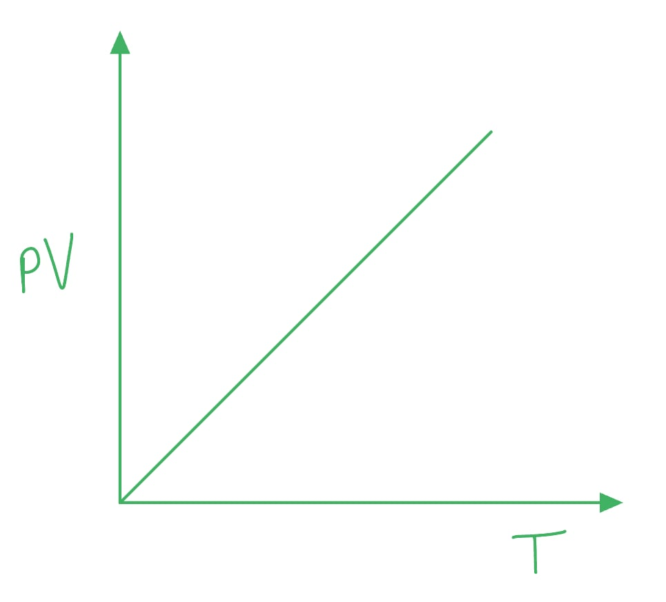
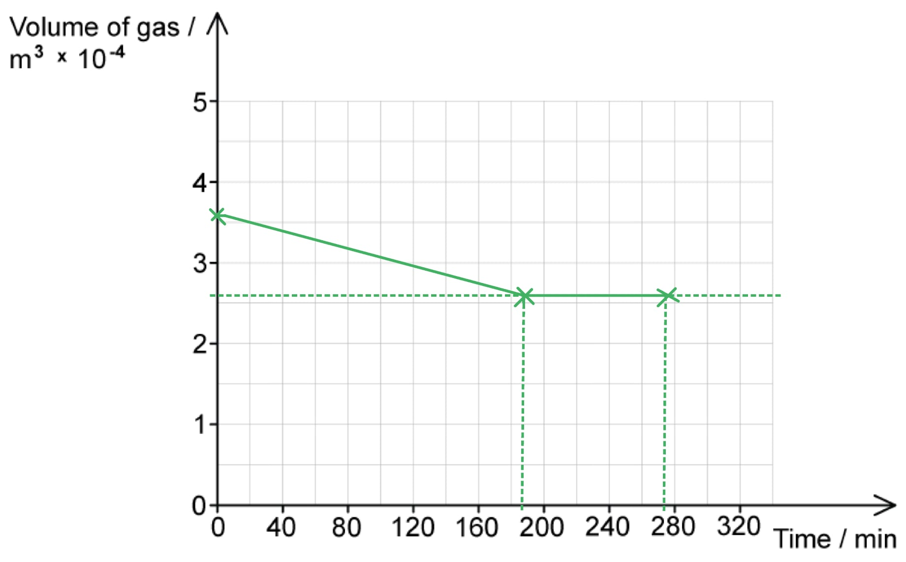
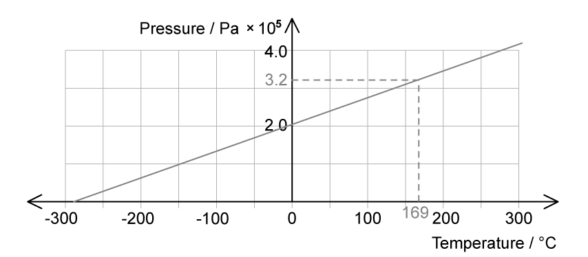

# Mark Schemes — Equation of State
**15. Ideal Gases** · Cambridge (CIE) A-LEVEL physics (9702)

## Structured Questions (10 questions)

### Q1
(i) An ideal gas:

- Obeys the law *pV* = constant × *T*; **[1 mark]**
- At all values of *p, V* and *T*; **[1 mark]**

(ii) Sketch a graph that represents the definition from part **(i)**

A graph that would score 2 marks should look like:

- Axes labelled *pV* and *T*; **[1 mark]**
- Straight diagonal line through the origin; **[1 mark]**

**[Total: 4 marks]**
The temperature of the air in the tyre is:

List the known quantities:

- Volume, *V* = 3.5 × 106 mm3
- Pressure, *p* = 2.0 × 105 Pa
- Number of moles, *n* = 0.29 mol

Convert the volume from mm3 to m3:

- 1 mm3 = 1 × 10–9 m3
- 3.5 × 106 mm3 = (3.5 × 106) × 10–9 = 0.0035 m3 **[1 mark]**

Determine the equation for the temperature, *T *and substitute in the values:

- $pV=nRT\RightarrowT=\frac{pV}{nR}$
- $T = \frac{( 2.0 \times 10^{5} ) \times 0.0035 }{0.29 \times 8.31} = 290.46 \mathrm{K}$ **[1 mark]**

Convert the temperature into °C:

- $T=290.46--273.15=17^{\circ}C$ **[1 mark]**

**[Total: 3 marks]**
The number of strokes of the pump to increase the pressure to 3.9 × 105 Pa at a temperature increase of 12 °C is:

- Initial number moles, *n*1 = 0.29 mol
- Initial pressure, *p*1 = 2.0 × 105 Pa
- Initial temperature, *T*1 = 17 °C = 17 + 273 = 290 K
- Final pressure, *p*2 = 2.7 × 105 Pa
- Final temperature, *T*2 = 290 + 10 = 300 K

Determine an equation for the new number of moles, *n*2:

- $pV=nRT\Rightarrown=\frac{pV}{RT}$ where $\frac{V}{R}$is a constant
- $n=constant\times\frac{p}{T}$
- $\frac{n_{1}T_{1}}{p_{1}}=\frac{n_{2}T_{2}}{p_{2}}$
- $n_{2}=\frac{n_{1}p_{2}T_{1}}{p_{1}T_{2}}=n_{1}\times\frac{p_{2}}{p_{1}}\times\frac{T_{1}}{T_{2}}$

Substitute in the values:

- $n_{2} = 0.29 \times ( \frac{2.7 \times 10^{5} }{2.0 \times 10^{5} } ) \times ( \frac{290}{300} )$ **[1 mark]**
- $n_{2}=0.378=0.38\mathrm{mol}$ **[1 mark]**

**[Total: 2 marks]**

> *Determining the equation for the final number of moles is quite tricky here. The trick is it to see which variables in the equation are **constant**, and then you can convert this into an equation for the variables **before** (with a subscript '1') and the variables **after** (with a subscript '2'). This comes up many times in A-level physics, especially in the ideal gases topic.*
The number of strokes of the pump to increase the pressure to 2.7 × 105 Pa at a temperature increase of 10 °C is:

- Initial number moles, *n*1 = 0.29 mol
- Final number of moles, *n*2 = 0.38 mol (from part c)
- Number of moles of air into tyre on each stroke = 0.0045 mol

Calculate the number of strokes:

- $changeinthenumberofmoles=n_{2}-n_{1}=0.38-0.29=0.09$ **[1 mark]**
- $numberofstrokes=\frac{0.09}{0.0045}=20$**[1 mark]**

**[Total: 2 marks]**

> *The number of strokes has to be an **integer** so you must round up or down when you calculate a value like this.*

### Q2
Calculate the total number of moles contained within the system:

List the known quantities:

- Pressure of gas, *p *= 1.02 × 105 Pa
- Volume of conical flask and tube, *V**T** = 325 cm**3*
- Volume of syringe, *V**S* = 30 cm3
- Molar gas constant, *R *= 8.31 J K−1 mol−1

Determine the temperature of the gas in Kelvin:

- The water is boiling, so the temperature must be 100 °C
- 100 °C = 100 + 273.15 K = 373.15 K

Calculate the total volume of the system, *V* in m3:

- $V=V_{T}+V_{S}=325+30=355\mathrm{cm}^{3}$
- Convert into m3:

  - 355 ÷ 1003 = 3.55 × 10−4 m3 **[1 mark]**

Use the ideal gas equation to calculate the number of moles, *n*:

- $pV=nRT$ so $n=\frac{pV}{RT}$
- $n = \frac{( 1.02 \times 10^{5 ) \times ( 3.55 \times 10^{-4} } )}{8.31 \times 373.15} = 1.17 \times 10^{- 2} \text{moles}$ **[1 mark]**

**[Total: 2 marks]**

> *Converting between units of area / volume can be **confusing**. Just go back to a **1 m**3** box** and consider the number of cm there:*

> *1 m = 100 cm*

> *1 m**3** = 100**3** cm**3** = 1 000 000 cm**3*
Sketch, on Fig. 1.2 a graph to show this process:

List the known quantities:

- Pressure of gas, *p *= 1.02 × 105 Pa (From part (a))
- Total initial volume of system, *V**1** = *3.55 × 10−4 m3 (From part (a))
- Number of moles, *n *= 1.17 × 10−2 (From part (a))
- Molar gas constant, *R *= 8.31 J K−1 mol−1
- Temperature at freezing point, *T**2* = 0 °C = 273.15 K

Use the ideal gas equation to calculate the volume of the gas in the conical flask at melting point, *V**2*:

- $pV=nRT$ so $V_{2}=\frac{nRT_{2}}{p}$
- $V_{2} = \frac{( 1.17 \times 10^{- 2} ) \times 8.31 \times 273.15}{( 1.02 \times 10^{5 )} = 2.60 \times 10^{-4} } \mathrm{m}^{3}$ **[1 mark]**

Convert the times into minutes:

- Time to cool = 3 hours = 180 minutes
- Time to freeze = 1.5 hours = 90 minutes

A graph that would score 2 marks should look like this:

- The volume is constant between 0 and 5 minutes **AND **185 to 275 minutes; **[1 mark]**
- The gradient of the graph is negative and constant between *V *= 3.55 × 10−4 m3  at 5 minutes **AND** *V *= 2.60 × 10−4 m3 at 185 minutes;** [1 mark]**

**[Total: 3 marks]**
Calculate the root mean square speed r.m.s. of the particles in the system when the conical flask is surrounded by ice in the beaker in the freezer:

List the known quantities:

- Specific latent heat of vapourisation, *L**v* = 2160 kJ kg−1 = 2160 × 103 J kg−1
- Specific latent heat of fusion, *L**f* = 324 kJ kg−1 = 324 × 103J kg−1
- Specific heat capacity of water, *C* = 4084 J kg−1 °C−1
- Change in temperature of the water, Δ*θ* = 100 °C
- Mass of gas, *m *= *m*
- Mass of ice / water, *M* = 240*m*

Obtain an expression for the energy of the system:

- Kinetic energy of molecules in conical flask = Energy lost from the system
- KE = Energy lost when water is still boiling + energy lost when water is cooling + energy lost when water is freezing
- $1 \frac{1}{2} m ( \text{angle} \text{brackets} c^{2} ) \text{angle} \text{brackets} = M L_{v} + M C \Delta \\theta + M L_{f}$ **[1 mark]**

Calculate the r.m.s:

- $1 \frac{1}{2} m ( \text{angle} \text{brackets} c^{2} ) \text{angle} \text{brackets} = 240 m L_{v} + 240 m C \Delta \\theta + 240 m L_{f}$
- $c = \sqrt{2 \times 240 ( L_{v} + c \Delta \\theta + L_{f} )}$
- $c = \sqrt{2 \times 240 ( ( 2160 \times 10^{3} ) + ( 4084 \times 100 ) + ( 324 \times 10^{3} ) )}$
- $c = \sqrt{2 \times 240 ( 2.8924 \times 10^{6} )}$
- $c=3.73\times10^{4}ms^{-1}$ **[1 mark]**

**[Total: 2 marks]**

### Q3
A table that would score 2 marks should look like this:

| **Possible Ideal Gas Equations** | **Place a tick (✓) here to indicate the ideal gas equations** |
|---|---|
| $pV=nRT$ | **✓ ****[1 mark]** |
| $p\propto\frac{1}{V}$ |   |
| $pV=NkT$ | **✓ ****[1 mark]** |
| $n=\frac{N}{N_{A}}$ |   |

- One mark for each correct tick

**[Total: 2 marks]**

> *There are only **two equations **used for ideal gases. The other equations are given by the following: *

- $p\propto\frac{1}{V}$* is Boyles Law*
- $n=\frac{N}{N_{A}}$* enables us to calculate the number of moles*
The definition of an ideal gas is:

- A gas which obeys the ideal gas equation; **[1 mark]**
- At all pressures, temperatures and volumes; **[1 mark]**

**[Total: 2 marks]**
(i)  The equation that defines the Boltzmann constant in terms of the molar gas constant and Avogadro's constant is:

- $k=\frac{R}{N_{A}}$ **[1 mark]**

(ii) A value for the Boltzmann constant is:

- *k *= 1.38 × 10−23 J K−1** [1 mark]**

**[Total: 2 marks]**
Calculate the amount of gas in the cylinder, in moles:

List the known quantities:

- Volume, *V* = 2.0 × 103 m3
- Temperature, *T *= 10°C + 273 = 283 K
- Pressure, *p* = 4.0 × 102 Pa
- Molar gas constant, *R* = 8.31 J K-1 mol-1

Use the ideal gas equation in terms of number of moles *n*:

- $pV=nRT$
- $n=\frac{pV}{RT}$ **[1 mark]**
- $n = \frac{( 4.0 \times 10^{2} ) \times ( 2.0 \times 10^{3} )}{8.31 \times 283}$ **[1 mark]**
- $n=340.18=340\mathrm{mol}$ (2 s.f.) **[1 mark]**

**[Total: 3 marks]**

> *All of the quantities in the question are written to **2 s.f.,** and your final answer should be too. *

### Q4
A table that should score 1 mark would look like this:

| **Possible Ideal Gasses Relations** | **Place a tick (✓) here to identify the correct relation** |
|---|---|
| $V\proptoT$ |   |
| $P\proptoT$ |   |
| $P\propto\frac{1}{V}$ |   |
| $pV\proptoT$ | **✓ ****[1 mark]** |

- One mark for the correct relation ticked

**[Total: 1 mark]**

> *There is only **one relation** that identifies an **ideal gas**. The other relations are all gas laws:*

- *Boyles Law*
- *Charles's Law*
- *Pressure Law*
The correct sentences are as follows:

(i)

- The molecules in a gas move around **randomly**** **at high speeds; **[1 mark]**

(ii)

- The temperature of the gas is related to the** ****average speed** of the particles; **[1 mark]**

(iii)

- Force is the rate of change of **momentum****; ****[1 mark]**

(iv)

- Pressure is **increased** if the volume of the container is reduced when the temperature remains constant; **[1 mark]**

**[Total: 4 marks]**
Calculate the pressure of the ideal gas in the same container when it is heated to 30 °C:

List the known quantities:

- Initial temperature, *T**1* = 10 °C
- Initial pressure, *P**1** = *4 × 105 Pa
- Final temperature, *T**2* = 30 °C

Convert the temperatures into Kelvin:

- *T**1* = 10 + 273 = 283 K
**AND**
- *T**2* = 30 + 273 = 303 K **[1 mark]**

Determine the correct gas law required to calculate the final pressure, *P**2*:

- Use the pressure law

  - $\frac{P_{1}}{P_{2}}=\frac{T_{1}}{T_{2}}$ **[1 mark]**
- Rearrange the equation to make *P**2* the subject:

  - $P_{2}=\frac{P_{1}T_{2}}{T_{1}}$

Substitute the known quantities and calculate *P**2*:

- $P_{2} = \frac{( 4 \times 10^{5} ) \times 303}{283}$ **[1 mark]**
- $P_{2}=4.3\times10^{5}\mathrm{Pa}$** [1 mark]**

**[Total: 4 marks]**

### Q5
Two equations that ideal gases obey are:

**Final answer:** **Any ****two**** from:**

- *PV* = *nRT*; **[1 mark]**
- *PV* = *NkT*; **[1 mark]**
- $PV\proptoT$; **[1 mark] ** 

**[Total: 2 marks]**
List the known quantities:

- Molar mass of air = 3.1 × 10–2 kg
- Volume, *V* = 4.2 × 10–2m3
- Pressure, *p* = 300 kPa = 300 × 103 Pa
- Temperature, *T* = 290 K

From data booklet:

- Molar gas constant, *R *= 8.31 J mol–1 K–1

(i)* *The amount of moles of air:

- *pV = nRT ***[1 mark]**
- *n* = $\frac{pV}{RT}$ =$\frac{( 300 \times 10^{3} ) \times ( 4.2 \times 10^{- 2} )}{8.31 \times 290}$  **[1 mark]**
- *n* = 5.23 = 5.2 mol **[1 mark]**

(ii) The mass of the air:

- Mass of the air = molar mass of air × number of moles of air
- Mass of the air = (3.1 × 10–2) × 5.23 = 0.162 = 0.162 kg **[1 mark]**

(iii) The density of the air:

- Density of the air $ρ$ = $\frac{m}{V}$  = $\frac{0.16}{4.2\times10^{-2}}$ = 3.9 kg m–3 **[1 mark]**

**[Total: 5 marks]**
List the known quantities:

- Number of moles of air*, n* = 0.47 mol
- Volume, *V* = 1.90 × 10–3m3
- Temperature, *T* = 252 K

From data booklet:

- Molar gas constant, *R *= 8.31 J mol–1 K–1** **

Pressure calculation:

- *pV = nRT*
- *p* =$\frac{nRT}{V}$ =$\frac{0.47\times8.31\times252}{1.90\times10^{-3}}$  **[1 mark]**
- *p* = 5.18 × 105 Pa **[1 mark]**

**[Total: 2 marks]**
List the known quantities:

- Number of moles of air*, n* = 0.47
- Volume, *V* = 1.90 × 10–3m3
- Initial temperature, $T_{i}$ = 252 K
- Final temperature, $T_{f}$ = 301 K
- Initial pressure $p_{i}$ = 5.18 × 105 Pa (from part c)

From data booklet:

- Molar gas constant, *R *= 8.31 J mol–1 K–1** **

Determine the correct equation:

- Since the volume is constant, use the Pressure law: $\frac{p}{T}$ = constant

Calculate final pressure, $p_{f}$ :

- $\frac{p_{i}}{T_{i}}=\frac{p_{f}}{T_{f}}$
- $p_{f}$= $\frac{p_{i}T_{f}}{T_{i}}$  =$\frac{( 5.18 \times 10^{5} ) \times 301}{252}$  **[1 mark]**
- $p_{f}$= 6.19 × 105 Pa **[1 mark] **3 s.f **[1 mark]**** **

**[Total: 3 marks]**

### Q6
Calculate the volume of hydrogen in the airship:

List the known quantities:

- Temperature = 8 °C = 8 + 273.15 = 281.15 K
- Pressure, *p* = 4.2 × 105 Pa
- Mass of the hydrogen in the ship, *m**g* = 1224 kg
- Atomic mass of hydrogen, *m**H* = 1.00794 g mol−1 = 1.00794 × 10−3 kg mol−1
- Molar gas constant, *R *= 8.31 m2 kg s-2 K-1 mol-1

Calculate the number of moles, *n* of hydrogen gas in the airship:

- $n=\frac{m_{g}}{m_{H}}$
- $n = \frac{1224}{( 1.00794 \times 10^{- 3} )} = 1.21 \times 10^{6}$  **[1 mark]**

Use the ideal gas equation to calculate the volume of the gas, *V*:

- $pV=nRT$
- $V=\frac{nRT}{p}$
- $V = \frac{( 1.21 \times 10^{6} ) \times 8.31 \times 281.15 }{( 4.2 \times 10^{5} )}$
- $V=6731m^{3}$ **[1 mark]**

Calculate the density, *ρ* of the hydrogen gas:

- $ρ=\frac{m}{V}$
- $ρ=\frac{1224}{6731}=0.18\mathrm{kg}m^{-3}$ **[1 mark]**

**[Total: 3 marks]**
Calculate the surface area of the inside surface of the airship at this same point in the flight:

List the known quantities:

- Mass of hydrogen inside airship, *m**g* = 1224 kg (from part (a))
- Pressure of hydrogen inside airship, *p* = 4.2 × 105 Pa (from part (a))
- Acceleration due to free fall, *g *= 9.81 m s−2

Calculate the weight of the airship:

- $W=mg$
- $W=1224\times9.81=1.2\times10^{4}N$ **[1 mark]**

Calculate the inside surface area of the airship:

- $P=\frac{F}{A}$ so $A=\frac{F}{P}$
- $A=\frac{1.2\times10^{4}}{4.2\times10^{5}}=0.029m^{2}$** [1 mark]**

**[Total: 2 marks]**

### Q7
List the known quantities:

- Pressure, *p* = 3.2 × 105 Pa
- Volume, *V* = 1.6 × 10–5 m3
- Number of molecules, *N* = 8.4 × 1020

From data booklet:

- The Boltzmann constant, *k *= 1.38 × 10–23 J K–1
- The Avogadro constant,  $N_{A}$ = 6.02 × 1023 mol–1
- Molar gas constant, *R *= 8.31 J mol–1 K–1

**Method 1: **Calculate temperature using the number of molecules, *N*:

- *pV = NkT*
- *T* = $\frac{pV}{Nk}$ = $\frac{( 3.2 \times 10^{5 ) \times ( 1.6 \times 10^{-5} } )}{( 8.4 \times 10^{20 ) \times ( 1.38 \times 10^{-23} } )}$  **[1 mark]**
- *T* = 441.68 K **[1 mark]**

Convert temperature into ºC:

- *T* = 441.68 – 273.15 = 168.53 = 169 ºC **[1 mark]**** **

**Final answer:** **OR**

**Method 2:** Calculate temperature using number of moles, *n*:

- *pV = nRT*
- *n* =$\frac{N}{N_{A}}$ = $\frac{8.4\times10^{20}}{6.02\times10^{23}}$ = 1.395 × 10–3 mol **[1 mark]**
- *T* = $\frac{pV}{nR}$ =$\frac{( 3.2 \times 10^{5 ) \times ( 1.6 \times 10^{-5} } )}{( 1.395 \times 10^{- 3} ) \times 8.31}$ = 441.67 K **[1 mark]**

Convert temperature into ºC:

- *T* = 441.67 – 273.15 = 168.54 = 169 ºC **[1 mark]**** **

**[Total: 3 marks]**
List the known quantities:

- Pressure at 169 ° C = 3.2 × 105 Pa
- Temperature at 3.2 × 105 Pa = 169 ° C (from part b)

A graph which would score 3 marks would look like:

- Straight line with positive gradient; **[1 mark]**

  - This is because the pressure is directly proportional to the temperature at constant volume of an ideal gas (pressure law from part a)
- Through (169, 3.2); **[1 mark]**

  - This is the temperature 169 ºC from part (b) and the pressure 3.2 × 105 Pa given in the equation
- Crosses the temperature axis between –250 ºC and –300 ºC; **[1 mark]**

  - The temperature scale is in ºC therefore absolute zero is at 0 K or –273.15 ºC

**[Total: 3 marks]**

> *Whenever you are asked to sketch or draw a graph, and there are values on the axes, check to see whether there are any specific values you have already calculated that could be relevant. *

> *In this case, we have already calculated a temperature for an equivalent pressure, so the line for your graph must go through this value.*
List the known quantities:

- Pressure, *p* = 4.0 × 105 Pa
- Volume, *V* = 1.6 × 10–5 m3
- Initial number of molecules, *N*0 = 8.4 × 1020
- Temperature, *T** *= 520 ºC = 520 + 273.15 = 793.15 K

From data booklet:

- The Boltzmann constant, *k *= 1.38 × 10–23 J K–1

Number of molecules left in container after valve opens, *N*:

- *pV = NkT*
- *N* = $\frac{pV}{kT}$ = $\frac{( 4.0 \times 10^{5 ) \times ( 1.6 \times 10^{-5} } )}{( 1.38 \times 10^{- 23} ) \times 793.15}$  **[1 mark]**
- *N =* 5.847 × 1020 **[1 mark]**

Number of molecules that will escape:

- Molecules that will escape = initial number of molecules ­– molecules that have left
- Molecules that will escape = (8.4 × 1020) – (5.847 × 1020) = 2.553 × 1020 **[1 mark]**** **

**[Total: 3 marks]**** **

> *This question can also be done using the number of moles, **n**, by rearranging **pV = nRT**. However, remember to find the number of molecules using N = **n**  after!*

### Q8
To determine the number of moles, *n*, of gas in the canister:

List the known quantities:

- Volume, $V=0.0349m^{3}$
- Pressure, $P=1.50\times10^{6}\mathrm{Pa}$
- Temperature, $T=20^{\circ}C$
- Molar gas constant, $R=8.31JK^{-1}\mathrm{mol}^{-1}$

Convert temperature into Kelvin:

- $T=20^{\circ}C+273=293K$ **[1 mark]**

Recall the ideal gas equation and rearrange to make *n* the subject:

- $PV=nRT\rightarrown=\frac{PV}{RT}$ **[1 mark]**

Substitute in the known values to calculate:

- $n = \frac{( 1.50 \times 10^{6} ) \times 0.0349}{ 8.31 \times 293}$** **
- $n=21.5\mathrm{mol}$** [1 mark]**

**[Total: 3 marks]**

> *Remember to convert any temperatures to Kelvin. You can do this within your calculation or when you list the known quantities if you prefer.*
To determine the pressure of the gas at 32°C:

List the known quantities:

- Volume, $V=0.0349m^{3}$
- Initial temperature, $T_{1}=20^{\circ}C+273=293K$
- Final temperature, $T_{2}=32^{\circ}C+273=305K$
- Initial pressure, $P_{1}=1.50\times10^{6}\mathrm{Pa}$
- Molar gas constant, $R=8.31JK^{-1}\mathrm{mol}^{-1}$

Recall the pressure law and rearrange to make *P*2 the subject:

- $\frac{p_{1}}{T_{1}}=\frac{p_{2}}{T_{2}}\rightarrowp_{2}=\frac{p_{1}T_{2}}{T_{1}}$ **[1 mark]**

Substitute in the known values to calculate:

- $p_{2} = \frac{( 1.50 \times 10^{6} ) \times 305}{293}$ **[1 mark]**
- $p_{2}=1.56\times10^{6}\mathrm{Pa}$ (3 s.f.)** [1 mark]**

**[Total: 3 marks]**
As the temperature of the gas increases...

- The average kinetic energy of the molecules increases; **[1 mark]**
- So the molecules collide with the surface of the container more frequently **AND** with a greater force; **[1 mark]**
- Since <u>pressure is force per unit area</u>, the pressure increases; **[1 mark]**

**[Total: 3 marks]**

### Q9
The ideal gas equation can also be written as $pV=NkT$ by:

State the definition of the Boltzmann constant, *k*:

- $k=\frac{R}{N_{A}}$

Determine the equation for the number of moles, *n*:

- $n=\frac{N}{N_{A}}$

Substitute this into the ideal gas equation:

- $p V = n R T = ( \frac{N}{N} _{A} ) R T$ **[1 mark]**

Substitute the Boltzmann constant:

- $k=\frac{R}{N_{A}}\RightarrowR=kN_{A}$
- $p V = ( \frac{N}{N} _{A} ) \times k N_{A} \times T = N k T$ **[1 mark]**

**[Total: 2 marks]**
Show that the amount of gas in the cylinder is 430 mol

List the known quantities:

- Radius of the cylinder, *r* = 120 mm = 120 × 10−3 m
- Height of the cylinder, *h* = 1350 mm 1350 × 10−3 m
- Temperature of the gas, *T* = 14 °C = 14 + 273 = 287 K
- Pressure, *p* = 1.7 × 107 Pa

Calculate the volume of the gas, *V*:

- $V=A\timesh=πr^{2}\timesh$
- $V = \mathrm{\pi } ( 120 \times 10^{- 3} )^{2} \times ( 1350 \times 10^{- 3} ) = 0.061 \mathrm{m}^{3}$ **[1 mark]**

Rearrange the ideal gas equation for the number of moles, *n*:

- $p V = n R T \Rightarrow n = \frac{pV}{RT}$ **[1 mark]**

Substitute in the values:

- $n = \frac{( 1.7 \times 10^{7} ) \times 0.061}{8.31 \times ( 287 )} = 434.8 = 430 \text{mol}$ **[1 mark]**

**[Total: 3 marks]**

> *You will be expected to remember the volume of common 3D shapes such as cubes, cylinders and spheres.*

> *T** in the ideal gas equation is always in Kelvin, do not miss out this conversion if you are given a temperature in °C.*
The percentage of the number of moles lost from the cylinder is:

- Rate of loss of atoms = 8.3 × 1015 atoms s–1
- Time, *t* = 51 days
- Initial number of moles, *n * = 434.8 mol (from part b)

Calculate the number of lost atoms:

- $a t o m s l o s t = ( 8.3 \times 10^{15} ) \times ( 51 \times 24 \times 60 \times 60 )$
- $atomslost=3.657\times10^{22}\mathrm{atoms}$ **[1 mark]**

Calculate the number of lost moles, *n*:

- $n=\frac{3.657\times10^{22}}{6.02\times10^{23}}=0.059\mathrm{mol}$ **[1 mark]**

Calculate the percentage of the number of moles lost:

- $\% m o l e s l o s t = \frac{0.059 }{434.8} \times 100 \%$
- $\% m o l e s l o s t = 0.01356 \% = 0.014 \%$ **[1 mark]**

**[Total: 3 marks]**

> *If the rate is in **s**–1** then the time you must multiply this by must be in **s **so the final units are **atoms**. Take care for small unit conversions like this, which are very easy to lose marks from.*

### Q10
The number of molecules in a gas containing 120 g of `O _ 8 ^ 16` is:

List the known quantities:

- Mass of sample, *m* = 120 g
- Molar mass of oxygen-16, *M*r = 16 g mol–1

Calculate the number of moles, *n*:

- $n=\frac{m}{M_{r}}=\frac{120}{16}$
- $n=7.5\mathrm{mol}$ **[1 mark]**

Calculate the number of molecules, *N*:

- $n=\frac{N}{N_{A}}\RightarrowN=nN_{A}$
- $N = 7.5 \times ( 6.02 \times 10^{23} ) = 4.5 \times 10^{24}$ **[1 mark]**

**[Total: 2 marks]**

> *The molar mass is **always** the **mass number** of the element, in g mol**–1**. You must be able to read the *$X pre_{Z} pre^{A}$* notation to correctly read the mass number for any element.*
The two states prove it behaves as an ideal gas because:

List the known quantities:

- Initial (and final) volume, *V*1 = 6.00 × 104 m3
- Initial pressure, *p*1 = 1.42 × 105 Pa
- Initial temperature, *T*1 = 8 °C = 8 + 273 = 281 K
- Final pressure, *p*2 = 1.70 × 105 Pa
- Final temperature, *T*2 = 63 °C = 63 + 273 = 336 K

Determine an equation linking *p*, *V* and *T*:

- $pV\proptoT\Rightarrow\frac{pV}{T}=constant$

Substitute in the initial values:

- $\frac{p_{1} V_{1} }{T_{1} } = \frac{( 1.42 \times 10^{5 ) \times ( 6.00 \times 10^{4} )}{281} = 3.03 \times 10^{7} }$** [1 mark]**

Substitute in the final values:

- $\frac{p_{2} V_{2} }{T_{2} } = \frac{( 1.70 \times 10^{5 ) \times ( 6.00 \times 10^{4} )}{336} = 3.03 \times 10^{7} }$** [1 mark]**

Conclusion:

- This is an ideal gas because $\frac{pV}{T}=constant$;** [1 mark]**

**[Total: 3 marks]**

> *The temperature must be in **Kelvin **when using the ideal gas equation.*

> *Anytime you want to change a proportionality into an equation:*

- *Turn the proportionality sign into an = sign and add a **constant** (e.g. k) *$pV=kT$
An estimate for the volume occupied by 0.54 moles of the gas is:

List the known quantities:

- Diameter of each atom, *d* = 0.12 nm = 0.12 × 10–9 m
- Number of moles of the gas, *n* = 0.54 mol

Calculate the volume of 1 atom:

- $volumeofasphere=\frac{4}{3}\mathrm{πr}^{3}$
- $v o l u m e o f 1 a t o m = \frac{4}{3} \mathrm{\pi } ( \frac{0.12 \times 10^{- 9} }{2} )^{3} = 9.05 \times 10^{- 31 } \mathrm{m}^{3}$* ***[1 mark]**

Calculate the number of atoms:

- $n=\frac{N}{N_{A}}\RightarrowN=nN_{A}$
- $N = 0.54 \times ( 6.02 \times 10^{23} ) = 3.25 \times 10^{23} \text{atoms}$ **[1 mark]**

Estimate the volume occupied by 0.54 moles of this gas, *V*:

- $V=volumeof1atom\timesnumberofatoms$
- $V = ( 9.05 \times 10^{- 31} ) \times ( 3.25 \times 10^{23} )$
- $V=2.941\times10^{-7}=3.0\times10^{-7}m^{3}$ **[1 mark]**

**[Total: 3 marks]**

> *An atom can be estimated to be a sphere (even if it is not really this shape). In a similar way, it is assumed a wire has a circular cross-sectional area, which will be useful in the topic of resistivity and Hooke's law.*
The differences in the volumes in part **(b) **and part **(c) **are:

- The volume in part (b) is for an ideal gas whilst the volume in (c) in as a real / non-ideal gas; **[1 mark]**
- The volume in part (b) / ideal gas is <u>much</u> larger than the volume of the real gas; **[1 mark]**
- This is justified because the volume of molecules / atoms is <u>negligible</u> **OR **the volume of the ideal gas is the volume of the container and not the atoms; **[1 mark]**

**[Total: 3 marks]**
