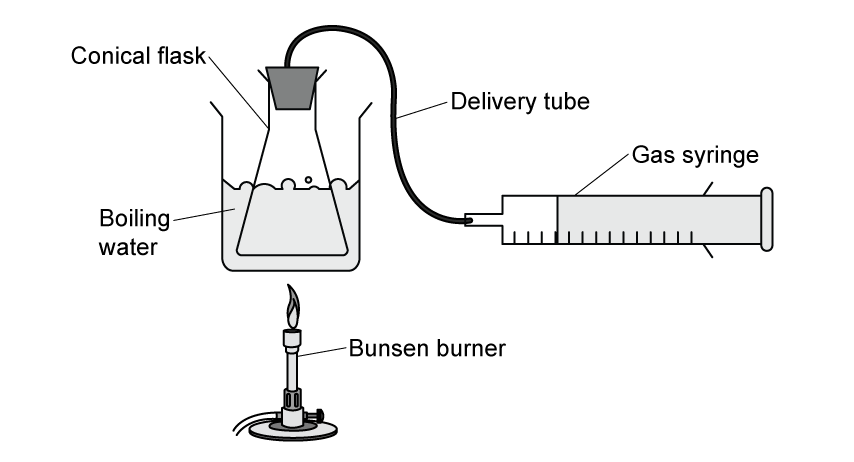
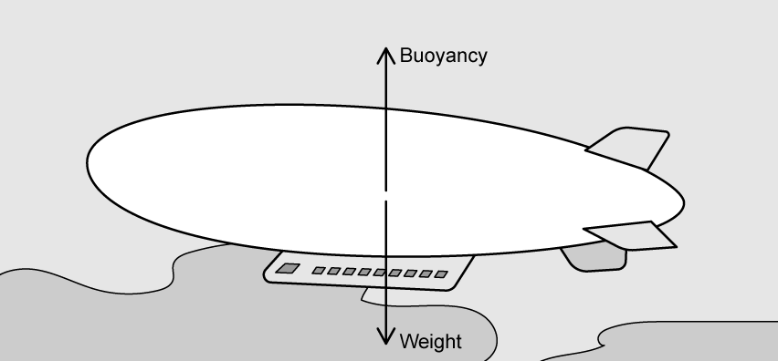

# Exam Questions — Equation of State
**15. Ideal Gases** · Cambridge (CIE) A-LEVEL physics (9702)
> Source: [https://www.savemyexams.com/a-level/physics/cie/25/topic-questions/](https://www.savemyexams.com/a-level/physics/cie/25/topic-questions/) · 10 questions across 1 sets

## Structured Questions (10 questions)

### Q1 — medium — 11 marks

**Q1** [4 marks]

(i) State what is meant by an *ideal* gas.

[2]

(ii) Sketch a graph that represents the definition from part **(i)**.

[2]

**Q1** [3 marks]

The air in a bicycle tire has a constant volume of 3.5 × 106 mm3. The pressure of 0.29 mol of the air is 2.0 × 105 Pa. The air may be considered to be an ideal gas.

Calculate the temperature of the air in the tire.

temperature = .......................... °C

**Q1** [2 marks]

**Extract:**

The air in a bicycle tire has a constant volume of 3.5 × 10^6 mm^3. The pressure of 0.29 mol of the air is 2.0 × 10^5 Pa. The air may be considered to be an ideal gas. Calculate the temperature of the air in the tire. [Answer: temperature = 17 °C = 290 K]

The pressure of the tire is increased using a pump. On each stroke of the pump, 0.0045 mol of air is forced into the tire.

Calculate the number of moles of air in the tire when the pressure increases to 2.7 × 105 Pa and the temperature increases by 10 °C.

**Q1** [2 marks]

**Extract:**

The air in a bicycle tire has a constant volume of 3.5 × 10^6 mm^3. The pressure of 0.29 mol of the air is 2.0 × 10^5 Pa. The air may be considered to be an ideal gas.
The pressure of the tire is increased using a pump. On each stroke of the pump, 0.0045 mol of air is forced into the tire. Calculate the number of moles of air in the tire when the pressure increases to 2.7 × 10^5 Pa and the temperature increases by 10 °C. (Final number of moles n_2 = 0.38 mol)

Calculate the number of strokes of the pump required to increase the pressure to 2.7 × 105 Pa and the temperature by 10 °C.

### Q2 — hard — 7 marks

**Q2** [2 marks]

A gas syringe is connected through a delivery tube to a conical flask which is immersed in a beaker of boiling water. The water is being heated by a constant bunsen burner flame as shown in Fig. 1.1. The syringe is frictionless so the gas pressure within the system remains equal to the atmospheric pressure 1.02 × 105 Pa.

**Fig 1.1**

The total volume of the conical flask and delivery tube is 325 cm3, and after settling in the boiling water the gas syringe has a volume of 30 cm3.

Calculate the total number of moles contained within the system.

**Q2** [3 marks]

**Extract:**

A gas syringe is connected through a delivery tube to a conical flask which is immersed in a beaker of boiling water. The water is being heated by a constant bunsen burner flame. The syringe is frictionless so the gas pressure within the system remains equal to the atmospheric pressure 1.02 × 10^5 Pa. The total volume of the conical flask and delivery tube is 325 cm^3, and after settling in the boiling water the gas syringe has a volume of 30 cm^3.

From part (a): Total initial volume of system, V1 = 3.55 × 10^−4 m^3; Number of moles, n = 1.17 × 10^−2; Pressure of gas, p = 1.02 × 10^5 Pa.

The bunsen burner is turned off and the whole system is placed in a freezer. The conical flask is left to cool in the beaker of water which turns into ice.

It takes 5 minutes for all the water to stop boiling and then 3 hours to cool until the point before the water turns to ice. It then takes a further 1.5 hours for all the water to turn into ice around the conical flask.

Sketch, on Fig. 1.2, a graph to show this process.

**Fig 1.2**

**Q2** [2 marks]

**Extract:**

A gas syringe is connected through a delivery tube to a conical flask which is immersed in a beaker of boiling water. The water is being heated by a constant bunsen burner flame as shown in Fig. 1.1.

The bunsen burner is turned off and the whole system is placed in a freezer. The conical flask is left to cool in the beaker of water which turns into ice. It takes 5 minutes for all the water to stop boiling and then 3 hours to cool until the point before the water turns to ice. It then takes a further 1.5 hours for all the water to turn into ice around the conical flask.

The mass of the ice and the water in the beaker is 240 times the mass of the gas in the system.

Calculate the root mean square speed (r.m.s.) of the particles in the system when the conical flask is surrounded by ice in the beaker in the freezer.

- Specific latent heat of vapourisation = 2160 kJ kg−1
- Specific latent heat of fusion = 324 kJ kg−1
- Specific heat capacity of water = 4084 J kg−1 °C−1

### Q3 — easy — 9 marks

**Q3** [2 marks]

There are two ideal gas equations.

Identify by placing a tick (✓) next to the two correct equations.

| **Possible Ideal Gas Equations** | **Place a tick (✓) here to indicate the ideal gas equations** |
|---|---|
| $pV=nRT$ |   |
| $p\propto\frac{1}{V}$ |   |
| $pV=NkT$ |   |
| $n=\frac{N}{N_{A}}$ |   |

**Q3** [2 marks]

Define an ideal gas.

**Q3** [2 marks]

This question is about the Boltzmann constant.

(i) State the equation that defines the Boltzmann constant in terms of the molar gas constant and Avogadro's constant

[1]

(ii) Use the data booklet to obtain a value for the Boltzmann constant.

[1]

**Q3** [3 marks]

A cylinder used for scuba diving contains an ideal gas with a volume of 2.0 × 103 m3. The gas is at a temperature of 10°C and a pressure of 4.0 × 102 Pa.

Calculate the amount of gas in the cylinder, in moles.

### Q4 — easy — 9 marks

**Q4** [1 mark]

All ideal gases obey a relation.

Identify by placing a tick (✓) next to the correct relation.

| **Possible Ideal Gas Relations** | **Place a tick (✓) here to identify the correct relation** |
|---|---|
| $V\proptoT$ |   |
| $P\proptoT$ |   |
| $P\propto\frac{1}{V}$ |   |
| $pV\proptoT$ |   |

**Q4** [4 marks]

The following sentences describe the behaviour of an ideal gas.

Identify, by drawing a circle around, the correct word from each pair.

(i) The molecules in a gas move around **randomly / in sequence** at high speeds

[1]

(ii) The temperature of the gas is related to the **space between / average speed** of the particles

[1]

(iii) Force is the rate of change of **momentum / pressure**

[1]

(iv) Pressure is **increased / decreased** if the volume of the container is reduced when the temperature remains constant.

[1]

**Q4** [4 marks]

An ideal gas is in a container of volume 0.005 m3. The gas is at a temperature of 10°C and a pressure of 4 × 105 Pa.

Calculate the pressure of the ideal gas in the same container when it is heated to 30 °C.

### Q5 — medium — 12 marks

**Q5** [2 marks]

State two equations or laws which ideal gases obey.

**Q5** [5 marks]

A car tyre of volume 4.2 × 10–2 m3 contains air at a pressure of 300 kPa and a temperature of 290 K. The mass of one mole of air is 3.1 × 10–2 kg.

Assuming that the air behaves as an ideal gas, calculate:

(i) The amount of moles of air.

[3]

(ii) The mass of the air.

[1]

(iii) The density of the air.

[1]

**Q5** [2 marks]

A bicycle tyre with 0.47 moles of air has a volume of 1.90 × 10–3 m3 when the temperature is 252 K.

Calculate the pressure inside the bicycle tyre.

**Q5** [3 marks]

**Extract:**

A bicycle tyre with 0.47 moles of air has a volume of 1.90 × 10^–3^ m^3^ when the temperature is 252 K. Calculate the pressure inside the bicycle tyre. p = 5.18 × 10^5^ Pa

After the bicycle has been ridden, the temperature of the air in the tyre is 301 K.

Calculate the new pressure in the tyre assuming the volume is unchanged.

Give your answer to an appropriate number of significant figures.

### Q6 — hard — 5 marks

**Q6** [3 marks]

An airship floating high up in the Earth's atmosphere is kept in position due to the balance of weight and buoyancy forces.

At one point in the flight, the hydrogen gas has a temperature of 8 °C at a pressure of 4.2 × 105 Pa.

The mass of the hydrogen in the ship is 1224 kg.

The atomic mass of hydrogen is 1.00794 g mol−1.

Calculate the density of the hydrogen gas in the airship.

**Q6** [2 marks]

**Extract:**

An airship floating high up in the Earth's atmosphere is kept in position due to the balance of weight and buoyancy forces. At one point in the flight, the hydrogen gas has a temperature of 8 °C at a pressure of 4.2 × 10^5 Pa. The mass of the hydrogen in the ship is 1224 kg.

Calculate the surface area of the inside surface of the airship at this same point in the flight.

### Q7 — medium — 9 marks

**Q7** [3 marks]

The pressure exerted by an ideal gas of 8.4 × 1020 molecules in a container of volume 1.6 × 10–5 m3 is 3.2 × 105 Pa.

Calculate the temperature of the gas in the container in ºC.

**Q7** [3 marks]

**Extract:**

The pressure exerted by an ideal gas of 8.4 × 10^20 molecules in a container of volume 1.6 × 10^–5 m^3 is 3.2 × 10^5 Pa. Calculate the temperature of the gas in the container in ºC. [Answer: T = 169 ºC at pressure 3.2 × 10^5 Pa]

The pressure of the gas is measured at different temperatures whilst the volume of the container and the mass of the gas remain constant.

**Fig 1.1**

Draw a graph on the grid in **Fig 1.1** to show how the pressure varies with the temperature.

**Q7** [3 marks]

**Extract:**

The pressure exerted by an ideal gas of 8.4 × 10^20 molecules in a container of volume 1.6 × 10^–5 m^3 is 3.2 × 10^5 Pa.

The container described in part (b) has a release valve that allows gas to escape when the pressure exceeds 4.0 × 105 Pa.

Calculate the number of gas molecules that escape when the temperature of the gas is raised to 520 °C.

### Q8 — easy — 9 marks

**Q8** [3 marks]

A canister of oxygen mixed with air has a volume of 0.0349 m3 and a pressure of 1.50 × 106 Pa. The canister is stored in a hospital basement at a temperature of 20°C.

Determine the number of moles of gas in the canister.

**Q8** [3 marks]

**Extract:**

A canister of oxygen mixed with air has a volume of 0.0349 m^3 and a pressure of 1.50 × 10^6 Pa. The canister is stored in a hospital basement at a temperature of 20°C.

The canister is brought up to a ward for use. Once the gas has reached equilibrium with the temperature of the hospital ward, the temperature of the canister is 32°C.

Determine the pressure of the gas at this temperature.

**Q8** [3 marks]

Explain the effect on the pressure of the gas when the temperature was increased.

### Q9 — medium — 8 marks

**Q9** [2 marks]

The ideal gas equation in terms of the number of moles, *n*, is written as

$pV=nRT$

where *R* is the molar gas constant.

Show that the ideal gas equation can also be written as

$pV=NkT$

where *N* is the number of molecules and *k* is the Boltzmann constant.

**Q9** [3 marks]

A cylinder for an ideal gas has a radius of 120 mm and a height of 1350 mm. The gas is at a temperature of 14 °C and a pressure of 1.7 × 107 Pa.

Show that the amount of gas in the cylinder is 430 mol.

**Q9** [3 marks]

**Extract:**

A cylinder for an ideal gas has a radius of 120 mm and a height of 1350 mm. The gas is at a temperature of 14 °C and a pressure of 1.7 × 10^7^ Pa. Show that the amount of gas in the cylinder is 430 mol. [Mark scheme: n = 434.8 = 430 mol]

The gas leaks slowly from the cylinder at an average rate of 8.3 × 1015 atoms s–1 so that, after a time of 51 days, the pressure reduces. The temperature remains constant.

Calculate the percentage of the number of moles lost from the cylinder.

### Q10 — medium — 11 marks

**Q10** [2 marks]

Calculate the number of molecules in a gas containing 120 g of `straight O presubscript 8 presuperscript 16`.

**Q10** [3 marks]

A different ideal gas has an initial volume of 6.00 × 104 m3 at a pressure of 1.42 × 105 Pa and a temperature of 8 °C

It is heated at a constant volume so that, in its final state, the pressure is 1.70 × 105 Pa at a temperature of 63 °C.

Show that these two states prove it behaves as an ideal gas.

**Q10** [3 marks]

Atoms of a real gas each have a diameter of 0.12 nm.

Estimate an accurate value for the volume occupied by 0.54 moles of this gas.

volume = ........................... m3

**Q10** [3 marks]

**Extract:**

Part (b): A different ideal gas has an initial volume of 6.00 × 10^4 m^3 at a pressure of 1.42 × 10^5 Pa and a temperature of 8 °C. This is proven to behave as an ideal gas.

Part (c): Atoms of a real gas each have a diameter of 0.12 nm. The estimated volume occupied by 0.54 moles of this gas is V = 2.941 × 10^-7 = 3.0 × 10^-7 m^3 (calculated as the volume of the atoms themselves).

Explain the differences in the volumes of the atoms in part **(b) **and part **(c)**.
