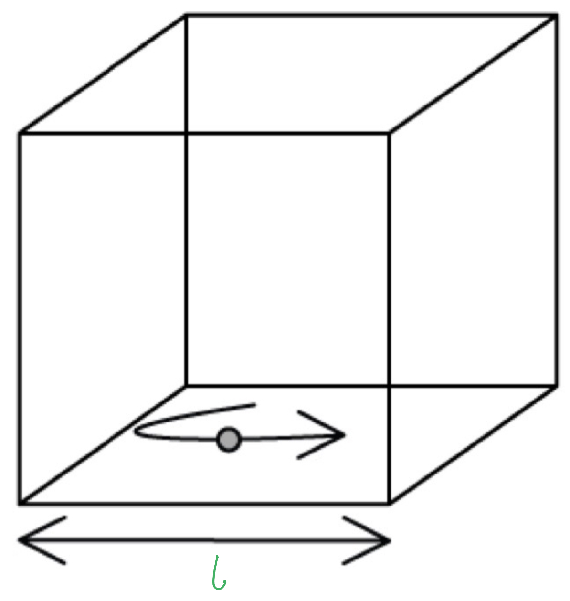
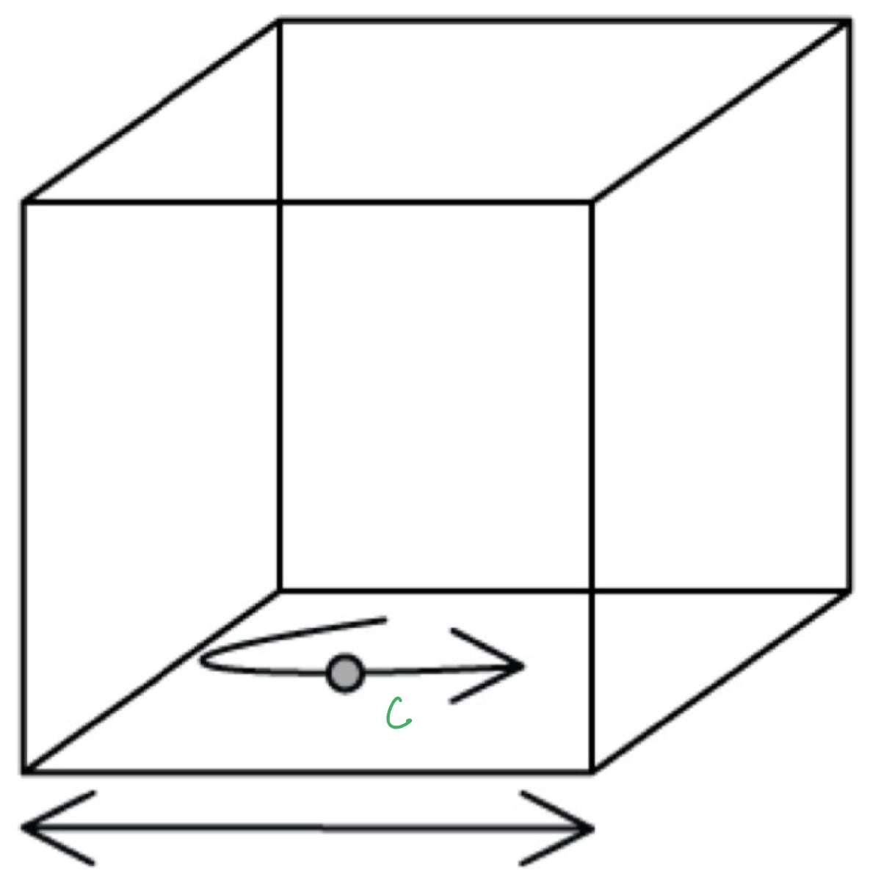
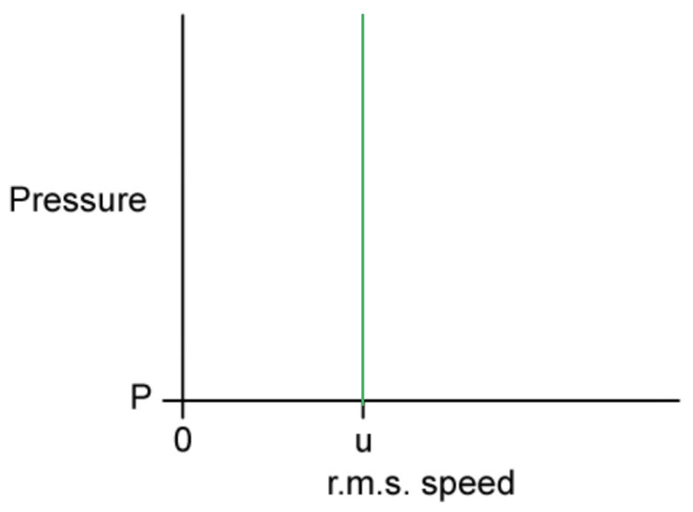
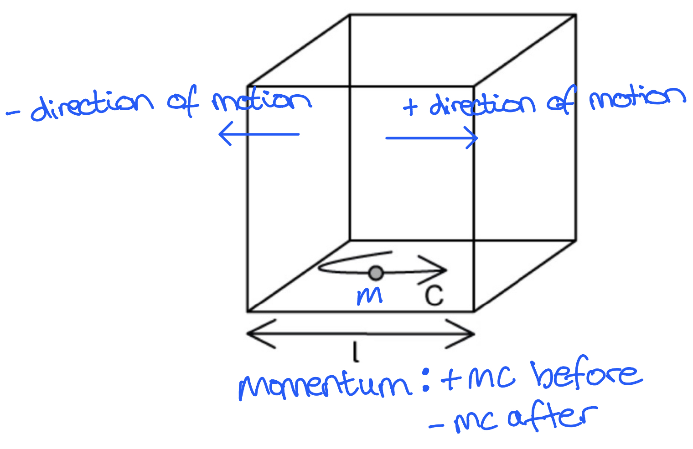
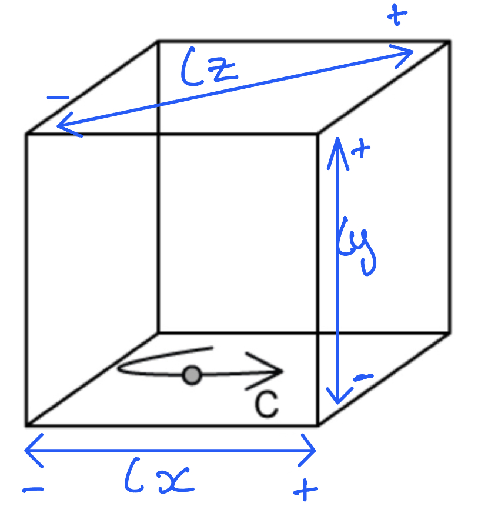

# Mark Schemes — Kinetic Theory of Gases
**15. Ideal Gases** · Cambridge (CIE) A-LEVEL physics (9702)

## Structured Questions (11 questions)

### Q1
A diagram that would score 1 mark should look like this:

- Horizontal arrow below the cube labelled with the letter $l$; **[1 mark]**

A diagram that would score 1 mark should look like this:

- Curved arrow inside the cube pointing to the right labelled with the letter $c$;** [1 mark]**

**[Total: 2 marks]**
A correctly marked table that would score 3 marks should look like this:

| **Some phrases about the derivation of the kinetic theory of gases** | **Place a tick (✓) here** |
|---|---|
| *c *is the specific heat capacity of the particles of the gas |   |
| *c *is not the speed of light | **✓ ****[1 mark]** |
| Time between particle collisions with the container walls = $\frac{2\timeslengthofcube}{speedofmolecule}$ | **✓ ****[1 mark]** |
| Time between particle collisions = $\frac{distance}{speed}$ | **✓ ****[1 mark]** |
| Time to travel length of cube = $lengthofcube\timesspeedofmolecule$ |   |

- **One mark for each correct statement ticked**

**[Total: 3 marks]**
Sentences that correctly explain step four of the derivation should look like this:

- Pressure is defined as the force per unit **area**. This is the pressure exerted by one **molecule**.** **The **area** of one wall is $l^{2}$;** ****[1 mark]**
- The gas contains a large **number**** **of molecules. Each molecule has a different **velocity** and they all contribute to the pressure; **[1 mark]**
- The **mean** squared speed of c2 is written with left and right-angled brackets <c2>; **[1 mark]**
- **One mark awarded for each correct sentence**

**[Total: 3 marks]**
(i) The molecules move in:

- 3-dimensions; **[1 mark]**

(ji) The volume of the cube in terms of its side length is:

- length cubed or $l^{3}$; **[1 mark]**

(iii) The equation for the density of the cube is:

- $density=\frac{mass}{volume}$ **[1 mark] ** **OR**
- $density=\frac{Nm}{V}$** [1 mark]**

**[Total: 3 marks]**

### Q2
The meaning of each of the symbols in the equation is as follows:

- $p$ = the pressure of the gas **AND **$V$ = the volume of the gas; **[1 mark]**
- $N$ = the number of molecules in the gas **AND **$m$ = the mass of one molecule of gas; **[1 mark]**
- $<c^{2}>$ = the mean square speed of the molecules in the gas; **[1 mark]**

**[Total: 3 marks]**
Show that the average translational kinetic energy is $E_{K}=\frac{3}{2}kT$:

- Ideal gas equation:  $pV=NkT$  and  $pV=\frac{1}{3}Nm<c^{2}>$
- ∴ $NkT=\frac{1}{3}Nm<c^{2}>$ **[1 mark]**
- $\cancel{N} k T = 1 \frac{1}{3} \cancel{N} m < c^{2} > \Leftrightarrow 3 k T = m < c^{2} >$
- Divide both sides by 2:  $\frac{3}{2}kT=\frac{1}{2}m<c^{2}>$ **[1 mark]**
- $E_{K}=\frac{1}{2}m<c^{2}>$ therefore,** **$E_{K}=\frac{3}{2}kT$

**[Total: 2 marks]**

> *The expression gives the **average **translational kinetic energy, so the expression *$3kT=m<c^{2}>$* must be ÷ 2*

> *The kinetic energy equation from mechanics = *$\frac{1}{2}mv^{2}$* where *$v^{2}=<c^{2}>$

> *Hence, *$E_{k}=\frac{3}{2}kT=\frac{1}{2}m<c^{2}>$
Determine the root-mean-square (r.m.s.) speed *u *of a nitrogen molecule at 20 °C:

List the known quantities:

- Mass of nitrogen molecule, $m$ = 4.65 × 10−26 kg
- Boltzmann constant, $k$ = 1.38 × 10−23 J K−1
- Temperature, $T$ = 20 °C = 20 + 273 = 293 K **[1 mark]**

Rearrange and substitute into the expression from **(b) **to find *u*:

- $\frac{1}{2}m<c^{2}>=\frac{3}{2}kT\Rightarrowmu^{2}=3kT$
- $mu^{2}=3kT\Rightarrowu=\sqrt{\frac{3kT}{m}}$
- $u = \sqrt{ \frac{3 \times ( 1.38 \times 10^{- 23} ) \times 293}{( 4.65 \times 10^{- 26} )} }$ **[1 mark]**
- $u = 510.75 \mathrm{m} \mathrm{s}^{- 1} = 511 \mathrm{m} \mathrm{s}^{- 1} ( 3 \mathrm{s} . \mathrm{f} . )$**[1 mark]**

**[Total: 3 marks]**

> *When making any calculations to do with ideal gases, always convert **temperature** into **K**.*
The graph of pressure with the r.m.s. speed is as follows:

- A straight line passing through (*u*, *P*); **[1 mark]**
- The line is vertical; **[1 mark]**

**[Total: 2 marks]**

> $E_{K}\proptoT$* so *$E_{K}$*is independent of *$P$*. Hence the r.m.s. remains constant as the pressure decreases.*

### Q3
Consider the change in momentum of the molecule as it hits the wall perpendicularly:

- Change in momentum = momentum after − momentum before
- $\Delta p = - m c - ( + m c )$
- $\Deltap=-2mc$** [1 mark]**

**[Total: 1 mark]**

(i) Write an expression for the time between collisions with the wall:

- The molecule travels from one side of the cube to the surface it collides with, this is a distance $l$
- After the collision, the molecule travels back across one side of the cube, the same distance $l$
- Hence, the molecule travels a total distance of $2l$ **[1 mark]**

Obtain an expression for the time between collisions:

- $time=\frac{distance}{speed}$
- $timebetweencollisions=\frac{distancebetweencollisions}{speedofmolecule}=\frac{2l}{c}$ **[1 mark]**

(ii) Write an expression for the rate of change in momentum:

- Rate of change of momentum:  $\frac{changeinmomentum}{timebetweencollisions}=\frac{\Deltap}{\Deltat}$ **[1 mark]**
- Rate of change of momentum:  $\frac{\Delta p}{\Delta t} = \frac{2 m c}{( \frac{2 l}{c} )} = \frac{m c^{2}}{l}$ **[1 mark]**

**[Total: 4 marks]**
The total pressure from the *N *particles in the box is:

- All the collisions take place on one face of the cube
- Area of the collision:  $l\timesl=l^{2}$ **[1 mark]**

Obtain an expression for pressure and substitute for force and area:

- Force = rate of change of momentum
- $p r e s s u r e = \frac{f o r c e}{a r e a} = \frac{( \frac{m c^{2}}{l} )}{l^{2}}$ **[1 mark]**

Obtain an expression that considers the different velocities of the molecules:

- Total pressure of the molecules: $p=\frac{Nmc^{2}}{l^{3}}$ **[1 mark]**
- The different velocities can be described by the mean square of the velocities $<c^{2}>$
- Hence, $p=\frac{Nm<c^{2}>}{l^{3}}$ **[1 mark]**

**[Total: 4 marks]**
Show that the kinetic theory of gases equation is $pV=\frac{1}{3}Nm<c^{2}>$:

- Velocity components in 3 dimensions:  $c^{2} = ( c_{x} )^{2} + ( c_{y} )^{2} + ( c_{z} )^{2}$
- Because of symmetry, it can be assumed that  $< ( c_{x} )^{2} > = < ( c_{y} )^{2} > = < ( c_{z} )^{2} >$
- Mean square speed:  $< ( c_{x} )^{2} > = 1 \frac{1}{3} < c^{2} >$ **[1 mark]**

Consider the volume of the cube:

- The cube is an $l\timesl\timesl$* *box
- Hence, volume $V=l^{3}$ **[1 mark]**

Substitute the values into the expression for pressure:

- $p=\frac{Nm<c^{2}>}{l^{3}}$
- $p=\frac{1}{3}\times\frac{Nm<c^{2}>}{V}$ **[1 mark]**
- Hence,** **$pV=\frac{1}{3}Nm<c^{2}>$

**[Total: 3 marks]**

> *It can be tricky to think about the **different components** of **velocity**:*

### Q4
(i) A perfectly elastic collision is when:

- Kinetic energy is conserved during the collision **OR**
- No kinetic energy is permanently transformed into internal energy (heat, deformation, sound); **[1 mark]**

(ii) The forces between the molecules are:

- There are no long-range intermolecular forces **OR**
- Forces between molecules are negligible except during collisions **[1 mark]**

(iii) The speed of the molecules considered in the kinetic theory is:

- The Root Mean Square (RMS) speed; **[1 mark]**

This is because:

- Because the macroscopic properties of the gas (like Temperature and Pressure) are related to the average kinetic energy of the molecules, which depends on the square of the speed;** [1 mark]**

**[Total: 4 marks]**
Two narrow apertures are required in the collimator to measure the velocity of the particles inside because:

- Particles in the main chamber move in a constant random  thermal motion; **[1 mark]**
- Only particles travelling in a straight line along the axis / parallel to the beam can pass through both apertures to reach the detector; **[1 mark]**
- This ensures the velocity measured is strictly the velocity in the direction of the beam; **[1 mark]**

**[Total: 3 marks]**

> *Understanding how a collimator works is **not **part of your **exam** syllabus, **but **hard questions will ask you to **apply** your **knowledge** from the syllabus to a new situation. *
Determine whether the propane sample behaves as an ideal gas:

- Molar mass of propane, *M**r* = 44.097 g mol−1 = 44.097 × 10−3 kg mol−1
- Average velocity of particles, *c* = 399.00 m s−1
- Uncertainty in velocity = 0.5 %
- Temperature, *T *= 9 °C = 9 + 273.15 = 282.15 K
- Avogadro constant, *N**A* = 6.02 × 1023 mol−1
- Boltzmann constant, *k* = 1.38 × 10−23 J K−1

Calculate the mass of one molecule, $m$

- $m=\frac{M_{r}}{N_{A}}=\frac{44.097\times10^{-3}}{6.02\times10^{23}}$
- $m=7.325\times10^{-26}\mathrm{kg}$ **[1 mark]**

Calculate the RMS speed, $c_{rms}$

- $c_{rms}=\sqrt{\frac{3kT}{m}}$
- $c_{r m s} = \sqrt{ \frac{3 \times ( 1.38 \times 10^{- 23} ) \times 282.15}{7.325 \times 10^{- 26} } }$
- $c_{rms}=399.20ms^{-1}$ **[1 mark]**

Compare to the measured value

- Measured value = 399.00 m s-1
- Calculated value = 399.20 m s-1
- $\% \text{uncertainty} = \frac{calculated \text{velocity} - \text{known} \text{velocity} }{known \text{velocity} } \times 100$
- $\% \text{uncertainty} = \frac{399.20 - 399.00}{399.00} \times 100$
- $\% \text{uncertainty} = 0.05 \%$ **[1 mark]**
- The difference between the theoretical and measured speeds is about 0.05%, which is much smaller than the 0.5% experimental uncertainty, therefore, the measured speed is consistent with the value predicted for an ideal gas; **[1 mark]**

**[Total: 4 marks]**

### Q5
The correct assumptions of kinetic theory are:

| **Possible statements of the kinetic theory of gases** | **Place a tick (✓) here** |
|---|---|
| The time of a collision is equal to the time between collisions |   |
| The molecules are mostly stationary but move upon collision with another molecule |   |
| Molecules of gas behave as identical, hard, perfectly elastic spheres | **✓ ****[1 mark]** |
| The volume of molecules is significant compared to the volume of the container |   |
| The time of a collision is negligible compared to the time between collisions | **✓ ****[1 mark]** |
| There are no forces of attraction or repulsion between the molecules | **✓**** [1 mark]** |
| The molecules are in continuous random motion | **✓ ****[1 mark]** |
| The molecules all have mass, so are attracted towards each other |   |
| The volume of the molecules is negligible compared to the volume of the container | **✓ ****[1 mark]** |

- **One mark for each correct statement**

**[Total: 5 marks]**
The symbol for the mean square speed of molecules in an ideal gas is:

- `< c ^2 >` **[1 mark]**

**[Total: 1 mark]**
The units for the mean square speed of the molecules in an ideal gas are:

- m2 s−2** [1 mark]**

**[Total: 1 mark]**
Calculate the average root mean square speed of the particles travelling at the following velocities:

Calculate the sum of the square of the velocities:

- $\sum_{ }^{ } c^{2} = 350^{2} + ( - 356 )^{2} + 346^{2} + ( - 351 )^{2} + 339^{2} = 607 074$ **[1 mark]**

Calculate the mean of the square of the velocities:

- $( \text{angle} \text{brackets} c^{2} ) \text{angle} \text{brackets} = \frac{607 074}{5} = 121 415$ **[1 mark]**

Calculate the root of the mean of the square of the velocities:

- $\sqrt{( \text{angle} \text{brackets} c^{2} ) \text{angle} brackets} = \sqrt{121 415} = 348 \mathrm{m} \mathrm{s}^{- 1}$ **[1 mark]**

**[Total: 3 marks]**

### Q6
Obtain an expression in terms of* F,* *n *and *T *for the height of the container:

- Surface pressure:  $P=\frac{F}{A}$
- Ideal gas equation:  $PV=nRT$
- Combine the equations:  $( \frac{F}{A} ) V = n R T$ **[1 mark]**

Substitute and rearrange the dimensions *l*, *h*, and *w *into the equation:

- Area:  $A=xy$
- Volume:  $V=xyz$*  *
- Substitute:   $\frac{F\timesxyz}{xy}=nRT\RightarrowFz=nRT$
- Rearrange for the height:  $z=\frac{nRT}{F}$ **[1 mark]**

**[Total: 2 marks]**
Calculate the average translational kinetic energy of the molecules in the gas of container A:

List the known quantities:

- Pressure of gas in B:  $P_{B}=\frac{1}{4}P_{A}$
- Volume of B:  $V_{B}=5V_{A}$
- Number of molecules in B:  $n_{B}=\frac{1}{2}n_{A}$
- Temperature of gas in B:  *T*B = 800 K
- Molar gas constant, *R *= 8.31 J K−1 mol−1
- Boltzmann constant, *k *= 1.38 × 10−23 J K−1

Write expressions in terms of the ideal gas equation for the gas contained in A and B:

- Gas in container A:  $P_{A}V_{A}=n_{A}RT_{A}$
- Gas in container B:  `P _ B V _ B = n _ B R T _ B <-> ( P _ A / 4 ) x ( 5 V _ A ) = ( n _ A / 2 ) R x 800` **[1 mark]**
- Simplify:  $\frac{5}{4}P_{A}V_{A}=400n_{A}R\RightarrowP_{A}V_{A}=320n_{A}R$

Equate the equations in terms of *R *to find the temperature in container A:

- Gas in container A:  $P_{A}V_{A}=n_{A}RT_{A}\RightarrowR=\frac{P_{A}V_{A}}{n_{A}T_{A}}$
- Gas in container B:  $P_{A}V_{A}=320n_{A}R\RightarrowR=\frac{P_{A}V_{A}}{320n_{A}}$
- Equate & simplify:  $\frac{P_{A}V_{A}}{n_{A}T_{A}}=\frac{P_{A}V_{A}}{320n_{A}}$
- Temperature of gas A:  $T_{A}=320K$ **[1 mark]**

Calculate the average translational kinetic energy of the molecules in the gas of container A:

- Average kinetic energy:  $E_{k}=\frac{3}{2}kT$
- $E_{k} = \frac{3}{2} \times ( 1.38 \times 10^{- 23} ) \times 320$
- $E_{k}=6.624\times10^{-21}J$** [1 mark]**

**[Total: 3 marks]**

### Q7
Calculate the number *n *of moles in the gas:

List the known quantities:

- Temperature of gas, $T$ = 24 °C = 24 + 273 = 297 K
- Volume of gas, $V$ = 3.3 × 10−3 m3 
- Pressure of gas, $P$ =  2.1 × 105 Pa
- Molar gas constant, $R$ = 8.31 J K−1 mol−1

State the ideal gas equation, rearrange and substitute the known quantities:

- $pV=nRT\Rightarrown=\frac{pV}{RT}$
- $n = \frac{( 2.1 \times 10^{5 ) \times ( 3.3 \times 10^{-3} } )}{8.31 \times 297}$ **[1 mark]**
- $n=0.28$ **[1 mark]**

**[Total: 2 marks]**
Determine the r.m.s speed of the gas molecules:

List the known quantities:

- Temperature of gas, $T$ = 297 K
- Mass of one molecule, $m$ = 30 u = 30 × (1.66 × 10−27) = 4.98 × 10−26 kg
- Boltzmann constant, $k$ = 1.38 × 10−23 J K−1

Use the equation for the average kinetic energy of one molecule of a gas:

- $\frac{1}{2}m<c^{2}>=\frac{3}{2}kT$ **[1 mark]**
- $c=\sqrt{\frac{3kT}{m}}$
- $c = \sqrt{ \frac{3 \times ( 1.38 \times 10^{- 23} ) \times 297}{( 4.98 \times 10^{- 26} )} }$ **[1 mark]**
- $c = 496.9 \mathrm{m} \mathrm{s}^{- 1} = 497 \mathrm{m} \mathrm{s}^{- 1} ( 3 \mathrm{s} . \mathrm{f} . )$** [1 mark]**

**[Total: 3 marks]**

> *Remember to convert the mass to **kg**. There are **many equations** in this topic. **Learn** the equations given for 1 molecule and how it will change for 1 mole / a certain number of particles. *

> *The other longer way to complete this question is to consider the **number of particles:*

> *using *$N=nN_{A}$*  and  *$pV=\frac{1}{3}Nm<c^{2}>$
Calculate the ratio of original to new r.m.s. speed:

List the known quantities:

- Original temperature, $T_{1}$ = 297 K
- Change in temperature = 72 °C = 72 K
- New temperature, $T_{2}$ = 297 + 72 = 369 K
- Original r.m.s. speed of molecules = $c_{1}$
- New r.m.s. speed of molecules = $c_{2}$

Substitute the known quantities into the ratio:

- r.m.s. speed of molecules:  $c\propto\sqrt{T}$ **[1 mark]**
- $\frac{c_{1}}{c_{2}}=\sqrt{\frac{T_{1}}{T_{2}}}=\sqrt{\frac{297}{369}}$
- $\frac{c_{1}}{c_{2}}$ = 0.8971 = 0.897 (3 s.f.) **[1 mark]**

**[Total: 2 marks]**

> *You can answer this question by **calculating** the **r.m.s speed **of one molecule of gas at the new temperature using the method from (c). This will give you the same correct answer but will take a lot l**onger**! *

> *Both the **K and °C** temperature scales are **linear**, so an increase in 72 °C = an increase in 72 K. *

### Q8
Calculate the average temperature of the gas:

List the known quantities:

- Number of moles, *n *= 3.0
- Pressure, *p *= 6.1 × 105 Pa
- Average translational kinetic energy of the molecules in the gas, *E**k-total* = 1 × 104 J
- Avogadro constant, *N**A* = 6.02 × 1023 mol−1
- Boltzmann constant, *k *= 1.38 × 10−23 J K−1
- Molar gas constant, *R *= 8.31 J K−1 mol−1

Calculate the translational kinetic energy of one molecule in the gas, *E**k-total*:

- The gas contains 3 moles, so *n *= 3
- Each mole of gas contains Avogadro's number of molecules, *N**A*
- Therefore, the translational kinetic energy of one molecule in the gas is given by the equation: $E_{k}=\frac{E_{k-total}}{nN_{A}}$
- $E_{k} = \frac{1 \times 10^{4} }{3 \times ( 6.02 \times 10^{23} )}$
- $E_{k}=5.537\times10^{-21}J$ **[1 mark]**

Calculate the temperature of the gas:

- Average kinetic energy:  $E_{k}=\frac{3}{2}kT\RightarrowT=\frac{2E_{k}}{3k}$
- $T = \frac{2 E_{k} }{3 k} = \frac{2 \times ( 5.537 \times 10^{- 21} )}{3 \times ( 1.38 \times 10^{- 23} )} = 267.5 \mathrm{K}$ **[1 mark]**

**[Total: 2 marks]**
Calculate the magnitude of the impulse when a gas atom collides with the walls of the box:

List the known quantities:

- Number of moles, *n *= 3.0 (From part (a))
- Average translational kinetic energy of one molecule, *E**k* = 5.54 × 10−21 J (From part (a))
- Molar mass, *M**r* = 5.9 g mol−1 = 5.9 × 10−3 kg mol−1
- Avogadro constant, *N**A* = 6.02 × 1023 mol−1

Calculate the mass of one molecule, *m*:

- $m=\frac{M_{r}}{N_{A}}$
- $m = \frac{( 5.9 \times 10^{- 3} )}{( 6.02 \times 10^{23} )}$
- $m=9.8\times10^{-27}\mathrm{kg}$ **[1 mark]**

Use the average translational kinetic energy of one molecule to calculate the average velocity, *c*:

- $E_{k} = 1 \frac{1}{2} m ( \text{angle} \text{brackets} c^{2} ) \text{angle} \text{brackets}$
- $c=\sqrt{\frac{2E_{k}}{m}}$
- $c = \sqrt{ \frac{2 \times ( 5.54 \times 10^{- 21} )}{9.8 \times 10^{- 27} } }$
- $c=1063ms^{-1}$ **[1 mark]**

Calculate the magnitude of the impulse of the gas atoms:

- The collision of the particles with the walls is perfectly elastic, so kinetic energy is conserved before and after each collision
- Consider the change in direction of the particle before and after the collision

  - Before the collision: the particle moves towards the wall and the velocity is positive
  - After the collision: the particle moves away from the wall and the velocity is negative

- Impulse = change in momentum = *mv *− *mu*
- Impulse =* mc − *(−*mc*)* *= 2*mc*
- Impulse = 2 × (9.8 × 10−27) × (1063)
- Impulse = 2.08 × 10−23 kg m s−1 **[1 mark]**

**[Total: 3 marks]**
Find the value of *y:*

List the known quantities:

- Original number of moles, *n *= 3.0
- Original pressure, *p**1** *= 6.1 × 105 Pa
- Volume of gas, *V* = 0.819 m3
- Original temperature, *T**1* = 267.5 K (from **(a)**)
- New temperature, *T**2* = 267.5 + 102.5 = 370 K
- New pressure, *p**2* = 0.02 × *p**1* = 0.02 × (6.1 × 105) = 1.22 × 104 Pa
- Molar gas constant, *R *= 8.31 J K−1 mol−1

Calculate the new number of moles, *n*:

- Ideal gas equation: $pV=nRT\Rightarrown=\frac{p_{2}V}{RT_{2}}$
- $n = \frac{( 1.22 \times 10^{4} ) \times 0.819}{8.31 \times 370} = 3.25 \text{mol}$** [1 mark]**

Calculate *y*:

- $y = \frac{d i f f e r e n c e i n m o l e s}{o r i g i n a l n u m b e r o f m o l e s} \times 100 \%$
- $y = \frac{3.25 - 3}{3} \times 100 = 8.3 \%$** [1 mark]**

**[Total: 2 marks]**

> *Δ**T** can be in °C or K, as the temperature difference is the **same** for both scales, as it is **linear**.*

### Q9
Assumptions of the simple kinetic model of a gas:

**Final answer:** **Any ****two ****from:**

- The gas contains a large number of molecules / atoms / particles; **[1 mark]**
- The molecules are in random motion; **[1 mark]**
- There are no intermolecular forces between the molecules; **[1 mark]**
- The collisions between the molecules are elastic; **[1 mark]**
- The time of the collisions is much less than the time between the collisions; **[1 mark]**
- The volume of molecules is much less than the volume of the containing vessel; **[1 mark]**

**[Total: 2 marks]**
A gas exerts a pressure on the sides of its container because:

**Final answer:** **Any ****three ****from:**

- The molecules collide with the walls; **[1 mark]**
- The <u>change in momentum</u> of the molecules (on collision with the walls) means there is a force (on the molecules); **[1 mark]**
- The molecules exert an equal and opposite force on the walls (of the container); **[1 mark]**
- Pressure is the average of the force from the collisions per surface area on the walls;** [1 mark]**

**[Total: 3 marks]**
Calculate the r.m.s. of the four speeds:

- Mean square speed:  $< c^{2} > = \frac{s u m o f ( 4 v a l u e s )^{2}}{4}$
- $< c^{2} > = \frac{( 1420 )^{2} + ( 1510 )^{2} + ( 1560 )^{2} + ( 1540 )^{2}}{4}$ **[1 mark]**
- $<c^{2}>$ = 2.275 × 106 m2 s−2** [1 mark]**

Calculate the r.m.s. speed:

- $r.m.s.=\sqrt{<c^{2}>}$
- $r.m.s.=\sqrt{2.275\times10^{6}}$ **[1 mark]**
- r.m.s. = 1.51 × 103 m s−1 (3 s.f.) **[1 mark]**

**[Total: 4 marks]**

> *Finding the **mean speed ≠** finding the **root mean square speed**. Be sure to **show all of the steps** above in your answer to gain full marks. *

### Q10
Calculate the thermodynamic temperature of the gas:

List the known quantities:

- Number of mol of gas, $n$ = 5.12 mol
- Pressure of gas, $p$ = 5.60 × 105 Pa
- Volume of gas, $V$ = 3.80 × 10–2 m3
- Molar gas constant, $R$ = 8.31 J K−1 mol−1

Use the ideal gas equation to determine $T$:

- $pV=nRT$ **[1 mark]**
- $T = \frac{p V}{n R} = \frac{( 5.6 \times 10^{5 ) \times ( 3.8 \times 10^{-2} } )}{5.12 \times 8.31}$
- $T = 500.15 \mathrm{K} = 500 \mathrm{K} ( 3 s. f. )$ **[1 mark]**

**[Total: 2 marks]**

- *Using the ideal gas equation the **temperature** is given in **K*

### Q11
The kinetic theory of gases equation is:

- $pV=$**[1 mark] **$1 \frac{1}{3} N m ( \text{angle} \text{brackets} c^{2} ) \text{angle} \text{brackets}$ **[1 mark]**

**[Total: 2 marks]**
Calculate the average kinetic energy of the particles in the gas:

List the known quantities:

- Temperature, *T* = 38 °C
- Boltzmann's constant, *k*** **= 1.38 × 10–23 J K–1

Convert temperature *T* from °C to K:

- *T* (K) = *T* (°C) + 273.15
- *T* = 38 + 273.15 = 311.15 K **[1 mark]**

State the equation for average kinetic energy:

- $\overline{E}_{k}=\frac{3}{2}kT=\frac{3}{2}\frac{R}{N_{A}}T$ **[1 mark]**

Substitute values into average kinetic energy equation:

- $\overline{E}_{k}=\frac{3}{2}\times(1.38\times10^{-23})\times311.15$ **[1 mark]**
- $\overline{E}_{k}$ = 6.44 × 10–21 J **[1 mark]**

**[Total: 4 marks]**

> *It is good to keep in mind that the** average kinetic energy equation** is the kinetic energy of **one** molecule in the gas. This is why the number of molecules hasn't been calculated from the number of moles - both the moles and volume are just a **red herring **in this question! *

> *Remember that temperature should always be in **kelvin (K)** in this topic. *
Correct sentences that would score 3 marks should look like this:

- A **higher** temperature implies **higher**** **average speed and therefore higher** ****kinetic**** ****energy****; [1 mark]**
- This causes an increase in the **momentum** transferred to the walls from **more** frequent collisions; **[1 mark]**
- This increase in **force** per collision leads to an increase in **pressure**; **[1 mark]**

**One**** mark for each correct sentence**

**[Total: 3 marks]**

> *The reason that it is technically the increased **force** per collision that leads to an increased pressure, is due to the definition of pressure. Pressure is the 'force per unit area' (*$p=\frac{F}{A}$*) and the area of the collisions remain constant. Remember, this has nothing to do with the ideal gas equation **pV** = **nRT**, and any reference to this will be ignored by the examiner.*
The collision assumed between the molecules and the walls of the container in the kinetic theory of gases is:

- Elastic; **[1 mark]**

**[Total: 1 mark]**
