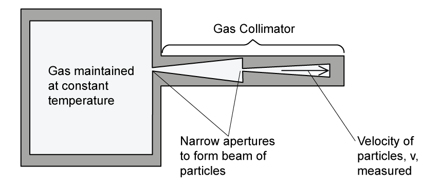

# Exam Questions — Kinetic Theory of Gases
**15. Ideal Gases** · Cambridge (CIE) A-LEVEL physics (9702)
> Source: [https://www.savemyexams.com/a-level/physics/cie/25/topic-questions/](https://www.savemyexams.com/a-level/physics/cie/25/topic-questions/) · 11 questions across 1 sets

## Structured Questions (11 questions)

### Q1 — easy — 11 marks

**Q1** [2 marks]

This question is about the derivation of the kinetic theory of gases equation.

The derivation is based on a particle inside a cube, as shown in Fig. 1.1.

**Fig. 1.1**

Identify the following by adding the indicated letter to the correct arrow on the diagram:

(i) The length $l$ of the side of the cube

[1]

(ii) The speed $c$ of the molecule.

[1]

**Q1** [3 marks]

**Extract:**

This question is about the derivation of the kinetic theory of gases equation. The derivation is based on a particle inside a cube, as shown in Fig. 1.1. Identify the following by adding the indicated letter to the correct arrow on the diagram: (i) The length l of the side of the cube (ii) The speed c of the molecule.

Step two of the derivation of the kinetic theory of gases is explained by the statements in Table 1.1.

Place ticks (**✓**) next to the phrases that correctly explain step two.

**Table 1.1**

| **Some phrases about the derivation of the kinetic theory of gases** | **Place a tick (✓) here** |
|---|---|
| *c *is the specific heat capacity of the particles of the gas |   |
| *c *is not the speed of light |   |
| Time between particle collisions with the container walls = $\frac{2\timeslengthofcube}{speedofmolecule}$ |   |
| Time between particle collisions = $\frac{distance}{speed}$ |   |
| Time to travel length of cube = $lengthofcube\timesspeedofmolecule$ |   |

**Q1** [3 marks]

**Extract:**

This question is about the derivation of the kinetic theory of gases equation. The derivation is based on a particle inside a cube, as shown in Fig. 1.1. Identify the following: (i) The length \$\$l\$\$ of the side of the cube (ii) The speed \$\$c\$\$ of the molecule.

Step four of the derivation of the kinetic theory of gases equation is explained in the sentences below.

Identify the correct words from the box to complete the sentences. You can use each word once, more than once or not at all.

| velocity  mean  speed  number  amount  area  force  exerted  molecule |
|---|

i. Pressure is defined as the force per unit __________. This is the pressure exerted by one __________. The __________ of one wall is $l^{2}$.

ii. The gas contains a large __________ of molecules. Each molecule has a different __________ and they all contribute to the pressure.

iii. The __________ squared speed of c2 is written with left and right-angled brackets <c2>.

**Q1** [3 marks]

**Extract:**

This question is about the derivation of the kinetic theory of gases equation. The derivation is based on a particle inside a cube, as shown in Fig. 1.1.

For the final step of the derivation of the kinetic theory of gases equation, state

(i) the number of dimensions the molecules are moving in

[1]

(ii) the volume of the cube in terms of its side length

[1]

(iii) the equation for the density of the cube.

[1]

### Q2 — medium — 10 marks

**Q2** [3 marks]

The kinetic theory of gases equation can be written as

`p V space equals space 1 third N m open angle brackets c squared close angle brackets`

State the meaning of each of the symbols in this equation.

**Q2** [2 marks]

**Extract:**

The kinetic theory of gases equation can be written as pV = (1/3) N m <c^2>

Use the equation in **(a) **to show that the average translational kinetic energy $E_{K}$ of a molecule of an ideal gas is given by

$E_{K}=\frac{3}{2}kT$

**Q2** [3 marks]

**Extract:**

Use the equation in (a) to show that the average translational kinetic energy E_K of a molecule of an ideal gas is given by E_K = (3/2) kT. Mark scheme: E_K = (1/2) m<c^2> therefore E_K = (3/2) kT, so (1/2) m<c^2> = (3/2) kT.

The mass of a nitrogen molecule is 4.65 × 10−26 kg.

Use the equation in **(b) **to determine the root-mean-square (r.m.s.) speed *u *of a nitrogen molecule at 20 °C.

Assume that nitrogen behaves as an ideal gas.

**Q2** [2 marks]

**Extract:**

Use the equation in (a) to show that the average translational kinetic energy E_K of a molecule of an ideal gas is given by E_K = (3/2) k T

The mass of a nitrogen molecule is 4.65 × 10^−26 kg. Use the equation in (b) to determine the root-mean-square (r.m.s.) speed u of a nitrogen molecule at 20 °C. Assume that nitrogen behaves as an ideal gas.
Result: u = 510.75 m s^−1 = 511 m s^−1 (3 s.f.)

A fixed mass of nitrogen gas at initial pressure $P$ is sealed in a cylindrical container by a moveable piston at one end, as shown in Fig. 1.1.

The temperature of the gas is 20 °C.

At all times, the gas and the container remain in thermal equilibrium with the surroundings. The piston is slowly moved out of the cylinder so that the nitrogen gas is decompressed.

On Fig. 1.2, sketch the variation of pressure with the r.m.s. speed of the nitrogen molecules as the pressure decreases.

### Q3 — medium — 12 marks

**Q3** [1 mark]

A single molecule is in a cube-shaped box with sides of equal length $l$. as shown in Fig. 1.1.

The molecule has a mass $m$* *and moves with a speed $c$* *parallel to one side of the box. It collides at regular intervals with the ends of the box, exerting a force and contributing to the pressure of the gas.

The collisions the particle has with the container walls are **elastic**.

Determine an expression for the change in momentum of the molecule as it hits a wall perpendicularly.

**Q3** [4 marks]

**Extract:**

A single molecule is in a cube-shaped box with sides of equal length \$\$l\$\$. The molecule has a mass \$\$m\$\$ and moves with a speed \$\$c\$\$ parallel to one side of the box. It collides at regular intervals with the ends of the box, exerting a force and contributing to the pressure of the gas. The collisions the particle has with the container walls are elastic. Change in momentum of the molecule as it hits a wall perpendicularly: \$\$\Delta p = -2mc\$\$

(i) Show that the time between collisions of the molecule on the container wall is given by:

$timebetweencollisions=\frac{2l}{c}$

[2]

(ii) Determine an expression for the change in momentum per second.

[2]

**Q3** [4 marks]

**Extract:**

A single molecule is in a cube-shaped box with sides of equal length l. The molecule has a mass m and moves with a speed c parallel to one side of the box. It collides at regular intervals with the ends of the box, exerting a force and contributing to the pressure of the gas. The collisions the particle has with the container walls are elastic.

(ii) Rate of change of momentum: Δp/Δt = 2mc/(2l/c) = mc²/l

Consider *N *molecules identical to the single molecule in parts **(a) **and **(b) **in the same cube-shaped box.

Each molecule has a different velocity that contributes to the pressure.

Calculate the total pressure from the *N *particles in the box.

**Q3** [3 marks]

**Extract:**

Consider N molecules identical to the single molecule in parts (a) and (b) in the same cube-shaped box. Each molecule has a different velocity that contributes to the pressure. Calculate the total pressure from the N particles in the box.
Hence, p = N m <c²> / l³

A single molecule is in a cube-shaped box with sides of equal length l. The molecule has a mass m and moves with a speed c parallel to one side of the box.

Hence, show that the kinetic theory of gases equation is:

$pV=\frac{1}{3}Nm<c^{2}>$

### Q4 — hard — 11 marks

**Q4** [4 marks]

The kinetic theory of gases assumes that collisions between particles and between particles and the walls of their container are perfectly elastic.

(i) Describe what is meant by a *perfectly elastic collision*

[1]

(ii) Describe the nature of the forces between the molecules

[1]

(iii) Describe, with a reason, the type of speed of the molecules considered in the kinetic theory.

[2]

**Q4** [3 marks]

A gas collimator is used to measure the average velocity of particles in a gas.

The collimator in Fig. 1.1 controls the pressure and the volume and it maintains a gas at a constant temperature.

**Fig. 1.1**

Explain why two narrow apertures are required in the collimator to measure the velocity of the particles inside.

**Q4** [4 marks]

A paint manufacturer is measuring the root mean square speed of a sample of propane particles used to make spray paint. At a temperature of 9 °C the propane molecules have a velocity of 399.00 m s−1  with an uncertainty of 0.5 %.

Propane has a molecular mass of 44.097 g mol−1.

Determine whether the propane sample behaves as an ideal gas.

### Q5 — easy — 10 marks

**Q5** [5 marks]

The kinetic theory of gasses is based upon a number of assumptions.

Place ticks (✓) next to the correct assumptions in Table 1.1.

**Table 1.1**

| **Possible statements of the kinetic theory of gases** | **Place a tick (✓) here** |
|---|---|
| The time of a collision is equal to the time between collisions |   |
| The molecules are mostly stationary but move upon collision with another molecule |   |
| Molecules of gas behave as identical, hard, perfectly elastic spheres |   |
| The volume of molecules is significant compared to the volume of the container |   |
| The time of a collision is negligible compared to the time between collisions |   |
| There are no forces of attraction or repulsion between the molecules |   |
| The molecules are in continuous random motion |   |
| The molecules all have mass, so are attracted towards each other |   |
| The volume of the molecules is negligible compared to the volume of the container |   |

**Q5** [1 mark]

Draw a circle around the correct symbol for the mean square speed of molecules in an ideal gas.

| $\sqrt{c}$ | `square root of open angle brackets c close angle brackets end root` | `square root of open angle brackets c squared close angle brackets end root` | $c$ | `open angle brackets c squared close angle brackets` |
|---|---|---|---|---|

**Q5** [1 mark]

State the units for the mean square speed of the molecules in an ideal gas.

**Q5** [3 marks]

Calculate the average root mean square speed of the particles travelling at the following velocities:

350 m s−1     −356 m s−1     346 m s−1     −351 m s−1     339 m s−1

### Q6 — hard — 5 marks

**Q6** [2 marks]

A sealed container A has the shape of a rectangular prism and contains an ideal gas. The dimensions of the container are *x*, *y *and z as shown in Fig. 1.1.

**Fig. 1.1**

- The average force exerted by the gas on the bottom wall of the container is *F*
- There are *n *moles of gas in the container
- The temperature of the gas is *T *

Obtain an expression for the height of the container in terms of* F,* *n *and *T*.

**Q6** [3 marks]

A second container B contains the same ideal gas.

The following information is known:

- The pressure in B is a quarter of the pressure in A
- The volume of B is five times the volume of A
- Container B contains half the number of molecules as A
- The temperature of container B is 800 K

Calculate the average translational kinetic energy of the molecules in the gas of container A.

### Q7 — medium — 7 marks

**Q7** [2 marks]

A fixed mass of an ideal gas is at a temperature of 24 °C. The volume of the gas is 3.3 × 10−3 m3 and the pressure is 2.1 × 105 Pa.

Calculate the number *n *of moles in the gas.

**Q7** [3 marks]

**Extract:**

A fixed mass of an ideal gas is at a temperature of 24 °C. The volume of the gas is 3.3 × 10^−3^ m^3^ and the pressure is 2.1 × 10^5^ Pa.

The mass of one molecule of the gas is 30 u.

Determine the r.m.s speed of the gas molecules.

**Q7** [2 marks]

**Extract:**

A fixed mass of an ideal gas is at a temperature of 24 °C. The volume of the gas is 3.3 × 10^−3^ m^3^ and the pressure is 2.1 × 10^5^ Pa.
Temperature of gas, T = 24 °C = 24 + 273 = 297 K

The temperature of the gas is increased by 72 °C.

Calculate the value of the ratio

$\frac{\mathrm{original}r.m.s.\mathrm{speed} \mathrm{of} \mathrm{molecules}}{\mathrm{new}r.m.s.\mathrm{speed} \mathrm{of} \mathrm{molecules}}$

### Q8 — hard — 7 marks

**Q8** [2 marks]

A sealed box contains 3.0 moles of a monatomic ideal gas. The average translational kinetic energy of the gas is 1 × 104 J.

Calculate the average temperature of the gas.

**Q8** [3 marks]

**Extract:**

A sealed box contains 3.0 moles of a monatomic ideal gas. The average translational kinetic energy of the gas is 1 × 10^4 J.

Calculate the translational kinetic energy of one molecule in the gas: E_k = E_k-total / (n N_A) = (1 × 10^4) / (3 × (6.02 × 10^23)) = 5.537 × 10^−21 J

The molar mass of the gas in the box is 5.9 g mol−1. Assume that there are perfectly elastic collisions between the particles and the box walls and that the particles travel perpendicular to the walls.

Calculate the magnitude of the impulse when one gas atom collides with one wall of the box.

**Q8** [2 marks]

**Extract:**

A sealed box contains 3.0 moles of a monatomic ideal gas. The average translational kinetic energy of the gas is 1 × 10^4 J. Calculate the average temperature of the gas. [Answer: T = 267.5 K]

The pressure of the ideal gas in the box is 6.1 × 105 Pa. The box is opened and additional molecules enter. The number of gas atoms is increased by *y *%.

The box is then resealed and the temperature of the remaining gas atoms increased by 102.5 °C. The new pressure in the box is 2% of the original pressure. The box has a volume 0.819 m3.

Find the value of *y*.

### Q9 — medium — 9 marks

**Q9** [2 marks]

State two assumptions of the simple kinetic model of a gas.

**Q9** [3 marks]

Use the kinetic model of gases and Newton’s laws of motion to explain how a gas exerts a pressure on the sides of its container.

**Q9** [4 marks]

In a sample of gas at room temperature, four of the atoms have the following speeds:

1.42 × 103 m s–1

1.51 × 103 m s–1

1.56 × 103 m s–1

1.54 × 103 m s–1

For these four atoms, calculate the r.m.s. to three significant figures.

### Q10 — medium — 2 marks

**Q10** [2 marks]

A cylinder contains 5.12 mol of an ideal gas at pressure 5.60 × 105 Pa and volume 3.80 × 10–2 m3.

Calculate the thermodynamic temperature of the gas.

temperature = ....................................................... K

*Source: Specimen 2022 Paper 4 Q2A*

### Q11 — easy — 10 marks

**Q11** [2 marks]

State the kinetic theory of gases equation.

**Q11** [4 marks]

A tank of volume 20 m3 contains 6.0 moles of an ideal monatomic gas. The temperature of the gas is 38 °C.

Calculate the average kinetic energy of the particles in the gas.

**Q11** [3 marks]

The following paragraph is an explanation of the relationship between the temperature of a gas and its pressure in terms of the kinetic model of an ideal gas.

Use the words in the box below to complete the sentences in the paragraph. They can be used once, more than once or not at all.

| higher | lower | more | kinetic energy |
|---|---|---|---|
| force | momentum | pressure | less |

i. A __________ temperature implies __________ average speed and therefore higher __________.

ii. This causes an increase in the __________ transferred to the walls from __________ frequent collisions.

iii. This increased __________ per collision leads to an increased __________.

**Q11** [1 mark]

State the type of collision assumed between the molecules and the walls of the container in the kinetic theory of gases.
