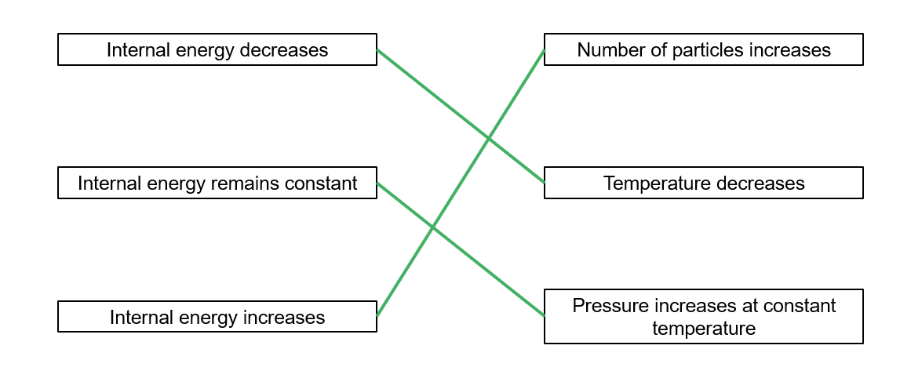

# Mark Schemes — Internal Energy
**16. Thermodynamics** · Cambridge (CIE) A-LEVEL physics (9702)

## Structured Questions (6 questions)

### Q1
To find the temperature:

List the known quantities:

- Number of moles, *n*  = 15.0 mol
- Number of atoms, *N* = 9.03 × 1024
- Root-mean-square speed, `square root of open angle brackets c squared close angle brackets end root` = 1680 m s−1
- Mass of an individual atom, *m* = 6.64 × 10−27 kg
- Molar gas constant, *R*  = 8.31 J K−1 mol−1

Recall the ideal gas law:

- $pV=nRT$

Use the pressure of an ideal gas equation from the formulae page:

- `p space equals space 1 third fraction numerator N m over denominator V end fraction open angle brackets c squared close angle brackets`

Combine the two to eliminate pressure and volume:

- `p V space equals space open parentheses 1 third fraction numerator N m over denominator up diagonal strike V end fraction open angle brackets c squared close angle brackets close parentheses space cross times space up diagonal strike V space equals space n R T` **[1 mark]**

Rearrange for temperature:

- `n R T space equals space fraction numerator N m open angle brackets c squared close angle brackets over denominator 3 end fraction`
- `T space equals space fraction numerator N m open angle brackets c squared close angle brackets over denominator 3 n R end fraction space equals space fraction numerator open parentheses 9.03 space cross times space 10 to the power of 24 close parentheses space cross times space open parentheses 6.64 space cross times space 10 to the power of negative 27 end exponent close parentheses space cross times space 1680 squared over denominator 3 space cross times space 15 space cross times space 8.31 end fraction` **[1 mark]**
- $T=453K$ **[1 mark]**

**[Total: 3 marks]**

> *Combining these two known equations requires some careful algebra. Additionally, a common pitfall is to forget to square the root-mean-square speed when using the pressure of an ideal gas equation. You had to square the 1680 m s**−1** to get the correct answer.*

> *Root-mean-square speed is written as *`square root of open angle brackets c squared close angle brackets end root`* and has units of speed,  m s**−1**.*

> *Mean-square speed is written as *`open angle brackets c squared close angle brackets`* and has units of speed-squared, m**2** s**−2**.*
To find the new temperature:

List the known quantities:

- Number of moles, *n*  = 15 mol (from (a))
- Molar gas constant, *R*  = 8.31 J K−1 mol−1
- Pressure, *p*  = 150 kPa = 150 × 103 Pa
- Volume, *V*  = 0.300 m3

Rearrange the ideal gas equation for temperature:

- $pV=nRT$
- $T=\frac{pV}{nR}$

Substitute the known quantities:

- `T space equals space fraction numerator open parentheses 150 space cross times space 10 cubed close parentheses space cross times space 0.300 over denominator 15 space cross times space 8.31 end fraction` **[1 mark]**
- $T=361K$ **[1 mark]**

**[Total: 2 marks]**
(i) Describe the change in internal energy:

- The internal energy decreases; **[1 mark]**

Explain your answer:

- Temperature has decreased; **[1 mark]**
- Internal energy is proportional to temperature **OR** Δ*U* ∝ Δ*T* ; **[1 mark]**

(ii) Describe the process which caused this:

- Heat / thermal energy was transferred from the gas to the surroundings; **[1 mark]**

Explain your answer:

- The volume was fixed / constant; **[1 mark]**
- No work was done; **[1 mark]**
- (Therefore) heat loss caused a loss of internal energy; **[1 mark]**

**[Total: 7 marks]**

> *Recall that internal energy can be decreased either by the gas doing work (i.e. expanding) or heat being transferred away from the gas. The container has a fixed volume, so the gas cannot expand or be compressed.*

> *This leaves only heat transfer as a means of reducing internal energy. This is a less formal way of stating the first law of thermodynamics - a concept you will come a cross in the next topic.*
The potential energy is unchanged because:

- (For an ideal gas) there are no intermolecular forces; **[1 mark]**
- (Additionally) no phase changes occur; **[1 mark]**

**[Total: 2 marks]**

> *Of course, in reality there are intermolecular forces between gaseous particles. For an ideal gas, however, these interactions are ignored and all internal energy is assumed to be derived from the average kinetic energy of the particles.*

> *This is why internal energy is directly proportional to temperature for an ideal gas. *

> *Potential energy changes if the gas condenses, as bonds form between the particles in a liquid phase, but that is not occurring here.*

### Q2
Calculate the change in internal energy:

List the known quantities:

- Initial temperature = 260 K
- Final temperature = 310 K

The change in internal energy of an ideal gas is proportional to the change in temperature, and can be written as:

- $ΔU\proptoΔT$

Calculate the factor by which temperature increases:

- $\frac{310}{260}=1.19$ **[1 mark]**

Write the factor by which internal energy changes:

- Internal energy <u>increases</u> by a factor of 1.2 **[1 mark]**

**[Total: 2 marks]**
(i) Describe the heat transferred:

- No heat is transferred between gas and surroundings; **[1 mark]**

Explain why:

- The gas is perfectly <u>insulated</u>; **[1 mark]**

(ii) Calculate the work done on the gas:

List the known quantities:

- Initial internal energy, *U**i*  = 2.3 kJ = 2300 J
- Factor by which internal energy increases, *α* = 1.19
- Heat transferred between gas and surroundings = 0 J

Relate work done and internal energy:

- The internal energy is increased by work done on the gas
- Work done = Δ*U*  **[1 mark]**

Calculate work done:

- Final internal energy, *U**f**  *= 1.19*U**i*
- $ΔU=U_{f}-U_{i}=1.19U_{i}-U_{i}$
- `W space equals space straight capital delta U space equals space open parentheses 1.19 space cross times space 2300 close parentheses space minus space 2300` **[1 mark]**
- $W=437J=440J$ **[1 mark]**

**[Total: 5 marks]**
State whether the balloon shrinks or grows:

- The balloon decreases in size / shrinks; **[1 mark]**

Explain why:

- Work is done <u>on</u> the gas; **[1 mark]**
- (Therefore) <u>volume</u> decreases; **[1 mark]**

**[Total: 3 marks]**

> *Work done is force exerted over a distance. To do work on a gas in a balloon, a force is exerted on it over a distance i.e. the balloon shrinks. This means the volume decreases.*
Describe changes in average kinetic energy:

- Average kinetic energy increases; **[1 mark]**

Explain why:

- As temperature increases, particles move with <u>greater average speed</u>; **[1 mark]**

**[Total: 2 marks]**

> *Temperature is just a measure of the average kinetic energies of all the particles in a substance.*

### Q3
Internal energy is defined as:

- The sum of (the random distribution of) kinetic and potential energies within a system of molecules; **[1 mark]**

**[Total: 1 mark]**
If the temperature decreases:

- (The system's) internal energy will decrease; **[1 mark]**

**[Total: 1 mark]**
To complete the sentence:

**One**** mark for each correct word:**

- For an ideal gas, temperature is **directly**** **proportional to **average **kinetic energy

**[Total: 2 marks]**

> *Temperature is simply a measure of the average kinetic energy of the particles in a system. If the particles are moving faster, the temperature is higher.*

> *This proportional relationship only applies, however, when using the **kelvin** scale. At 0 K, or absolute zero, the particles have no kinetic energy.*
This is only true for an ideal gas because:

- Ideal gases have no potential energy; **[1 mark]**
- Because there are no interactions / forces between the particles; **[1 mark]**

**[Total: 2 marks]**

> *The statement above omits the potential energy from the definition of internal energy.*

> *In this topic, you must be familiar with the assumptions made in the ideal gas model. An ideal gas has particles that collide but have no intermolecular interactions.*

> *In a solid, liquid, or real gas, however, there are interactions between particles. These make up the system's potential energy, which contributes to internal energy. *

### Q4
To calculate the new internal energy:

List the known quantities:

- Initial temperature, *T**i*  = 400 K
- Final temperature, *T**f*  = 600 K
- Initial internal energy, *U**i*  = 2800 J

Use direct proportionality:

- $T\proptoU$
- Therefore, $\frac{T_{f}}{T_{i}}=\frac{U_{f}}{U_{i}}$ **[1 mark]**

Substitute the known quantities to find the new internal energy, *U**f* :

- $U_{f}=U_{i}\times\frac{T_{f}}{T_{i}}=2800\times\frac{600}{400}$ **[1 mark]**
- $U_{f}=4200J$ **[1 mark]**

**[Total: 3 marks]**

> *The equation *$\frac{T_{f}}{T_{i}}=\frac{U_{f}}{U_{i}}$* is essentially saying 'if temperature doubles, internal energy also doubles'. This is direct proportionality, but you could have also used the initial temperature and initial internal energy to find a constant of proportionality and found final internal energy that way. Both methods are equivalent.*
To calculate the increase in total kinetic energy:

List the known quantities:

- Initial internal energy, *U**i*  = 2800 J
- Final internal energy, *U**f*  = 4200 J

Determine the increase in internal energy:

- $ΔU=U_{f}-U_{i}=4200-2800$
- $ΔU=1400J$ **[1 mark]**

State the change in total kinetic energy:

- Change in total kinetic energy = change in internal energy = 1400 J **[1 mark]**

**[Total: 2 marks]**

> *Recall the definition of internal energy:*

- *Internal energy is the sum of a random distribution of kinetic and potential energies associated with molecules of a system*
- *Ideal gases have no potential energy*
- *All internal energy is kinetic energy*

> *Remembering this will help you answer the final part of the question.*
To find the number of atoms:

List the known quantities:

- Number of moles, *n* = 3 mol

From the data page:

- Avogadro constant, *N**A**  = *6.02 × 1023 mol−1

Calculate the number of atoms:

- *N**A* is the number of atoms in 1 mol
- $\mathrm{number} \mathrm{of} \mathrm{atoms}=3\times6.02\times10^{23}$
- $\mathrm{number} \mathrm{of} \mathrm{atoms}=1.8\times10^{24}$ **[1 mark]**

**[Total: 1 mark]**
To find average kinetic energy of a single particle:

List the known quantities:

- Final total kinetic energy, *E *= 4200 J (from part (b))
- Number of atoms, *N* = 1.8 × 1024 (from part (c))

Calculate average kinetic energy per particle, *E**k avg *:

- $E_{kavg}=\frac{E}{N}=\frac{4200}{1.8\times10^{24}}$ **[1 mark]**
- $E_{kavg}=2.3\times10^{-21}J$ **[1 mark]**

**[Total: 2 marks]**

### Q5
Three correct lines:

**One**** mark for each correct line**

**[Total: 3 marks]**

> *If temperature decreases, then internal energy also decreases. This explains the first line.*

> *For the second line, internal energy is independent of pressure provided that temperature is constant. Equally, pressure could be constant or decrease - as long as temperature is constant, internal energy is also constant for an ideal gas.*

> *Internal energy is a measure of the total kinetic and potential energies of all particles in a system. If there are more particles, it follows that internal energy increases.*
If internal energy increases, the average particle motion changes as follows:

- Average speed of the particles <u>increases</u> / the particles move <u>faster</u> on average; **[1 mark]**

**[Total: 1 mark]**
The internal energy may be increased by:

- Doing work on the system; **[1 mark]**
- Heating the system; **[1 mark]**

**[Total: 2 marks]**
To find the change in internal energy:

List the known quantities:

- Work done on system, *W*  = 3.5 kJ
- Thermal energy transferred from system, *Q*  = 1.2 kJ

Determine energy gained and energy lost by the system:

- Work done on system increases internal energy
- Thermal energy transferred away from system reduces internal energy

Calculate the change in internal energy, Δ*U* :

- $ΔU=W-Q$ **[1 mark]**
- $ΔU=3.5-1.2$
- $ΔU=2.3\mathrm{kJ}$ **[1 mark]**

**[Total: 2 marks]**

> *This question gives a preview of the next topic: Δ**U = Q − W ** is a rearrangement of the first law of thermodynamics.*

> *You need to remember the things that either increase or decrease internal energy. Refer back to the revision notes to recap this if necessary.*

### Q6
Internal energy is defined as

- The sum of the <u>random distribution</u> of <u>kinetic and potential energies</u> within a system of molecules; **[1 mark]**

**[Total: 1 mark]**
(i) The internal energy of a lump of copper as it cools:

- The potential energy is unchanged as the atoms remain in the same positions (in the solid); **[1 mark]**
- The vibrational kinetic energy reduces because the temperature gets lower; **[1 mark]**
- So the internal energy is less; **[1 mark]**

(ii) The internal energy of some water as it evaporates at a constant temperature:

- The potential energy increases because the separation of the atoms increases (as the water molecules move from a liquid to evaporate as a gas); **[1 mark]**
- The kinetic energy remains constant because the temperature remains constant; **[1 mark]**
- So the internal energy increases; **[1 mark]**

**[Total: 6 marks]**
