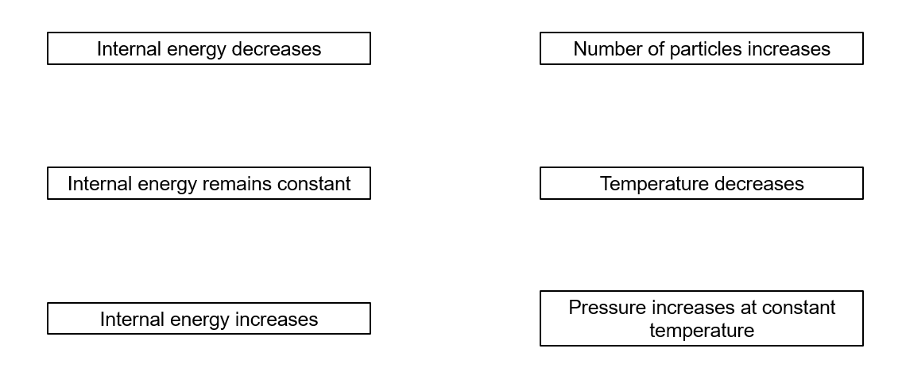

# Exam Questions — Internal Energy
**16. Thermodynamics** · Cambridge (CIE) A-LEVEL physics (9702)
> Source: [https://www.savemyexams.com/a-level/physics/cie/25/topic-questions/](https://www.savemyexams.com/a-level/physics/cie/25/topic-questions/) · 6 questions across 1 sets

## Structured Questions (6 questions)

### Q1 — medium — 14 marks

**Q1** [3 marks]

A container of fixed volume holds 15.0 moles of a monatomic ideal gas. This is 9.03 × 1024 atoms in total.

Each atom has a mass of 6.64 × 10−27 kg.

The gas is held at a temperature such that the root-mean-square speed is 1680 m s−1.

Calculate this temperature.

**Q1** [2 marks]

**Extract:**

A container of fixed volume holds 15.0 moles of a monatomic ideal gas. This is 9.03 × 10^24^ atoms in total.

The gas undergoes a process and now has a pressure of 150 kPa. The container has a fixed volume of 0.300 m3.

Calculate the new temperature of the gas.

**Q1** [7 marks]

**Extract:**

A container of fixed volume holds 15.0 moles of a monatomic ideal gas. ... The gas is held at a temperature such that the root-mean-square speed is 1680 m s^−1^. Calculate this temperature. [Answer: T = 453 K]

The gas undergoes a process and now has a pressure of 150 kPa. The container has a fixed volume of 0.300 m^3^. Calculate the new temperature of the gas. [Answer: T = 361 K]

For the process outlined in part (b):

(i) Describe the change in internal energy. Explain your answer.

[3]

(ii) Describe the process which caused this change in internal energy. Explain your answer.

[4]

**Q1** [2 marks]

**Extract:**

A container of fixed volume holds 15.0 moles of a monatomic ideal gas.

The boiling point of this gas is 350 K. Explain why the potential energy of this ideal gas does not change.

### Q2 — medium — 12 marks

**Q2** [2 marks]

A monatomic gas, contained within a balloon, increases in temperature from 260 K to 310 K.

Calculate the factor by which the internal energy changes, stating whether this is an increase or decrease.

**Q2** [5 marks]

**Extract:**

A monatomic gas, contained within a balloon, increases in temperature from 260 K to 310 K. Calculate the factor by which the internal energy changes, stating whether this is an increase or decrease. [Answer: Internal energy increases by a factor of 1.19 (310/260 = 1.19)]

The initial internal energy was 2.3 kJ. The gas in the balloon is perfectly insulated.

(i) Describe the heat transferred between the gas and its surroundings.

Explain your answer.

[2]

(ii) Calculate the work done on the gas.

[3]

**Q2** [3 marks]

**Extract:**

A monatomic gas, contained within a balloon, increases in temperature from 260 K to 310 K.

The initial internal energy was 2.3 kJ. The gas in the balloon is perfectly insulated. Calculate the work done on the gas. (Work done = ΔU = (1.19 × 2300) − 2300 = 437 J = 440 J, work is done on the gas.)

State whether the balloon increases or decreases in size.

Explain your answer.

**Q2** [2 marks]

**Extract:**

A monatomic gas, contained within a balloon, increases in temperature from 260 K to 310 K.

Describe and explain the change in average kinetic energy of the particles in this process.

### Q3 — easy — 6 marks

**Q3** [1 mark]

Define internal energy.

**Q3** [1 mark]

Describe the change in internal energy if a system's temperature decreases.

**Q3** [2 marks]

Complete the sentence, using words from the options below:

For an ideal gas, temperature is .................... proportional to ................... kinetic energy.

| **inversely** | **never** | **an atom's** |
|---|---|---|
| **total** | **directly** | **average** |

**Q3** [2 marks]

Explain why the following statement made by a student is only true for an ideal gas:

'*internal energy is the sum of the kinetic energies of all the particles*'.

### Q4 — easy — 8 marks

**Q4** [3 marks]

For an ideal gas, internal energy is directly proportional to temperature in kelvin.

A sample of ideal gas is in a perfectly insulated box of fixed volume.

The temperature of the sample rises from 400 K to 600 K. Its internal energy was initially 2800 J.

Calculate its new internal energy.

**Q4** [2 marks]

**Extract:**

For an ideal gas, internal energy is directly proportional to temperature in kelvin. A sample of ideal gas is in a perfectly insulated box of fixed volume. The temperature of the sample rises from 400 K to 600 K. Its internal energy was initially 2800 J.
U_f = 4200 J (new internal energy calculated in part a)

Calculate the increase in total kinetic energy of the particles in the ideal gas.

**Q4** [1 mark]

The sample contains 3 moles of ideal gas.

Calculate the number of atoms in the sample.

**Q4** [2 marks]

**Extract:**

The temperature of the sample rises from 400 K to 600 K. Its internal energy was initially 2800 J. New internal energy U_f = 4200 J.

All internal energy is kinetic energy. Final total kinetic energy = 4200 J.

The sample contains 3 moles of ideal gas. Number of atoms N = 1.8 × 10^24.

Calculate the average kinetic energy of a particle in the sample of ideal gas after it has been heated.

### Q5 — easy — 8 marks

**Q5** [3 marks]

Draw **three** lines on Fig 1.1 between the corresponding effects on internal energy and changes to the system.

**Fig 1.1**

**Q5** [1 mark]

The internal energy of an ideal gas increases.

Describe the change in average particle motion.

**Q5** [2 marks]

Name two ways the internal energy of the system may be increased.

**Q5** [2 marks]

The volume of a container filled with an ideal gas is reduced. In this process, 3.5 kJ of work is done **on **the system.

At the same time, 1.2 kJ of thermal energy is transferred **from **the system to its surroundings.

Calculate the change in internal energy.

### Q6 — medium — 7 marks

**Q6** [1 mark]

Define internal energy.

**Q6** [6 marks]

State and explain, in molecular terms, whether the internal energy of the following increases, decreases or does not change.

(i) A lump of copper as it is cooled.

[3]

(ii) Some water as it evaporates at a constant temperature.

[3]
