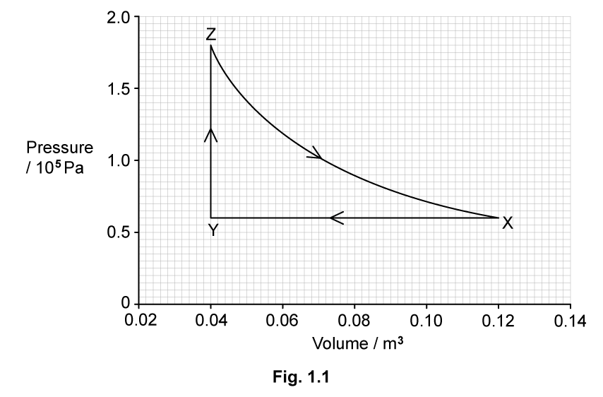

# Exam Questions — The First Law of Thermodynamics
**16. Thermodynamics** · Cambridge (CIE) A-LEVEL physics (9702)
> Source: [https://www.savemyexams.com/a-level/physics/cie/25/topic-questions/](https://www.savemyexams.com/a-level/physics/cie/25/topic-questions/) · 6 questions across 1 sets

## Structured Questions (6 questions)

### Q1 — hard — 7 marks

**Q1** [2 marks]

A fixed mass of an ideal gas is initially at a temperature of 20 °C.

The gas has a volume of 0.12 m3 and a pressure of 0.6 × 105 Pa.

State what is meant by an ideal gas.

**Q1** [2 marks]

**Extract:**

A fixed mass of an ideal gas is initially at a temperature of 20 °C. The gas has a volume of 0.12 m^3 and a pressure of 0.6 × 10^5 Pa.

The gas undergoes three successive changes, as shown in Fig. 1.1.

The initial state of the gas is represented by point X. The gas is cooled at constant pressure to point Y by the removal of 24.0 kJ of thermal energy.

The gas is then heated at constant volume to point Z.

Finally, the gas expands at constant temperature back to its original pressure and volume at point X. During the expansion, the gas does 15.8 kJ of work.

Calculate the magnitude of the work done in kJ during the change XY.

**Q1** [3 marks]

**Extract:**

The gas undergoes three successive changes, as shown in Fig. 1.1. The initial state of the gas is represented by point X. The gas is cooled at constant pressure to point Y by the removal of 24.0 kJ of thermal energy. The gas is then heated at constant volume to point Z. Finally, the gas expands at constant temperature back to its original pressure and volume at point X. During the expansion, the gas does 15.8 kJ of work.
Calculate the magnitude of the work done in kJ during the change XY: W = pΔV = (0.6 × 10^5) × (0.12 − 0.04) = 4800 J = 4.8 kJ

Complete Table 1.1 to show the work done on the gas, the thermal energy supplied to the gas and the increase in internal energy of the gas, for each of the changes XY, YZ and ZX.

**Table 1.1**

| change | increase in internal energy of gas / kJ | thermal energy supplied to gas / kJ | work done on gas / kJ |
|---|---|---|---|
| XY |   | −24.0 |   |
| YZ |   |   |   |
| ZX |   |   | −15.8 |

### Q2 — easy — 9 marks

**Q2** [3 marks]

A sample of an ideal gas is contained in a rigid container enclosed by a piston, as shown in Fig. 1.1.

**Fig. 1.1**

The work done has a negative value.

State and explain the direction of the piston's motion.

**Q2** [3 marks]

**Extract:**

A sample of an ideal gas is contained in a rigid container enclosed by a piston, as shown in Fig. 1.1. The work done has a negative value.

The gas is perfectly insulated during this process.

Write an algebraic expression relating change in internal energy and work done.

**Q2** [3 marks]

**Extract:**

A sample of an ideal gas is contained in a rigid container enclosed by a piston, as shown in Fig. 1.1. The work done has a negative value.
The gas is perfectly insulated during this process. The system is perfectly insulated, q = 0 J, therefore ΔU = W (change in internal energy equals work done).

Describe the change in temperature of the gas.

Explain your answer.

### Q3 — easy — 8 marks

**Q3** [3 marks]

A monatomic gas, contained within a balloon, gains 43 kJ of internal energy.

This process involves 25 kJ of thermal energy being transferred to the gas.

Calculate the work done through this process, including the whether work is done on or by the balloon.

**Q3** [3 marks]

**Extract:**

A monatomic gas, contained within a balloon, gains 43 kJ of internal energy. This process involves 25 kJ of thermal energy being transferred to the gas. Calculate the work done through this process, including the whether work is done on or by the balloon.

W = + 18 kJ; Work is done on the balloon. Work done on the system (gas compressed) is positive; Work done by the system (gas expands) is negative.

State whether the balloon increases or decreases in size.

Explain your answer.

**Q3** [2 marks]

**Extract:**

A monatomic gas, contained within a balloon, gains 43 kJ of internal energy. This process involves 25 kJ of thermal energy being transferred to the gas. Calculate the work done through this process... W = +18 kJ. Work is done on the balloon.

The pressure of the gas remains constant at 202 kPa.

Calculate the magnitude of the change in volume of the balloon.

### Q4 — medium — 8 marks

**Q4** [2 marks]

State the first law of thermodynamics and include any relevant units.

**Q4** [2 marks]

A fixed mass of water is in a beaker at atmospheric pressure. The initial temperature of the water is 0 °C. The water is supplied with thermal energy *q*, so that its temperature increases to 10 °C. There is no net change in the volume of the water.

Determine the work done and the increase in internal energy of the water by completing **Table 1.1**, considering the first law of thermodynamics.

**Table 1.1**

| Work done on water | thermal energy supplied to water | increase in internal energy of water |
|---|---|---|
|   | + *q* |   |

**Q4** [2 marks]

**Extract:**

A fixed mass of water is in a beaker at atmospheric pressure. The initial temperature of the water is 0 \u00b0C. The water is supplied with thermal energy q, so that its temperature increases to 10 \u00b0C. There is no net change in the volume of the water.

Determine the work done and the increase in internal energy of the water by completing Table 1.1, considering the first law of thermodynamics.

Table 1.1: work done on water = 0; thermal energy supplied to water = +q; increase in internal energy of water = +\u0394U. The volume of the water does not change, so the work done on the water = 0. The water remains at atmospheric pressure, and the only energy supplied is thermal energy, so the internal energy of the water increases by +\u0394U.

The water from part (b) is now heated so it's temperature increases by a further 10 °C to a final temperature of 20 °C. This process causes the volume of the water to increase so that work *W *is done.

Assume that the change in internal energy is the same as in part (b).

Determine the work done, thermal energy supplied and the increase in internal energy of the water by completing **Table 1.2**, considering the first law of thermodynamics.

**Table 1.2**

| Work done on water | thermal energy supplied to water | increase in internal energy of water |
|---|---|---|
|   |   |   |

**Q4** [2 marks]

**Extract:**

A fixed mass of water is in a beaker at atmospheric pressure. The initial temperature of the water is 0 °C. The water is supplied with thermal energy q, so that its temperature increases to 10 °C. There is no net change in the volume of the water. (Table 1.1: work done on water = 0, thermal energy supplied = +q, increase in internal energy = +ΔU)

The water from part (b) is now heated so its temperature increases by a further 10 °C to a final temperature of 20 °C. This process causes the volume of the water to increase so that work W is done. Assume that the change in internal energy is the same as in part (b). (Table 1.2: work done on water = −W, thermal energy supplied = +W +ΔU, increase in internal energy = +ΔU)

Explain how the average specific heat capacity of the water, in parts (b) and (c), between 10 °C and 20 °C compares with its average value between 0 °C and 10 °C.

### Q5 — medium — 9 marks

**Q5** [2 marks]

Define the work done by a gas.

**Q5** [2 marks]

A mass of water with negligible volume is vapourised into water vapour of volume 0.82 m3 at a temperature of 100 °C and atmospheric pressure 1.0 × 105 Pa. The thermal energy supplied to the water is 9.5 × 105 J.

Calculate the magnitude of the work done by the water in expanding against the atmosphere when it vapourises.

work done ............................................. J

**Q5** [2 marks]

**Extract:**

A mass of water with negligible volume is vapourised into water vapour of volume 0.82 m^3 at a temperature of 100 °C and atmospheric pressure 1.0 × 10^5 Pa. The thermal energy supplied to the water is 9.5 × 10^5 J.
Work done by the water in expanding against the atmosphere when it vapourises W = 82 000 J = 8.2 × 10^4 J

Determine the increase in internal energy of the water when it vapourises at 100 °C. Explain your reasoning.

increase in internal energy = ....................................... J

**Q5** [3 marks]

Suggest, with a reason, how the specific latent heat of vapourisation of water at a pressure greater than atmospheric pressure compares with its value at atmospheric pressure.

### Q6 — hard — 5 marks

**Q6** [3 marks]

Fig. 1.1 shows a chamber containing 5.2 kg of a gas, with a 0.75 kg piston above the gas.

**Fig. 1.1**

When the gas is supplied with 32.4 kJ of heat, the piston experiences an average upwards acceleration 3.5 m s−2 over a distance of 12 cm.

Calculate the work done by the gas.

**Q6** [2 marks]

**Extract:**

Fig. 1.1 shows a chamber containing 5.2 kg of a gas, with a 0.75 kg piston above the gas. When the gas is supplied with 32.4 kJ of heat, the piston experiences an average upwards acceleration 3.5 m s^−2 over a distance of 12 cm.

Later, the piston is fixed in place and is unable to move. The gas is supplied with the same amount of heat. Its temperature raises by 20 K.

Calculate the specific heat capacity of the gas at a constant volume, *C**V** .*
