# Mark Schemes — Simple Harmonic Oscillations
**17. Oscillations** · Cambridge (CIE) A-LEVEL physics (9702)

## Structured Questions (8 questions)

### Q1
An oscillation is:

- Repeated back and forth movements; **[1 mark]**
- On either side of any equilibrium position;** [1 mark]**

**[Total: 2 marks]**
Correctly drawn lines on the table that would score 5 marks should look like this:

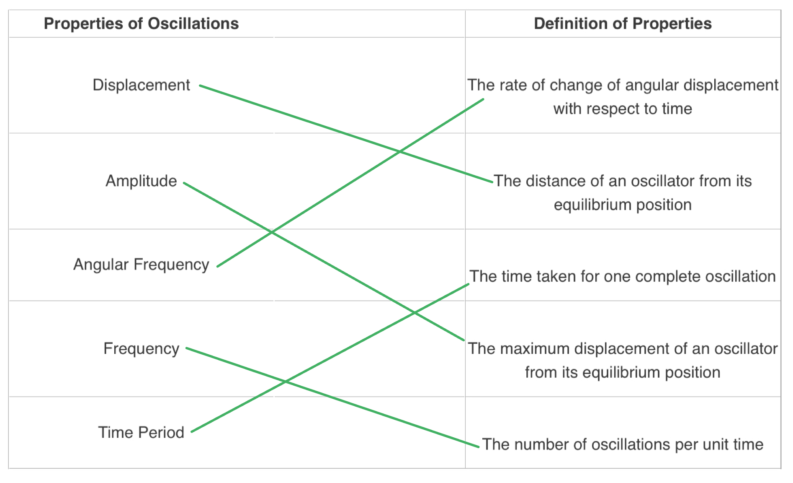

- One mark for each correct line drawn

**[Total: 5 marks]**
Simple harmonic oscillation is:

- A type of oscillation in which the acceleration of a body; **[1 mark]**
- Is proportional to its displacement; **[1 mark]**
- But acts in the opposite direction; **[1 mark]**

**[Total: 3 marks]**
A correctly labelled diagram that would score 5 marks should look like this:

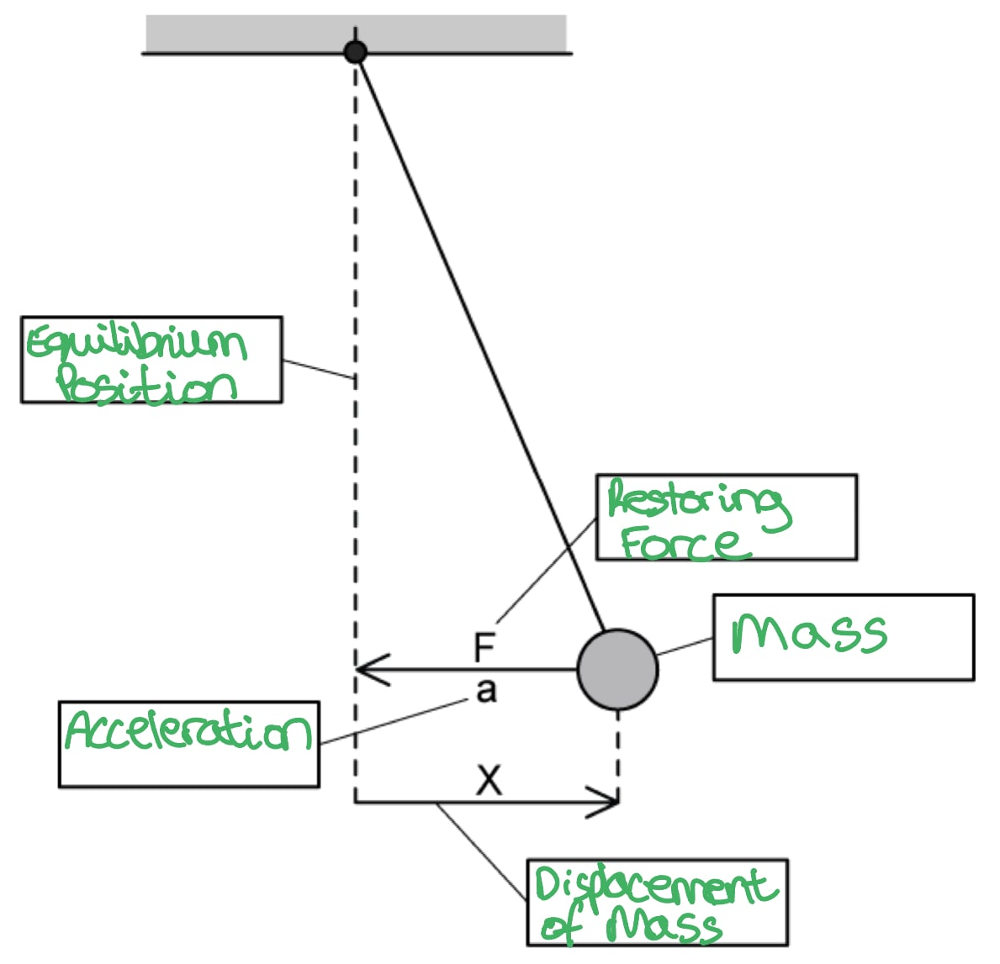

- One mark for each label in the correct place

**[Total: 4 marks]**

### Q2
The defining equation for simple harmonic motion is:

- $a\propto-x$* ***[1 mark]**
- Where $a$ = acceleration **AND** $x$ = displacement (from equilibrium); **[1 mark]**

Explain what the equation means:

- Acceleration and displacement are directly proportional; **[1 mark]**
- Acceleration and displacement must always be in <u>opposite directions</u>; **[1 mark]**

**[Total: 4 marks]**

> *Whenever you state an equation, it is important to define the **variables**. With simple harmonic motion, remember that not only does the negative sign mean that the vectors have opposite directions, but since displacement is measured away from the **equilibrium** position, acceleration must always be towards it.*
A sketch of one swing of the pendulum which would score full credit is shown below:

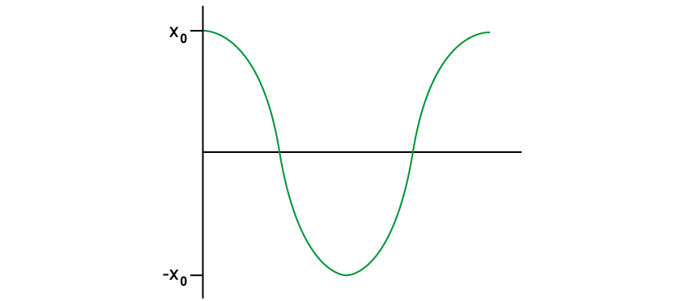

- Amplitude, $x_{0}$  and $-x_{0}$are marked on the y axis; **[1 mark]**
- The graph starts from (0, $x_{0}$); **[1 mark]**
- The graph dips to $-x_{0}$; **[1 mark]**
- Only one complete wave is shown; **[1 mark]**

**[Total: 4 marks]**

> *Be careful to make sure that you know what is happening when **t** = 0. If you get this first plot of the graph right, the rest is more likely to be correct. A pendulum bob will usually start at the maximum displacement, not at equilibrium although questions may start measurements, such as period, from the equilibrium position as this is the standard way of measuring it. A mass-spring system will often start at equilibrium but could be stretched or compressed to begin the oscillations. Also, you should check **how many** oscillations you have been asked to show.*

> *Always note if any values are given in a question, or can be deduced from it, then make sure to add them to the axes of your sketch.*
Determine the frequency of the oscillation:

List the known quantities:

- Time taken for 10 oscillations = 12.0 s

Determine the period, *T:*

- $T=\frac{\mathrm{total} \mathrm{time} \mathrm{taken}}{\mathrm{number} \mathrm{of} \mathrm{oscillations}}=\frac{12.0}{10}$ = 1.2 s **[1 mark]**

Use the equation for frequency and period:

- Frequency:*  *$f=\frac{1}{T}$ **[1 mark]**
- Substitute:  $f=\frac{1}{1.2}$
- $f$ = 0.83 Hz **[1 mark]**

**[Total: 3 marks]**

> *Always set out your known quantities and immediately look for any conversions which may be required. Doing this at the start allows you space to notice, for example, that the question gave the time for 10 oscillations, not one, so you know you need to find the average value.*
Examples of objects that perform SHM are:

**Final answer:** **Any ****two**** from:**

- A mass on a spring; **[1 mark]**
- A mass on a string / pendulum; **[1 mark]**
- Plucked guitar strings; **[1 mark]**
- Electrons in alternating current flowing through a wire; **[1 mark]**
- Vibration of the eardrum; **[1 mark]**

**[Total: 2 marks]**

> *You will get the mark for any reasonable answer, but it is best to learn two so that you have some answers ready if needed.*

### Q3
State the direction of the resultant force:

- Upward** [1 mark]**

Explain the direction of the resultant force:

- The upthrust of the block which is greater than the weight **[1 mark]**

**[Total: 2 marks]**
The oscillations of the block are simple harmonic because:

- The area *A *,density *ρ, * and *g are constant,* so the force *F *is proportional to displacement *x* **[1 mark]**
- *F *and *x *act in opposite directions **[1 mark]****[Total: 2 marks]**

> *Link this equation to the **defining equation** of SHM. *

$a=-ω^{2}x$

> *This is negative because the object will **accelerate towards the centre** of the motion as **displacement is reduced**. *
Obtain an expression for the angular frequency *ω* of the oscillations of the block:

Consider Newton's Second Law to obtain an expression for the acceleration of the block:

- $F=ma$
- So, $a=\frac{F}{m}=\frac{-Agρx}{m}$ **[1 mark]**

Consider the equation for centripetal acceleration:

- $a=rω^{2}$
- Where, *x *is the radius of the oscillation
- $a=-ω^{2}x$ **[1 mark]**

Combine the two equations for acceleration, *a*:

- $-ω^{2}x=\frac{-Agρx}{m}$
- $ω^{2}=\frac{Agρ}{m}$
- $ω=\sqrt{\frac{Agρ}{m}}$ **[1 mark]**

**[Total: 3 marks]**
(i) The maximum negative displacement of the block is not equal to the maximum positive displacement because:

- There is damping due to the viscous forces in the liquid; **[1 mark]**

(ii) Determine the decrease in energy of the oscillation for the first half of the oscillation:

- List the known quantities:

  - Mass of block, *m *= 0.65 kg

Use the graph to obtain a value for the gradient

- Point 1: (0, 0) and point 2: (−0.10, 4.60)

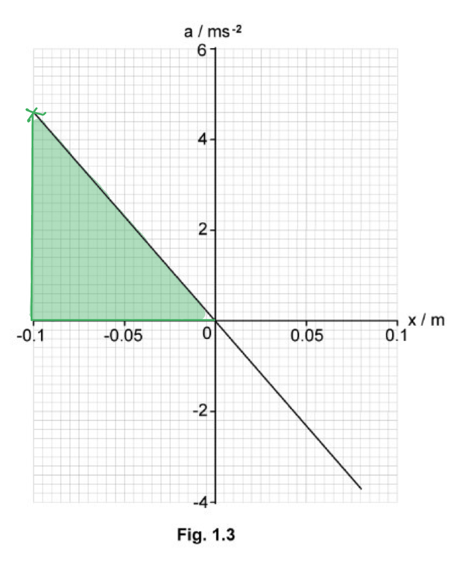

- gradient = `fraction numerator increment y over denominator increment x end fraction space equals fraction numerator 0 space minus space 4.60 over denominator 0 space minus space open parentheses negative 0.10 close parentheses end fraction space equals space fraction numerator negative 4.60 over denominator 0.10 end fraction`
- gradient = −46.0 **[1 mark]**

Use the graph to obtain values for displacement 1, *x**1* and displacement 2, *x**2*:

- *x**1* = −0.100 m and *x**2* = 0.080 m

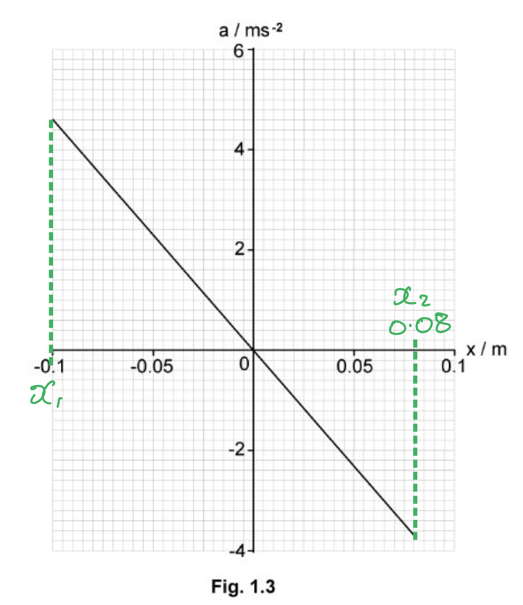

- Recall the equation for the total energy of an SHM system
- $E=\frac{1}{2}mω^{2}x_{0}^{2}$ **[1 mark]**
- So the change in total energy between two amplitudes is
- `E space equals space 1 half space m omega squared open parentheses x subscript 1 squared space minus space x subscript 2 squared close parentheses`

- Substitute in the values obtained from the graph to calculate

  - From $a=-ω^{2}x$, `open vertical bar gradient close vertical bar space equals space omega squared space`
- `E space equals space 1 half cross times 0.65 cross times 46.0 cross times open parentheses 0.100 squared minus 0.080 squared close parentheses`
- $E=0.05382$
- $E=$ $0.054J$** ** (2 s.f.) **[1 mark]**

**[Total: 4 marks]**

### Q4
(i) To mark on the graph a point where velocity is half its initial value:

- Kinetic energy is proportional to velocity2
- If the velocity is halved, then the kinetic energy is a quarter of the initial `open parentheses 1 over 2 squared close parentheses`
- Any point on the graph at 5 mJ marked; **[1 mark]**

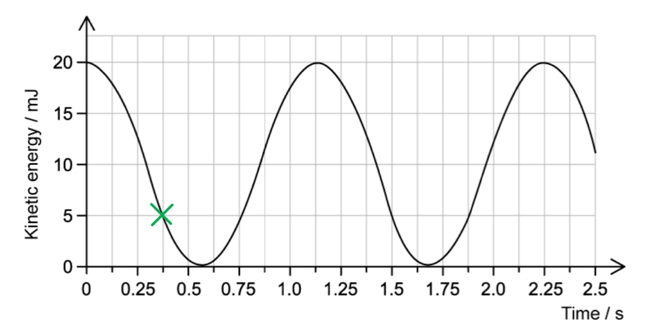

(ii) To calculate the length of the pendulum:

- From the graph, the time period is 2.25 s
- Acceleration of free fall, *g*  = 9.81 m s−2 (from the data page)
- Period, $T=2π\sqrt{\frac{l}{g}}$
- Length, *l = *$\frac{T^{2}g}{4π^{2}}$*= *`fraction numerator open parentheses 2.25 close parentheses squared cross times 9.81 over denominator 4 straight pi squared end fraction`* ***[1 mark]**
- *l = *1.26 m **[1 mark]**

**[Total: 3 marks]**

> *Don't forget that kinetic energy reaches a maximum value **twice** in a single period, as the pendulum passes through the centre (maximum kinetic energy) from one side and then back again from the other. *
(i) A sketch of the potential energy gaining one mark:

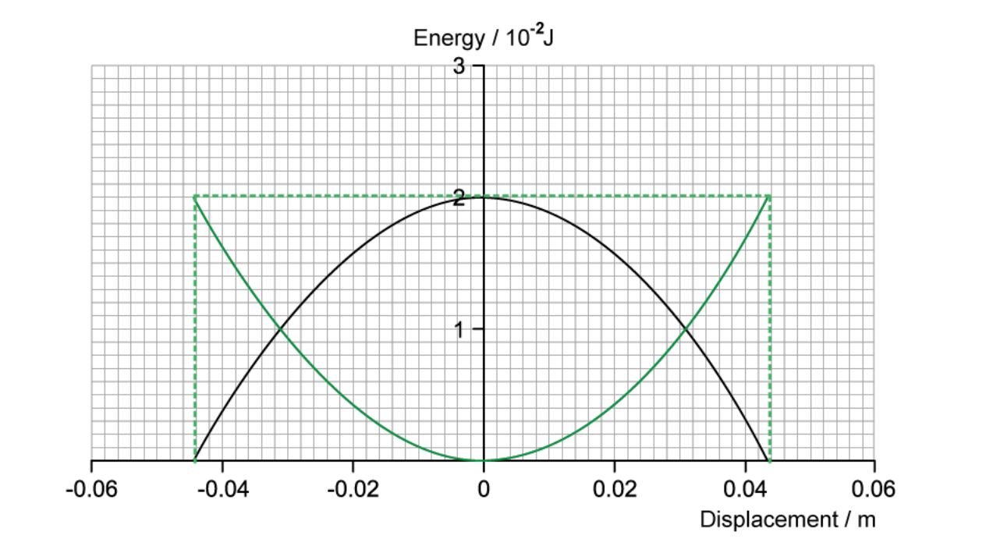

- Line drawn as above, reflected from the $E_{k}$ line at y = 1 × 10–2 **AND**
- line stops at amplitude of 0.044 m **AND**
- Lines cross at 1 × 10–2 J **AND**
- maximum value of new line is 2 × 10–2J when at the maximum displacement; **[1 mark]**

(ii) To calculate the pendulum bob's mass:

List the known quantities:

- Maximum kinetic energy, $E_{k}$= 2 × 10–2 J (from graph)
- Time period, *T* = 2.25 s (from part a)
- Amplitude, *x*0 = 0.044 m (from graph)

Calculate the maximum velocity:

- $v=\pmω\sqrt{x_{0}^{2}-x^{2}}$ (from the formula page)

  - At $v_{max}$, *x* = 0 m
- $v_{max}$=* *$ωx_{0}$* = *$\frac{2πx_{0}}{T}$
- $v_{max}$*= *$\frac{2π\times0.044}{2.25}$* *= 0.12 m s–1 **[1 mark]**

Calculate mass from equation for kinetic energy:

- $E_{kmax}=\frac{1}{2}mv_{max}^{2}$
- `m space equals space fraction numerator 2 E subscript k space m a x end subscript over denominator v subscript m a x end subscript squared end fraction space equals space fraction numerator 2 space cross times open parentheses 2 space cross times space 10 to the power of negative 2 end exponent close parentheses over denominator 0.12 squared end fraction`
- *m = *2.78 kg **[1 mark]**

**[Total: 3 marks]**
List the known quantities:

- Period, *T* = 2.25 s (from part a)
- Amplitude, *x*0 = 0.044 m (from part a)
- Mass, *m* = 2.78 kg (from part b)

Determine the acceleration:

- Acceleration, $a=-ω^{2}x$ (from the formula page)

  - Maximum acceleration occurs at maximum displacement
- `a subscript m a x end subscript space equals space minus omega squared x subscript 0 space equals space minus open parentheses fraction numerator 2 pi over denominator T end fraction close parentheses squared x subscript 0`
- `a subscript m a x end subscript space equals space minus open parentheses fraction numerator 2 pi over denominator 2.25 end fraction close parentheses squared space cross times space 0.044 space equals space minus 0.343 space straight m space straight s to the power of negative 2 end exponent` **[1 mark]**

Calculate the magnitude of the maximum force upon the pendulum:

- $F_{max}=ma_{max}$
- $F_{max}=2.78\times0.343=0.95N$ **[1 mark]**

**[Total: 2 marks]**

> *The question asks for magnitude, so you can ignore the minus sign. This just tells us that acceleration opposes displacement. *

### Q5
The graph shows that the motion of the pendulum is simple harmonic because:

- The graph is a straight line through the origin which shows that *a *is proportional to *x*; **[1 mark]**
- The gradient of the graph is negative which shows that *a *acts in the opposite direction to *x*; **[1 mark]**

**[Total: 2 marks]**
Calculate the angular frequency *ω* of the oscillations:

Draw lines on the graph to obtain the gradient:

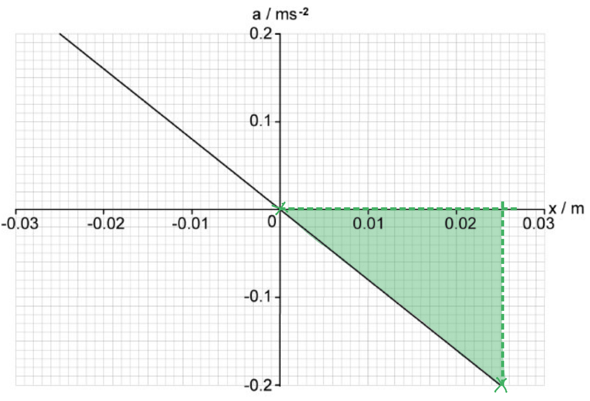

- Point 1: (0, 0) and point 2: (0.025, −0.2)
- gradient = $\frac{\Deltay}{\Deltax}=-\frac{0.2}{0.025}=-8$ **[1 mark]**

Calculate the angular frequency of the oscillations, *ω*:

- gradient = − *ω*2
- So, `omega space equals space square root of negative g r a d i e n t end root space equals space square root of negative open parentheses negative 8 close parentheses end root`
- $ω=2.83\mathrm{rad}s^{-1}$ **[1 mark]**

**[Total: 2 marks]**
Determine *k*:

List the known quantities:

- Angular frequency, *ω* = 2.83 rad s−1
- Length of pendulum, *L *= 1.56 m

Rearrange and substitute into the equation:

- $k=ω^{2}L$
- $k=2.83^{2}\times1.56$ **[1 mark]**
- $k=12.5ms^{-2}$ **[1 mark]**

**[Total: 2 marks]**
The effect of decreasing the length of the string is:

- Decreasing *L *causes *ω* to increase; **[1 mark]**
- So, the amplitude of the oscillation will decrease;** [1 mark]**

**[Total: 2 marks]**

> *Use **(c) and (b)** to help answer this question:*

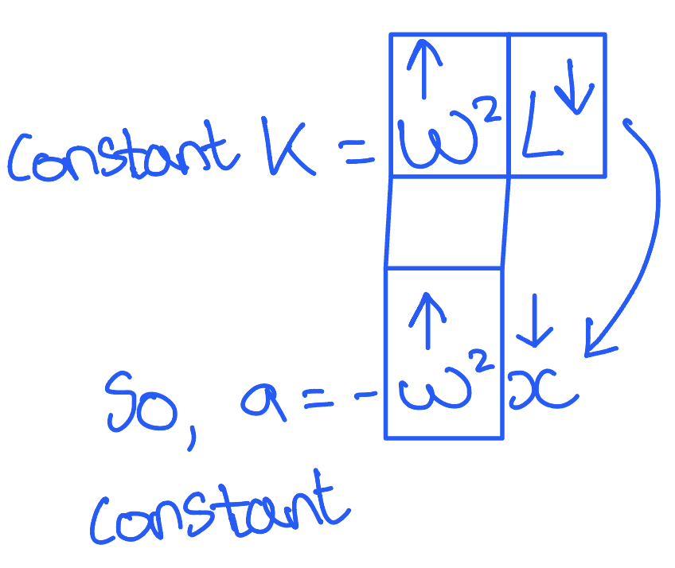

### Q6
List the known quantities:

- Mass, *m* = 0.42 kg
- Passes through equilibrium 200 minute–1
- Kinetic Energy at *x* = 0, $E_{k}$= 500 mJ = 0.5 J

Determine the time period of the mass:

- The mass passes through the equilibrium position twice in one time period

  - There are 100 complete oscillations per minute
- *T* = $\frac{1}{f}$where *f* = $\frac{100}{60}$ s-1
- *T* = $\frac{60}{100}$= 0.6 s **[1 mark]**

Determine the angular velocity of the mass:

- *ω *= $\frac{2π}{T}$= $\frac{2π}{0.6}$ = 10.472 rad s–1 **[1 mark]**

Kinetic energy (and velocity) is maximum when displacement is zero:

- $E_{k}$=$\frac{1}{2}$*mv*2
- $v_{max}=ωx_{0}$* * where *x*0  is amplitude
- $E_{k}=\frac{1}{2}mω^{2}x_{0}^{2}$
- 0.5 = $\frac{1}{2}$× 0.42 × (10.472)2 × *x*02

Rearrange for amplitude *x*0 and substitute in the values:

- Amplitude, *x*0 =`square root of fraction numerator 2 cross times 0.5 over denominator 0.42 cross times open parentheses 10.472 close parentheses squared end fraction end root` = 0.147 m = 14.7 cm **[1 mark]**

Calculate the distance:

- Distance between the two maxima is twice the amplitude
- *d *= 14.7 × 2 = 29.3 = 29 cm (2 sf) **[1 mark]**

**[Total: 4 marks]**

> *There are several useful formulae for the simple harmonic oscillation on the formula page. The equation *$v_{max}=ωx_{0}$* can be derived from:*

$v=\pmω\sqrt{x_{0}^{2}-x^{2}}$

> *by realising that speed is at a maximum at the equilibrium position, when **x**  is zero. Here, **x**0**  is maximum displacement (the amplitude).*
List the known quantities:

- Kinetic Energy at *x* = 0, $E_{k}$= 500 mJ = 0.5 J
- Mass, *m* = 0.42 kg

Calculate the maximum velocity

- $E_{k}$= $\frac{1}{2}$*mv*2
- Velocity, v = $\sqrt{\frac{2E_{k}}{m}}$  = $\sqrt{\frac{2\times0.5}{0.42}}$ = 1.54 m s–1

A graph that would score 2 marks should look like:

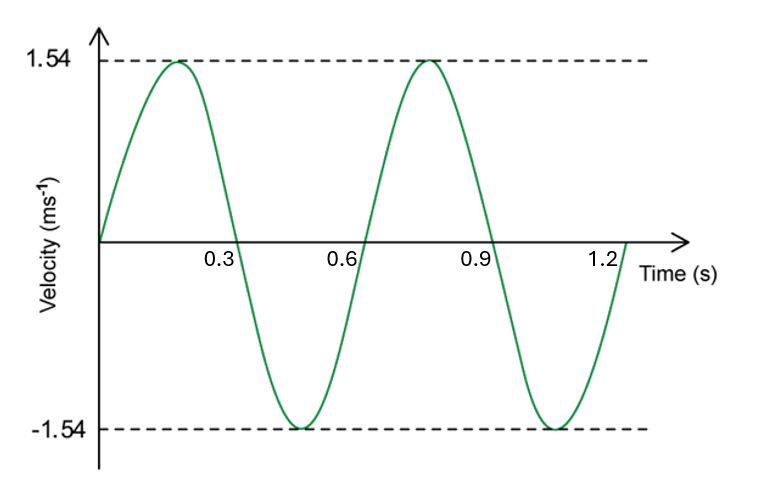

- Periodic waveform; **[1 mark]**
- Maximum velocity of 1.54 shown and time period of 0.6 s shown; **[1 mark]**
- Graph axes are expected to be correctly labelled with units

**[Total: 2 marks]*** *

> *A periodic waveform is a sine or cosine curve. Either is fine here for the graph, since you are not told whether the mass starts oscillating from its equilibrium position or at its amplitude.*
List the known quantities:

- Angular velocity, *ω *= 10.5 rad s–1
- Amplitude, *x*0 = 0.147 m
- Speed of block, *v* = 0.8 m s–1

State formula for speed of a harmonic oscillator and solve for *v*:

- *v* = ± `omega square root of open parentheses x subscript 0 squared minus x squared close parentheses end root` (from the formula page)

Rearrange for *x* :

- `open parentheses v over omega close parentheses squared space equals space x subscript 0 squared space minus space x squared`
- `x squared space equals space x subscript 0 squared space minus space open parentheses v over omega close parentheses squared`
- `x space equals space square root of x subscript 0 squared minus open parentheses v squared over omega squared close parentheses end root`* ***[1 mark]**

Substitute the known quantities:

- *x =*`square root of open parentheses 0.147 close parentheses squared minus open parentheses open parentheses 0.8 close parentheses squared over open parentheses 10.5 close parentheses squared close parentheses end root`
- *x *= 0.126 m **[1 mark]**

**[Total: 2 marks]**
Derive equation for frequency of a pendulum:

- *f =*$\frac{1}{T}$* *=  $\frac{1}{2π}\sqrt{\frac{k}{m}}$

Consider the effect of a stronger gravitational field:

- Period is independent of gravitational acceleration / there is no *g* term, so change in *g* will not affect frequency; **[1 mark]**

Consider the effect of 3 additional springs in parallel:

- 4 springs will require 4 times the force to extend the same distance, so <u>*k*</u><u> in this experiment is quadrupled</u> (× 4); **[1 mark]**
- Frequency is proportional to $\sqrt{k}$, so the <u>frequency is doubled</u>; **[1 mark]**

**[Total: 3 marks]**

> *The phrase 'without calculation' is your hint that the question wants you to use proportionality reasoning to answer this question. This is a really key skill in A level physics.*

### Q7
The defining equation of simple harmonic motion and the meaning of each of the symbols used are:

- $a=-ω^{2}x$ is the defining equation of simple harmonic motion; **[1 mark]**
- *a *= acceleration, *x *= the displacement (of the object) from its equilibrium position and *ω* = angular frequency; **[1 mark]**

**[Total: 2 marks]**
(i) The amplitude of the oscillations is:

- *x**0* = 0.08 m; **[1 mark]**

(ii) The angular frequency of the oscillations is:

Draw lines on the graph to locate two co-ordinates for (*x*, *v*):

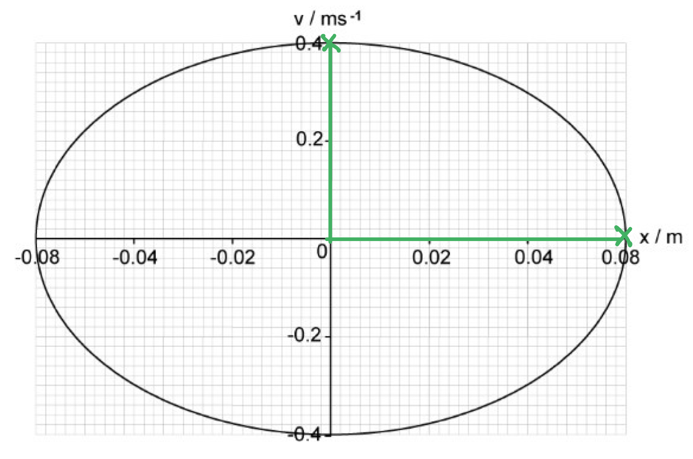

- Point 1: (*x**0*, v) = (0.08, 0) and point 2: (*x*, *v*) = (0, 0.4)

Use the equation for calculating speed in an oscillator:

- $v=\pmω\sqrt{x_{0}^{2}-x^{2}}$
- `0.4 space equals space omega square root of open parentheses 0.08 squared space minus space 0 squared close parentheses end root` **[1 mark]**
- $ω=\frac{0.4}{0.08}$
- $ω=5\mathrm{rad}s^{-1}$** [1 mark]**

**[Total: 3 marks]**

> *In part (ii) you could choose** any** two sets of **coordinates** but it's easier to choose ones with 0's in! *
(i) Damping is:

- The loss of the total energy of a system; **[1 mark]**
- Due to resistive forces; **[1 mark]**

(ii) A sketch on Fig. 1.2, that shows the variation with *x *of *v* when the amplitude of the oscillations is 0.03 m:

Calculate the maximum velocity, *v**max*:

- $v_{max}=ωA$
- $v_{max}=5\times0.03=0.15ms^{-1}$

A graph that should score 2 marks would look like this:

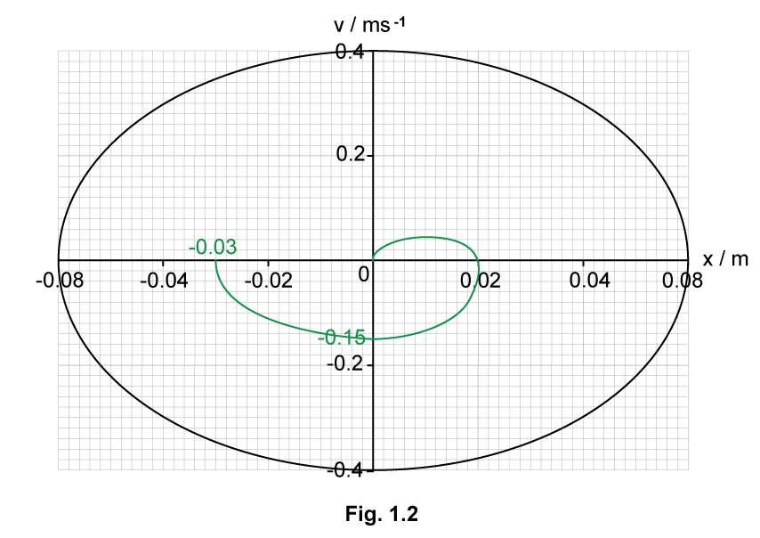

- An open loop is drawn starting at ± 0.03 m, passing through *v**max*; **[1 mark]**
- Damping is heavy, so the object does not reach *x**0* on the other side but comes back to rest at the equilibrium position with *v *< *v**max*; **[1 mark]**

**[Total: 4 marks]**

> *Part (ii) is really tricky. To understand what is happening **draw on the graph** the positions of the oscillator at different times,*

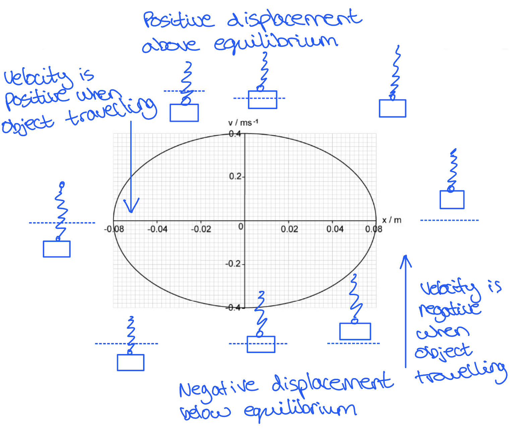

### Q8
A graph that would score 2 marks should look like this:

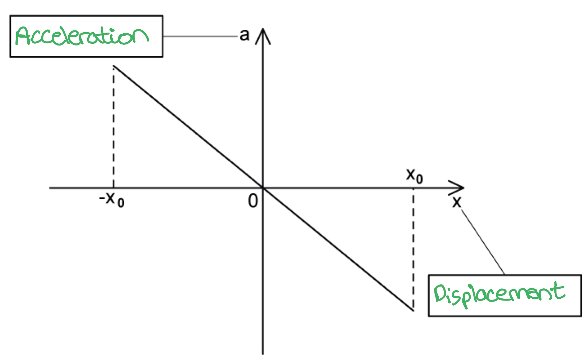

- Horizontal axis is labelled as displacement; **[1 mark]**
- Vertical axis is labelled as acceleration; **[1 mark]**

**[Total: 2 marks]**
Two correctly labelled graphs that would score 2 marks should look like this:

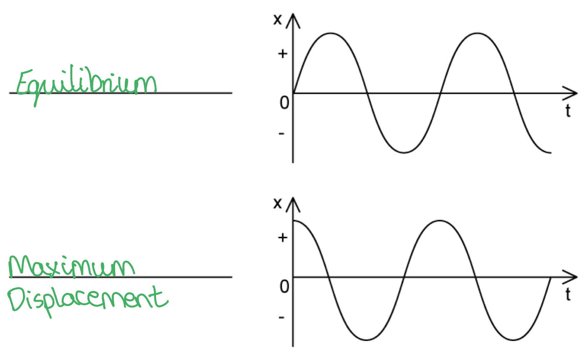

- Top graph labelled as starting in the equilibrium position; **[1 mark]**
- Bottom graph labelled as starting at the maximum displacement; **[1 mark]**

**[Total: 2 marks]**
Identify the variables in the equation:

- *v *= speed of oscillator; **[1 mark]**
- *ω* = angular frequency of oscillation; **[1 mark]**
- *x**0* = amplitude of oscillation; **[1 mark]**
- *x* = displacement of oscillator; **[1 mark]**

**[Total: 4 marks]**
