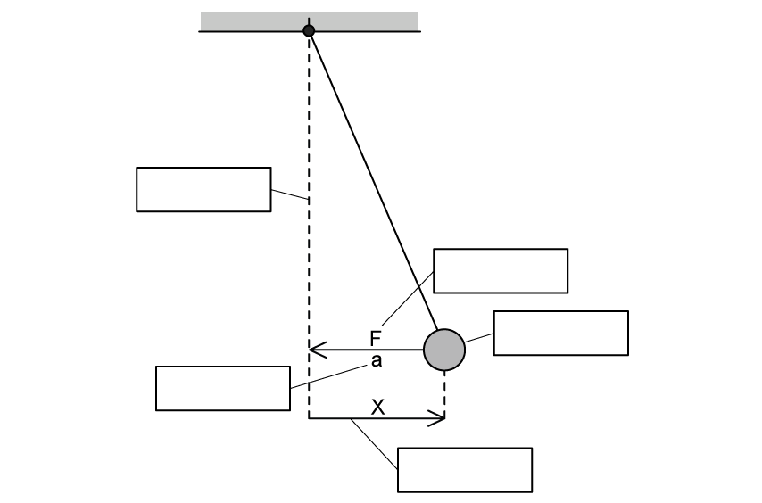
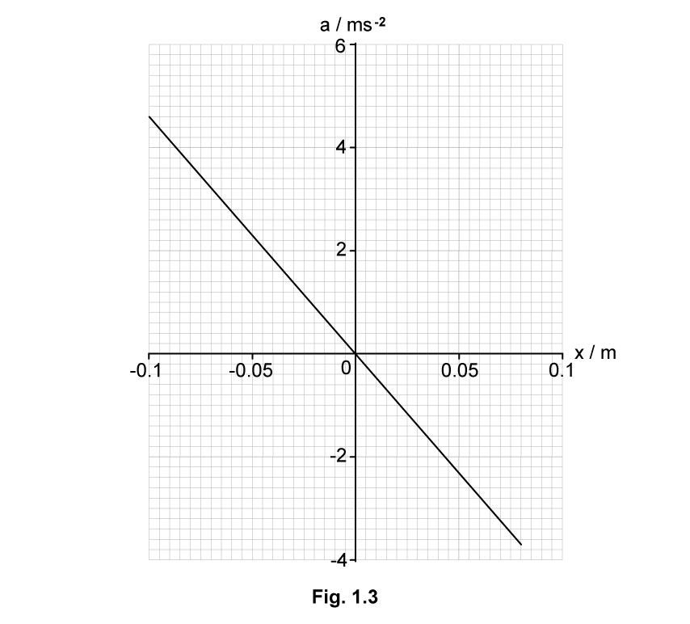
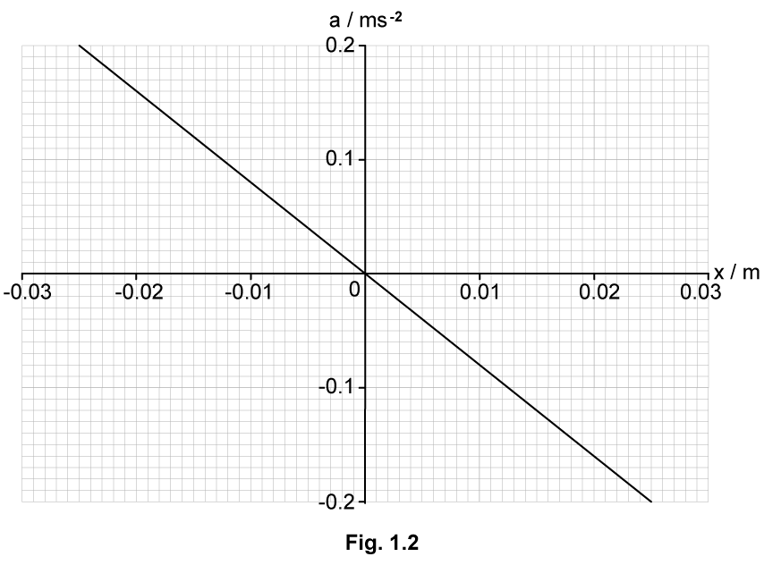
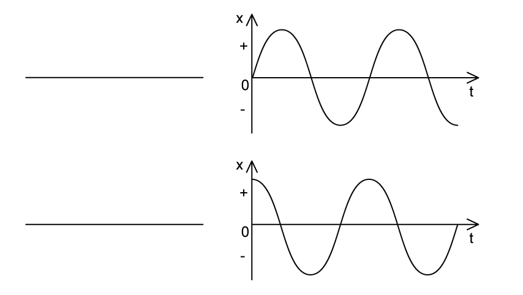

# Exam Questions — Simple Harmonic Oscillations
**17. Oscillations** · Cambridge (CIE) A-LEVEL physics (9702)
> Source: [https://www.savemyexams.com/a-level/physics/cie/25/topic-questions/](https://www.savemyexams.com/a-level/physics/cie/25/topic-questions/) · 8 questions across 1 sets

## Structured Questions (8 questions)

### Q1 — easy — 14 marks

**Q1** [2 marks]

Define an oscillation.

**Q1** [5 marks]

Identify the correct definition by drawing lines between the properties of oscillations and their definition.

| **Properties of Oscillations** | **Definition of Properties** |
|---|---|
| Displacement | The rate of change of angular displacement with respect to time |
| Amplitude | The distance of an oscillator from its equilibrium position |
| Angular Frequency | The time taken for one complete oscillation |
| Frequency | The maximum displacement of an oscillator from its equilibrium position |
| Time Period | The number of oscillations per unit time |

**Q1** [3 marks]

Define simple harmonic oscillation.

**Q1** [4 marks]

Use the words in the box below to correctly label the diagram of an oscillating pendulum in Fig 1.1.

| displacement of mass | mass | acceleration | restoring force | equilibrium position |
|---|---|---|---|---|

**Fig. 1.1**

### Q2 — easy — 13 marks

**Q2** [4 marks]

A pendulum undergoes small-angle oscillations.

State and explain the equation that defines simple harmonic motion.

**Q2** [4 marks]

**Extract:**

A pendulum undergoes small-angle oscillations.

Sketch a graph to show the variation of displacement against time for one swing of the pendulum.

Start the time at zero seconds and mark the amplitude of the oscillation $x_{0}$.

**Q2** [3 marks]

The time taken for 10 oscillations is found to be 12.0 s.

Determine the frequency of the oscillation.

**Q2** [2 marks]

**Extract:**

A pendulum undergoes small-angle oscillations. State and explain the equation that defines simple harmonic motion.

Give **two** other examples of objects that perform simple harmonic motion.

### Q3 — medium — 11 marks

**Q3** [2 marks]

A small wooden cuboid block of mass *m *floats in water, as shown in Fig. 1.1.

The top face of the block is horizontal and has an area *A*. The density of the water is *ρ*.

The block is displaced downwards as shown in Fig. 1.2 so that the surface of the water is now higher up the block.

State and explain the direction of the resultant force acting on the wooden block in this position.

**Q3** [2 marks]

**Extract:**

A small wooden cuboid block of mass m floats in water. The top face of the block is horizontal and has an area A. The density of the water is ρ. The block is displaced downwards so that the surface of the water is now higher up the block.

The block in **(a) **is now released so that is oscillates vertically.

The resultant force *F *acting on the block is given by

$F=-Agρx$

where *g *is the gravitational field strength and *x *is the vertical displacement of the block from the equilibrium position.

Explain why the oscillations of the block are simple harmonic motion.

**Q3** [3 marks]

**Extract:**

The block in (a) is now released so that it oscillates vertically. The resultant force F acting on the block is given by F = -Agρx where g is the gravitational field strength and x is the vertical displacement of the block from the equilibrium position.

A small wooden cuboid block of mass m floats in water. The top face of the block is horizontal and has an area A. The density of the water is ρ.

Use the equation from **(b) **to obtain an expression for the angular frequency *ω* of the oscillations of the block.

**Q3** [4 marks]

The block is now placed in a liquid with a lower density. The block is displaced and released so that it oscillates vertically. The variation with displacement *x *of the acceleration *a *of the block is measured for the first half of the oscillation, as shown in Fig. 1.3.

(i) Explain why the maximum negative displacement of the block is not equal to its maximum positive displacement.

[1]

(ii) The mass of the block is 0.65 kg.

Use Fig. 1.3. to determine the decrease $\DeltaE$ in energy of the oscillation for the first half of the oscillation.

*E *= ................................................... J [3]

### Q4 — hard — 8 marks

**Q4** [3 marks]

A small metal pendulum bob is suspended at rest from a fixed point with a length of thread of negligible mass. Air resistance is negligible. The pendulum begins to oscillate. Fig. 1.1 shows the variation of kinetic energy of the pendulum bob with time.

**Fig. 1.1**

(i) Label on the graph with the letter X a point where the speed of the pendulum is half that of its initial speed.

[1]

(ii) Calculate, in metres, the length of the thread, if the period *T*  is given by the equation:

$T=2π\sqrt{\frac{l}{g}}$

where *l*  is the pendulum length and *g*  is the acceleration of free fall.

[2]

**Q4** [3 marks]

**Extract:**

A small metal pendulum bob is suspended at rest from a fixed point with a length of thread of negligible mass. Air resistance is negligible. The pendulum begins to oscillate. Fig. 1.1 shows the variation of kinetic energy of the pendulum bob with time. From the graph, the time period is 2.25 s

Fig. 1.2 shows how the kinetic energy of the pendulum varies with displacement.

**Fig. 1.2**

(i) Sketch on the diagram above a graph to show how the potential energy of the pendulum varies with displacement.

[1]

(ii) Calculate the mass of the pendulum bob.

[2]

**Q4** [2 marks]

**Extract:**

From the graph, the time period is 2.25 s.

Maximum kinetic energy, E_k = 2 × 10^–2 J (from graph); Time period, T = 2.25 s; Amplitude, x0 = 0.044 m (from graph). Calculate mass from equation for kinetic energy: m = 2.78 kg

Calculate the magnitude of the maximum force upon the pendulum.

### Q5 — medium — 8 marks

**Q5** [2 marks]

A pendulum consists of a bob (small plastic sphere) attached to the end of a piece of wire. The other end of the wire is attached to a fixed point. The bob oscillates with small oscillations about its equilibrium position, as shown in Fig. 1.1.

The length *L *of the pendulum, measured from the fixed point to the centre of the bob, is 1.56 m.

The acceleration *a *of the bob varies with its displacement *x *from the equilibrium position as shown in Fig. 1.2.

State how Fig. 1.2 shows that the motion of the pendulum is simple harmonic.

**Q5** [2 marks]

**Extract:**

The acceleration a of the bob varies with its displacement x from the equilibrium position as shown in Fig. 1.2. The graph shows a straight line through the origin with a negative gradient, passing through points (0, 0) and (0.025, −0.2), with a in ms⁻² on the y-axis and x in m on the x-axis.

Use Fig. 1.2 from **(a) **to calculate the angular frequency *ω* of the oscillations.

*ω *= ................................................. rad s−1

**Q5** [2 marks]

**Extract:**

The length L of the pendulum, measured from the fixed point to the centre of the bob, is 1.56 m.
Calculate the angular frequency ω of the oscillations: ω = 2.83 rad s⁻¹

The angular frequency *ω* is related to the length *L *of the pendulum by

$ω=\sqrt{\frac{k}{L}}$

where *k *is a constant.

Use your answer from **(b) **to determine *k*. Give a unit for your answer.

*k *= ............................................... unit ................

**Q5** [2 marks]

**Extract:**

The angular frequency ω is related to the length L of the pendulum by ω = √(k/L) where k is a constant.

Whilst the pendulum is oscillating, the length of the string is decreased in such a way that the total energy of the oscillations remains constant.

Suggest and explain the qualitative effect of this change on the amplitude of the oscillations.

### Q6 — hard — 11 marks

**Q6** [4 marks]

A mass of 0.42 kg is attached to a spring and the system is made to oscillate with simple harmonic motion (SHM) on a horizontal, frictionless surface. The mass passes through the equilibrium position 200 times per minute.

The kinetic energy of the mass as it passes through the equilibrium position is 500 mJ. There are two points where the restoring force acting on the mass is at its maximum.

Show that the distance between these points is approximately 29 cm.

**Q6** [2 marks]

**Extract:**

A mass of 0.42 kg is attached to a spring and the system is made to oscillate with simple harmonic motion (SHM) on a horizontal, frictionless surface. The mass passes through the equilibrium position 200 times per minute. The kinetic energy of the mass as it passes through the equilibrium position is 500 mJ. There are two points where the restoring force acting on the mass is at its maximum.

Sketch a graph to show how the velocity of the mass varies with time. Label the graph with any suitable values.

**Q6** [2 marks]

**Extract:**

A mass of 0.42 kg is attached to a spring and the system is made to oscillate with simple harmonic motion (SHM) on a horizontal, frictionless surface. The mass passes through the equilibrium position 200 times per minute. The kinetic energy of the mass as it passes through the equilibrium position is 500 mJ.

Angular velocity, ω = 10.472 rad s^–1; Amplitude, x0 = 0.147 m

Find the distance of the mass from the equilibrium position when the speed of the block is 0.8 m s–1

**Q6** [3 marks]

**Extract:**

A mass of 0.42 kg is attached to a spring and the system is made to oscillate with simple harmonic motion (SHM) on a horizontal, frictionless surface. The mass passes through the equilibrium position 200 times per minute.

The experiment is moved to planet X. The gravitational acceleration on planet X is g$x$. It is known that  $\frac{g_{x}}{g}$ = 2. Another change is that three more identical springs are placed in parallel to the original spring.

The period of a spring undergoing simple harmonic oscillation is given by:

$T=2π\sqrt{\frac{m}{k}}$

where *m*  is the mass of the object at the end of the spring and *k*  is the spring constant.

Describe, without calculations, how these changes affect the frequency with which the mass oscillates.

### Q7 — medium — 9 marks

**Q7** [2 marks]

An object is suspended from a spring that is attached to a fixed point as shown in Fig. 1.1.

The object oscillates vertically with simple harmonic motion about its vertical position.

State the defining equation for simple harmonic motion. Identify the meaning of each of the symbols used to represent physical quantities.

**Q7** [3 marks]

**Extract:**

An object is suspended from a spring that is attached to a fixed point as shown in Fig. 1.1. The object oscillates vertically with simple harmonic motion about its vertical position.

The variation with displacement *x *from the equilibrium position of the velocity *v* of the object is shown in Fig. 1.2.

Use Fig. 1.2 to:

(i) Determine the amplitude *x**0* of the oscillations

*x**0* = .............................................. m [1]

(ii) Determine the angular frequency *ω* of the oscillations.

[2]

**Q7** [4 marks]

**Extract:**

The variation with displacement x from the equilibrium position of the velocity v of the object is shown in Fig. 1.2. Use Fig. 1.2 to: (i) Determine the amplitude x0 of the oscillations [x0 = 0.08 m]; (ii) Determine the angular frequency ω of the oscillations [ω = 5 rad s⁻¹].

The oscillations of the object are now heavily damped.

(i) State what is meant by damping.

[2]

(ii) Assume that the damping does not change the angular frequency of the oscillations.

On Fig. 1.2, sketch the variation with *x *of *v* when the amplitude of the oscillations is 0.03 m.

[2]

### Q8 — easy — 8 marks

**Q8** [2 marks]

The graph in Fig. 1.1 shows that the acceleration of an object is directly proportional to the negative displacement.

**Fig. 1.1**

Label the two axis of the graph on Fig. 1.1.

**Q8** [2 marks]

The graphs in Fig. 1.3 show an oscillator starting at the equilibrium position and an oscillator starting at the maximum displacement.

**Fig. 1.3**

Identify by writing next to the graphs on Fig 1.3 the correct name of the starting position of the oscillator.

**Q8** [4 marks]

The equation below defines how the speed of an oscillator changes with the displacement of the oscillator.

`v space equals space plus-or-minus omega square root of open parentheses x subscript 0 squared space minus space x squared close parentheses end root`

Identify the variables in the equation by stating the variable and the quantity it represents in the space below.
