# Mark Schemes — Energy in Simple Harmonic Motion
**17. Oscillations** · Cambridge (CIE) A-LEVEL physics (9702)

## Structured Questions (8 questions)

### Q1
A graph which would score full credit is shown below:

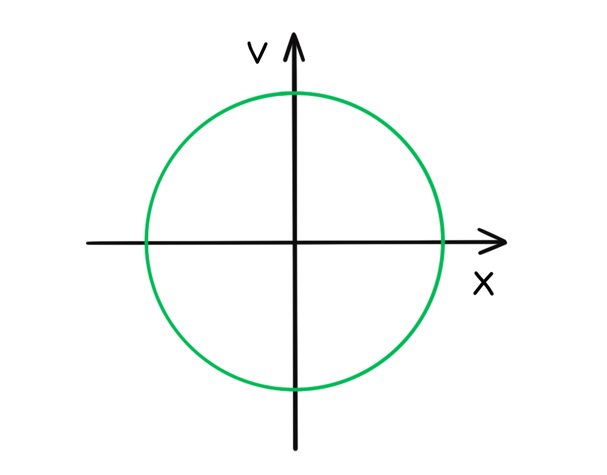

- When displacement $x$ = 0, velocity is maximum in both directions (the mass is in equilibrium); **[1 mark]**
- When velocity $v$ = 0, displacement is maximum in both directions (the mass is at its amplitude); **[1 mark]**

**[Total: 2 marks]**

> *You are unlikely to be given a question as tricky as this in your exam but being able to do it and follow the thought process will set you up well for other difficult questions. The thinking involved is not beyond that of a top A level candidate.*

> *The question is asking for a **velocity-displacement** graph and not a displacement graph.*

> *When sketching graphs, take it step by step. Start with the situation for one variable being zero – what is the other value at this point? Next walk through the motion. Sketching a drawing of the object in motion often helps. You might have been tempted to draw a sine wave in answer to this question, but that only applies when **time** is on the x-axis.*

> *The important fact to remember is that when **x** = 0, **v** = maximum and when **x** = maximum, **v** = 0.*
List the known quantities:

- Mass attached to the spring, *m* = 50 g = 0.05 kg
- $E_{k}$ = $\frac{1}{2}$ *mv*2

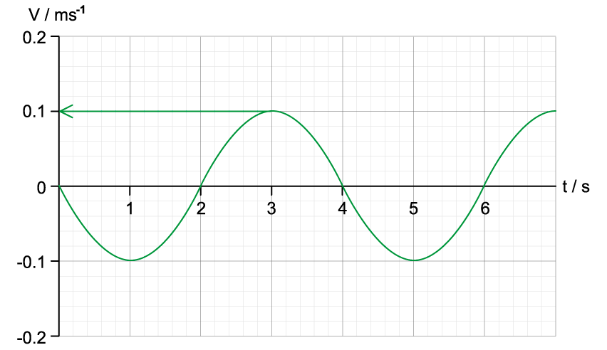

- From the graph, $v_{max}$= 0.1 m s–1 

State that the total energy of the system is equal to the maximum kinetic energy:

- $E_{T}$ = $E_{Kmax}$ **[1 mark]**

Calculate the maximum kinetic energy, $E_{Kmax}$:

- $E_{Kmax}$ =  $\frac{1}{2}mv^{2}_{max}$
- $E_{Kmax}$ = $\frac{1}{2}$$mv^{2}_{max}$ = $\frac{1}{2}$ × 0.05 × (0.1)2 = 0.25 mJ **[1 mark]**

**[Total: 2 marks]**

> *The total energy of the system at maximum velocity is equal to the maximum kinetic energy.*
List the known quantities:

- Maximum kinetic energy, $E_{k}$= 0.25 mJ (from part b)

Determine the equation for potential energy, $E_{P}$:

- The total energy of the system, $E_{T}$ = Kinetic energy,  $E_{k}$+ Potential energy $E_{P}$
- Therefore, $E_{P}=E_{T}-E_{K}$

  - When the kinetic energy is 0, the potential energy is at a maximum

Determine *v*  from the graph at *t* = 6 s:

- When$t$ = 6 s the velocity, $v$ = 0

  - This means $E_{k}$= 0 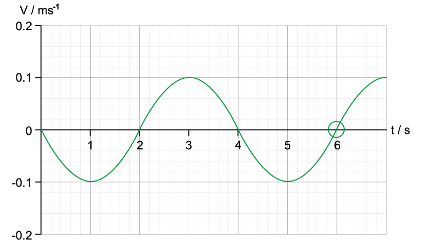

Determine potential energy, $E_{P}$:

- *v* = 0 at the maximum or minimum amplitude of the oscillation

  - This means all the kinetic energy has been transferred to potential energy
- Therefore $E_{P}=E_{T}$ = 0.25 mJ **[1 mark]**

**[Total: 1 mark]**

> *Some questions are easier than they look at first glance. Be aware that a question worth only 1 mark probably doesn’t have very much working required to answer it. Don't confuse the potential energy in this scenario with gravitational potential energy. *
List the known quantities:

- Mass, *m *= 50 g = 0.05 kg
- Total energy of system in part b), *E**T* = 0.25 mJ
- Time period of oscillation, *T *= 4 s (from part b)
- *v**max* = 0.1 m s−1 (From part b)

Determine the angular velocity of the oscillation, *ω*:

- Recall: $ω=\frac{2π}{T}$
- $ω=\frac{2π}{4}=\frac{π}{2}$ **[1 mark]**

Determine the amplitude of oscillation, *x**0*:

- Recall: $v_{max} = ω x_{0}$
- $x_{0}=\frac{0.1}{\frac{π}{2}}=0.06366m$ **[1 mark]**

Calculate the total energy of the system, *E**T*:

- Recall: $E_{T}=\frac{1}{2}mω^{2}x_{0}^{2}$
- `E subscript T equals 1 half cross times 0.05 cross times open parentheses straight pi over 2 close parentheses squared cross times 0.06366 squared equals 2.5 cross times 10 to the power of negative 4 end exponent equals 0.25 space mJ` **[1 mark]**

**[Total: 3 marks]**

> *For a vertical mass-spring system, measuring displacement from the equilibrium position means gravitational potential energy is already accounted for. The total energy is still *`E_{T} = \frac{1}{2} m \omega^{2} \left(x_{0}\right)^{2}`* where *$x_{0}$* is measured from equilibrium.*

### Q2
The total of energy of a system oscillating in simple harmonic motion is:

- The <u>sum</u> of the <u>potential energy</u> and the <u>kinetic energy</u> of the system; **[1 mark]**

**[Total: 1 mark]**

> *You may also have answered this question using the equation **E**T** = **E**p** + **E**k**. This is ok as long as you remember to define the terms you use. For example, the total energy **E**T**  is equal to potential energy **E**p** plus kinetic energy **E**k **in a system.*
(i) Identify the position of the pendulum when kinetic energy is zero:

- The kinetic energy is zero at amplitude *x**0*
- Therefore, kinetic energy is zero at position A **OR** C **[1 mark]**

(ii) Identify the position of the pendulum when potential energy is at a maximum:

- The potential energy is at a maximum at the amplitude *x**0*
- Therefore, potential energy is at a maximum at position A **OR** C; **[1 mark]**

(iii) Identify the position of the pendulum when kinetic energy is at a maximum:

- The kinetic energy is at a maximum at the equilibrium position
- Therefore, the kinetic energy is at a maximum position B; **[1 mark]**

(iv) Identify the position of the pendulum when potential energy is zero:

- The potential energy is zero at the equilibrium position
- Therefore, potential energy is zero at position B; **[1 mark]**

**[Total: 4 marks]**

> *You may want to annotate the diagram to help you visualise the energy transfers to help with your answer. *

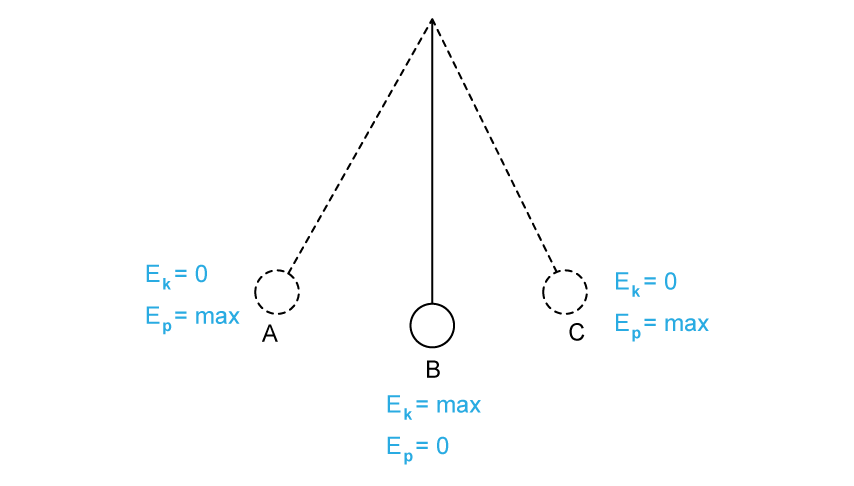
To determine the total energy of the system:

- The kinetic energy is at a maximum as the pendulum swings through the equilibrium position
- Maximum kinetic energy = total energy of the system;** [1 mark]**
- *E*k max = *E*total = 0.324 J **[1 mark]**

**[Total: 2 marks]**
Calculate the angular speed of the pendulum at the equilibrium position:

List the known quantities:

- Amplitude, $x_{0}$ = 5 cm = 0.05 m
- Mass, $m$ = 20 g = 0.02 kg
- Total energy, $E$ = 0.324 J

Use the equation for total energy in SHM and rearrange to make *ω* the subject:

- $E=\frac{1}{2}mω^{2}x_{0}^{2}$
- $ω=\sqrt{\frac{2E}{mx_{0}^{2}}}$ **[1 mark]**

Substitute in the known values to calculate:

- `omega space equals space square root of fraction numerator 2 space cross times space 0.324 over denominator 0.02 space cross times space open parentheses 0.05 close parentheses squared end fraction end root` **[1 mark]**
- $ω=113.84=114\mathrm{rad}s^{-1}$ **[1 mark]**

**[Total: 3 marks]**

### Q3
To calculate the acceleration at the moment of release:

List the known quantities:

- Mass,* m**m* = 75 g = 0.075 kg
- Force per mm, *F* = 0.025 N mm−1
- Amplitude of oscillations, $x_{0m}$ = 0.055 m = 55 mm

Determine the force required to pull the mass 0.055 m to the right:

- Force = force per mm × amplitude of oscillation
- F = 0.025 × 55 = 1.4 N per spring
- There are two springs so 2 × 1.4 N = 2.8 N

Calculate the acceleration at the moment of release:

- Rearrange *F* = *ma*
- *a *=* *$\frac{F}{m}$* = *$\frac{2.8}{0.075}$* *= 37 m s−2 **[1 mark]**

Consider the direction of motion:

- Since *a* ∝ −$x$, *a* will be negative
- *a* = −37 m s−2 **[1 mark]**

**[Total: 2 marks]**
To estimate the maximum kinetic energy of the ion:

List the known quantities:

- Frequency, *f *= 8 ×1012 Hz
- Mass of ion,* m**i* = 6 ×10−26 kg
- Amplitude of oscillations, $x_{0i}$ = 2 ×10−11 m

From the data booklet:

- *K**E* = $\frac{1}{2}$*mv*2
- $E=\frac{1}{2}mω^{2}x_{0}^{2}$

Calculate the maximum kinetic energy of the ion:

- $K_{Emax}=E_{total}$
- $E=\frac{1}{2}mω^{2}x_{0}^{2}$ and $ω=\frac{2π}{T}=2πf$
- Combining these equations gives `E space equals space 1 half m open parentheses 2 straight pi f close parentheses squared x subscript 0 squared`
- `E space equals space 1 half space cross times space open parentheses 6 cross times 10 to the power of negative 26 end exponent close parentheses space cross times space open parentheses 2 straight pi space cross times space open parentheses 8 cross times 10 to the power of 12 close parentheses close parentheses squared space cross times space open parentheses 2 cross times 10 to the power of negative 11 end exponent close parentheses squared`** [1 mark]**
- `E space equals space 3 cross times 10 to the power of negative 20 end exponent space straight J space open parentheses 1 space straight s. straight f. close parentheses`** [1 mark]**

**[Total: 2 marks]**
To sketch the variation of kinetic and potential energy over time, including appropriate values:

Label the axes Energy and time:

Draw the total energy of the mass-spring system on the axes using a ruler and include the value:

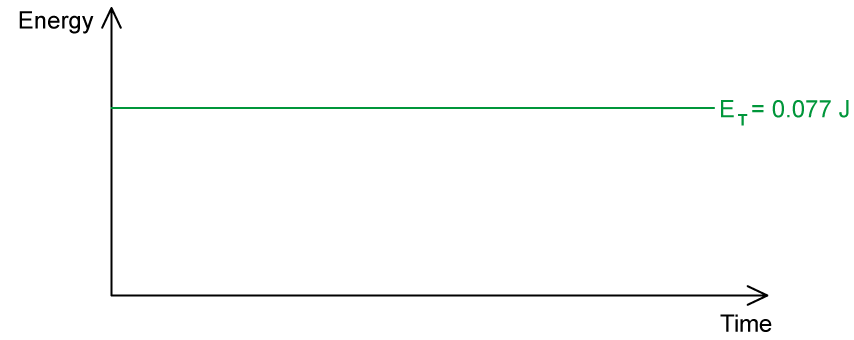

- Axes labelled correctly **AND** total energy value given with appropriate horizontal line; **[1 mark]**

Divide the time axis equally over one complete period:

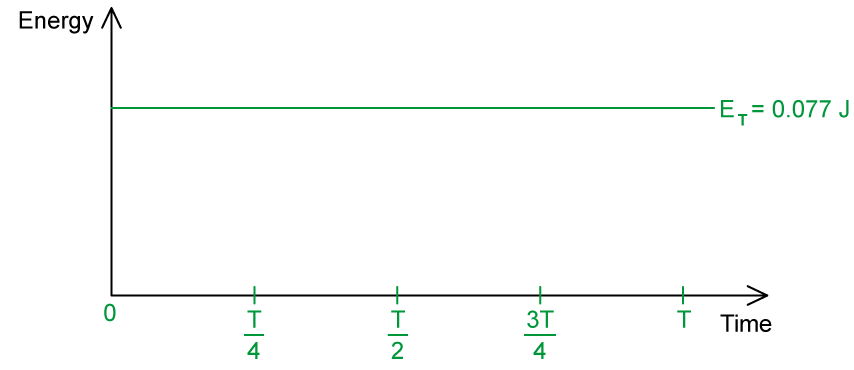

Sketch the kinetic energy of the mass on the axes and label it *E**k*:

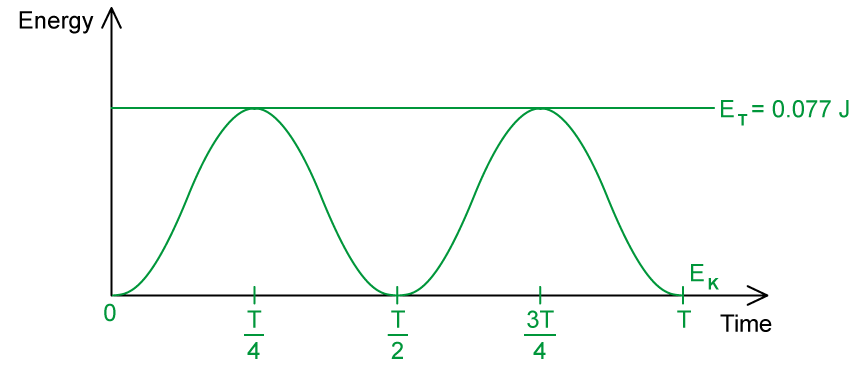

- *E**k*  = 0 at:

  - *t* = 0
  - *t* =$\frac{T}{2}$
  - *t* = *T*

**AND**

- *E**k** *= 0.077 J at:

  - *t* = $\frac{T}{4}$
  - *t* = $\frac{3T}{4}$ **[1 mark]**

Sketch the potential energy in the springs on the axes and label it *E**p*:

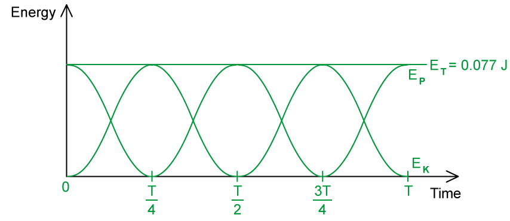

- *E**P** *= 0 at:

  - *t* = $\frac{T}{4}$
  - *t* = $\frac{3T}{4}$

**AND**

- *E**P*  = 0.077 J at:

  - *t* = 0
  - *t* =$\frac{T}{2}$
  - *t* = *T ***[1 mark]**

**[Total: 3 marks]**
Determine the positions of the mass when *E**p* = max:

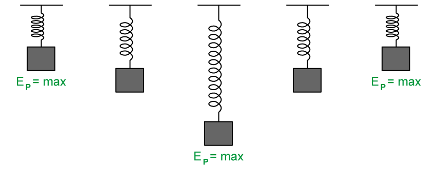

- *E**p* = max annotated at the points of maximum displacement; **[1 mark]**

Determine the positions of the mass when *E**k* = max:

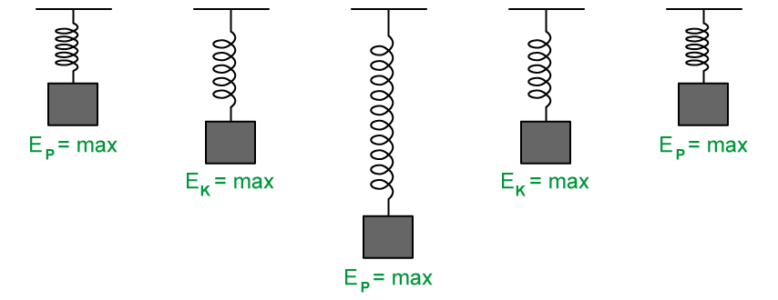

- *E**k* = max annotated at the points of equilibrium; **[1 mark]**

Annotate the velocities at each position:

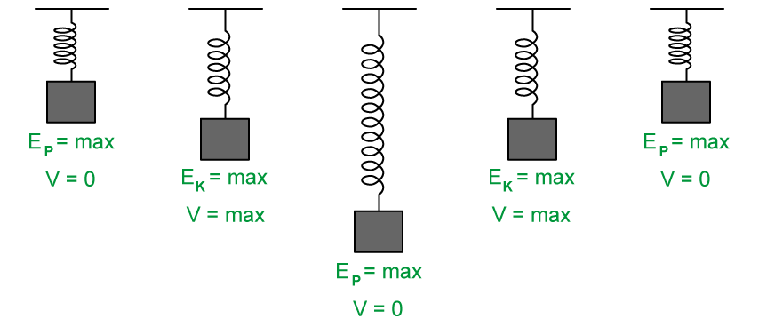

- *v* = 0 annotated at the points of maximum displacement

**AND**

- *v* = max annotated at the equilibrium positions; **[1 mark]**

**[Total: 3 marks]**

> *You may find it easier to mark the velocities first as this can help you to determine the positions where **E**k** = max since kinetic energy is it a maximum at the point of maximum velocity (equilibrium position). Remember that v = 0 at the points where the oscillation changes direction. As long as you include all the information the question asks for, either way is fine.*

### Q4
The time period of the pendulum is:

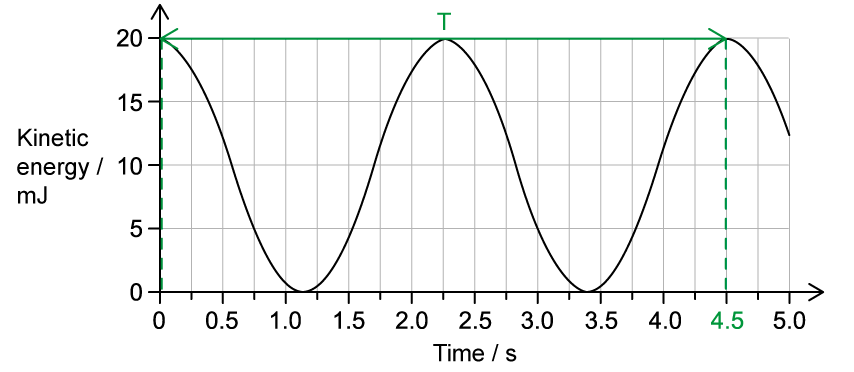

- 4.5 s **[1 mark]**

**[Total: 1 mark]**

> *The time period is the time taken for **one full oscillation** of the pendulum. This can be read from the graph. Make sure to always check the units on the time axis before stating your final answer! In this case it is in seconds (s) but many graphs often have milliseconds (ms) instead.*

> *Remember that for a graph of kinetic energy, one full oscillation from the equilibrium position contains three peaks. Kinetic energy is at a maximum as the pendulum passes the equilibrium position. Therefore, for one complete oscillation, kinetic energy will begin at maximum, dip to zero at amplitude, peak at maximum as it passes through equilibrium, dip to zero at the opposite amplitude, and then return to maximum as it returns to equilibrium position.*
A label that would score 1 mark should look like:

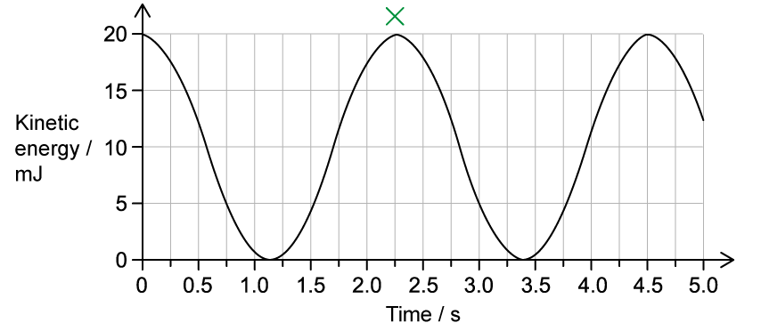

- Label 'X' at any maxima (0 s, 2.25 s or 4.5s ); **[1 mark]**

**[Total: 1 mark]**

> *The pendulum has maximum kinetic energy at the equilibrium position, because that is when it is travelling at its fastest **speed**. This is because kinetic energy is equal to *$\frac{1}{2}$*mv**2** where **m** is the mass and **v** is the speed. At its maximum amplitude, the pendulum bob momentarily stops so has zero speed and therefore zero kinetic energy. *
(i) The maximum kinetic energy of the bob is:

- 20 mJ **OR **20 × 10–3 J  (from the graph) **[1 mark]**

(ii) The maximum speed of the bob is:

List the known quantities:

- Mass of the bob, *m *=* *60 × 10–3 kg
- Kinetic energy of the bob, *E*k = 20 mJ = 20 × 10–3 J

Rearrange the kinetic energy equation for the speed, *v:*

- $E_{K}=\frac{1}{2}mv^{2}$
- $2E_{K}=mv^{2}$
- *v* = $\sqrt{\frac{2E_{k}}{m}}$ **[1 mark]**

Substitute the values into the speed equation:

- *v* = $\sqrt{\frac{2\times(20\times10^{-3})}{60\times10^{--3}}}$**[1 mark]**
- *v* = 0.8165 = 0.82 m s–1 **[1 mark]**

**[Total: 4 marks]**

> *The maximum kinetic energy is read from the maximum value on the graph. Remember to always check the units of the variable on the axes, in this case, it is in mJ and **not** just J!*

### Q5
The potential energy of the pendulum at:

- X = maximum

**AND**

- Y = maximum

**AND**

- Z = minimum; **[1 mark]**

**[Total: 1 mark]**
To determine the mass of the pendulum bob:

List the known quantities:

- Amplitude, $A=x_{0}=60\mathrm{cm}=0.6m$
- Frequency, $f=0.7\mathrm{Hz}$
- Maximum kinetic energy, $E_{Kmax}=23J$

Recall the total energy equation and rearrange to solve for *m*:

- $E=\frac{1}{2}mω^{2}x_{0}^{2}$
- $m=\frac{2E}{ω^{2}x_{0}^{2}}$ **[1 mark]**

Substitute the equation for angular velocity into the total energy equation:

- $ω=\frac{2π}{T}=2πf$
- `m space equals space fraction numerator 2 E over denominator open parentheses 2 straight pi f close parentheses squared x subscript 0 squared end fraction` **[1 mark]**

Substitute in the known values to calculate mass:

- $E_{Kmax}=E$ **[1 mark]**
- `m space equals space fraction numerator 2 space cross times space 23 over denominator open parentheses 2 straight pi space cross times space 0.7 close parentheses squared space cross times space open parentheses 0.6 close parentheses squared end fraction`
- $m=6.6\mathrm{kg}$** [1 mark]**

**[Total: 4 marks]**
To calculate the kinetic energy of the pendulum bob:

List the known quantities:

- Maximum kinetic energy, $E_{Kmax}=\frac{1}{2}mω^{2}x_{0}^{2}=23J$ (from part (b))
- Amplitude, $A=x_{0}=0.6m$ (from part (a))
- Frequency, $f=0.7\mathrm{Hz}$ (from part (a))
- Mass of pendulum, $m=6.6\mathrm{kg}$ (from part (b))

Determine the displacement from the equilibrium position:

- The question states that the pendulum is $0.4x_{0}$ from its maximum displacement 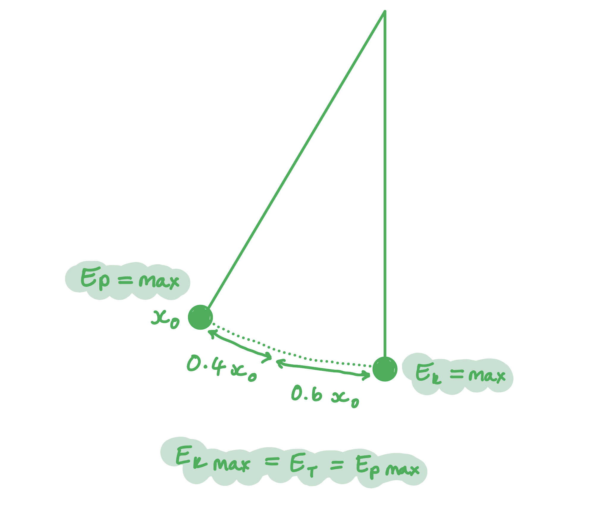

  - Therefore, it is $0.6x_{0}$ from its equilibrium position **OR** $x=0.6\times0.6=0.36m$ **[1 mark]**

Using the kinetic energy equation to determine the kinetic energy at this displacement:

- `E subscript K space end subscript space equals 1 half m omega squared open parentheses x subscript 0 squared space minus space x squared close parentheses space equals 1 half m open parentheses 2 pi f close parentheses squared open parentheses x subscript 0 squared space minus space x squared close parentheses`
- `E subscript K space end subscript space equals 1 half space cross times space 6.6 space cross times space open parentheses 2 pi space cross times space 0.7 close parentheses squared space cross times space open parentheses 0.6 squared space minus space 0.36 squared close parentheses` **[1 mark]**
- $E_{K}=14.72J$** [1 mark]**

**OR**

- `E subscript K space end subscript space equals 1 half m omega squared open parentheses x subscript 0 squared space minus space x squared close parentheses space equals 1 half m omega squared open parentheses x subscript 0 squared space minus space open parentheses 0.6 x subscript 0 close parentheses squared close parentheses`
- `E subscript K space end subscript space equals 1 half m omega squared x subscript 0 squared open parentheses 1 space minus space 0.6 squared close parentheses space equals 23 open parentheses 1 space minus space 0.6 squared close parentheses` **[1 mark]**

- $E_{K}=14.72J$** [1 mark]**

**[Total: 3 marks]**

> *We can use the total energy equation in this instance because we know the value of the maximum kinetic energy which is equal to the total energy of the system. Always choose equations based on the known quantities you are given (or can calculate from what you are given!)*

### Q6
Sentences completed with the correct words:

- The displacement-time graph is a curve identical to a **sine** graph when the oscillator starts from its equilibrium position; **[1 mark]**
- Velocity is the rate of change of **displacement**; **[1 mark]**
- The velocity-time graph is **90°** out of phase with the displacement-time graph; **[1 mark]**
- Acceleration is the rate of change of **velocity**; **[1 mark]**
- The acceleration-time graph is **identical** to the displacement graph except reflected on the x-axis; **[1 mark]**

**[Total: 5 marks]**
The equation for the total energy of a simple harmonic system is:

- `E space equals space 1 half m omega squared open parentheses x subscript o close parentheses squared`** [1 mark]**

**[Total: 1 mark]**
A diagram that would score 5 marks should look like this:

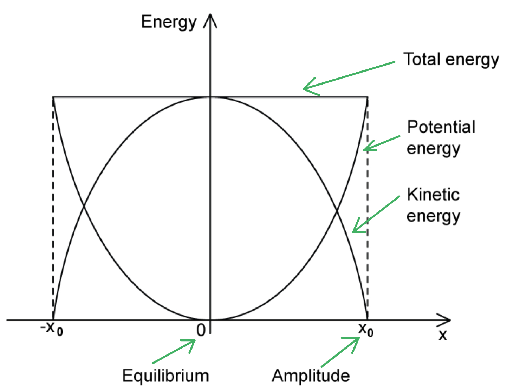

- Total energy joined to horizontal axis; **[1 mark]**
- Potential energy joined to U shaped curve; **[1 mark]**
- Kinetic energy joined to n shaped curve; **[1 mark]**
- Equilibrium joined to 0 on horizontal axis; **[1 mark]**
- Amplitude joined to one or both of *x**0* or *−x**0* on the horizontal axis; **[1 mark]**

**[Total: 5 marks]**
A table that would score 2 marks should look like this:

| **Possible statements about the displacement-time graphs** | **Place a tick (✓) here if the statement is correct** |
|---|---|
| The amplitude of oscillations *x**0** *can be found from the maximum value of *x* | **Final answer:** ** **  **✓ ****[1 mark]** |
| If the oscillations start at the positive or negative amplitude, the displacement will be at its minimum |   |
| The time period of oscillations *T* can be found from reading the time taken for one full cycle | **Final answer:** ** **  **✓ ****[1 mark]** |
| The graph always starts at 0 |   |

- One mark for each correct statement ticked

**[Total: 2 marks]**

> *The two incorrect statements are correct below:*

- *If the oscillations start at the positive or negative amplitude, the displacement will be at its **maximum*
- *The graph **might not **always starts at 0*

### Q7
List the known quantities:

- Cross-sectional area of liquid = *A*
- Mass of liquid = *m*
- Density of liquid = *ρ*
- Volume of liquid = *V*
- Length of liquid column =* L*

Recall the equations for maximum kinetic energy *E**k (max)*, volume *V* and density *ρ*:

- `E subscript k space open parentheses m a x close parentheses end subscript space equals space 1 half m v subscript m a x end subscript squared` **AND**
- *V *= *AL* **AND**
- $ρ=\frac{m}{V}$ **[1 mark]**

Rearrange and substitute the equations for mass *m *and volume *V*:

- $ρ=\frac{m}{V}$ $\rightarrow$ $m=ρV$
- `m space equals space rho space cross times space open parentheses A L close parentheses`
- `E subscript k space open parentheses m a x close parentheses end subscript space equals space 1 half open parentheses rho A L close parentheses v subscript m a x end subscript squared`
- `E subscript k space open parentheses m a x close parentheses end subscript space equals space 1 half A L rho v subscript m a x end subscript squared`** [1 mark]**

**[Total: 2 marks]**

> *To answer this question correctly take time to think about all the equations you know that can help you express the quantity you want with those you need. Even though the water is curved it is a cylinder of length **L, **so volume = cross-sectional area **A **× **L**. *
List the known quantities:

- Cross-sectional area of liquid = *A*
- Mass of liquid = *m*
- Density of liquid = *ρ*
- Volume of liquid = *V*
- Length of liquid =* L*

Obtain an expression in terms of cross-sectional area *A* and density *ρ* for the mass *m* of the liquid:

- *m *= *Vρ*
- Let *x**max* be amplitude / maximum displacement of the oscillation above the equilibrium position where gravitational potential energy is gained
- So, *m *= *Ax**max**ρ ***[1 mark]**

Obtain an expression for gravitational potential energy *E**p* (max) in terms of cross-sectional area *A *and density of liquid *ρ*:

- At maximum displacement, the gravitational potential energy of the water is the energy needed to lift a section of the water a height *x**max* above the equilibrium position = *E**p (max)* = *mgx**max*
- *E**p (max)* = (*Ax**max**ρ*) × *gx**max*
- *E**p (max)* = *Aρgx**max**2* **[1 mark]**

**[Total: 2 marks]**

> *Gravtiational potential energy is gained when the water is a height of **x**max** above the equilibrium position hence the equation for the mass of the water moving above this position contains **x**max**. The SHM equation for **v**max** is **v**max** = **ωA** where **A **is amplitude and not cross-sectional area. Don't let this confuse you! *
List the known quantities:

- `E subscript k space open parentheses m a x close parentheses end subscript space equals space 1 half A L rho v subscript m a x end subscript squared` (From part a))
- *E**p (max)* = *Aρgx**max**2 *(From part b))

Combine the expressions and rearrange to get an expression for $\frac{x_{max}}{v_{max}}$:

- $\frac{1}{2}ALρv_{max}^{2}=Aρgx_{max}^{2}$
- $\frac{v_{max}^{2}}{x_{max}^{2}}=\frac{2Aρg}{ALρ}$
- $\frac{v_{max}^{2}}{x_{max}^{2}}=\frac{2g}{L}$
- $\frac{v_{max}}{x_{max}}=\sqrt{\frac{2g}{L}}$
- $\frac{x_{max}}{v_{max}}=\sqrt{\frac{L}{2g}}$ **[1 mark]**

Use the equation for *v**max* to substitute in for *ω*:

- Recall: *v**max *= *ωx**max *(for amplitude *x**max*)
- $ω=\frac{v_{max}}{x_{max}}$ $\rightarrow$ $\frac{1}{ω}=\frac{x_{max}}{v_{max}}$
- $\frac{1}{ω}=\sqrt{\frac{L}{2g}}$ **[1 mark]**

Recall the equation for angular velocity, *ω *in terms of time period *T *and obtain the required equation:

- Recall: $ω=\frac{2π}{T}$
- So, $\frac{1}{ω}=\frac{T}{2π}$
- $\frac{T}{2π}=\sqrt{\frac{L}{2g}}$ **[1 mark]**
- So, $T=2π\sqrt{\frac{L}{2g}}$

**[Total: 3 marks]**

> *You do not need to know this equation for your course, so don't learn it. These types of hard questions are common when they take you beyond the syllabus. *
List the known quantities:

- $\frac{x_{max}}{v_{max}}=0.05$ s
- $\frac{x_{max}}{v_{max}}=\sqrt{\frac{L}{2g}}$ (From part c)
- $\frac{x_{max}}{v_{max}}=\frac{1}{ω}$ (From part c)
- Acceleration due to free-fall, *g *= 9.81 m s−2

Substitute the known quantities into the correct equation to calculate *L*:

- $0.05=\sqrt{\frac{L}{2\times9.81}}$
- $0.05^{2}=\frac{L}{19.62}$
- $L=0.049$ m
- $L=4.9$ cm **[1 mark]**

Substitute the known quantities into the correct equation to calculate *ω*:

- $0.05=\frac{1}{ω}$
- $ω=\frac{1}{0.05}$
- $ω=20$ rad s−1 **[1 mark]**

**[Total: 2 marks]**

> *This question is straightforward if you can use the equations from part c). You can also use the equation for the total energy in simple harmonic motion given on your data page to answer this question: *

$E=\frac{1}{2}mω^{2}x_{0}^{2}$

### Q8
(i) Determine the maximum potential energy:

Identify from the graph the maximum potential energy:

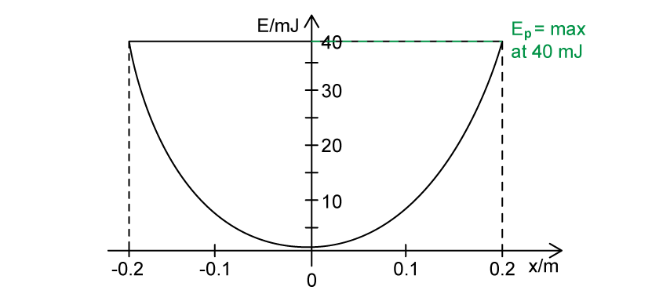

- The graph reaches a maximum potential energy of <u>40 mJ</u> at amplitude *x**0*; **[1 mark]**

(ii) Determine the total energy:

Identify from the graph the total energy:

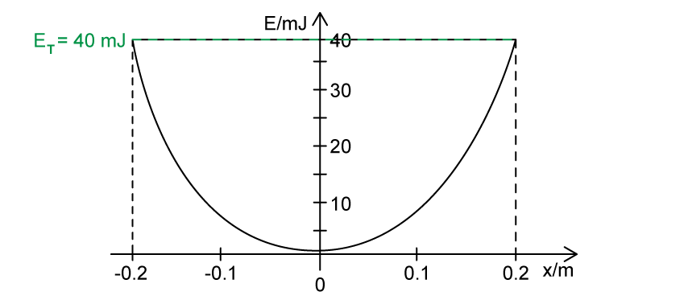

- The graph shows that the total energy is <u>40 mJ;</u> **[1 mark]**

**[Total: 2 marks]**

> *Potential energy is equal to the total energy at amplitude **x**0**. Kinetic energy is equal to the total energy at the equilibrium point. As the kinetic energy store fills, the potential energy store empties, and vice versa. The total energy of the system is conserved.*
(i) Use the graph to determine the amplitude *x**0*:

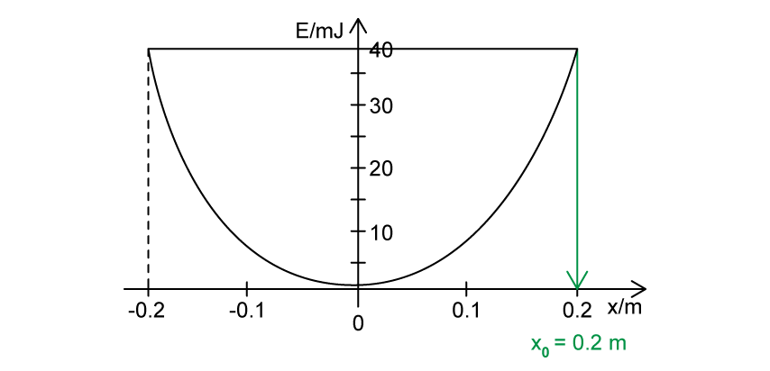

- Amplitude *x**0* = 0.2 m **[1 mark]**

(ii) Use the graph to determine the potential energy at *x* = 0.1 m:

- The potential energy at x = 0.1 m is 9<u> mJ </u>**[1 mark]**

**[Total: 2 marks]**

> *When the resolution of the graph is large, there will usually be a small range of acceptable answers. In this question, an answer of 8 mJ or 9 mJ would be awarded the mark. If the graph is given on graph paper, then you would be expected to give a very accurate reading. Either way, always try to be as accurate as possible when determining a value from a graph. It may help to pencil in the 1 mJ lines to be as accurate as possible. *

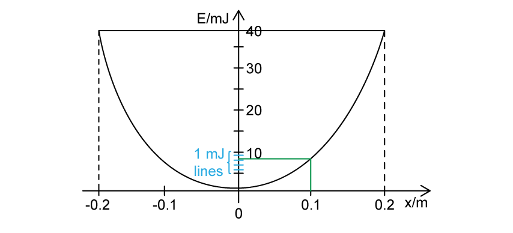

> *As you can see, the value is more like 8.5 mJ.*
Determine the kinetic energy of the mass-spring system at *x* = 0.1 m:

List the known quantities:

- Total energy, $E$ = 40 mJ (from part a)
- Potential energy at x = 0.1 m, $E_{P}$ = 9 mJ (from part b)

Determine an expression for *E*K:

- Energy in a system in SHM is conserved
- So, total energy:  $E=E_{K}+E_{P}$
- Therefore, kinetic energy:  $E_{K}=E-E_{P}$ **[1 mark]**

Calculate the kinetic energy at *x* = 0.1 m:

- $E_{K}$ = 40 − 9 = 31 mJ** [1 mark]**

**[Total: 2 marks]**
Calculate the maximum velocity of the oscillation:

List the known quantities:

- Maximum kinetic energy, *E* = *E**K max* = 40 mJ = 0.04 J
- Mass *m* = 25 g = 0.025 kg

Recall and rearrange the kinetic energy equation to solve for *v:*

- $E_{K}=\frac{1}{2}mv^{2}$
- *v* = $\sqrt{\frac{2E_{K}}{m}}$ **[1 mark]**

Calculate the velocity:

- v = $\sqrt{\frac{2\times0.04}{0.025}}$ = 1.8 m s−1 **[1 mark]**

**[Total: 2 marks]**
