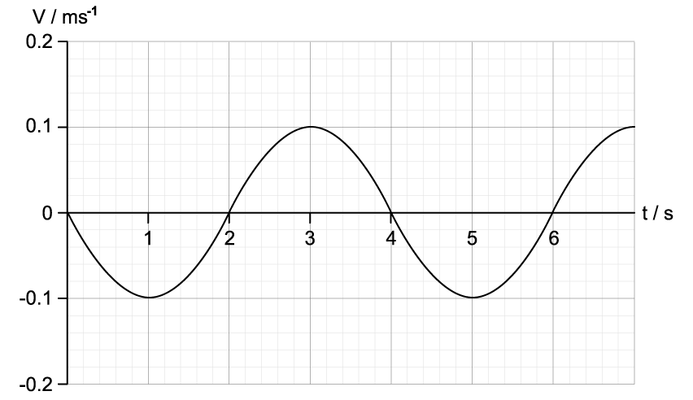
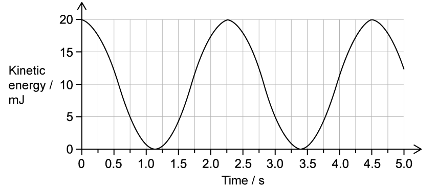
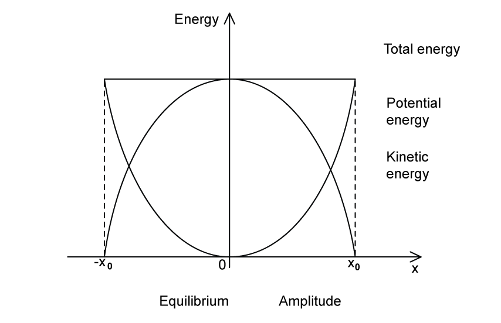

# Exam Questions — Energy in Simple Harmonic Motion
**17. Oscillations** · Cambridge (CIE) A-LEVEL physics (9702)
> Source: [https://www.savemyexams.com/a-level/physics/cie/25/topic-questions/](https://www.savemyexams.com/a-level/physics/cie/25/topic-questions/) · 8 questions across 1 sets

## Structured Questions (8 questions)

### Q1 — hard — 8 marks

**Q1** [2 marks]

A mass-spring system has been set up horizontally on the lab bench, so that the mass can oscillate.

Sketch a velocity-displacement graph of the motion of the block as it undergoes simple harmonic motion.

**Q1** [2 marks]

A mass of *m* = 50 g is attached to the mass-spring system.

The graph in Fig. 1.1 shows the variation with time of the velocity of the block.

**Fig. 1.1**

Determine the total energy of the system when it is oscillating with a mass of 50 g.

**Q1** [1 mark]

**Extract:**

A mass of m = 50 g is attached to the mass-spring system. The graph in Fig. 1.1 shows the variation with time of the velocity of the block. Fig. 1.1 [velocity-time graph: velocity oscillates sinusoidally, v_max = 0.1 m/s, with v = 0 at t = 0, 2, 4, 6 s]. Determine the total energy of the system when it is oscillating with a mass of 50 g. Mark scheme: E_T = E_Kmax = ½ × 0.05 × (0.1)^2 = 0.25 mJ

Determine the potential energy of the system when 6 seconds have passed.

**Q1** [3 marks]

**Extract:**

A mass of m = 50 g is attached to the mass-spring system. The graph in Fig. 1.1 shows the variation with time of the velocity of the block. Fig. 1.1. Determine the total energy of the system when it is oscillating with a mass of 50 g.
From the graph, v_max = 0.1 m s^–1. The total energy of the system is equal to the maximum kinetic energy: E_T = E_Kmax = 1/2 m v_max^2 = 1/2 × 0.05 × (0.1)^2 = 0.25 mJ. Time period T = 4 s (from graph).

The mass-spring system is now fixed so the mass and spring oscillate vertically. The mass remains at 50 g and the angular velocity and time period the same as before.

Show that the total energy of the system is still the same as in part (b).

### Q2 — easy — 10 marks

**Q2** [1 mark]

Define the total energy for a system oscillating in simple harmonic motion.

**Q2** [4 marks]

Fig. 1.1 shows the positions of a simple pendulum in simple harmonic motion.

**Fig. 1.1**

Identify the position of the pendulum when:

(i) Kinetic energy is zero

[1]

(ii) Potential energy is at a maximum

[1]

(iii) Kinetic energy is at a maximum

[1]

(iv) Potential energy is zero

[1]

**Q2** [2 marks]

**Extract:**

(iii) Identify the position of the pendulum when kinetic energy is at a maximum:
- The kinetic energy is at a maximum at the equilibrium position
- Therefore, the kinetic energy is at a maximum position B

At the equilibrium position, the kinetic energy of the pendulum is 0.324 J.

Determine the total energy of the system.

**Q2** [3 marks]

**Extract:**

At the equilibrium position, the kinetic energy of the pendulum is 0.324 J. Determine the total energy of the system.
The kinetic energy is at a maximum as the pendulum swings through the equilibrium position. Maximum kinetic energy = total energy of the system; E_k max = E_total = 0.324 J

The amplitude of the pendulum is 5 cm, and the mass of the bob is 20 g.

Calculate the angular speed of the pendulum as it swings through the equilibrium position.

### Q3 — medium — 10 marks

**Q3** [2 marks]

Fig. 1.1 shows a mass-spring system which undergoes simple harmonic motion.

The mass of 75 g is connected between two identical springs. The mass-spring system rests on a frictionless surface. A force of 0.025 N is needed to compress or extend the spring by 1.0 mm.

The mass is pulled from its equilibrium position to the right by 0.055 m and then released. The mass oscillates about the equilibrium position in simple harmonic motion.

**Fig. 1.1**

Calculate the acceleration of the mass at the moment of release.

**Q3** [2 marks]

The mass-spring system from part (a) can be used to model the motion of an ion in a crystal lattice structure. The model is shown in Fig. 1.2.

**Fig. 1.2**

The frequency of the oscillation of the ion is 8 × 1012 Hz and the mass of the ion is 6 × 10−26 kg. The amplitude of the vibration of the ion is 2 × 10−11 m.

Estimate the maximum kinetic energy of the ion.

**Q3** [3 marks]

**Extract:**

Fig. 1.1 shows a mass-spring system which undergoes simple harmonic motion. The mass of 75 g is connected between two identical springs. The mass-spring system rests on a frictionless surface. A force of 0.025 N is needed to compress or extend the spring by 1.0 mm. The mass is pulled from its equilibrium position to the right by 0.055 m and then released. The mass oscillates about the equilibrium position in simple harmonic motion.

For the mass-spring system in part (a) the total energy of the system is 0.077 J.

Sketch a graph showing the variation over time of the kinetic energy of the mass and the potential energy of the springs.

You should use the axes given below, include appropriate values, and show the oscillation over one full period.

**Q3** [3 marks]

**Extract:**

Fig. 1.1 shows a mass-spring system which undergoes simple harmonic motion. The mass of 75 g is connected between two identical springs. The mass-spring system rests on a frictionless surface. A force of 0.025 N is needed to compress or extend the spring by 1.0 mm. The mass is pulled from its equilibrium position to the right by 0.055 m and then released. The mass oscillates about the equilibrium position in simple harmonic motion.

The same mass and a single spring from part (a) are attached to a rigid horizontal support.

Fig 1.3 shows the vertical spring-mass system as it moves through one period.

**Fig. 1.3**

Annotate the diagram to show when:

*E**p* = max

*E**k* = max

*v* = 0

*v* = max

### Q4 — medium — 6 marks

**Q4** [1 mark]

A small metal pendulum bob is suspended from a fixed point by a thread with negligible mass. Air resistance is also negligible.

The pendulum begins to oscillate from rest. Assume that the motion of the system is simple harmonic, and in one vertical plane. Fig. 1.1 shows the variation of kinetic energy of the pendulum bob with time.

**Fig. 1.1**

Determine the time period of the pendulum.

**Q4** [1 mark]

**Extract:**

A small metal pendulum bob is suspended from a fixed point by a thread with negligible mass. Air resistance is also negligible. The pendulum begins to oscillate from rest. Assume that the motion of the system is simple harmonic, and in one vertical plane. Fig. 1.1 shows the variation of kinetic energy of the pendulum bob with time.

Label a point X on the graph where the pendulum is in equilibrium.

**Q4** [4 marks]

**Extract:**

A small metal pendulum bob is suspended from a fixed point by a thread with negligible mass. Air resistance is also negligible. The pendulum begins to oscillate from rest. Assume that the motion of the system is simple harmonic, and in one vertical plane. Fig. 1.1 shows the variation of kinetic energy of the pendulum bob with time. Fig. 1.1 (graph shows maximum kinetic energy of 20 mJ)

The mass of the pendulum bob is 60 × 10–3 kg.

i) Determine the maximum kinetic energy of the pendulum bob.

[1]

ii) Show that the maximum speed of the bob is about 0.82 m s–1.

[3]

### Q5 — medium — 6 marks

**Q5** [1 mark]

Fig 1.1 shows a graph of the displacement over time of a simple pendulum oscillating in simple harmonic motion.

**Fig. 1.1**

State the potential energy of the pendulum at points X, Y and Z in terms of maximum and minimum.

**Q5** [4 marks]

The amplitude of the pendulum is 60 cm when it swings with a frequency of 0.7 Hz. During this oscillation, the maximum kinetic energy of the pendulum is 23 J.

Determine the mass of the pendulum bob.

**Q5** [1 mark]

**Extract:**

The amplitude of the pendulum is 60 cm when it swings with a frequency of 0.7 Hz. During this oscillation, the maximum kinetic energy of the pendulum is 23 J.
Determine the mass of the pendulum bob. (m = 6.6 kg)

Calculate the kinetic energy of the pendulum when the pendulum bob is at a distance of $0.4x_{0}$ from its point of maximum displacement.

### Q6 — easy — 13 marks

**Q6** [5 marks]

Complete the gaps, using the words from the box, in the sentences that describe the relationship between the simple harmonic motion graphs.

| cosine | sine | identical | motion |
|---|---|---|---|
| displacement | 45° | 90° | velocity |

- The displacement-time graph is a curve identical to a _____________ graph when the oscillator starts from its equilibrium position.
- Velocity is the rate of change of _____________
- The velocity-time graph is _____________ out of phase with the displacement-time graph
- Acceleration is the rate of change of _____________
- The acceleration-time graph is _____________ to the displacement graph except reflected on the x-axis.

**Q6** [1 mark]

State the equation for the total energy of a simple harmonic system.

**Q6** [5 marks]

Fig. 1.1 shows the graph of potential, kinetic and total energy of a simple harmonic system for half a period of simple harmonic oscillation.

**Fig. 1.1**

Match the labels to the correct place on the graph by drawing a line between them.

**Q6** [2 marks]

Identify, by placing a tick (✓) next to, the correct statements about the key features of the displacement-time graph.

| **Possible statements about the displacement-time graphs** | **Place a tick (✓) here if the statement is correct** |
|---|---|
| The amplitude of oscillations *x**0** *can be found from the maximum value of *x* |   |
| If the oscillations start at the positive or negative amplitude, the displacement will be at its minimum |   |
| The time period of oscillations *T* can be found from reading the time taken for one full cycle |   |
| The graph always starts at 0 |   |

### Q7 — hard — 9 marks

**Q7** [2 marks]

A U shaped tube with cross-sectional area *A *contains a liquid of mass *m*, density *ρ* and volume *V *as shown in Fig. 1.1. When the water of length *L* is in equilibrium in the tube the levels of water on either side are equal. When the water is pushed down a distance *x**max* on one side of the tube then the water on the opposite side rises. Upon release the water undergoes simple harmonic motion as the water levels on each side rise and fall about the equilibrium position.

**Fig. 1.1**

Obtain an expression for the maximum kinetic energy of the liquid in terms of its cross-sectional area *A, *density *ρ, *maximum velocity *v*max and length of water *L*.

**Q7** [2 marks]

**Extract:**

A U shaped tube with cross-sectional area A contains a liquid of mass m, density ρ and volume V as shown in Fig. 1.1. When the water of length L is in equilibrium in the tube the levels of water on either side are equal. When the water is pushed down a distance x_max on one side of the tube then the water on the opposite side rises. Upon release the water undergoes simple harmonic motion as the water levels on each side rise and fall about the equilibrium position.

Obtain an expression in terms of cross-sectional area *A*,* *liquid density *ρ*,* *and *x**max* for the gravitational potential energy *E**p** **(max)* of the liquid in the U-shaped tube in Fig. 1.1.

**Q7** [3 marks]

**Extract:**

A U shaped tube with cross-sectional area A contains a liquid of mass m, density ρ and volume V as shown in Fig. 1.1. When the water of length L is in equilibrium in the tube the levels of water on either side are equal. When the water is pushed down a distance x_max on one side of the tube then the water on the opposite side rises. Upon release the water undergoes simple harmonic motion as the water levels on each side rise and fall about the equilibrium position.
E_k(max) = 1/2 ALρ(v_max)^2 (From part a)
E_p(max) = Aρg(x_max)^2 (From part b)

Show that the time period of the oscillation of the liquid in the U shaped tube of Fig. 1.1 is given by the equation

$T=2π\sqrt{\frac{l}{2g}}$

**Q7** [2 marks]

**Extract:**

A U shaped tube with cross-sectional area A contains a liquid of mass m, density ρ and volume V as shown in Fig. 1.1. When the water of length L is in equilibrium in the tube the levels of water on either side are equal. When the water is pushed down a distance x_max on one side of the tube then the water on the opposite side rises. Upon release the water undergoes simple harmonic motion.

From part c: x_max/v_max = sqrt(L/2g) and 1/ω = sqrt(L/2g), i.e. x_max/v_max = 1/ω. Also v_max = ωx_max.

Determine the length of the liquid in the pipe, *L* in centimetres and the corresponding angular velocity, *ω* when the ratio of maximum displacement and maximum velocity is 0.05 s in Fig. 1.1.

### Q8 — easy — 8 marks

**Q8** [2 marks]

A mass-spring system oscillates with simple harmonic motion. The graph in Fig. 1.1 shows how the potential energy of the spring varies with displacement.

**Fig. 1.1**

Using Fig. 1.1, determine:

(i) the maximum potential energy of the system

[1]

(ii) the total energy of the system.

[1]

**Q8** [2 marks]

**Extract:**

A mass-spring system oscillates with simple harmonic motion. The graph in Fig. 1.1 shows how the potential energy of the spring varies with displacement. Fig. 1.1 (graph of E/mJ vs x/m: potential energy is a parabola with minimum 0 at x=0 and reaching 40 mJ at x = ±0.2 m).

Using Fig. 1.1, determine:

(i) the amplitude *x**0* of the oscillation

[1]

(ii) the potential energy in the spring when the displacement is *x *= 0.1 m.

[1]

**Q8** [2 marks]

**Extract:**

A mass-spring system oscillates with simple harmonic motion. The graph in Fig. 1.1 shows how the potential energy of the spring varies with displacement. (ii) the total energy of the system. Mark scheme: The graph shows that the total energy is 40 mJ.
(ii) the potential energy in the spring when the displacement is x = 0.1 m. Mark scheme: The potential energy at x = 0.1 m is 9 mJ.

Determine the kinetic energy of the mass-spring system at *x* = 0.1 m.

**Q8** [2 marks]

The block used in the same mass-spring system has a mass of 25 g. The maximum kinetic energy of the block is 40 mJ.

Calculate the maximum velocity of the oscillating block
