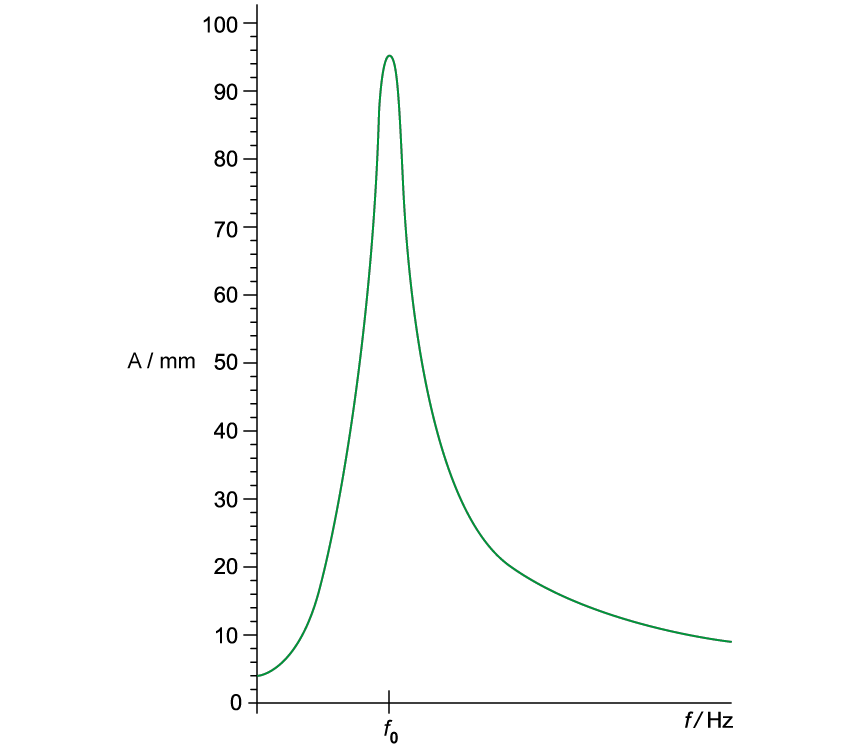
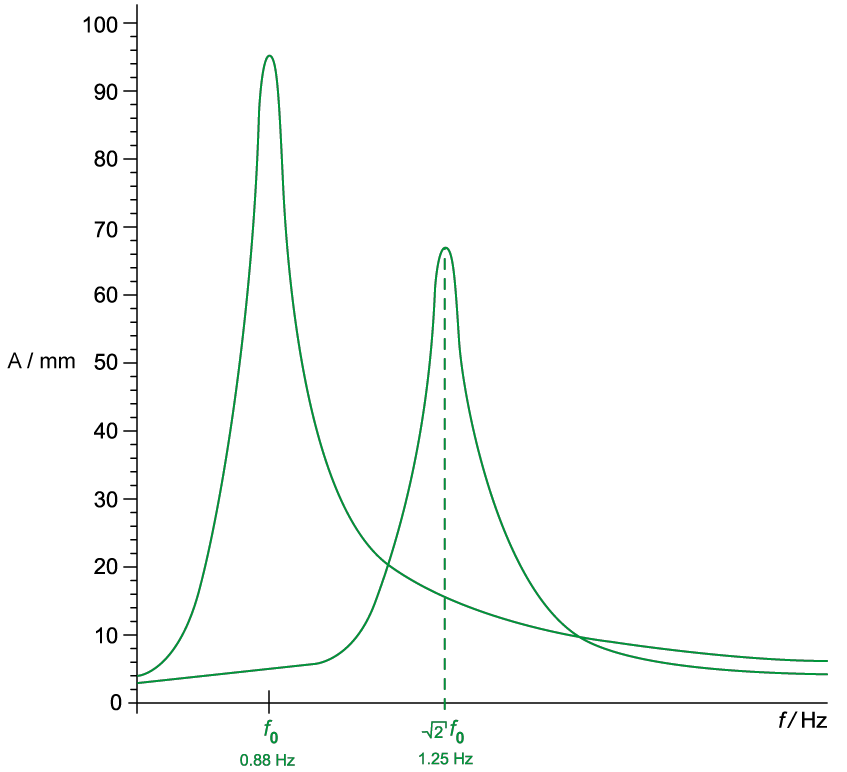
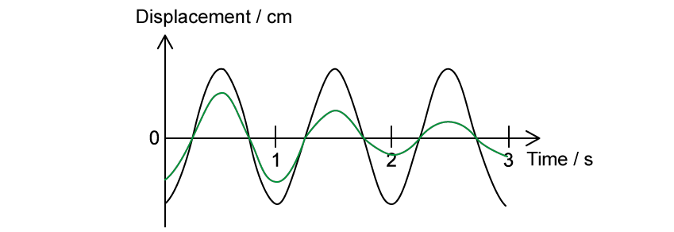
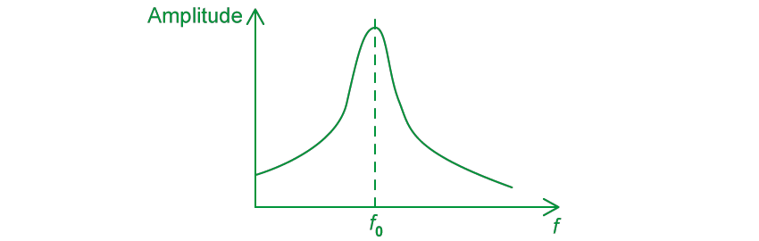
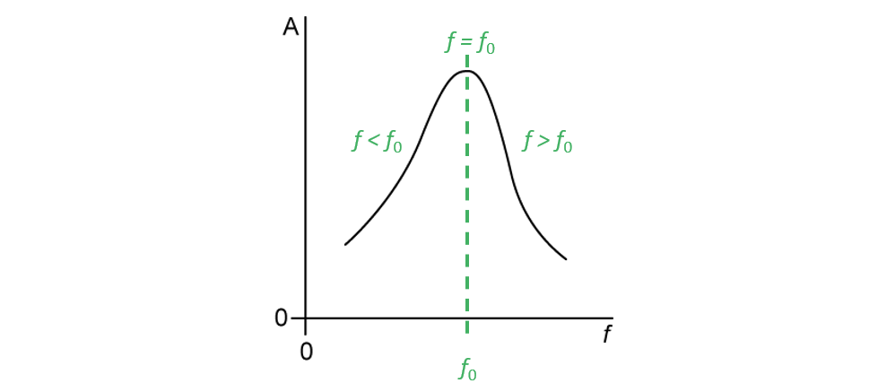
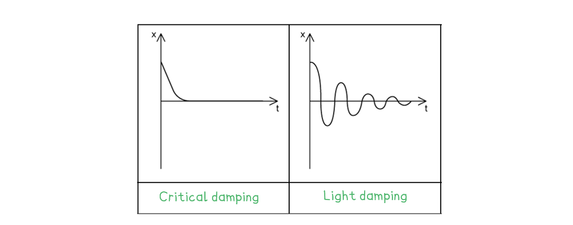
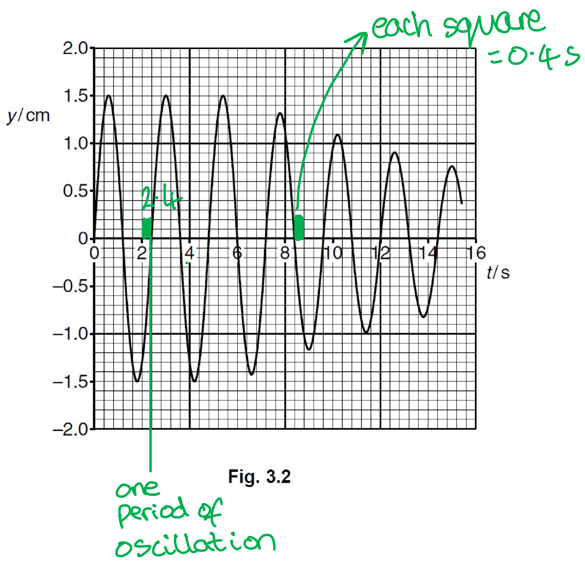
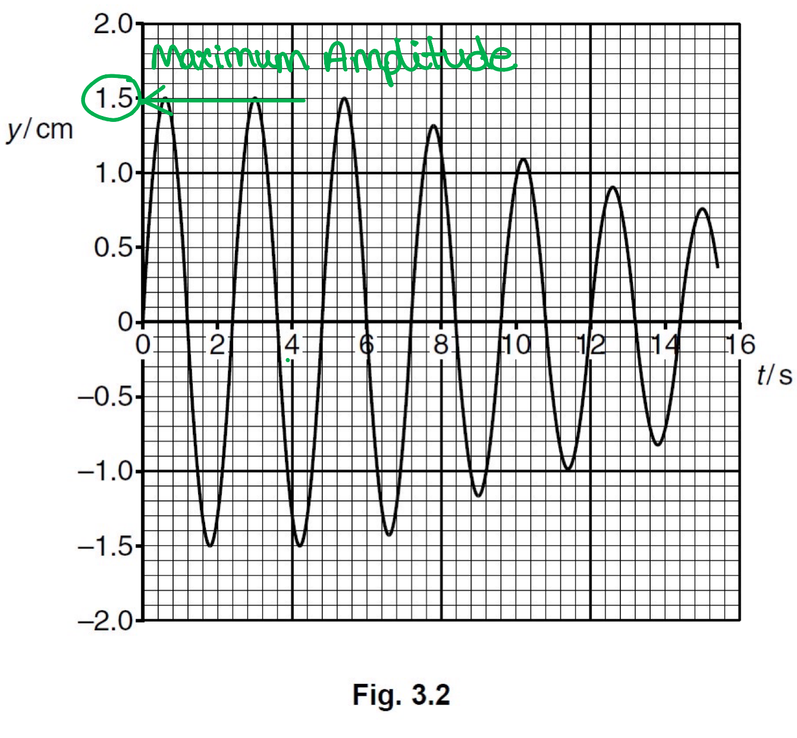
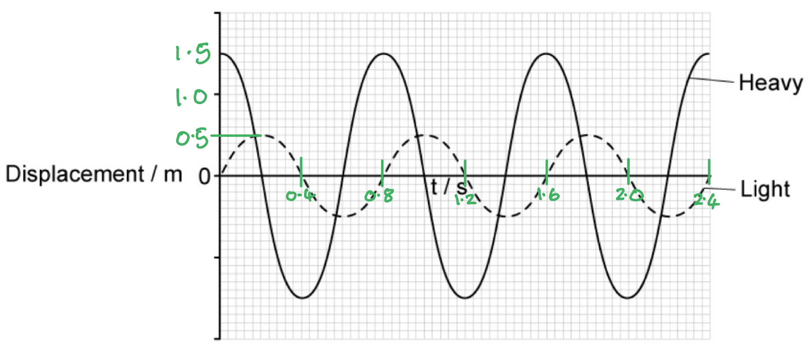
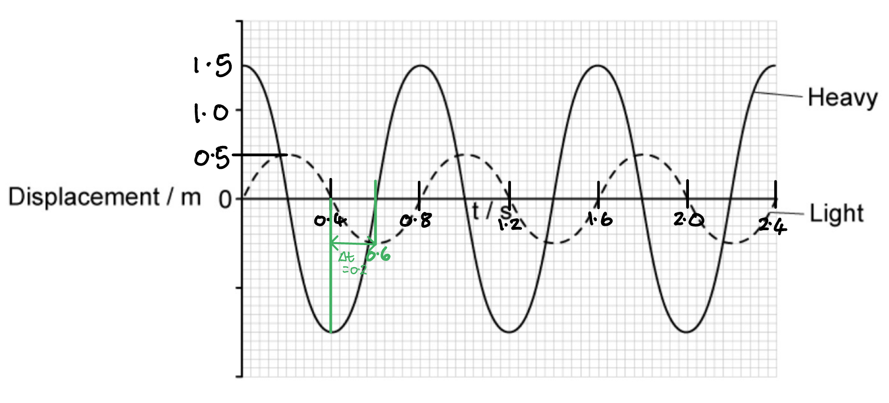

# Mark Schemes — Damped & Forced Oscillations, Resonance
**17. Oscillations** · Cambridge (CIE) A-LEVEL physics (9702)

## Structured Questions (8 questions)

### Q1
Calculate the mean time period, *T*:

- Sum of times = 45.8 + 44.6 + 45.6 + 45.8 + 45.2 = 227
- Mean time for 40 oscillations, 40*T* =$\frac{227}{5}$ = 45.4 s
- Mean time period, *T* =$\frac{45.4}{40}$ = 1.135 s **[1 mark]**

Calculate the natural frequency:

- There is no driving force, so the natural frequency is $f_{0}$  =$\frac{1}{T}$
- Natural frequency, $f_{0}$ = $\frac{1}{1.135}$  = 0.881 Hz **[1 mark]**

Determine the percentage uncertainty in the data:

- For a set of data, the uncertainty = ± half of the range
- Uncertainty in data, Δ(40*T*) = $\frac{45.8-44.6}{2}$ = 0.6 s
- Percentage uncertainty = $\frac{\Delta ( 40 T )}{40 T}$ × 100%
- Percentage uncertainty = $\frac{0.6}{45.4}$ × 100% = 1.3 % **[1 mark]**

Calculate the uncertainty in natural frequency and quote the final answer to 3 s.f:

- $\frac{\Deltaf_{0}}{f_{0}}$ =$\frac{\DeltaT}{T}$
- Δ$f_{0}$ = $f_{0}$  ×$\frac{\DeltaT}{T}$
- Uncertainty in natural frequency, Δ$f_{0}$ = 0.881 × $\frac{0.6}{45.4}$ = 0.012 Hz
- Therefore, $f_{0}$ = 0.881 ± 0.012 Hz (3 s.f.) **[1 mark]**

**[Total: 4 marks]**

> *It is easy to get confused when combining uncertainties in formulae, especially when we have the reciprocal of period here.*

> *In this equation:*

$\mathrm{speed}=\frac{\mathrm{distance}}{\mathrm{time}}$

> *the percentage uncertainty of speed is simply the sum of the percentage uncertainties of distance and time.*

> *For the equation in this question:*

$f=\frac{1}{T}$

> *we are combining the percentage uncertainty of time period and the number 1. Obviously, the number 1 has no uncertainty so the percentage uncertainty of frequency is just 0 + the percentage uncertainty of period - this is why we can say:*

$\frac{Δf}{f}=\frac{ΔT}{T}$
An example of a graph that would earn 3 marks:

- Graph starts at 4 mm; **[1 mark]**
- Peak at 95 mm aligned with $f_{0}$ ; **[1 mark]**
- Sharp increase and decrease; **[1 mark]**

**[Total: 3 marks]**
Determine the new resonant frequency:

- Removing one spring leads to double the stiffness *k* → 2*k  *as the system extends half as much for a given load
- Natural frequency with 2 springs, $f_{0}=C\sqrt{k}$, where *C*  is some constant of proportionality
- Natural frequency with 1 spring, $f_{0,1}=C\sqrt{2k}$
- $\frac{f_{0,1}}{f_{0}}=\frac{C\sqrt{2k}}{C\sqrt{k}}=\sqrt{2}$
- Therefore, the new resonant frequency, $f_{0,1}=\sqrt{2}f_{0}$

An example of a graph that would earn 3 marks:

- Same peak shape (due to same damping conditions); **[1 mark]**
- New peak amplitude is lower (any value); **[1 mark]**
- The new curve has a resonant peak labelled at $\sqrt{2}f_{0}$ **OR **1.25 Hz; **[1 mark]**

**[Total: 3 marks]**

### Q2
Why the magnet moves vertically when subjected to a direct current:

Any **two** from:

- When a d.c. supply is switched on, the solenoid produces a magnetic field; **[1 mark]**
- (Depending on the orientation of the bar magnet,) the magnetic field either attracts or repels the magnet; **[1 mark]**
- The magnetic field causes the magnet to move either towards or away from the solenoid; **[1 mark]**

Why the magnet oscillates when subjected to an alternating current:

Any **two** from:

- When a.c. passes through the solenoid, an <u>alternating</u> magnetic field is produced; **[1 mark]**
- The alternating magnetic field alternately attracts and repels the magnet; **[1 mark]**
- The alternating magnetic field causes the magnet to periodically move towards and away from the solenoid, hence oscillations occur; **[1 mark]**

Why the amplitude is associated with the applied frequency:

Any **two** from:

- The magnet undergoes <u>forced oscillations</u> as a result of the a.c. passing through the solenoid; **[1 mark]**
- The amplitude varies with the applied frequency of the driving oscillations; **[1 mark]**
- Frequency of magnet oscillations originate from the frequency of the alternating current supply; **[1 mark]**** **

**[Total: 6 marks]**
(i) To explain the damping:

Faraday's Law:

- As the magnet oscillates, there is a <u>change in magnetic flux</u> experienced by the damping cylinder **AND**
- This <u>induces an e.m.f.</u> in the damping cylinder, which in turn sets up a <u>magnetic field in the cylinde</u>r; **[1 mark]**

Lenz’s law:

- According to Lenz's law, the direction of this magnetic field set up opposes the effects of the oscillating magnet; **[1 mark]**
- This reduces the amplitude of the oscillations; hence, damping is observed; **[1 mark]**

(ii) An example of a graph that would earn 1 mark:

- Amplitude decreasing smoothly with time following an exponential 'envelope' pattern; **[1 mark]**** **

**[Total: 4 marks]**
How forced oscillations occur:

- Alternating current causes the coil's magnetic field to change direction periodically; **[1 mark]**
- Hence this repels and attracts the S pole of the magnet periodically; **[1 mark]**** **
- (As a result) the system now oscillates (with a constant amplitude and) at the driving frequency / frequency of the alternating current; **[1 mark]**

**[Total: 3 marks]**
Define resonance:

- Resonance occurs when the frequency of the alternating current approaches that of the natural frequency $( f_{0} )$ of the system; **[1 mark]**

Explain how it occurs:

- At this frequency *f*0  there will be maximum transfer of energy to the system and the amplitude will reach a maximum **OR**
- Maximum energy is transferred to the system at *f*0  shown on the graph; **[1 mark]**

**[Total: 2 marks]**

### Q3
(i) Natural frequency is...

- The frequency of an oscillation when the object is allowed to oscillate freely; **[1 mark]**

(ii) Driving frequency is...

- The frequency of an oscillation when the object is acted upon by an applied force;** [1 mark]**

**[Total: 2 marks]**
The term resonance means:

- As the driving frequency (of an oscillator) approaches the natural frequency, the system gains energy (from the driving force); **[1 mark]**
- When the driving frequency and the natural frequency are equal, the oscillation reaches a maximum amplitude (this is resonance); **[1 mark]**

**[Total: 2 marks]**
A diagram scoring 3 marks would look like:

(i) The area of the graph where the driving frequency is less than the natural frequency:

- *f* < *f*0 labelled on the positive gradient; **[1 mark]**

(ii) The area of the graph where the driving frequency is equal to the natural frequency:

- *f* = *f*0 labelled at the top of the curve where the gradient is zero; **[1 mark]**

(iii) The area of the graph where the driving frequency is greater than the natural frequency:

- *f* > *f*0 labelled on the negative gradient; **[1 mark]**

**[Total: 3 marks]**

### Q4
(i) Forced frequency is:

- The frequency at which as object is made to vibrate / oscillate; **[1 mark]**

(ii) The natural frequency of vibration is:

- The frequency at which an object vibrates when free to do so; **[1 mark]**

(iii) Resonance is:

- The maximum amplitude of vibration of an oscillating body; **[1 mark]**
- When the forced frequency equals the natural frequency (of vibration); **[1 mark]**

**[Total: 4 marks]**
A situation where resonance is useful:

- State the situation and what it is that is vibrating; **[1 mark]**
- Explain why this is useful; **[1 mark]**

**An example of an answer that would score 2 marks is:**

- The vibration of the piezoelectric crystal; **[1 mark]**
- To maximise the amplitude of the ultrasound waves; **[1 mark]**

**[Total: 2 marks]**

> *Notice that this question asks for **useful **examples of resonance. If you missed that word and gave examples of bridges falling, or wine glasses breaking, you would be giving **not-useful** examples and missing the mark.*

> *Other possible examples include the method by which microwave ovens cook food and acoustic resonance used in musical instruments. *

> *The trick with revising something like this is to find one or two examples which make sense to you, and just learn those. You will never need a long list in an exam.*
State a situation where resonance should be avoided and suggest how the effects of resonance should be reduced:

- State what it is that is vibrating; **[1 mark]**
- Explain how the vibrations are reduced; **[1 mark]**

An example of an answer that would score 2 marks is:

- Metal panels (in a building) vibrating; **[1 mark]**
- Place strengthening struts across the panel to reduce vibrations; **[1 mark]**

**[Total: 2 marks]**

### Q5
Damping is...

- The reduction in the <u>energy</u> and <u>amplitude</u> of oscillations;** [1 mark]**
- Due to the <u>resistive forces</u> acting on the oscillating system; **[1 mark]**

**[Total: 2 marks]**
Damping affects the amplitude of an oscillating object because...

- The <u>resistive forces</u> (such as friction or air resistance) act to <u>oppose the motion</u> of the oscillator;** [1 mark]**
- <u>Energy is transferred away</u> from the oscillating system; **[1 mark]**
- Therefore, the amplitude decreases; **[1 mark]**

**[Total: 3 marks]**

> *When answering an 'explain' question, make sure you use either 'because', 'due to' or 'therefore' in your answer to ensure you fully answer the question.*

> *Another way to phrase this answer would be:*

> *Damping reduces the amplitude of an oscillation [1 mark] due to the resistive force opposing the motion of the oscillator [1 mark] which transfer energy away from the system [1 mark].*
For a damped oscillation:

- The frequency of the oscillation does not change as the amplitude decreases; **[1 mark]**

**[Total: 1 mark]**
An answer scoring two marks would look like:

- <u>Critical damping</u> written under the non-oscillating graph;** [1 mark]**
- <u>Light damping</u> written under the oscillating graph; **[1 mark]**

**[Total: 2 marks]**

### Q6
(i) Determine the frequency *f*:

- (From the graph) *T* = 2.4 s **[1 mark]**
- $f=\frac{1}{T}=\frac{1}{2.4}$ = 0.42 Hz **[1 mark]**

** **

(ii) Calculate the energy of the oscillations during the time interval* t* = 0 to *t* = 6.0 s:

List the known quantities:

- Mass of magnet, $m$ = 250 g = 250 × 10−3 kg

Draw lines on the graph to obtain an expression for the maximum amplitude of oscillation, $y_{0}$:

- Maximum amplitude, $y_{0}$ = 1.5 cm = 1.5 × 10−2 m

Write an expression for the total energy in terms of *f* and *y**0*:

- $E = 1 \frac{1}{2} m \\omega ^{2} ( x_{0} )^{2}$
- $ω=2πf$
- $E = 1 \frac{1}{2} m ( 2 \pi f )^{2} ( y_{0} )^{2}$ **[1 mark]**

Substitute the known quantities into the expression:

- $E = 1 \frac{1}{2} \times ( 250 \times 10^{- 3} ) \times 4 \pi ^{2} \times 0.42^{2} \times ( 1.5 \times 10^{- 2} )^{2}$ **[1 mark]**
- $E = 1.96 \times 10^{- 4} \mathrm{J} = 2.0 \times 10^{- 4} \mathrm{J} ( 2 \mathrm{s} . \mathrm{f} . )$ **[1 mark]**

**[Total: 5 marks]**

- *Use the **graph** for all the **information** you **need*
The type of damping is:

- <u>Light</u>, because the amplitude gradually decreases; **[1 mark]**

**[Total: 1 mark]**

### Q7
The meaning of resonance is:

- Oscillations of an object at maximum amplitude; **[1 mark]**
- When the driving frequency (of the oscillations) equals the natural frequency (of the object); **[1 mark]**

**[Total: 2 marks]**
Calculate the frequency, *f *of the oscillations:

Compare the equation given to the equation for the displacement of a SHM oscillator:

- $x = A \sin ( \\omega t ) = 0.5 \sin ( 2.5 \pi t )$
- Hence, angular velocity, $ω=2.5π$

Use the time period equation:

- $T=\frac{2π}{ω}$ **[1 mark]**
- $T=\frac{2π}{2.5π}=\frac{4}{5}=0.8s$ **[1 mark]**

Calculate the frequency, *f*:

- $f=\frac{1}{T}=\frac{1}{0.8}=1.25\mathrm{Hz}$ **[1 mark]**

**[Total: 3 marks]**
On Fig. 1.2, label both axes with the correct scales:

List the known quantities:

- Amplitude of oscillation, *A *= 0.5 m (from part (b))
- Time period of oscillation, *T *= 0.8 s (from part (b))

A graph with both axes labelled correctly would look like this:

- Displacement scale labelled: 0.5, 1.0, 1.5, 2.0 **[1 mark]**
- Time scale labelled: 0.4, 0.8, 1.2, 1.6, 2.0, 2.4 **[1 mark]**

**[Total: 2 marks]**
(i) Phase difference is:

- How far a point or a wave is in front or behind another; **[1 mark]**

(ii) Determine the magnitude of the phase difference:

List the known quantities:

- Time period of both oscillations, *T *= 0.8 s

Draw lines on the graph to determine the time difference between the troughs of each wave:

- Time difference, Δ*t* = 0.2 s

Use the phase difference equation:

- $ϕ=\frac{2π\Deltat}{T}$
- $ϕ=\frac{2π\times0.2}{0.8}$** [1 mark]**
- $ϕ=\frac{1}{2}π\mathrm{rad}=1.57\mathrm{rad}$ **[1 mark]**

**[Total: 3 marks]**

> *Both objects oscillate **coherently**, so they are continually 0.2 s out of phase with each other. This must mean that they have the **same time period **T**. You can check this on the graph to be sure! *

> *It is easiest to find the time difference using **both peaks or both troughs** from the graph. *

### Q8
When oscillations are lightly damped...

- The amplitude decreases non-lineally over time **OR **the amplitude decays exponentially over time; **[1 mark]**

**[Total: 1 mark]**
State a similarity between heavy and critical damping:

- In both heavy and critical damping, the object stops oscillating and returns to its equilibrium position; **[1 mark]**

State a difference between heavy and critical damping:

- A heavily damped object will return to its equilibrium position slowly over time, whereas a critically damped object will return to its equilibrium position in the shortest possible time;** [1 mark]**

**[Total: 2 marks]**
(i) A sketch graph of heavy damping that would score 3 marks:

- y-axis labelled *x* / displacement **AND** x-axis labelled *t* / time; **[1 mark]**
- Line drawn as a smooth curve showing <u>no oscillations</u>;** [1 mark]**
- Line reaches zero in the <u>second half</u> of the time axis;** [1 mark]**

(ii) A sketch graph of critical damping that would score 3 marks:

- y-axis labelled *x* / displacement **AND** x-axis labelled *t* / time; **[1 mark]**
- Line drawn as a smooth curve showing <u>no oscillations</u>; **[1 mark]**
- Line reaches zero in the <u>first half</u> of the time axis; **[1 mark]**

**[Total: 6 marks]**
