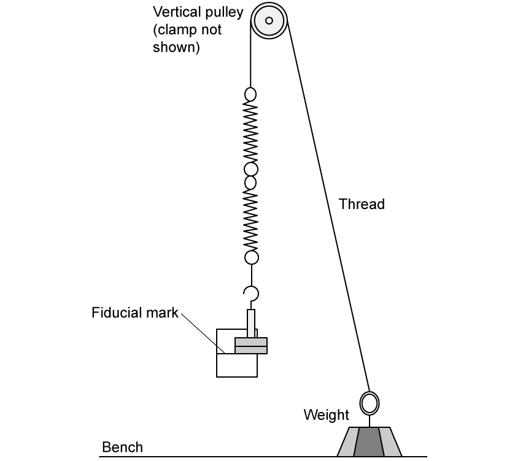
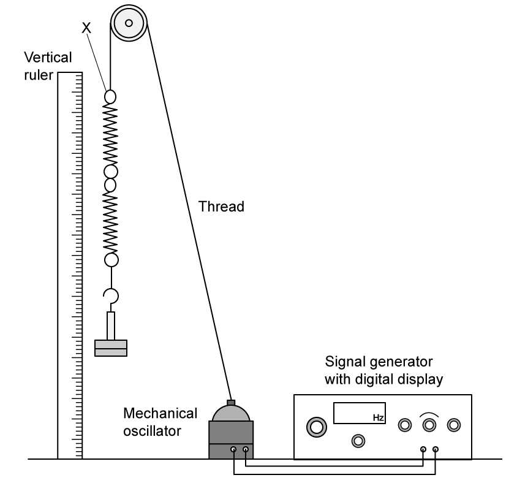
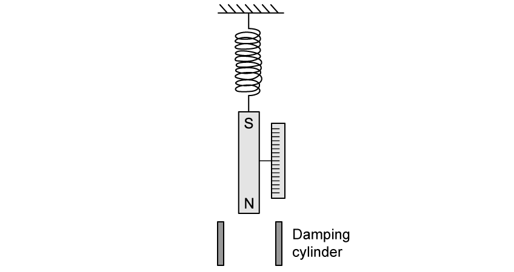
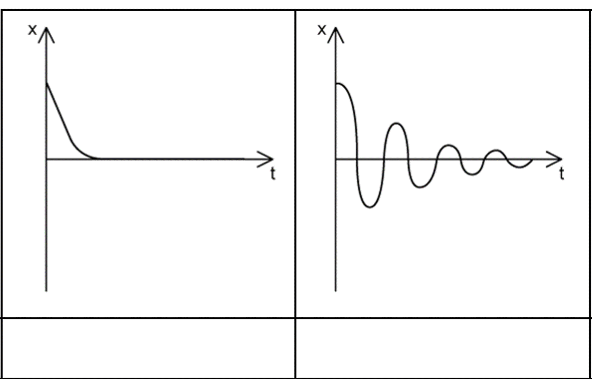
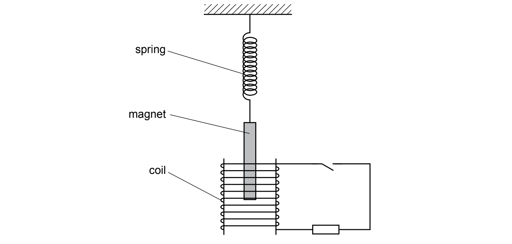
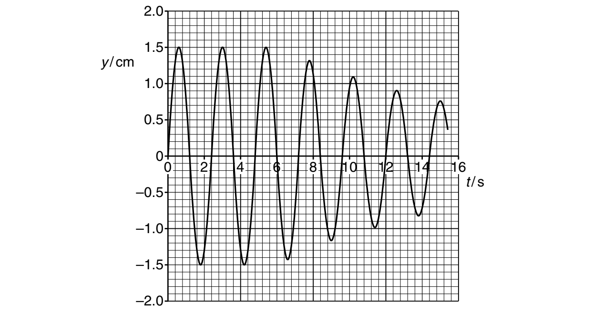
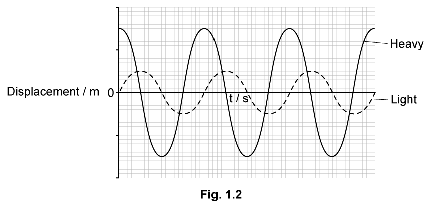

# Exam Questions — Damped & Forced Oscillations, Resonance
**17. Oscillations** · Cambridge (CIE) A-LEVEL physics (9702)
> Source: [https://www.savemyexams.com/a-level/physics/cie/25/topic-questions/](https://www.savemyexams.com/a-level/physics/cie/25/topic-questions/) · 8 questions across 1 sets

## Structured Questions (8 questions)

### Q1 — hard — 10 marks

**Q1** [4 marks]

A student investigates the vertical oscillations of the mass–spring system shown in Fig. 1.1.

**Fig. 1.1**

The system is suspended from one end of a thread passing over a pulley. The other end of the thread is tied to a weight. The system is shown in Fig. 1.1 with the mass at the equilibrium position, denoted by the fiducial mark. The spring constant is the same for each spring.

The table below shows the measurements recorded by the student over the course of 5 repeats of the experiment.

**Table 1.1**

| **Time for 40 oscillations of the mass-spring system / s** |   |   |   |   |
|---|---|---|---|---|
| 45.8 | 44.6 | 45.6 | 45.8 | 45.2 |

Determine the natural frequency of the mass-spring system and the percentage uncertainty in the data. Hence quote the natural frequency with its uncertainty to an appropriate number of significant figures.

**Q1** [3 marks]

The student connects the thread to a mechanical oscillator. The oscillator is set in motion using a signal generator and this causes the mass–spring system to undergo forced oscillations.

A vertical ruler is set up alongside the mass–spring system as shown in Fig. 1.2. The student measures values of *A*, the amplitude of the oscillations of the mass as *f*, the frequency of the forcing oscillations, is varied.

**Fig. 1.2**

At the point X, where the mass–spring system is joined to the thread, the amplitude of the oscillations is 4 mm. When the mass–spring system resonates at its natural frequency, amplitude of oscillation is 95 mm.

On the axes provided, sketch the expected relationship between the amplitude and frequency of oscillation.

**Fig. 1.3**

**Q1** [3 marks]

**Extract:**

Determine the natural frequency of the mass-spring system... Natural frequency, f_0 = 1/1.135 = 0.881 Hz

The student connects the thread to a mechanical oscillator. The oscillator is set in motion using a signal generator and this causes the mass–spring system to undergo forced oscillations. The student measures values of A, the amplitude of the oscillations of the mass as f, the frequency of the forcing oscillations, is varied. At the point X, where the mass–spring system is joined to the thread, the amplitude of the oscillations is 4 mm. When the mass–spring system resonates at its natural frequency, amplitude of oscillation is 95 mm. On the axes provided, sketch the expected relationship between the amplitude and frequency of oscillation.

The student removes one of the springs and then repeats the experiment.

Sketch a new line on your graph to show the results the student would obtain.

Give a value for the new frequency only, but the new amplitude does not need a specific value.

The relationship between frequency and spring constant can be described as:

$f\propto\sqrt{k}$

### Q2 — hard — 15 marks

**Q2** [6 marks]

A bar magnet is suspended on a spring as shown in Fig. 1.1. A pole of the magnet is located near to one end of a solenoid.

**Fig. 1.1**

The observations made are summarised in Table 1.1.

**Table 1.1**

| **Supply** | **Observation** |
|---|---|
| Direct current (d.c.) | 1. The magnet moves vertically |
| Alternating current (a.c.) | 2. The magnet oscillates |
| 3. When the frequency of the alternating current (a.c) is changed, the amplitude of vibration of the magnet is associated with the applied frequency |   |

Explain these observations.

**Q2** [4 marks]

Fig. 1.2 shows a long bar magnet suspended by a coiled spring from a rigid support along with the displacement-time graph of the resulting oscillations.

**Fig. 1.2**

The amplitude of vertical oscillations of the magnet can be measured by observing the motion of a pointer attached to it as the pointer moves over a fixed vertical scale.

The lower end of the magnet is now suspended in a cylinder of aluminium as shown in Fig. 1.3. This produces damping of the vertical oscillations.

**Fig. 1.3**

(i) Explain, using Faraday's law and Lenz's law, why damping of the vertical oscillations of the magnet occurs.

[3]

(ii) On Fig. 1.2, sketch the new displacement-time graph of the vertical oscillations of the magnet.

[1]

**Q2** [3 marks]

In Fig. 1.4, a flat horizontal coil has been placed around the S pole of the long magnet and the damping cylinder removed.

A cross-section of this is shown and the direction of the current passing round the coil is represented with crosses and dots.

**Fig. 1.4**

When there is an alternating current in the coil, the magnet vibrates under forced oscillations.

Explain how the magnet in Fig. 1.4 is made to perform forced oscillations.

**Q2** [2 marks]

**Extract:**

When there is an alternating current in the coil, the magnet vibrates under forced oscillations. Explain how the magnet in Fig. 1.4 is made to perform forced oscillations.

The graph, Fig. 1.5, shows how the amplitude of the oscillations $y_{0}$ varies with *f*, frequency of the alternating current.

**Fig. 1.5**

Explain how resonance occurs in this experiment.

### Q3 — easy — 7 marks

**Q3** [2 marks]

Define

(i) natural frequency

[1]

(ii) driving frequency.

[1]

**Q3** [2 marks]

Oscillating systems can exhibit a property known as resonance.

Explain what is meant by the term *resonance*.

**Q3** [3 marks]

The resonance curve in Fig. 1.1 shows how the amplitude *A* of an oscillation varies with driving frequency *f*.

**Fig. 1.1 **

On Fig. 1.1 label the following features:

(i) the region where the driving frequency is less than the natural frequency,* f* < *f*0

[1]

(ii) the region where the driving frequency is equal to the natural frequency, *f* = *f*0

[1]

(iii) the region where the driving frequency is greater than the natural frequency, *f* > *f*0

[1]

### Q4 — medium — 8 marks

**Q4** [4 marks]

For an oscillating body, state what is meant by:

(i) forced frequency,

[1]

(ii) natural frequency of vibration,

[1]

(iii) resonance.

[2]

**Q4** [2 marks]

State and explain one situation where resonance is useful.

**Q4** [2 marks]

In some situations, resonance should be avoided. State one such situation and suggest how the effects of resonance are reduced.

### Q5 — easy — 8 marks

**Q5** [2 marks]

Define the term *damping*.

**Q5** [3 marks]

Explain how damping affects the amplitude of an oscillating object.

**Q5** [1 mark]

Describe the relationship between frequency and amplitude of a damped oscillation.

**Q5** [2 marks]

Fig. 1.1 shows two graphs of damped oscillators.

State the type of damping shown in each graph by writing in the box below each graph.

**Fig. 1.1**

### Q6 — medium — 6 marks

**Q6** [5 marks]

A bar magnet of mass 250 g is suspended from the free end of a spring, as illustrated in Fig. 3.1.

**Fig. 3.1**

The magnet hangs so that one pole is near the centre of a coil of wire. The coil is connected in series with a resistor and a switch. The switch is open.

The magnet is displaced vertically and then allowed to oscillate.

At time* t* = 0, the magnet is oscillating freely. At time *t* = 6.0 s, the switch in the circuit is closed.

The variation with time *t* of the vertical displacement *y* of the magnet is shown in Fig. 3.2.

**Fig. 3.2**

For the oscillating magnet, use data from Fig. 3.2 to determine, to two significant figures:

(i) the frequency *f*

f = ...................................... Hz [2]

(ii) the energy of the oscillations during the time interval* t* = 0 to *t* = 6.0 s.

energy = ....................................... J [3]

*Source: Specimen 2022 Paper 4 Q3A*

**Q6** [1 mark]

**Extract:**

A bar magnet of mass 250 g is suspended from the free end of a spring. The magnet hangs so that one pole is near the centre of a coil of wire. The coil is connected in series with a resistor and a switch. The switch is open. The magnet is displaced vertically and then allowed to oscillate. At time t = 0, the magnet is oscillating freely. At time t = 6.0 s, the switch in the circuit is closed. The variation with time t of the vertical displacement y of the magnet is shown in Fig. 3.2.

When the switch is closed, the oscillations are damped.

Explain, with reference to Fig. 3.2, whether this damping is light, critical or heavy.

*Source: Specimen 2022 Paper 4 Q3B*

### Q7 — medium — 10 marks

**Q7** [2 marks]

Fig. 1.1 shows a light pendulum and a heavy pendulum, both suspended from the same piece of copper wire. This copper wire is secured at each end to fixed points.

Both pendulums have the same natural frequency.

The heavy pendulum is set to oscillate perpendicular to the plane of the diagram. As it oscillates, it causes the light pendulum to oscillate.

State what is meant by resonance.

**Q7** [3 marks]

Fig. 1.2 shows the variation with time *t *of the displacements of the two pendulums for three oscillations.

The variation with *t *of the displacement *x *of the light pendulum is given by

`x space equals space 0.5 space sin space open parentheses 2.5 pi space t close parentheses`

where *x *is in metres and *t *is in seconds.

Calculate the frequency, *f *of the oscillations.

*f *= ........................................... Hz

**Q7** [2 marks]

**Extract:**

Fig. 1.2 shows the variation with time t of the displacements of the two pendulums for three oscillations. The variation with t of the displacement x of the light pendulum is given by x = 0.5 sin(2.5πt) where x is in metres and t is in seconds.

On Fig. 1.2, label both axes with the correct scales. Use the space below for any additional working that you need.

**Q7** [3 marks]

**Extract:**

Fig. 1.2 shows the variation with time t of the displacements of the two pendulums for three oscillations. The variation with t of the displacement x of the light pendulum is given by x = 0.5 sin(2.5πt) where x is in metres and t is in seconds. (From part b, the time period T = 0.8 s.)

(i) Define phase difference, *Φ.*

[1]

(ii) Determine the magnitude of the phase difference *Φ *between the oscillations of the light and heavy pendulums. Give a unit with your answer.

*Φ *= .......................................... unit ............ [2]

### Q8 — easy — 9 marks

**Q8** [1 mark]

Describe the process of light damping on an object in simple harmonic motion.

**Q8** [2 marks]

State one similarity and one difference between the features of heavy damping and critical damping on an object oscillating in simple harmonic motion.

**Q8** [6 marks]

Sketch a graph of:

(i) Heavy damping

[3]

(ii) Critical damping

[3]
