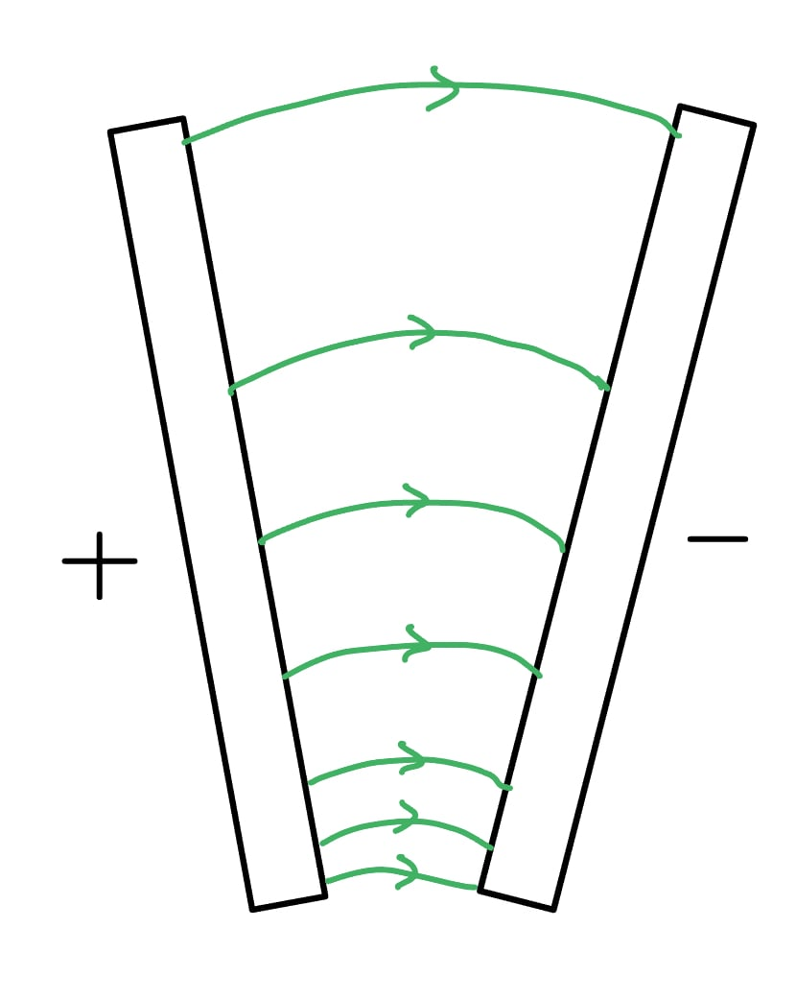
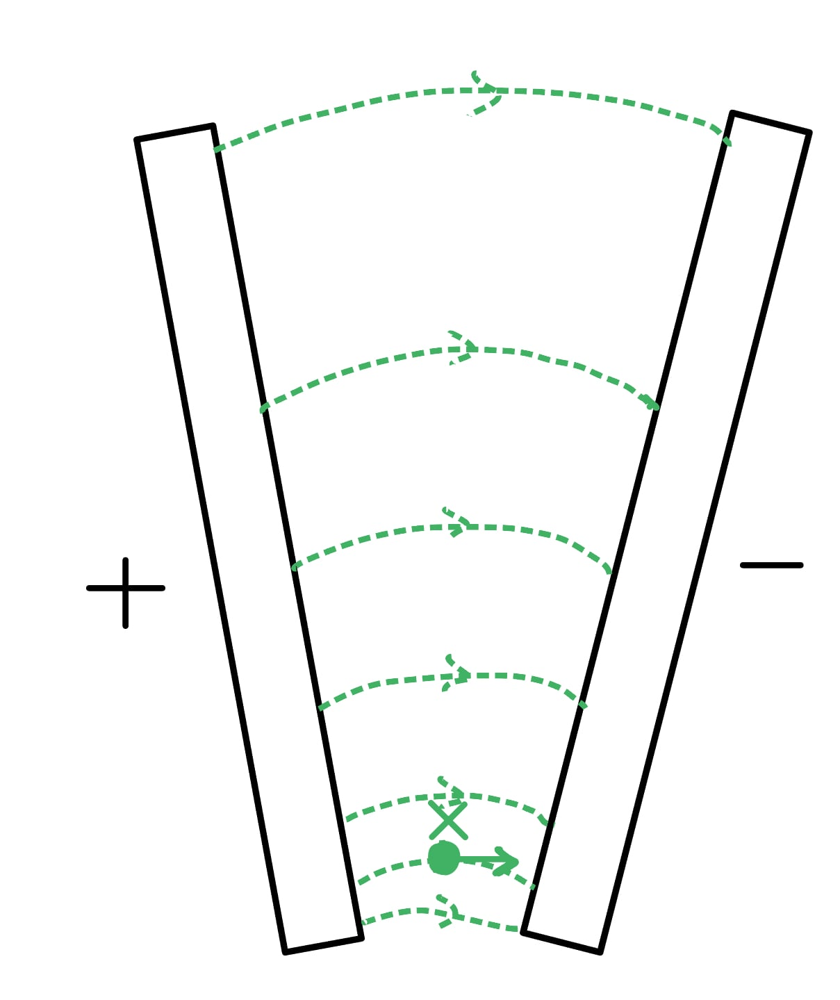
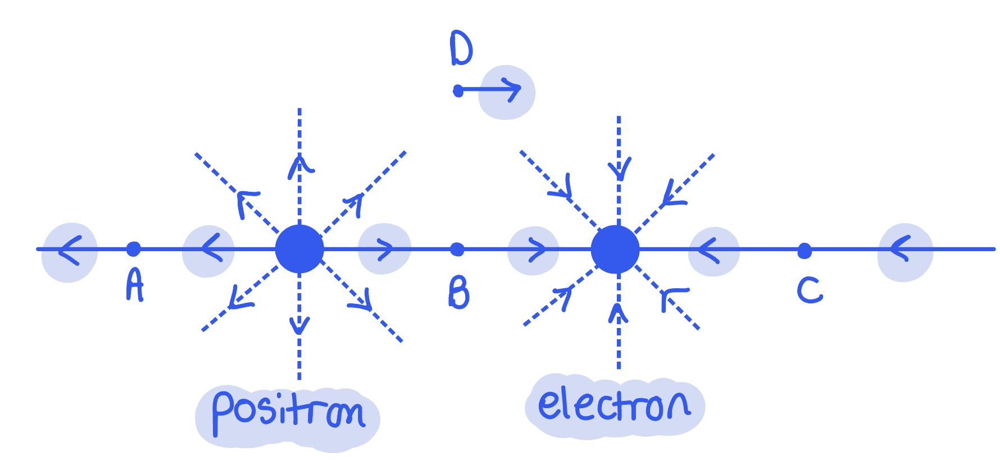
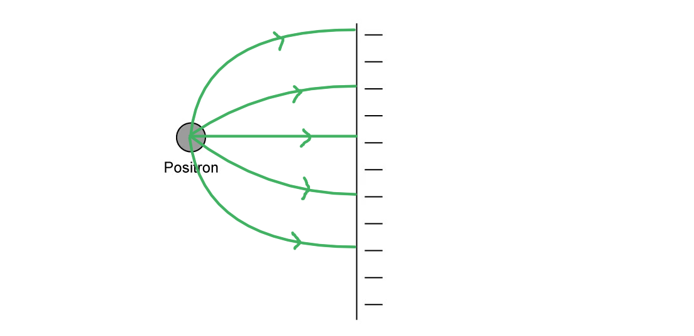
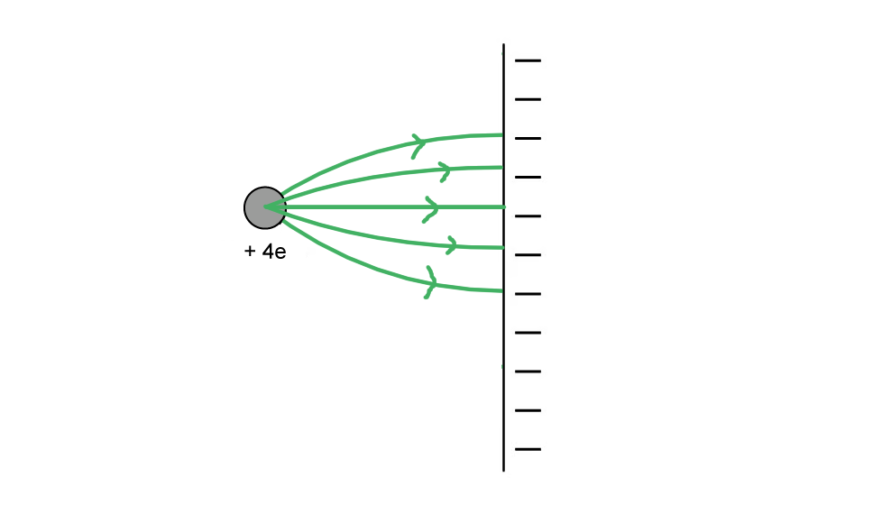
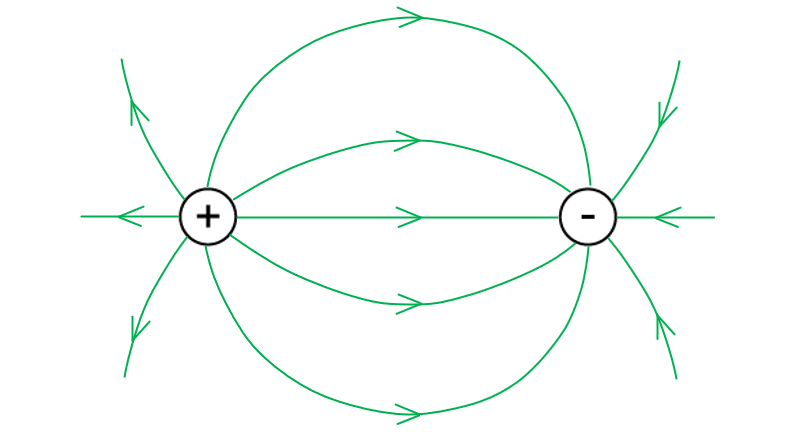
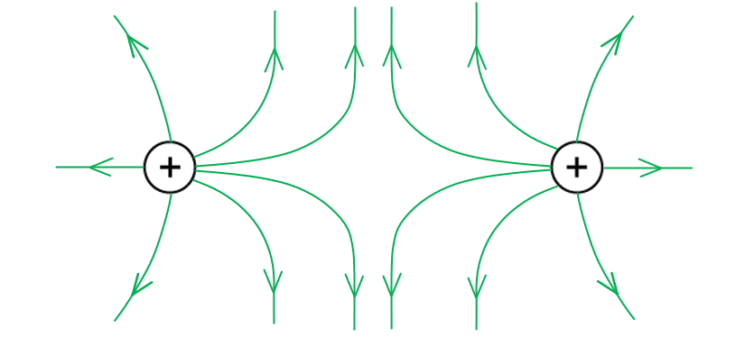

# Mark Schemes — Electric Fields & Field Lines
**18. Electric Fields** · Cambridge (CIE) A-LEVEL physics (9702)

## Structured Questions (5 questions)

### Q1
The direction in which the electron accelerates is:

- To the <u>right</u>;** [1 mark]**

Because:

- The (electric) field lines are the direction that a <u>positive</u> charge would move / a negative charge accelerates in the opposite direction to (electric) field lines;** [1 mark]**

**[Total: 2 marks]**
The acceleration of the electron is:

List the known quantities:

- Electric field strength, *E* = 2.5 pN C–1 =  2.5 × 10–12 N C–1

From the formulae page:

- Rest mass of electron, *m*e = 9.11 × 10–31 kg
- Elementary charge, *e* = 1.60 × 10–19 C

State the equations for the electric force:

- $F=qE=ma$

Rearrange for the acceleration, *a*:

- $a=\frac{qE}{m}$ ** [1 mark]**

Substitute in the values:

- `a space equals space fraction numerator space open parentheses 1.60 space cross times space 10 to the power of negative 19 end exponent close parentheses space cross times space open parentheses 2.5 space cross times space 10 to the power of negative 12 end exponent close parentheses over denominator 9.11 space cross times space 10 to the power of negative 31 end exponent end fraction` ** [1 mark]**
- $a=0.439=0.44ms^{-2}$** [1 mark]**

**[Total: 3 marks]**
If a proton is accelerated instead:

- The size of the acceleration would be smaller / lower **AND **it would be to the <u>left</u> / the opposite direction (to the electron's acceleration); **[1 mark]**
- Because the magnitude of charge is the same, but the mass is larger; **[1 mark]**

**[Total: 2 marks]**

> *We can see this from the equation *$a=\frac{qE}{m}$* in part (b). Since **E** and **q** are the same (it's the same field, and protons and electrons and electrons have the same magnitude of charge) then as **m** increases, **a** decreases. The mass of a proton is on the data page in your exam, and it's value is much higher than a mass of an electron!*

> *However, don't forget that they have **opposite** charges. Since acceleration is a vector, you must also mention the proton's **direction**.*

### Q2
A sketch that would score 2 marks should look like:

- Field lines from closer together at the bottom and gradually further apart; **[1 mark]**
- Arrows pointing from the positive to negative plate;** [1 mark]**

**[Total: 2 marks]**
A sketch that would score 2 marks should look like:

(i)

- 'X' labelled at bottom of the gap between the plates; **[1 mark]**

(ii)

- Arrow from the 'X' to the <u>right</u> (towards the negative plate); **[1 mark]**

**[Total: 2 marks]**

> *The closer together (denser) the field lines, the stronger the field.*
The acceleration is:

List the known quantities:

- Electric field strength, *E* = 6.0 × 10–2 V m–1

From the formulae page:

- Rest mass of proton, *m*p = 1.67 × 10–27 kg
- Elementary charge, *e* = 1.60 × 10–19 C

Determine an equation for the acceleration, *a*:

- $F=Eq=ma$
- $a=\frac{Eq}{m}$ **[1 mark]**

Substitute in the values:

- `a space equals space fraction numerator open parentheses 6.0 space cross times space 10 to the power of negative 2 end exponent close parentheses space cross times space open parentheses 1.60 space cross times space 10 to the power of negative 19 end exponent close parentheses space over denominator 1.67 space cross times space 10 to the power of negative 27 end exponent end fraction` **[1 mark]**
- $a=5.7\times10^{6}ms^{-2}$ **[1 mark]**

**[Total: 3 marks]**

### Q3
The direction of the electric force is:

(i) A:

- Left; **[1 mark]**

(ii) B:

- Right; **[1 mark]**

(iii) C:

- Left; **[1 mark]**

(iv) D:

- Right; **[1 mark]**

**[Total: 4 marks]**

> *You can figure out the direction of the force by the direction of the field lines (Since **F** = **Eq**, so **F** and **E** are in the same direction).*

> *The positron has field lines going outwards, whilst they go into the electron. Drawing the arrow shows the direction of the forces on an object that is at points A to D.*

The force on the positron is:

List the known quantities:

- Electric field strength, *E* = 5.6 kV m–1 = 5.6 × 103 V m–1 (= 5.6 × 103 N C–1)

From the formulae page:

- Elementary charge, *e* = 1.60 × 10–19 C

Calculate the force:

- $F=qE$
- `F space equals space open parentheses 1.60 space cross times space 10 to the power of negative 19 end exponent close parentheses space cross times space open parentheses 5.6 space cross times space 10 cubed close parentheses`
- $F=8.96\times10^{-16}=9.0\times10^{-16}N$ **[1 mark]**

**[Total: 1 mark]**

> *Although you haven't been given the charge in the question, you should remember from topic 11.1 that the positron is the **antiparticle** of the electron. This means it is identical to the electron, except it has the opposite **charge**. The **magnitude** (size) of its charge is still the same, so you can still use **e**, the elementary charge of an electron as **q**.*
A sketch that would score 2 marks should look like:

- At least 5 lines from positron to plate, all curved apart from a straight central one; **[1 mark]**
- Arrows directed from positron to plate; **[1 mark]**

**[Total: 2 marks]**
A sketch that would score 2 marks should look like:

- At least 5 lines from positron to plate, all curved apart from a straight central one **AND ****a**rrows directed from positive charge to plate; **[1 mark]**
- Field lines <u>closer together</u> than those in part (c); **[1 mark]**

**[Total: 2 marks]**

> *The only thing that has changed in this question is the strength of the positive charge. The density of the electric field lines around a charge or between plates tells us how strong the charge is. The closer the field lines are together (denser), the stronger the charge.*

### Q4
An electric field line indicates:

- The direction of the (electric) force; **[1 mark]**
- Experienced by a positive (test) charge; **[1 mark]**

**[Total: 2 marks]**
The electric field lines between positive and negative point charges are as follows:

- At least <u>six</u> radial field lines drawn; **[1 mark]**
- Lines connect the positive and negative charges; **[1 mark]**
- Arrows directed from the positive charge to the negative charge; **[1 mark]**

**[Total: 3 marks]**

> *Remember a few simple rules with field lines and the diagrams will be easy to draw. *

- *Arrows always point away from positive charges and towards negative charges.*
- *The closer lines are to the point charges, the closer they are together.*
The electric field lines between the two positive charges are as follows:

- At least <u>six</u> radial field lines drawn; **[1 mark]**
- A space between the positive charges / no connections between field lines; **[1 mark]**
- Arrows directed away from the positive charges; **[1 mark]**

**[Total: 3 marks]**

> *Since like charges repel, these two positive charges cannot have force lines between them which join up. It makes the diagram look strange, but it is correct.*
The difference between gravitational forces and electric forces is:

**EITHER**

- Gravitational forces are always attractive; **[1 mark]**
- Electric forces can be attractive or repulsive; **[1 mark]**

**OR**

- Gravitational forces are small in magnitude (compared to electric forces); **[1 mark]**
- Electric forces are large in magnitude (compared to gravitational forces); **[1 mark]**

**[Total: 2 marks]**

### Q5
(i) An electric field is:

- A region / space / area where a charge experiences an (electric) force; **[1 mark]**

(ii) Electric field strength is a:

- <u>Vector</u> quantity; **[1 mark]**

This is because:

- It represents the <u>direction</u> in which a positive charge will accelerate; **[1 mark] ** **OR**
- It is defined as the force per unit positive charge, and force is a vector quantity (so electric field strength will be a vector quantity); **[1 mark]**

**[Total: 3 marks]**
The direction of the force acting on the negative ion is:

- To the left / in the opposite direction to the field lines; **[1 mark]**

**[Total: 1 mark]**** **

> *The field lines representing an electric field show the direction in which **a positive point charge** would move if it were placed in the field at a particular point. Negative charges will move in the **opposite** direction to the field lines.*

> *The ion has a negative charge, therefore it must move in the opposite direction to the field lines, as shown below:*

Calculate the magnitude of the electric force acting on the negative ion:

List the known quantities:

- Work done on the ion, *W* = 3.6 × 10–17 J
- Displacement (in the direction of the force), *d* = 75 mm = 75 × 10–3 m

Use the equation for work done to calculate force:

- Work done:  $W=Fd\RightarrowF=\frac{W}{d}$ **[1 mark]**
- Electric force:  $F=\frac{3.6\times10^{-17}}{75\times10^{-3}}$ = 4.8 × 10–16 N  **[1 mark]**

**[Total: 2 marks]**
(i) Calculate the charge on the ion:

List the known quantities:

- Electric force, $F$ = 4.8 × 10–16 N (from part c)
- Electric field strength, $E$ = 1.5 × 103 N C−1

Use the equation for electric force on a charge:

- Electric force on a charge:  $F=qE\Rightarrowq=\frac{F}{E}$ **[1 mark]**
- Substitute:  $q=\frac{4.8\times10^{-16}}{1.5\times10^{3}}$
- Charge on ion:  $q$ = (−)3.2 × 10−19 C **[1 mark]**

(ii) Deduce the number of electrons gained by the atom:

- Elementary charge, e = 1.6 × 10−19 C (from data page)
- The charge on one electron is 1e
- Therefore, the atom gained = $\frac{3.2\times10^{-19}}{1.6\times10^{-19}}$ = 2 electrons; **[1 mark]**

**[Total: 3 marks]**
