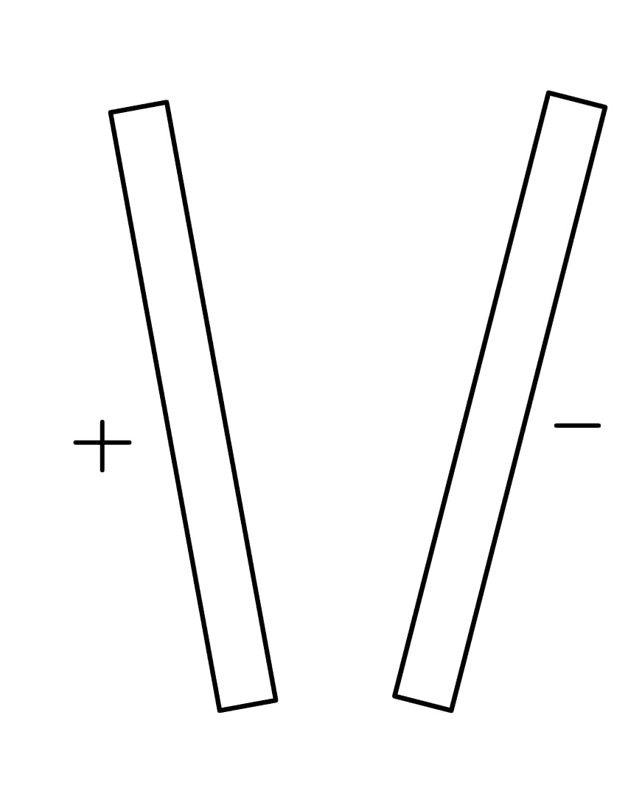
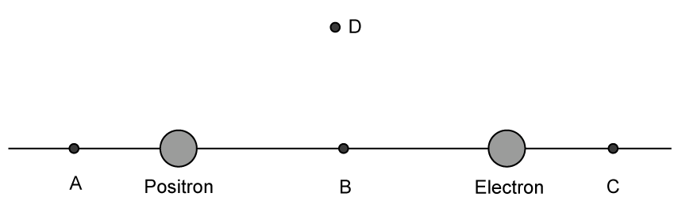

# Exam Questions — Electric Fields & Field Lines
**18. Electric Fields** · Cambridge (CIE) A-LEVEL physics (9702)
> Source: [https://www.savemyexams.com/a-level/physics/cie/25/topic-questions/](https://www.savemyexams.com/a-level/physics/cie/25/topic-questions/) · 5 questions across 1 sets

## Structured Questions (5 questions)

### Q1 — medium — 7 marks

**Q1** [2 marks]

Fig 1.1 shows an electron in a uniform electric field.

**Fig 1.1**

State the direction in which the electron will accelerate in the field and explain why this happens.

**Q1** [3 marks]

**Extract:**

Fig 1.1 shows an electron in a uniform electric field.

The strength of the electric field is 2.5 pN C–1.

Calculate the acceleration of the electron through the field.

**Q1** [2 marks]

**Extract:**

Fig 1.1 shows an electron in a uniform electric field. State the direction in which the electron will accelerate in the field and explain why this happens. The direction in which the electron accelerates is to the right.
The strength of the electric field is 2.5 pN C^–1^. Calculate the acceleration of the electron through the field. From the formulae page: Rest mass of electron, m_e = 9.11 × 10^–31 kg; Elementary charge, e = 1.60 × 10^–19 C. F = qE = ma; a = qE/m; a = 0.44 m s^–2.

Explain how the acceleration changes if a proton is accelerated instead.

### Q2 — medium — 7 marks

**Q2** [2 marks]

A potential difference is applied between two metal plates that are not parallel, as shown in Fig 1.1.

**Fig** **1.1**

Sketch the electric field lines between the plates.

**Q2** [2 marks]

**Extract:**

A potential difference is applied between two metal plates that are not parallel, as shown in Fig 1.1. Fig 1.1 (non-parallel plates with '+' on the left plate and '-' on the right plate, plates closer together at the bottom and further apart at the top). Field lines from closer together at the bottom and gradually further apart; Arrows pointing from the positive to negative plate.

A proton is placed between the plates in Fig 1.1.

(i) Identify where the proton needs to be to experience the greatest electric force. Label this point X.

[1]

(ii) Sketch the direction the proton accelerates in at this point.

[1]

**Q2** [3 marks]

Calculate the acceleration of the proton when placed in a uniform electric field of field strength 6.0 × 10–2 V m–1.

### Q3 — medium — 9 marks

**Q3** [4 marks]

An electron and positron are on the same straight line as shown in Fig 1.3.

**Fig 1.3**

State the direction of the electric force at points

(i) A

(ii) B

(iii) C

(iv) D.

**Q3** [1 mark]

Calculate the force on the positron if it was accelerated through an electric field with a strength of 5.6 kV m–1.

**Q3** [2 marks]

Fig 1.2 shows the positron near a negatively charged metal plate.

**Fig 1.2**

Sketch the field lines from the positron.

**Q3** [2 marks]

**Extract:**

Fig 1.2 shows the positron near a negatively charged metal plate. Sketch the field lines from the positron. Mark scheme: At least 5 lines from positron to plate, all curved apart from a straight central one; Arrows directed from positron to plate.

The positron is now replaced with a charge of +4*e* instead as shown in Fig 1.3.

**Fig 1.3**

Sketch the field lines of the +4*e*.

### Q4 — easy — 10 marks

**Q4** [2 marks]

State what is indicated by the direction of an electric field line.

**Q4** [3 marks]

On Fig. 1.1, draw field lines to represent the electric field acting between the two charges.

**Fig. 1.1**

**Q4** [3 marks]

On Fig. 1.2, draw field lines to represent the electric field acting between the two charges.

**Fig. 1.2**

**Q4** [2 marks]

Gravitational fields and electric fields share many similarities. One similarity is that Newton's law of gravitation applies to point masses, and Coulomb's law applies to point charges.

State a difference between gravitational forces and electric forces.

### Q5 — easy — 9 marks

**Q5** [3 marks]

(i) Explain what is meant by an *electric field*.

[1]

(ii) State and explain whether *electric field strength* is a scalar or a vector quantity.

[2]

**Q5** [1 mark]

Fig. 1.1 shows a negative ion which is free to move in a uniform electric field.

**Fig. 1.1**

State the direction of the force acting on the negative ion.

**Q5** [2 marks]

An electric field does 3.6 × 10–17 J of work on the negative ion to accelerate it through a distance of 75 mm.

Show that the electric force acting on the negative ion is 4.8 × 10–16 N.

**Q5** [3 marks]

**Extract:**

An electric field does 3.6 × 10^–17^ J of work on the negative ion to accelerate it through a distance of 75 mm. Show that the electric force acting on the negative ion is 4.8 × 10^–16^ N.

The magnitude of the electric field strength is 1.5 × 103 N C−1.

(i) Calculate the charge on the ion.

[2]

(ii) Deduce the number of electrons gained by the atom.

[1]
