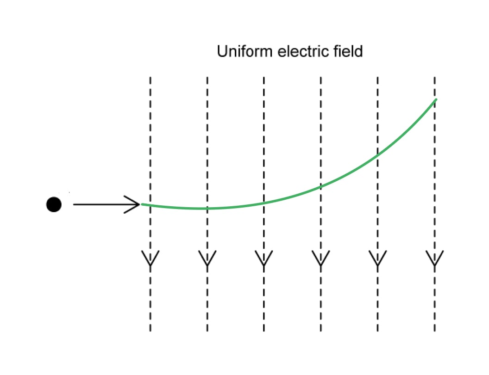
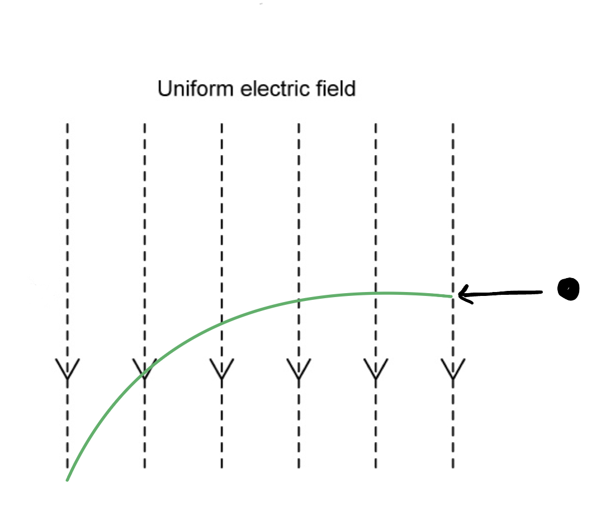
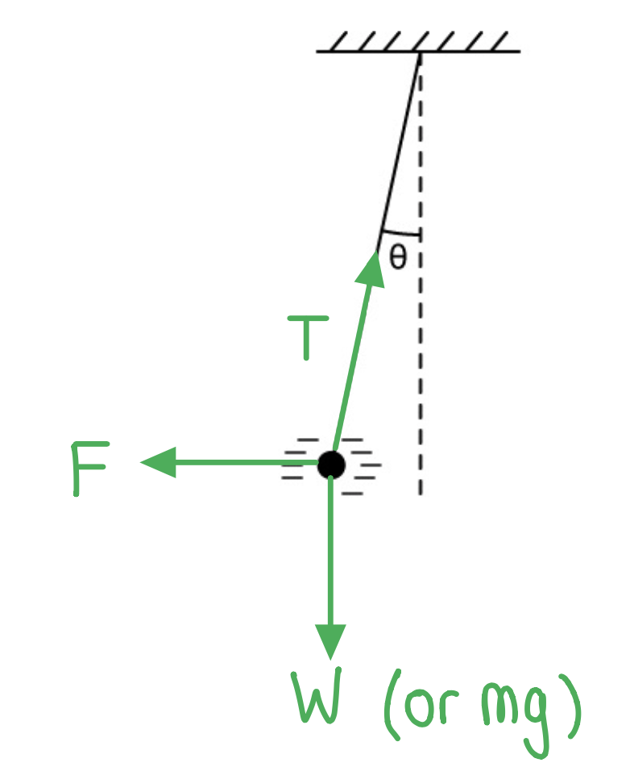
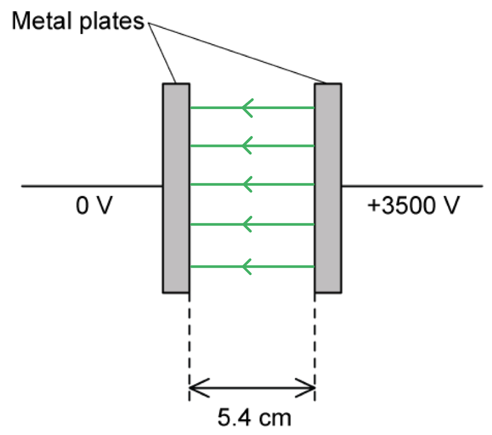
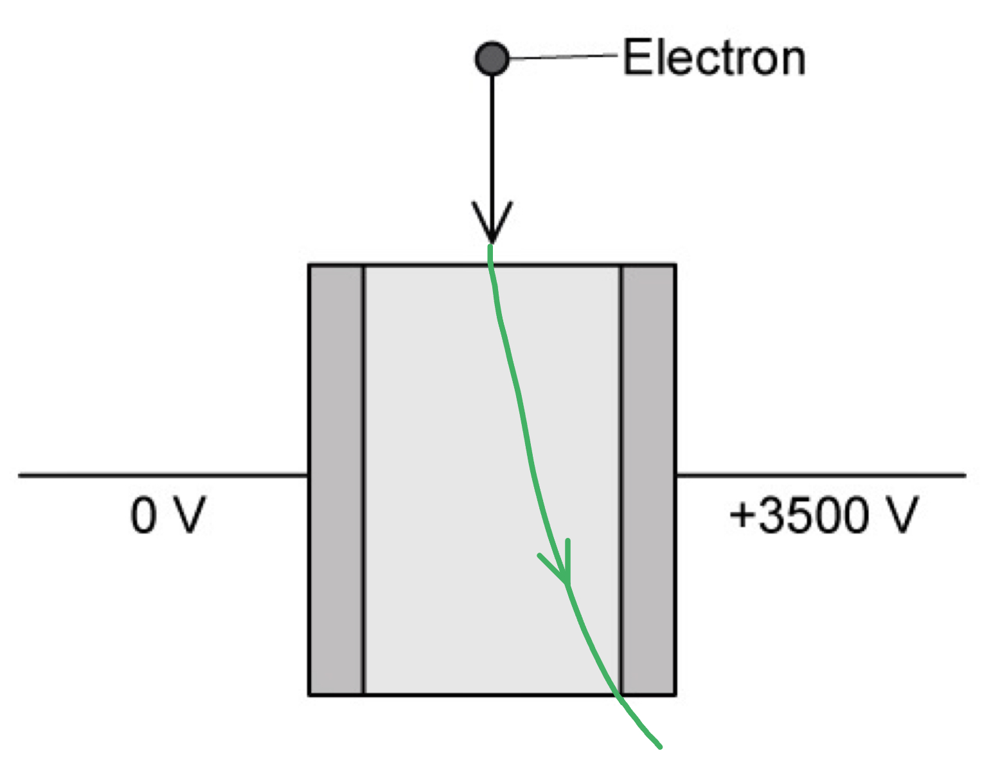
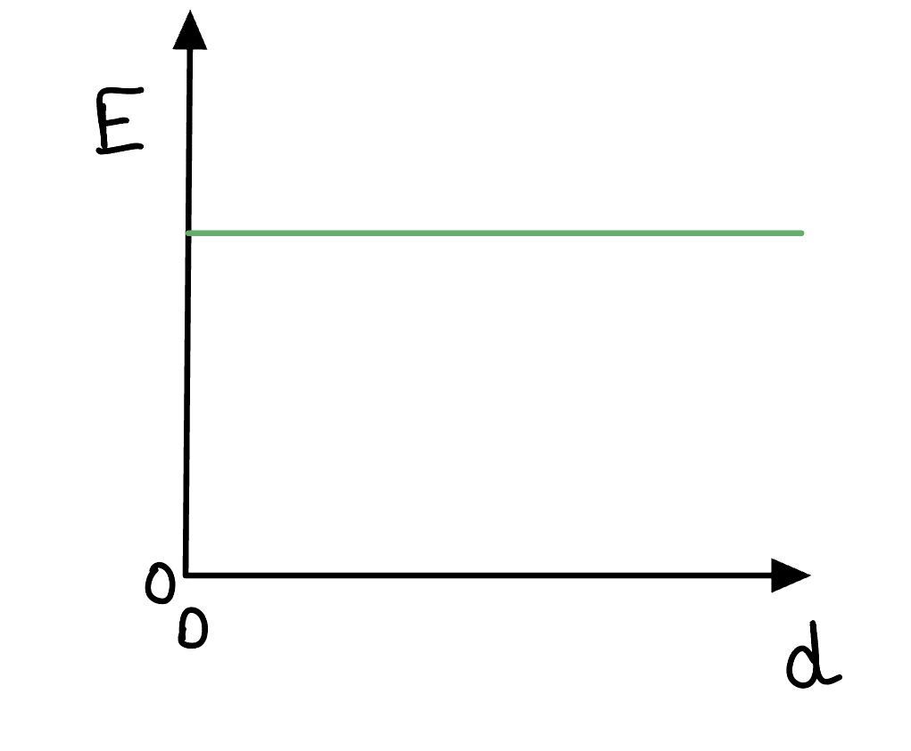

# Mark Schemes — Uniform Electric Fields
**18. Electric Fields** · Cambridge (CIE) A-LEVEL physics (9702)

## Structured Questions (5 questions)

### Q1
Electric field strength is defined as:

- The force per unit <u>positive</u> charge (acting on a stationary charge); **[1 mark]**

**[Total: 1 mark]**
A sketch which would score 2 marks looks like:

- At least <u>four</u> parallel equally spaced straight lines drawn perpendicular to the plates; **[1 mark]**
- All lines have arrows directed from positive to negative plate (right to left);** [1 mark]**

**[Total: 2 marks]**** **

> *You should know that the electric field between the two parallel plates is** uniform**. This means that the field will have the **same field strength **at every point between the plates. The strength of the electric field is represented by the separation of the field lines.*

- *The closer the electric field lines, the stronger the electric field*
- *the further the electric field lines, the weaker the electric field*

> *A uniform electric field is represented by electric field lines which are equally spaced. *

> *It is also important to include an arrow to show the direction of the electric field. Electric field lines always point away from a positive charge and towards a negative charge.*
Calculate the electric field strength between the plates:

List the known quantities:

- Potential difference between the plates, *V* = 200 V
- Separation between the plates, *d* = 50 mm = 50 × 10–3 m

Use the equation for electric field strength:

- Electric field strength:  $E=\frac{V}{d}$ **[1 mark]**
- Substitute:  $E=\frac{200}{50\times10^{-3}}$* *
- Evaluate: * *$E$ = 4000 **[1 mark]**
- Unit:  V m–1 **OR**** **N C–1 **[1 mark]**

**[Total: 3 marks]**

> *There are two ways of calculating electric field strength, but it is important to understand the difference between them. *

> *The equation:*

$E=\frac{V}{d}$

> *is used to calculate the electric field strength between **parallel plates**, where **V** is the potential difference between the plates and **d** is the separation of the plates. This is a uniform field *

> *The equation: *

> $E=\frac{1}{4\mathrm{πε}_{0}}\frac{Q}{r^{2}}$*  *

> *is used to calculate the electric field strength around a **point charge**, where **Q** is the charge which produces the electric field and **r** is the distance between the charge producing the electric field to the point where the electric field strength is being calculated. This is a radial (a type of non-uniform) field.*
(i) The direction of the force acting on the charge is:

- Towards the positive plate / to the right; **[1 mark]**

(ii) Calculate the force acting on the charge:

List the known quantities:

- Charge on polystyrene ball, $Q$ = 0.15 μC = 0.15 × 10–6 C
- Electric field strength, $E$ = 4000 V m–1 (from part c)

Use the equation for electrostatic force:

- Force on a charge:  $F=EQ$ **[1 mark]**
- $F$ = 4000 × (0.15 × 10–6)
- $F$* *= 6 × 10–4 N **[1 mark]**

**[Total: 3 marks]**

### Q2
A diagram that would score 1 mark should look like:

- Parabolic curve directed <u>upwards</u>; **[1 mark]**

The shape of the trajectory is:

- A parabola;** [1 mark]**

**[Total: 2 marks]**

> *To know which direction the curve is in, the electron will accelerate in the **opposite** direction to the field lines because it is negative (the field lines are the direction of a positive charge)*
A diagram that would score 2 marks should look like:

- Parabolic curve directed <u>downwards</u>; **[1 mark]**
- Same curvature as the parabola in part (a); **[1 mark]**

**[Total: 2 marks]**

> *The positron was introduced in topic 11.1 Atoms, Nuclei & Radiation. It the antiparticle of the electron, completely identical except it has the opposite charge (positive).*

> *This means its path will be in the **same** direction as the field lines, but nothing else about the path should change! Make sure it is not more or less curved than the path you draw in part (a) for the electron.*
List the known quantities:

- Magnitude of charge, *Q* = 0.17 µC = 0.17 × 10–6 C
- Potential difference (p.d.), *V* = 400 V
- Electrostatic force, *F* = 34 mN = 34 × 10–3 N

Calculate the separation, *d*:

- Electric field strength, *E* =$\frac{F}{Q}$ =$\frac{V}{d}$
- *d* = $\frac{VQ}{F}$= $\frac{400 \times ( 0.17 \times 10^{- 6} )}{34 \times 10^{- 3} }$ **[1 mark]**
- *d* = 2.0 × 10–3 m (20 mm) **[1 mark]**** **

**[Total: 2 marks]**
A diagram that would score 2 marks would look like:

- Electrostatic force, $F_{E}$ / *F* / 34 mN horizontally to the left; **[1 mark]**
- Weight *W*  **or** *mg*  vertically down **and** tension *T*  upwards along the thread **[1 mark]**** **

**[Total: 2 marks]**

### Q3

(i) The charges on the plates are as follows:

- (+) on plate B, (−) on plate A; **[1 mark]**

(ii) The electric field lines are as follows:

- At least four lines drawn from plate B to plate A; **[1 mark]**
- The field lines are parallel and equally spaced; **[1 mark]**

**[Total: 3 marks]**** **

> *Remember a **uniform **electric field exists between two parallel and oppositely charged plates. Therefore, the electric field lines are **parallel** and **equally spaced** from each other.*
(i) Increasing the potential difference between the plates causes:

- A greater electric field strength / force (on the alpha particle); **[1 mark]**
- (Hence) a greater deflection; **[1 mark]**

(ii) Increasing the separation between the plates causes:

- A smaller electric field strength / force (on the alpha particle); **[1 mark]**
- (Hence) a smaller deflection; **[1 mark]**

**[Total: 4 marks]**** **

> *The stronger the electric field strength between the two parallel plates, the more a charged particle will deflect. The equation used to calculate the electric field strength, **E**, between two parallel charged plates is:*

$E=\frac{V}{d}$

> *where **V** is the voltage across the plates and **d** is the separation distance. *

> *From this equation, we can see that the electric field strength is inversely proportional to the distance between the plates *$( E \propto \frac{1}{d} )$*. Therefore, if the distance between the charged plates **increases**, the electric field strength will **decrease**.*
The properties of alpha and beta particles that can cause differences in deflections are:

**Final answer:** **Any two ****pairs from:**

- Charge; **[1 mark]**
- Opposite charges deflect in opposite directions **OR **the greater the charge, the greater the deflection **OR** alpha deflects more than beta due to greater charge; **[1 mark]**

- Mass; **[1 mark]**
- The greater the mass, the smaller the deflection **OR** alpha deflects less than beta due to larger mass; **[1 mark]**

- Speed; **[1 mark]**
- The greater the speed, the smaller the deflection; **[1 mark]**

**[Total: 4 marks]**

> *The faster a charged particle enters the electric field, the smaller the deflection. This is because it will spend **less** **time** in the electric field. *

> *The **smaller** the potential difference applied between the charged parallel plates, the smaller the electric field strength. This is because electric field strength and potential difference are directly proportional *$( E = \frac{V}{d} )$*.*

> *This means that less force will be acting on a charged particle due to the electric field (since *$F=qE$*), and therefore less deflection.*
The path of the negatively charged particle is as follows:

- Arrow deflected downwards towards plate B; **[1 mark]**
- Length of path equivalent to alpha particle (in Fig. 1.1);** ****[1 mark]**

**[Total: 2 marks]**** **

> *We know from part (a) that plate B is positive. Therefore, the negatively charged particle will be attracted towards plate B (and repelled from plate A). *

> *As the negatively charged particle has the same mass and the same magnitude of charge as the alpha particle, the size of the deflection will be the **same** as in **Fig. 1.1**, the only difference is that the deflection will be **downwards**.*

### Q4
The direction of an electric field line indicates:

- The direction of the (electric) force; **[1 mark]**
- Experienced by a positive (test) charge; **[1 mark]**

**[Total: 2 marks]**
On Fig. 1.1, draw five lines to represent the electric field in the region between the plates:

A diagram that would score 3 marks should look like this:

- One straight line is drawn perpendicular to the two plates, starting on one plate and finishing on the other; **[1 mark]**
- Five straight lines are drawn parallel to the one above, uniformly spaced; **[1 mark]**
- Arrows are drawn on each line from the right side to the left side plate; **[1 mark]**

**[Total: 3 marks]**
Calculate the strength of the electric field between the plates:

List the known quantities:

- Potential difference between the plates, *V *= 3500 V
- Separation between the plates, *d* = 5.4 cm = 0.054 m

Use the equation for electric field strength:

- $E=\frac{V}{d}$ **[1 mark]**
- $E=\frac{3500}{0.054}$
- $E = 6.48 \times 10^{4 \mathrm{N} \mathrm{C}^{-1} } = 6.5 \times 10^{4 \mathrm{N} \mathrm{C}^{-1} } ( 2 \mathrm{s} . \mathrm{f} . )$ **[1 mark]**

**[Total: 2 marks]**
On Fig. 1.2, draw a line to show the path of the electron as it moves through and out of the region of the electric field:

A diagram that would score 2 marks should look like this:

- Electron path is straight outside the field and a smooth curve inside; **[1 mark]**
- The direction of deflection is shown as towards the positive plate; **[1 mark]**

**[Total: 2 marks]**

### Q5
A graph that would score 1 mark should look like:

- Horizontal line at a non-zero value; **[1 mark]**

**[Total: 1 mark]**
The potential difference between the plates is:

List the known quantities:

- Electric force, *F = *50 nN = 50 × 10–9 N
- Separation of the plates, *d* = 24 mm = 24 × 10–3 m

From the formulae page:

- Elementary charge, *e*  = 1.60 × 10–19 C

Determine the equation for the potential difference between the plates, *V*:

- $F=Eq$ and $E=\frac{V}{d}$
- $F=\frac{Vq}{d}$
- $V=\frac{Fd}{q}$ **[1 mark]**

Substitute in the values:

- $V = \frac{( 50 \times 10^{- 9} ) \times ( 24 \times 10^{- 3} ) }{1.60 \times 10^{- 19} }$ **[1 mark]**
- $V=7.5\times10^{9}V=7.5\mathrm{GV}$ **[1 mark]**

**[Total: 3 marks]**
The charge of the particle is:

List the known quantities:

- Mass of the particle, *m* = 5.0 g = 5 × 10–3 kg
- Separation of the plates, *d* = 24 mm = 24 × 10–3 m
- Potential difference between the plates, *V* = 7.5 × 109 V

Determine an equation for the charge of the particle, *q*:

- To remain stationary, the electric force upwards = weight downwards
- $F=Eq=mg$
- $q=\frac{mg}{E}$ **[1 mark]**

Calculate the electric field strength, *E*:

- $E=\frac{\DeltaV}{\Deltad}=\frac{7.5\times10^{9}}{24\times10^{-3}}=3.125\times10^{11}Vm^{-1}$ **[1 mark]**

Substitute the values into the charge equation, *q*:

- $q = \frac{( 5.0 \times 10^{- 3} ) \times 9.81}{3.125 \times 10^{11} }$ **[1 mark]**
- $q=1.5696\times10^{-13}C=1.6\times10^{-13}C$ **[1 mark]**

> *Remember you **cannot** use the same electric force **F** as in part (b), because this is a different particle to the proton. We can use the same potential difference and separation between the plates because these are the property of the plates itself (which haven't changed), instead of the particle.*
If the separation of the plates starts to decrease:

- The particle starts to accelerate / move <u>upwards</u> / move towards the <u>positive</u> plate; **[1 mark]**
- As the separation <u>decreases</u>, the (electric) field strength <u>increases</u>; **[1 mark]**
- So the (electric) force <u>increases</u> / the (electric) force becomes bigger than the weight; **[1 mark]**

**[Total: 3 marks]**
