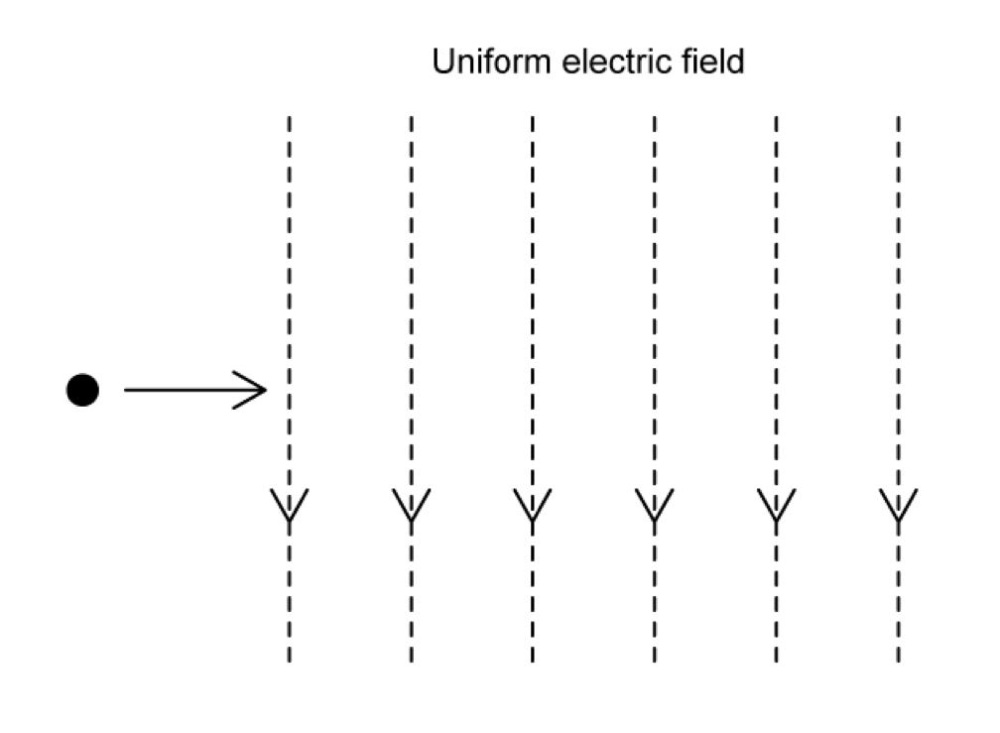
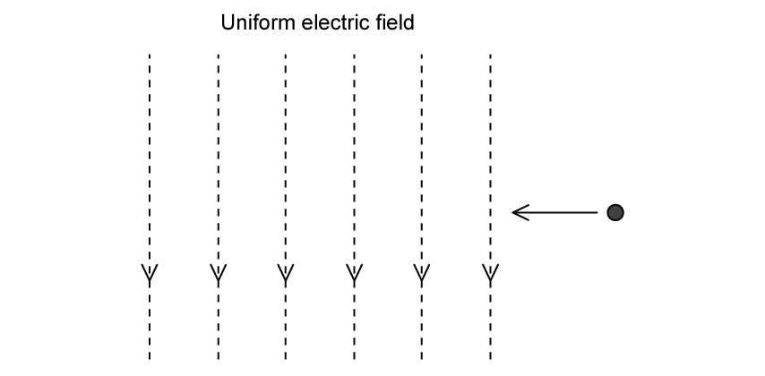

# Exam Questions — Uniform Electric Fields
**18. Electric Fields** · Cambridge (CIE) A-LEVEL physics (9702)
> Source: [https://www.savemyexams.com/a-level/physics/cie/25/topic-questions/](https://www.savemyexams.com/a-level/physics/cie/25/topic-questions/) · 5 questions across 1 sets

## Structured Questions (5 questions)

### Q1 — easy — 9 marks

**Q1** [1 mark]

Define *electric field strength*.

**Q1** [2 marks]

A uniform electric field is produced between two vertical metal plates shown in** **Fig. 1.1.

**Fig. 1.1**

On Fig. 1.1, draw lines to represent the electric field between the plates.

**Q1** [3 marks]

The metal plates are 50 mm apart. When the switch is closed, the plates are charged by a 200 V dc supply, as shown in Fig 1.2.

**Fig. 1.2**

Calculate the electric field strength between the plates when the switch is closed.

State an appropriate unit for your answer.

**Q1** [3 marks]

**Extract:**

The metal plates are 50 mm apart. When the switch is closed, the plates are charged by a 200 V dc supply, as shown in Fig 1.2. Calculate the electric field strength between the plates when the switch is closed.

Electric field strength: E = V/d = 200 / (50 × 10^–3) = 4000 V m^–1

A small polystyrene ball of charge –0.15 μC is suspended between the metal plates, as shown in** **Fig. 1.3.

**Fig. 1.3**

(i) State the direction of the force acting on the charge.

[1]

(ii) Calculate the magnitude of the force acting on the charge.

[2]

### Q2 — medium — 8 marks

**Q2** [2 marks]

Fig 1.1 shows an electron that enters an electric field at right angles to the field.

**Fig 1.1**

Sketch the path of the electron on Fig 1.1 once it enters the uniform electric field. State the shape of this trajectory.

**Q2** [2 marks]

**Extract:**

Fig 1.1 shows an electron that enters an electric field at right angles to the field. Sketch the path of the electron on Fig 1.1 once it enters the uniform electric field. State the shape of this trajectory.
Mark scheme: Parabolic curve directed upwards. The shape of the trajectory is a parabola.

A positron enters the field at right angles instead, as shown in Fig 1.2.

**Fig 1.2**

Sketch the path of the positron on Fig 1.2.

**Q2** [2 marks]

Fig 1.3 shows a small polystyrene ball which is suspended between two vertical metal plates, **P****1** and **P****2**, distance *d* apart that are initially uncharged.

The ball carries a charge of –0.17 μC.

**Fig 1.3**

When the switch is closed, a p.d. of 400 V is applied between **P****1** and **P****2** and the ball experiences an electrostatic force of 34 mN.

Calculate the value *d*.

**Q2** [2 marks]

**Extract:**

Fig 1.3 shows a small polystyrene ball which is suspended between two vertical metal plates, P1 and P2, distance d apart that are initially uncharged. The ball carries a charge of –0.17 μC. When the switch is closed, a p.d. of 400 V is applied between P1 and P2 and the ball experiences an electrostatic force of 34 mN.

Because of the electrostatic force acting on it, the ball is displaced from its original position. It comes to rest when the suspended thread makes an angle *θ * with the vertical, as shown in Fig 1.4.

**Fig 1.4**

On Fig 1.4, mark and label the forces that act on the ball when it is in this position.

### Q3 — easy — 13 marks

**Q3** [3 marks]

A uniform electric field is produced between two charged parallel plates, A and B. A positively* *charged alpha particle enters the electric field and deflects, as shown in Fig. 1.1.

**Fig. 1.1**

On Fig. 1.1,

(i) label plates A and B with (+) or (−) to show the charges

[1]

(ii) draw lines to represent the electric field between the plates.

[2]

**Q3** [4 marks]

**Extract:**

A uniform electric field is produced between two charged parallel plates, A and B. A positively charged alpha particle enters the electric field and deflects, as shown in Fig. 1.1.

State and explain the effect on the deflection of the alpha particle when

(i) the potential difference applied between A and B is increased

[2]

(ii) the separation of A and B is increased.

[2]

**Q3** [4 marks]

**Extract:**

A uniform electric field is produced between two charged parallel plates, A and B. A positively charged alpha particle enters the electric field and deflects, as shown in Fig. 1.1.

The alpha particle is replaced by a beta particle. The separation of the plates and the potential difference applied across them is kept the same.

State and explain **two** properties of alpha and beta particles that can affect the amount these particles deflect in an electric field.

**Q3** [2 marks]

**Extract:**

A uniform electric field is produced between two charged parallel plates, A and B. A positively charged alpha particle enters the electric field and deflects, as shown in Fig. 1.1.

(i) label plates A and B with (+) or (−) to show the charges

Mark scheme: The charges on the plates are as follows: (+) on plate B, (−) on plate A.

The alpha particle is replaced by a negatively charged particle which has the same mass and magnitude of charge as an alpha particle, as shown in Fig. 1.2.

The separation of the plates and the potential difference applied across them is kept the same.

**Fig. 1.2**

On Fig. 1.2, draw the path of the negatively charged particle between the parallel plates.

### Q4 — medium — 9 marks

**Q4** [2 marks]

State what is indicated by the direction of the electric field line.

**Q4** [3 marks]

Fig. 1.1 shows a pair of parallel metal plates with a potential difference (p.d.) of 3500 V between them.

**Fig. 1.1**

The plates are separated by a distance of 4.6 cm. The plates are in a vacuum.

On Fig. 1.1, draw five lines to represent the electric field in the region between the plates.

**Q4** [2 marks]

**Extract:**

Fig. 1.1 shows a pair of parallel metal plates with a potential difference (p.d.) of 3500 V between them. The plates are separated by a distance of 4.6 cm. The plates are in a vacuum.

Calculate the strength of the electric field between the plates.

electric field strength = .................................... N C−1

**Q4** [2 marks]

**Extract:**

Fig. 1.1 shows a pair of parallel metal plates with a potential difference (p.d.) of 3500 V between them. The plates are separated by a distance of 4.6 cm. The plates are in a vacuum.

A moving electron enters the region between the plates from the left, as shown in Fig. 1.2.

**Fig. 1.2**

The electron is deflected by the electric field.

On Fig. 1.2, draw a line to show the path of the electron as it moves through and out of the region of the electric field.

### Q5 — medium — 11 marks

**Q5** [1 mark]

An electric field exists in the space between two charged metal plates in Fig 1.1.

**Fig 1.1**

Sketch the graph on Fig 1.2 of the variation of electric field strength *E*  with distance *d*  from A along the line AB.

**Fig 1.2**

**Q5** [3 marks]

The force on a proton placed between the plates is 50 nN and the separation of the plates is 24 mm.

Calculate the potential difference between the plates.

**Q5** [4 marks]

**Extract:**

The force on a proton placed between the plates is 50 nN and the separation of the plates is 24 mm.
V = 7.5 × 10^9 V = 7.5 GV

A negatively charged particle of mass 5.0 g remains stationary exactly halfway from each plate, as shown in Fig 1.3.

**Fig 1.3**

Calculate the charge of the particle.

**Q5** [3 marks]

**Extract:**

A negatively charged particle of mass 5.0 g remains stationary exactly halfway from each plate, as shown in Fig 1.3.
To remain stationary, the electric force upwards = weight downwards. The separation of the plates is 24 mm and the potential difference between the plates is 7.5 × 10^9 V.

State and explain what will happen to the particle if the separation of the plates starts to decrease.
