# Mark Schemes — Electric Force Between Point Charges
**18. Electric Fields** · Cambridge (CIE) A-LEVEL physics (9702)

## Structured Questions (7 questions)

### Q1
List the known quantities:

- Distance, *d* = 1.8 × 10−8 m
- Mass*, m* = 1.7 × 10−9 kg
- Charge, *q* = 3.2 × 10−19 C
- Gravitational constant, *G* = 6.67 × 10−11 N m2 kg−2
- Permittivity of free space, *ε**o* = 8.85 × 10−12 C2 N−1 m−2

Deduce an expression for the resultant force:

- X and Y are in a circular motion around O
- The forces which hold the particle in motion are gravity and the Coulomb force
- Resultant centripetal force, $F_{R}=F_{g}+F_{c}$

  - Where *F**R* = resultant force, *F**g* = force due to gravity, *F**c* = Coulomb force

Find *F**g*, the force due to gravity:

- $F_{g}=G\frac{Mm}{r^{2}}$
- Therefore $F_{g}=(6.67\times10^{-11})\times\frac{(1.7\times10^{-9})^{2}}{(1.8\times10^{-8})^{2}}=5.950\times10^{-13}N$ **[1 mark]**

Find *F**c*, the Coulomb force by combining the equations for Coulomb's law and Coulomb's constant:

- $F_{c}=\frac{q_{1}q_{2}}{4πε_{0}r^{2}}$
- Therefore $F_{c}=\frac{(3.2\times10^{-19})^{2}}{4π\times(8.85\times10^{-12})\times(1.8\times10^{-8})^{2}}=2.842\times10^{-12}N$ **[1 mark]**

Add the forces to find the resultant and use *F = ma* to find acceleration:

- $F_{R}=ma$
- Therefore, $a=\frac{(F_{g}+F_{c})}{m}$
- Therefore $a=\frac{(5.950\times10^{-13})+(2.842\times10^{-12})}{(1.7\times10^{-9})}=2.022\times10^{-3}$
- *a* = 2.0 × 10−3 m s−2 (2 s.f.); **[1 mark]**

**[Total: 3 marks]**

> *In many situations gravity can be taken as negligible, however in this situation the particles are close enough together that gravity plays a part.*

> *An alternative method to find the time period would use the equation  *$F_{R}=mω^{2}r$*, which introduces one extra step but still ends at the same place and same answer.*

> *Once the force has been found, acceleration can be obtained from circular motion equations.*

> *Finally, the last equation can be found two ways, either by deriving as suggested in the solution above, or, using quick dimensional analysis as a reminder. Notice that angular velocity is measured in 'per seconds', therefore time period must be, in effect, 'per angular velocity'.*
List the known quantities:

- Acceleration of particles, *a *= 2.022 × 10−3 m s−2
- Separation of particles, *d *= 1.8 × 10−8 m

Recall the equation for centripetal acceleration and determine the angular velocity of X and Y:

- $a=ω^{2}r$
- $ω=\sqrt{\frac{a}{r}}$

- $ω=\sqrt{\frac{2.022\times10^{-3}}{0.5\times(1.8\times10^{-8})}}=473.99s^{-1}$ **[1 mark]**

Recall that for motion in a circle:

- $T=\frac{2π}{ω}$
- $T=\frac{2π}{473.99}=1.33\times10^{-2}s$ = 13 ms (2 s.f) **[1 mark]**

**[Total: 2 marks]**
List the known quantities:

- Magnitude of each charge, *q *= 3.2 × 10−19 C
- Separation distance between charges, *d *= 1.8 × 10−8 m
- Electric field strength, *E *= 6.5 V m−1 

Calculate the electric force on each charge, *F*:

- Recall: *F* = *qE *
- *F *= (3.2 × 10−19) × 6.5
- *F *= 2.08 × 10−18 N **[1 mark]**

Calculate the torque, *τ*:

- *τ *= *Fd*
- *τ *= (2.08 × 10−18) × (1.8 × 10−8)
- *τ *= 3.744 × 10−26 N m **[1 mark]**

Explain the presence of the torque:

- The electric force *F * produces a turning effect about the centre of the circle O; **[1 mark]**
- Without the electric field there is no torque present on X and Y to produce a turning effect; **[1 mark]**
- The force *F*  is equal in magnitude but opposite in direction on X and Y and acts perpendicular to the distance between them; **[1 mark]**

**[Total: 5 marks]**

> *Look back through all your workings in previous parts of this question to obtain the variables you need for this part.*
List the known quantities:

- Radius of gold nucleus, *r**g* = 7.0 fm = 7.0 × 10−15 m
- Radius of alpha particle, *r**α* = 1.7 fm = 1.7 × 10−15 m
- Separation of particles, *d *= 1.8 × 10−8 m

Determine the order of magnitude of the additional separation, Δ*r* caused by the gold and helium nuclei radii:

- Δ*r *= *r**g** *+ *r**α ***[1 mark]**
- Δ*r *= (7.0 × 10−15) + (1.7 × 10−15) = 8.7 × 10−15 **[1 mark]**

**[Total: 2 marks]**

### Q2
A diagram that would score 3 marks would be:

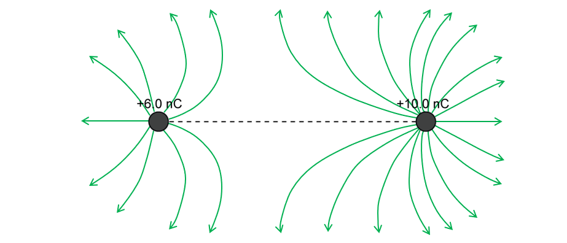

**Final answer:** **Any ****three**** from:**

- Field lines radiating <u>outwards</u> from the charges (correct direction of arrows); **[1 mark]**
- More lines coming from the +10.0 nC charge than the +6.0 nC charge; **[1 mark]**
- Lines are radial and curve when closer to the opposite charge; **[1 mark]**
- Neutral point (no fields lines) closer to the +6.0 nC charge than to the +10.0 nC charge; **[1 mark]**** **

**[Total: 3 marks]**
List the known quantities:

- Separation between the two charges, *r* = 67 mm = 67 × 10–3 m
- $Q_{1}$= +10.0 nC
- $Q_{2}$= +6.0 nC

From the formulae page:

- Permittivity of free space, $ε_{0}$ = 8.85 × 10–12 F m–1** OR **$\frac{1}{4πε_{0}}$** **= 8.99 × 109 m F–1

Calculate the force:

- Coulomb’s Law: *F* = $\frac{Q_{1}Q_{2}}{4\mathrm{πε}_{0}r^{2}}$ **[1 mark]**
- *F* = `fraction numerator open parentheses 8.99 space cross times space 10 to the power of 9 close parentheses space cross times space open parentheses 10.0 cross times 10 to the power of negative 9 end exponent close parentheses cross times open parentheses 6.0 cross times 10 to the power of negative 9 end exponent close parentheses over denominator open parentheses 67 cross times 10 to the power of negative 3 end exponent close parentheses squared end fraction`**[1 mark]**
- *F* = 1.2 × 10–4 N **[1 mark]**** **

**[Total: 3 marks]**** **

> *Remember that the charges must be in Coulombs and the separation **r**  must be in metres for Coulomb's law**. *

> *The magnitude of this force is identical to the magnitude of the force exerted on the +6.0 nC charge by the +10.0 nC charge. The only thing that would change, is its direction (they would be in opposite directions).*

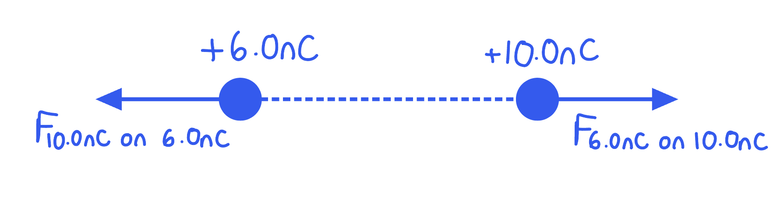

> *This is because the electric force is due to the interaction of **both** charges, not a force produced by just one, which is a common misconception.*
The electric force on the 10.0 nC charge:

- Decreases by 4 / quarters; **[1 mark]**
- Because $F\propto\frac{1}{r^{2}}$ / the force is inversely proportional to the separation between the charges <u>squared</u>; **[1 mark]**

**[Total: 2 marks]**

> *We can see this if we put the numbers into the equation.*

> *If we say *$F=\frac{Q_{1}Q_{2}}{4πε_{0}r^{2}}$* and **r**  becomes 2**r**  (the separation doubles), then the force becomes *`F space equals space fraction numerator Q subscript 1 Q subscript 2 space over denominator 4 pi epsilon subscript 0 open parentheses 2 r close parentheses squared end fraction space equals space F space equals space fraction numerator Q subscript 1 Q subscript 2 space over denominator 4 pi epsilon subscript 0 4 r squared end fraction`*.*

> *This new force is now **four times smaller** than the original.*

### Q3
The electric forces between the nuclei act as follows:

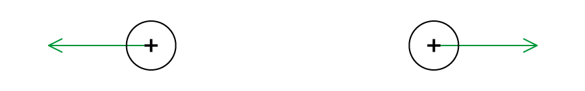

- Arrows pointing away from the centre of each point charge; **[1 mark]**
- Arrow size equal in magnitude; **[1 mark]**

**[Total: 2 marks]**
A similarity between the force fields is:

- (Electric and gravitational) <u>forces</u> both follow an inverse square law with distance / $F\propto\frac{1}{r^{2}}$; **[1 mark] ** **OR**
- (Electric and gravitational) <u>potentials</u> both follow an inversely proportional relationship with distance /** **$V\propto\frac{1}{r}$; **[1 mark]**

A difference between the force fields is:

- Gravitational forces are always attractive; **[1 mark]**
- Electric forces can be attractive or repulsive; **[1 mark]**

**[Total: 3 marks]**
Calculate the electric force between the alpha and aluminium nuclei:

List the known quantities

- Distance between nuclei, *r* = 2.0 nm = 2.0 × 10–9 m
- Coulomb constant, $\frac{1}{4πε_{0}}$ = 8.99 × 109 m F–1 (from the data page)
- Elementary charge, *e* = 1.60 × 10–19 C (from the data page)
- Charge on alpha particle, *Q**1* = 2*e* = 2 × (1.60 × 10–19) C
- Charge on aluminium nucleus, *Q**2* = 13*e* = 13 × (1.60 × 10–19) C

Use Coulomb's law to calculate the electric force:

- Coulomb's law:  $F=\frac{Q_{1}Q_{2}}{4πε_{0}r^{2}}$ **[1 mark]**
- Substitute:  `F space equals space fraction numerator open parentheses 8.99 cross times 10 to the power of 9 close parentheses cross times 2 cross times 13 cross times left parenthesis 1.60 cross times 10 to the power of negative 19 end exponent right parenthesis squared over denominator left parenthesis 2.0 cross times 10 to the power of negative 9 end exponent right parenthesis squared end fraction` **[1 mark]**
- Electric force:  $F$ = 1.5 × 10–9 N **[1 mark]**

**[Total: 3 marks]**
(i) Calculate the gravitational force between the alpha and aluminium nuclei:

List the known quantities

- Distance between nuclei, *r* = 2.0 nm = 2.0 × 10–9 m
- Gravitational constant, $G$ = 6.67 × 10–11 N m2 kg–2 (from the formula sheet)
- Atomic mass unit, u = 1.66 × 10–27 kg
- Mass of alpha particle, *m**1* = 4u = 4 × (1.66 × 10–27)
- Mass of aluminium nucleus, *m**2* = 27u = 27 × (1.66 × 10–27)

Use Newton's law of gravitation to calculate the gravitational force:

- Newton's law of gravitation:  $F=\frac{Gm_{1}m_{2}}{r^{2}}$ **[1 mark]**
- Substitute:  `F space equals space fraction numerator open parentheses 6.67 cross times 10 to the power of negative 11 end exponent close parentheses cross times 4 cross times 27 cross times left parenthesis 1.66 cross times 10 to the power of negative 27 end exponent right parenthesis squared over denominator left parenthesis 2.0 cross times 10 to the power of negative 9 end exponent right parenthesis squared end fraction`
- Gravitational force:  $F$ = 5.0 × 10–45 N **[1 mark]**

(ii) Gravitational effects do not need to be accounted for because:

- The gravitational force between two nuclei is negligible / much smaller compared to the electric force; **[1 mark]**

**[Total: 3 marks]**

### Q4
List the known quantities:

- Charge, $Q_{1}$ = –30 µC = –30 × 10–6 C
- Charge, $Q_{2}$ = 50 µC = 50 × 10–6 C
- Charge, $Q_{3}$ = 70 µC = 70 × 10–6 C
- Distance of $Q_{3}$ from centre of charges = 5m
- Distance between $Q_{1}$ and $Q_{2}$ = 10 m
- Permittivity of free space, $ε_{0}$ = 8.85 × 10–12 F m–1

(i) Calculate force from $Q_{1}$ , $F_{13}$:

Calculate separation from each charge, *r*:

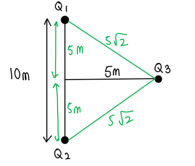

- From Pythagoras’s theorem *r* = $\sqrt{5^{2}+5^{2}}=5\sqrt{2}$ m **[1 mark]**

Calculate the magnitude of the resultant force, $F_{13}$:

- Since the question asks for the <u>magnitude</u> of the resultant force, the minus sign of the negative charge is not required
- Recall Coulomb's Law: $F=\frac{Q_{1}Q_{2}}{4\mathrm{πε}_{0}r^{2}}$
- $F_{13}$ =$\frac{Q_{1}Q_{3}}{4\mathrm{πε}_{0}r^{2}}$ = `fraction numerator open parentheses 30 cross times 10 to the power of negative 6 end exponent close parentheses cross times open parentheses 70 cross times 10 to the power of negative 6 end exponent close parentheses over denominator 4 straight pi cross times open parentheses 8.85 cross times 10 to the power of negative 12 end exponent close parentheses cross times open parentheses 5 square root of 2 close parentheses squared end fraction`
- $F_{13}$ = 0.3777 = 0.38 N **[1 mark]**

(ii) Calculate force from $Q_{2}$ , $F_{23}$:

- $F_{23}$ = `fraction numerator Q subscript 2 Q subscript 3 over denominator 4 pi epsilon subscript 0 r squared end fraction equals fraction numerator open parentheses 50 cross times 10 to the power of negative 6 end exponent close parentheses cross times open parentheses 70 cross times 10 to the power of negative 6 end exponent close parentheses over denominator 4 pi cross times open parentheses 8.85 cross times 10 to the power of negative 12 end exponent close parentheses cross times open parentheses 5 square root of 2 close parentheses squared end fraction`
- $F_{23}$ = 0.6294 = 0.63 N **[1 mark]**** **

**[Total: 3 marks]**
List the known quantities:

- Distance of from centre of charges = 5 m
- Distance between $Q_{1}$ and $Q_{2}$ = 10 m
- $F_{13}$ is attractive (opposite charges attract)
- $F_{23}$ is repulsive (like charges repel)

(i) Calculate direction of electric force from $Q_{1}$, $θ_{13}$:

Calculate angle $θ$  from the x axis:

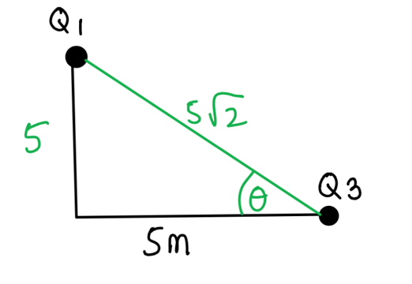

- `tan open parentheses theta close parentheses` = $\frac{opposite}{adjacent}$ = $\frac{5}{5}$ = 1
- $θ$ =`begin mathsize 16px style tan to the power of negative 1 end exponent open parentheses 1 close parentheses end style` = 45º **[1 mark]**

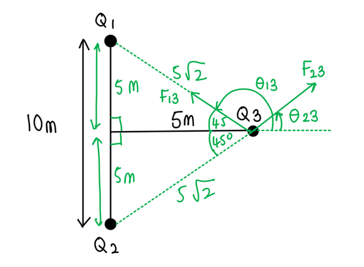

- $θ_{13}$ = 180 ­– 45 = 135 ­º **[1 mark]**

(ii) Calculate the direction of electric force from $Q_{2}$, $θ_{23}$:

- Vertically opposite angles are equal
- $θ_{23}$= 45 ­º **[1 mark]**** **

**[Total: 3 marks]**
List the known quantities:

- Force from $Q_{1}$ , $F_{13}$= 0.3777 N (From part a)
- Force from $Q_{2}$, $F_{23}$ = 0.6294 N (From part a)

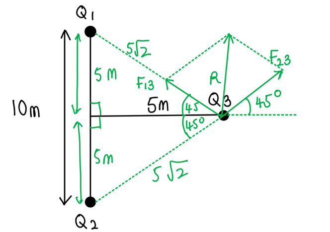

Calculate the x and y components of the resultant force, $R$:

- $R_{x}$ = $F_{23x}$  ­–  $F_{13x}$= 0.6294 cos(45) – 0.3777 cos(45) = 0.17798 N **[1 mark]**
- $R_{y}$ = $F_{23y}$ + $F_{13y}$ = 0.6294 sin(45) + 0.3777 sin(45) = 0.71213 N **[1 mark]**

Calculate the magnitude of the resultant force *R* using vector addition:

- *R* =`square root of open parentheses R subscript x close parentheses squared plus open parentheses R subscript y close parentheses squared end root` = `square root of open parentheses 0.17798 close parentheses squared plus open parentheses 0.71213 close parentheses squared end root`
- *R* = 0.734 N **[1 mark]**** **

**[Total: 3 marks]**

> *This is also a case of Pythagoras' theorem where **F**13** and **F**23** are perpendicular to each other. The method shown works for all angles if you come across other similar questions. Remember that the x component of the resultant force is the net horizontal force from both *$Q_{1}$* and *$Q_{2}$*, and similarly for the y component. Don't forget it is standard convention to take the right hand side as positive and the left hand side as negative. *

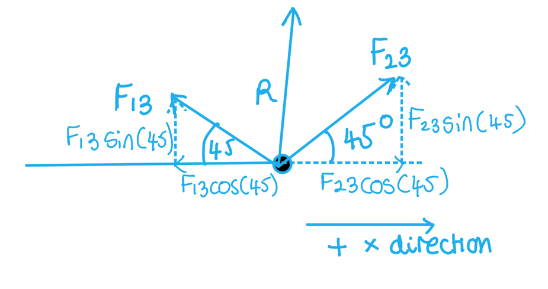
List the known quantities:

- x component of the resultant force, $R_{x}$ = 0.17798 N
- y component of the resultant force, $R_{y}$ = 0.71213 N

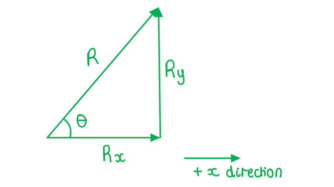

Calculate direction of *R*  from the positive x axis:

- `tan open parentheses theta close parentheses` = $\frac{R_{y}}{R_{x}}$ = $\frac{0.71213}{0.17798}$ **[1 mark]**
- $θ$ = `tan to the power of negative 1 end exponent open parentheses fraction numerator 0.71213 over denominator 0.17798 end fraction close parentheses` = 76.0º (3 s.f.) **[1 mark]**** **

**[Total: 2 marks]**

### Q5
Coulomb’s law states:

- The (electric) force between <u>two point charges</u>; **[1 mark]**
- Is proportional to the product of the charges and inversely proportional to the square of their separation; **[1 mark]**

**[Total: 2 marks]**

> *Many definitions in A–level physics involve describing an equation in words. Remember that Coulomb’s law is equal to*

$F=\frac{Q_{1}Q_{2}}{4πε_{0}r^{2}}$

> *Therefore, *$F\proptoQ_{1}Q_{2}$* (force is proportional to the product of the **two **charges) and *$F\propto\frac{1}{r^{2}}$*  (force is inversely proportional to the square of their separation)*
Calculate the magnitude of the electric force acting on each point charge:

List the known quantities:

- Magnitude of the charges, *q* = 3.2 × 10–15 C
- Separation between the charges, *r* = 5.0 mm = 5.0 × 10–3 m
- Coulomb constant, $\frac{1}{4πε_{0}}$ = 8.99 × 109 m F–1 (from data page)

Use Coulomb’s law to calculate the force between the point charges:

- Coulomb’s law:  $F=\frac{Q_{1}Q_{2}}{4πε_{0}r^{2}}$ **[1 mark]**
- Substitute:  `F space equals space fraction numerator open parentheses 8.99 cross times 10 to the power of 9 close parentheses open parentheses 3.2 cross times 10 to the power of negative 15 end exponent close parentheses squared over denominator open parentheses 5.0 cross times 10 to the power of negative 3 end exponent close parentheses squared end fraction` **[1 mark]**
- Electric force:  $F$ = 3.7 × 10–15 N **[1 mark]**

**[Total: 3 marks]**

> *In this question, you are asked to calculate the **magnitude** of the electric force acting on each point charge. This means that you do **not** need to include the negative sign in your answer. A negative sign simply indicates that the electric force between the positive and negative point charges is **attractive**.*
(i) If the magnitude of one of the charges doubles, the electric force:

- Doubles; **[1 mark]**
- (Because) electric force is directly proportional to the magnitude of each point charge **OR** $F\proptoQ_{1}Q_{2}$; **[1 mark]**

(ii) If the separation between the charges increases, the electric force:

- Decreases; **[1 mark]**
- (Because) electric force and distance follow an inverse square law **OR** $F\propto\frac{1}{r^{2}}$; **[1 mark]**

**[Total: 4 marks]**
(i) The correct arrows are as follows:

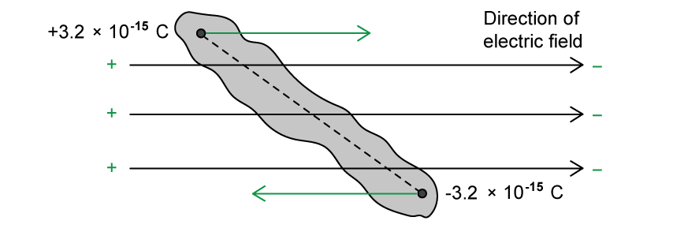

- Top arrow from the positive charge pointing in direction of field; **[1 mark]**
- Bottom arrow the negative charge pointing in opposite direction to field; **[1 mark]**

(ii) The dust particle would subsequently:

- Rotate to align with the field; **[1 mark]**
- In a clockwise direction; **[1 mark]**

**[Total: 4 marks]**

> *In this question, if you annotate your diagram correctly, it should be straightforward to visualise the motion of the dust particle.*

> *The electric field points from the **positive **plate to the **negative **plate, so the dust particle will spin around until the positive end is closest to the negative plate (on the right side) and the negative end is closest to the positive plate (on the left side)*

### Q6
List the known quantities:

- Separation of the proton, *r*  = 1.88 × 10–15 m

(i) The electrostatic force is:

From the formulae page:

- Permittivity of free space, $ε_{0}$ = 8.85 × 10–12 F m–1** OR **$\frac{1}{4πε_{0}}$** **= 8.99 × 109 m F–1
- Elementary charge, *e  *= 1.60 × 10–19 C

Calculate the electrostatic force, *F*E:

- $F_{E}=\frac{Q_{1}Q_{2}}{4πε_{0}r^{2}}$ **[1 mark]**
- `F subscript E space equals fraction numerator space open parentheses 8.99 space cross times space 10 to the power of 9 close parentheses space cross times space open parentheses 1.60 space cross times space 10 to the power of negative 19 end exponent close parentheses space cross times space open parentheses 1.60 space cross times space 10 to the power of negative 19 end exponent close parentheses over denominator open parentheses 1.88 space cross times space 10 to the power of negative 15 end exponent close parentheses squared end fraction`
- $F_{E}=65N$ **[1 mark]**

(ii) The gravitational force is:

From the formulae page:

- Rest mass of proton, *m*p  = 1.67 × 10–27 kg
- Gravitational constant, *G*  = 6.67 × 10–11 N m2 kg–2

Calculate the gravitational force, *F*G:

- $F_{G}=\frac{Gm_{1}m_{2}}{r^{2}}$ **[1 mark]**
- `F subscript G space equals space fraction numerator open parentheses 6.67 space cross times space 10 to the power of negative 11 end exponent close parentheses space cross times space open parentheses 1.67 space cross times space 10 to the power of negative 27 end exponent close parentheses space cross times space open parentheses 1.67 space cross times space 10 to the power of negative 27 end exponent close parentheses space over denominator open parentheses 1.88 space cross times space 10 to the power of negative 15 end exponent close parentheses squared end fraction`
- $F_{G}=5.263\times10^{-35}=5.3\times10^{-35}N$ **[1 mark]**

**[Total: 4 marks]**

> *Although it looks like the question hasn't given you many of the values needed, remember there are many given on the **data and formulae page** of your exam paper. The common ones to look out for are:*

- *Permittivity of free space, **ε**0*
- *Rest mass of a proton, **m**p*
- *Rest mass of an electron, **m**e*
- *Elementary charge, **e** (this is the charge of an electron **and** proton - the only difference is the electron is negative whilst the proton is positive!)*

> *You don't need to remember any of these values. Using the formulae page during your revision will make it easier by the time it comes to your exam to find the values you want!*
The answers in (a) give evidence for the existence of the strong nuclear force because:

- The force of <u>repulsion</u> is (much) greater than the force of <u>attraction</u>; **[1 mark]**
- There must be another force of attraction / the strong nuclear force; **[1 mark]**
- To hold the nucleus together; **[1 mark]**

**[Total: 3 marks]**

> *You can see from the numbers in part (a), **F**E** = 65 N (the force of **repulsion **between the protons) whilst **F**G **= 5.3 × 10**–35** N ) (the force of **attraction** between the protons). It wouldn't be enough to just say **F**E** > **F**G**, you must relate your answer to attractive and repulsive forces. *

> *Without the strong nuclear force, we wouldn't have nuclei (and therefore wouldn't exist!) since the electrostatic repulsion between protons would mean they could never be close together. Since neutrons are neutral (no charge) there are no electrostatic forces between them.*
The radius of the protons is not taken into account when calculating the electrostatic force between them because:

- They are assumed to be <u>point charges</u> /  <u>charged point masses</u>; **[1 mark]**

**[Total: 1 mark]**

> *Although they're most likely not, protons can be assumed to be spherical charges. Just like a spherical conductor, or a point outside a spherical conductor, the charge on the sphere may be considered to be a **point charge** at its centre. *
The distance between the electrons and the protons in the nucleus is:

List the known quantities:

- Electrostatic force, *F = *92 nN = 92 × 10–9 N

From the formulae page:

- Permittivity of free space, = 8.85 × 10–12 F m–1** OR **$\frac{1}{4πε_{0}}$** **= 8.99 × 109 m F–1
- Elementary charge, *e* = 1.60 × 10–19 C

Determine an equation for the distance, *r*:

- $F=\frac{Q_{1}Q_{2}}{4πε_{0}r^{2}}$
- $r=\sqrt{\frac{Q_{1}Q_{2}}{4πε_{0}F}}$ **[1 mark]**

Substitute in the values:

- `r space equals space square root of fraction numerator open parentheses 8.99 space cross times space 10 to the power of 9 close parentheses space cross times space open parentheses 1.60 space cross times space 10 to the power of negative 19 end exponent close parentheses space cross times space open parentheses 1.60 space cross times space 10 to the power of negative 19 end exponent close parentheses over denominator 92 space cross times space 10 to the power of negative 9 end exponent end fraction end root` **[1 mark]**
- $r=50\times10^{-12}=50\mathrm{pm}$ **[1 mark]**

**[Total: 3 marks]**

### Q7
Determine the magnitude of the force between the two charges:

List the known quantities:

- Charge A, *Q**A* = +3.1 nC = 3.1 × 10−9 C
- Charge B, *Q**B* = −6.2 nC = −6.2 × 10−9 C
- Distance between charges, *r* = 0.014 mm = 0.014 × 10–3 m

- $\frac{1}{4πε_{0}}$ = 8.99 × 109 m F−1

Use Coulomb's Law to calculate the force between the charges:

- $F=\frac{Q_{A}Q_{B}}{4πε_{0}r^{2}}$
- `F space equals space open parentheses 8.99 space cross times space 10 to the power of 9 close parentheses space cross times space fraction numerator open parentheses 3.1 space cross times space 10 to the power of negative 9 end exponent close parentheses space cross times space open parentheses 6.2 space cross times space 10 to the power of negative 9 end exponent close parentheses over denominator open parentheses 0.014 space cross times space 10 to the power of negative 3 end exponent close parentheses squared end fraction` **[1 mark]**
- `F space equals space 881.6 space straight N space equals space 880 space straight N space open parentheses 2 space straight s. straight f. close parentheses` **[1 mark]**

**[Total: 2 marks]**

> *The question is asking for the **magnitude **of the force, hence the **magnitude **of the charges only should be used in the calculation.*
The magnitude of the electric force between the charges is very high because:

- The charges are very close together / the separation of the charges is small / *r *is small; **[1 mark]**
- The magnitude of the charges on A and B are large; **[1 mark]**

**[Total: 2 marks]**
(i) Draw arrows on Fig. 1.1 to show the direction of the electrostatic force coming from charges A and B

A diagram that would score 2 marks should look like this:

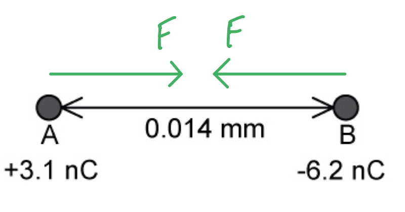

- Two arrows of equal length labelled F / force; **[1 mark]**
- Facing towards each other; **[1 mark]**

(ii) The electrostatic force between charges A and C will be different to that between A and B because:

- Both charges A and C are positive, so there is a <u>repulsive</u> force between them; **[1 mark]**
- Hence, the electrostatic force will be directed <u>away</u> from both particles; **[1 mark]**

(iii) On Fig. 1.2 draw an arrow representing the direction of the resultant force acting on the positron:

A diagram that would score 1 mark should look like this:

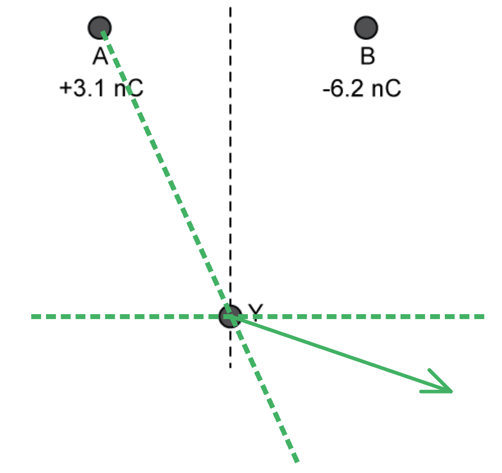

- A straight arrow drawn to the right of Y at an angle; **[1 mark]**

**[Total: 5 marks]**
