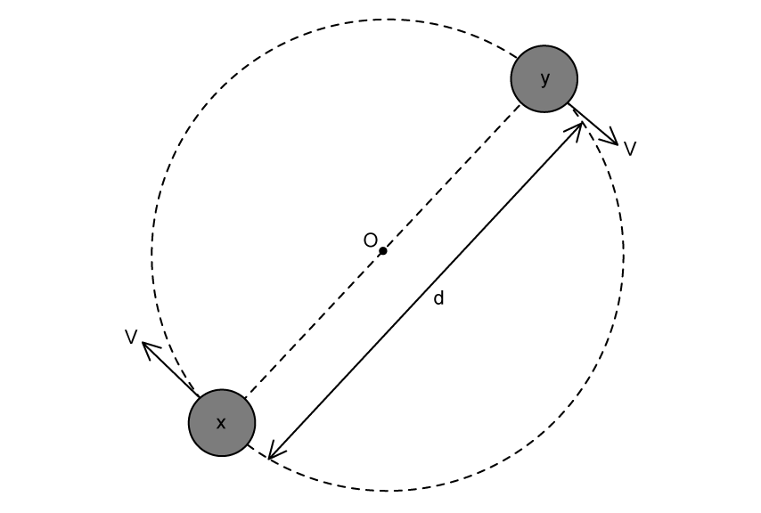

# Exam Questions — Electric Force Between Point Charges
**18. Electric Fields** · Cambridge (CIE) A-LEVEL physics (9702)
> Source: [https://www.savemyexams.com/a-level/physics/cie/25/topic-questions/](https://www.savemyexams.com/a-level/physics/cie/25/topic-questions/) · 7 questions across 1 sets

## Structured Questions (7 questions)

### Q1 — hard — 12 marks

**Q1** [3 marks]

Two charged objects X and Y are made to circle a point O. X and Y are at a distance, *d* = 1.8 × 10−8 m and they have equal masses, where *m* = 1.7 × 10−9 kg as shown in Fig. 1.1.

The objects carry an equal but opposite charge, where the magnitude *q* = 3.2 × 10−19 C.

**Fig. 1.1**

Calculate the acceleration of X and Y.

**Q1** [2 marks]

**Extract:**

Two charged objects X and Y are made to circle a point O. X and Y are at a distance, d = 1.8 × 10^−8 m and they have equal masses, where m = 1.7 × 10^−9 kg as shown in Fig. 1.1. The objects carry an equal but opposite charge, where the magnitude q = 3.2 × 10^−19 C. Calculate the acceleration of X and Y.
a = 2.0 × 10^−3 m s^−2 (2 s.f.)

Calculate the time required for the particles in part a) to make one complete orbit.

**Q1** [5 marks]

**Extract:**

Two charged objects X and Y are made to circle a point O. X and Y are at a distance, d = 1.8 × 10^−8 m and they have equal masses, where m = 1.7 × 10^−9 kg as shown in Fig. 1.1. The objects carry an equal but opposite charge, where the magnitude q = 3.2 × 10^−19 C.

A torque is experienced by particles X and Y from part a) when placed in an electric field of strength 6.5 V m−1. The electric field acts perpendicular to the line between X and Y.

Calculate the magnitude and explain the presence of the instantaneous torque when the particles are just starting to move in the electric field.

**Q1** [2 marks]

**Extract:**

Two charged objects X and Y are made to circle a point O. X and Y are at a distance, *d* = 1.8 × 10^−8^ m and they have equal masses, where *m* = 1.7 × 10^−9^ kg as shown in Fig. 1.1. The objects carry an equal but opposite charge, where the magnitude *q* = 3.2 × 10^−19^ C.

The particles X and Y in part a) are replaced with a gold nucleus $Au_{79}^{197}$ of radius 7.0 fm, and an alpha particle of radius 1.7 fm. They are circling point O with the same separation *d *and are no longer in an electric field.

Show that the separation of the gold nucleus and the alpha particle is around 9 × 10−15 larger than the separation of particles X and Y.

### Q2 — easy — 8 marks

**Q2** [3 marks]

Fig. 1.1 shows two point charges of + 6.0 nC and + 10.0 nC which are 67 mm apart. **  **

**Fig. 1.1 **

On Fig. 1.1, sketch the pattern of the electric field surrounding the charges.

**Q2** [3 marks]

**Extract:**

Fig. 1.1 shows two point charges of + 6.0 nC and + 10.0 nC which are 67 mm apart.

Calculate the magnitude of the force exerted on the +10.0 nC charge by the +6.0 nC charge.

**Q2** [2 marks]

**Extract:**

Fig. 1.1 shows two point charges of + 6.0 nC and + 10.0 nC which are 67 mm apart.

State and explain what happens to the electric force on the 10.0 nC if the distance between the charges is doubled.

### Q3 — medium — 11 marks

**Q3** [2 marks]

An alpha particle and an aluminium nucleus are isolated in a vacuum, as shown in Fig. 1.1.

Each nucleus may be considered to be a point mass with a point charge.

**Fig. 1.1**

On Fig. 1.1, draw arrows to show the direction of the electric forces acting on the nuclei.

**Q3** [3 marks]

**Extract:**

An alpha particle and an aluminium nucleus are isolated in a vacuum, as shown in Fig. 1.1. Each nucleus may be considered to be a point mass with a point charge.

State **one **similarity and **one **difference between the gravitational force field and the electric force field around the nuclei.

**Q3** [3 marks]

**Extract:**

An alpha particle and an aluminium nucleus are isolated in a vacuum, as shown in Fig. 1.1. Each nucleus may be considered to be a point mass with a point charge.

An aluminium nucleus contains 13 protons.

The alpha particle and the aluminium nucleus are separated by a distance of 2.0 nm.

Calculate the electric force between the alpha particle and the aluminium nucleus.

**Q3** [3 marks]

**Extract:**

An alpha particle and an aluminium nucleus are isolated in a vacuum, as shown in Fig. 1.1. Each nucleus may be considered to be a point mass with a point charge.

An aluminium nucleus contains 13 protons. The alpha particle and the aluminium nucleus are separated by a distance of 2.0 nm. Calculate the electric force between the alpha particle and the aluminium nucleus. Electric force: F = 1.5 × 10^–9 N

The aluminium nucleus contains 27 nucleons in total.

(i) Calculate the gravitational force between the two nuclei.

[2]

(ii) Suggest why gravitational effects do not need to be accounted for in electric field calculations involving nuclei.

[1]

### Q4 — hard — 11 marks

**Q4** [3 marks]

Three fixed isolated point charges, $Q_{1}$ , $Q_{2}$  and $Q_{3}$ are located as shown in Fig. 1.1 below.

**FIg. 1.1**

$Q_{1}$ has a charge of –30 µC, $Q_{2}$ has a charge of 50 µC and $Q_{3}$ has a charge of 70 µC. $Q_{3}$ is equidistant from charges $Q_{1}$ and $Q_{2}$. The right is taken as the positive x direction.

Calculate the magnitude of the electric force on $Q_{3}$ from:

(i) $Q_{1}$

[2]

(ii) $Q_{2}$

[1]

**Q4** [3 marks]

**Extract:**

Three fixed isolated point charges, Q1, Q2 and Q3 are located as shown in Fig. 1.1 below. Q1 has a charge of –30 µC, Q2 has a charge of 50 µC and Q3 has a charge of 70 µC. Q3 is equidistant from charges Q1 and Q2. The right is taken as the positive x direction.

Calculate the direction of the electric force with respect to the positive x-axis on Fig 1.1 from $Q_{3}$:

(i) $Q_{1}$

[2]

(ii) $Q_{2}$

[1]

**Q4** [3 marks]

**Extract:**

Three fixed isolated point charges, Q1, Q2 and Q3 are located as shown in Fig. 1.1 below. Q1 has a charge of –30 µC, Q2 has a charge of 50 µC and Q3 has a charge of 70 µC. Q3 is equidistant from charges Q1 and Q2. The right is taken as the positive x direction.
Force from Q1, F13 = 0.3777 N. Force from Q2, F23 = 0.6294 N.
θ13 = 135º, θ23 = 45º (directions with respect to positive x-axis).

Calculate the magnitude of the resultant force on $Q_{3}$.

**Q4** [2 marks]

**Extract:**

Calculate the x and y components of the resultant force, R:
- Rx = F23x – F13x = 0.6294 cos(45) – 0.3777 cos(45) = 0.17798 N
- Ry = F23y + F13y = 0.6294 sin(45) + 0.3777 sin(45) = 0.71213 N

Calculate the direction of the resultant force on $Q_{3}$ with respect to the *x* axis.

### Q5 — easy — 13 marks

**Q5** [2 marks]

State Coulomb’s law.

**Q5** [3 marks]

Two point charges of +3.2 × 10−15 C and –3.2 × 10−15 C are separated by a distance of 5.0 mm.

Calculate the magnitude of the electric force acting on each point charge.

**Q5** [4 marks]

**Extract:**

Two point charges of +3.2 × 10^−15^ C and –3.2 × 10^−15^ C are separated by a distance of 5.0 mm. Calculate the magnitude of the electric force acting on each point charge.

State and explain the effect on the magnitude of the electric force between the two point charges if, separately,

(i) the magnitude of one of the charges doubles

[2]

(ii) the separation between the charges increases.

[2]

**Q5** [4 marks]

**Extract:**

Two point charges of +3.2 × 10^−15^ C and –3.2 × 10^−15^ C are separated by a distance of 5.0 mm.

The two point charges represent the two ends of a dust particle suspended in the air, as shown in Fig. 1.1.

A uniform electric field is applied across the region containing the dust particle.

**Fig. 1.1**

(i) On Fig. 1.1, draw arrows to show the direction of the force on each charge due to the electric field.

[2]

(ii) Describe the subsequent motion of the dust particle in the electric field.

[2]

### Q6 — medium — 11 marks

**Q6** [4 marks]

Helium-3 is a light, stable isotope of helium with two protons and one neutron.

The protons are assumed to be 1.88 × 10–15 m apart.

For the two protons, calculate:

(i) the electrostatic force,

[2]

(ii) the gravitational force.

[2]

**Q6** [3 marks]

**Extract:**

Helium-3 is a light, stable isotope of helium with two protons and one neutron. The protons are assumed to be 1.88 × 10^–15^ m apart. For the two protons, calculate: (i) the electrostatic force, (ii) the gravitational force.

From the mark scheme: The electrostatic force F_E = 65 N. The gravitational force F_G = 5.263 × 10^–35 = 5.3 × 10^–35 N.

The force that holds the protons together in the nucleus is known as the strong nuclear force.

Suggest how your answers in (a) give evidence for the existence of the strong nuclear force.

**Q6** [1 mark]

**Extract:**

Helium-3 is a light, stable isotope of helium with two protons and one neutron. The protons are assumed to be 1.88 × 10^–15^ m apart. For the two protons, calculate: (i) the electrostatic force, (ii) the gravitational force.

State why the radius of the protons is not taken into account when calculating the electrostatic force between them.

**Q6** [3 marks]

The electrostatic force between an electron in the ground state of the helium-3 atom and the protons is 92 nN.

Show that the distance between the electron and the protons in the nucleus is about 50 pm.

### Q7 — medium — 9 marks

**Q7** [2 marks]

Two point charges A and B are placed 0.014 mm apart as shown in Fig. 1.1.

**Fig. 1.1**

The charge of A is +3.1 nC and the charge of B is −6.2 nC. Determine the magnitude of the force between the two charges.

**Q7** [2 marks]

**Extract:**

Two point charges A and B are placed 0.014 mm apart as shown in Fig. 1.1. The charge of A is +3.1 nC and the charge of B is −6.2 nC. Determine the magnitude of the force between the two charges.

The magnitude of the electric forces between the charges is very high.

State and explain why this is the case.

**Q7** [5 marks]

**Extract:**

Two point charges A and B are placed 0.014 mm apart as shown in Fig. 1.1. The charge of A is +3.1 nC and the charge of B is −6.2 nC.

(i) Draw arrows on Fig. 1.1 to show the direction of the electrostatic force coming from charges A and B.

[2]

(ii) Particle B is replaced by particle C. Particle C has a charge of +6.2 nC.

Describe how the electrostatic force between charges A and C will be different to that between A and B.

[2]

(iii) A positron is placed at point Y, equidistant from both A and B, as shown in Fig. 1.2. **Fig. 1.2** ** **

On Fig. 1.2 draw an arrow representing the direction of the resultant force acting on the positron.

[1]
