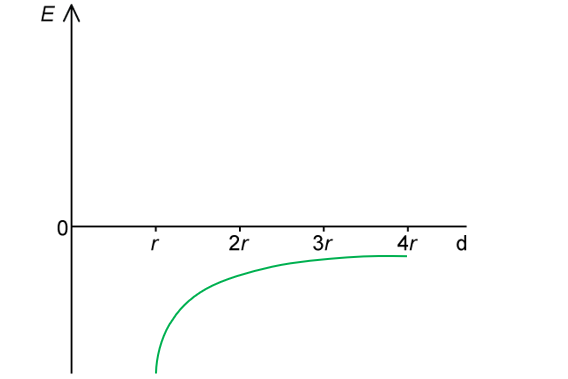
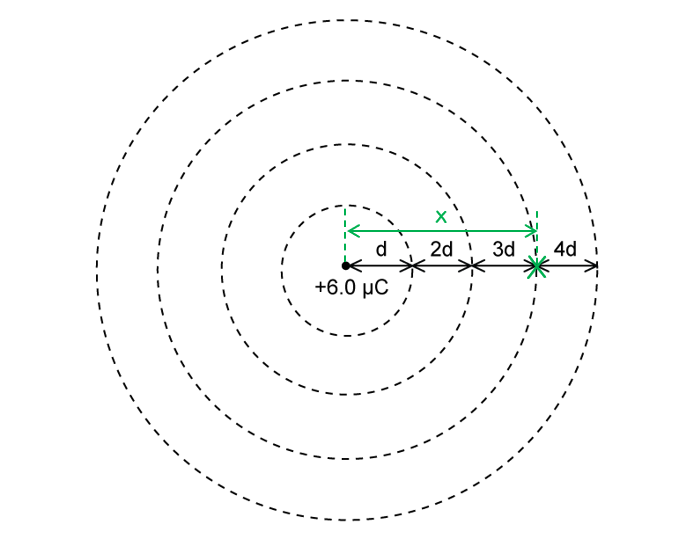

# Mark Schemes — Electric Field of a Point Charge
**18. Electric Fields** · Cambridge (CIE) A-LEVEL physics (9702)

## Structured Questions (5 questions)

### Q1
The electric field strength the α-particle experiences is:

List the known quantities:

- Atomic number of the gold nucleus = 79
- Distance of closest approach, *r* = 0.75 × 10–14 m

From the formulae page:

- Permittivity of free space, $ε_{0}$ = 8.85 × 10–12 F m–1** OR **$\frac{1}{4πε_{0}}$** **= 8.99 × 109 m F–1
- Elementary charge, *e* = 1.60 × 10–19 C

Determine the equation for the electric field strength of the gold nucleus, *E*:

- $E=\frac{Q}{4πε_{0}r^{2}}$

Determine *Q*, the charge of the gold nucleus:

- $Q = 79 e = 79 \times ( 1.60 \times 10^{- 19} ) = 1.264 \times 10^{- 17} \mathrm{C}$ **[1 mark]**

Substitute the values into the electric field equation:

- $E = \frac{( 8.99 \times 10^{9 ) \times ( 1.264 \times 10^{-17} } ) }{( 0.75 \times 10^{- 14} )^{2}}$ **[1 mark]**
- $E=2.02\times10^{21}Vm^{-1}=2.0\times10^{21}Vm^{-1}$ **OR **$NC^{-1}$**[1 mark]**

**[Total: 3 marks]**

> *Remember that the charge of a nucleus is just the total charge of the protons. Each proton has a charge, **e**, the elementary charge (the same charge as an electron, which makes atoms neutral). This is then multiplied by the **atomic** or **proton** number to get the total charge. The mass number, 197, is not used in this question.*
The gold nucleus experiences an electric field strength roughly 40 times less than the α–particle because:

List the known quantities:

- Electric field strength due to gold nucleus, *E*Au = 2.020153 × 1021 V m–1 (from part a)
- Distance of closest approach, *r* = 0.75 × 10–14 m

From the formulae page:

- Elementary charge, *e* = 1.60 × 10–19 C

Determine the charge of the α–particle:

- An α–particle has 2 protons and 2 neutrons (helium nucleus)
- Therefore, it's charge *Q* = 2*e ***[1 mark]**

Calculate the electric field strength experienced by the gold nucleus (from the α–particle):

- `E _ alpha = (2 e)/(4 pi ϵ _ 0 r ^2) = (( 8.99 x 10 ^ 9 ) x 2 x ( 1.60 x 10 ^ - 19 ))/(( 0.75 x 10 ^ - 14 ) ^2)`
- $E_{α}=5.11\times10^{19}Vm^{-1}$

Determine the ratio of the electric field strengths:

- $\frac{E_{Au}}{E_{α}} = \frac{2.02\times10^{21}}{5.11\times10^{19}}$ = 39.5 **[1 mark]**

**[Total: 2 marks]**

> *You must remember that the composition of an α-particle, which is the same as a helium nucleus (*$He_{2}^{4}$*) is 2 protons and 2 neutrons.*

> *Remember **Q** in the electric field strength equation is the charge that is producing the field. The α-particle experiences the field of the gold nucleus, and vice versa. Since the α-particle has much less charge, it is expected that it will produce a much smaller electric field strength.*
The direction the α–particle will travel in after it is momentarily stationary is:

- Away from the gold nucleus / in the opposite direction;** [1 mark]**

- It will be repelled / there is electrostatic repulsion between the α–particle and the gold nucleus **AND **since they are both positively charged / the same charge;** [1 mark]** **OR**
- Since the α–particle has a positive charge, it will travel in the same direction as the field lines produced by the gold nucleus;** [1 mark]**

**[Total: 2 marks]**

### Q2
Electric field strength is defined as:

- The (electric) <u>force</u>; **[1 mark]**
- Per unit <u>positive</u> charge (acting on a stationary charge);** ****[1 mark]**

**[Total: 2 marks]**

> *Remember not to forget the unit ‘positive’ charge. This is important to denote the convention of the electric field lines directed away from positive and towards negative charges.*
(i) The negatively charged sphere is:

- Sphere B; **[1 mark]**
- (Because) field lines are directed from positive to negative; **[1 mark]**

(ii) The sphere with the greater magnitude of charge is:

- Sphere A; **[1 mark]**
- (Because) the closer the field lines, the greater the strength of the field; **[1 mark]**

**[Total: 4 marks]**** **

> *Remember that electric field lines show the direction in which a positive charge would move if placed at a particular point. Therefore, the field lines point **away** from a **positive** charge and **towards** a **negative** charge.*

> *The strength of the electric field is shown by the **spacing** of the electric field lines.  The closer the field lines are together, the stronger the electric field. The further apart the electric field lines are, the weaker the electric field.*
The formula for electric field strength at the surface of the sphere is:

- $E=\frac{Q}{4πε_{0}r^{2}}$ **[1 mark]**
- Where $ε_{0}$ is the permittivity of free space, *Q* is the charge on the sphere, and* r* is the radius of the sphere; **[1 mark]**

**[Total: 2 marks]**
List the known quantities:

- Electric field strength at surface of A = 2.6 × 103 V cm–1
- Electric field strength at surface of B = 1.3 × 103 V cm–1
- Charge on surface of sphere B = 7.5 µC = 7.5 × 10–6 C
- Coulomb constant, $\frac{1}{4πε_{0}}$ = 8.99 × 109 m F–1 (from data page)

(i) Calculate the radius of sphere B:

- Electric field strength:  $E=\frac{Q}{4πε_{0}r^{2}}$
- Rearrange:  $r^{2}=\frac{Q}{4πε_{0}E}\Rightarrowr=\sqrt{\frac{Q}{4πε_{0}E}}$ **[1 mark]**
- Substitute:  $r_{B} = \sqrt{ \frac{( 8.99 \times 10^{9 ) \times ( 7.5 \times 10^{-6} } )}{1.3 \times 10^{3}} }$
- Radius of B:  $r_{B}$ = 7.2 cm ≈ 7 cm **[1 mark]**

(ii) Calculate the magnitude of the charge stored on the surface of sphere A:

- If the spheres have the same radius, then $\frac{1}{4πε_{0}r^{2}}$ = constant for both A and B
- Therefore, $\frac{E_{A}}{E_{B}}=\frac{Q_{A}}{Q_{B}}$
- The ratio of the field strengths is $\frac{E_{A}}{E_{B}}=\frac{2.6\times10^{3}}{1.3\times10^{3}}=2$ **[1 mark]**
- Therefore, $\frac{E_{A}}{E_{B}}=\frac{Q_{A}}{Q_{B}}=2$
- So, the charge on the surface of A is $Q_{A}=7.5\times2=15\mathrm{μC}$ **[1 mark]**

**[Total: 4 marks]**

> *Notice that the field strength has been given in V cm**–1**, and the answer to (i) is required in cm. Look out for units in questions like this so you don't waste time converting units when you don't need to! *

> *In part (ii), if you are confident using ratios, you will be able to obtain the relationship between field strength and charge quickly and this can save a lot of time compared to carrying out two sets of calculations!*

### Q3
The charge of the sphere is assumed to be:

- A <u>point charge</u>; **[1 mark]**
- Positioned at the <u>centre</u> of the sphere; **[1 mark]**

**[Total: 2 marks]**

> *This is called the 'point charge approximation' that is used throughout the A level. It states that for a point outside a **spherical conductor**, the **charge** on the sphere may be considered to be a **point** **charge** at its **centre**. This is why electric field lines look like they're always coming from the centre of a charge spherical conductor.*
The maximum charge that can be stored on the sphere is:

List the known quantities:

- Electric field strength, *E *= –6.2 MV m–1 = –6.2 × 106 V m–1
- Radius, *r* = 40 cm = 0.40 m

From the formulae page:

- Permittivity of free space, $ε_{0}$ = 8.85 × 10–12 F m–1

Determine the equation for the charge of the sphere:

- $E=\frac{Q}{4πε_{0}r^{2}}$
- $Q=E4πε_{0}r^{2}$ **[1 mark]**

Substitute in the values:

- $Q = ( - 6.2 \times 10^{6 ) \times 4 \mathrm{\pi } \times ( 8.85 \times 10^{-12} } ) \times ( 0.40 )^{2}$ **[1 mark]**
- $Q = ( - ) 1.1 \times 10^{- 4} \mathrm{C}$ **[1 mark]**

**[Total: 3 marks]**

> *The negative sign doesn't matter so much in your answer, unless specified in the question. However, the **magnitude** of the charge** Q** needs to be correct for full marks.*
A sketch that would score 3 marks should look like:

- No field for *d* < *r ***[1 mark]**
- For *d* > *r*, steep upward curve, not going to zero; **[1 mark]**
- Graph only on the bottom half (negative electric field strength); **[1 mark]**

**[Total: 3 marks]**

### Q4
The relationship between electric field strength and distance are related by:

- An inverse square law **OR** $E\propto\frac{1}{r^{2}}$ **OR** if distance doubles, electric field strength falls by $\frac{1}{4}$; **[1 mark]**

**[Total: 1 mark]**
List the known quantities:

- Charge on sphere X, $Q$ = 2.0 × 10−9 C
- Coulomb constant, $\frac{1}{4πε_{0}}$ = 8.99 × 109 m F–1 (from data page)

(i) Calculate the electric field strength at a distance of 2 cm:

- Electric field strength:  $E=\frac{Q}{4πε_{0}r^{2}}$ **[1 mark]**
- Distance from charge = 2 cm = 0.02 m
- Substitute:  $E = \frac{( 8.99 \times 10^{9 ) ( 2.0 \times 10^{-9} } )}{0.02^{2}}$
- $E$ = 44 950 = 45 000 V m–1 (45 kV m–1) **[1 mark]**

(ii) Calculate the electric field strength at a distance of 10 cm:

- Electric field strength:  $E=\frac{Q}{4πε_{0}r^{2}}$
- Distance from charge = 10 cm = 0.1 m
- Substitute:  $E = \frac{( 8.99 \times 10^{9 ) ( 2.0 \times 10^{-9} } )}{0.1^{2}}$
- $E$ = 1798 = 1800 V m–1 (1.8 kV m–1) **[1 mark]**

**[Total: 3 marks]**

> *For part (ii), you could take your answer to (i) and divide it by 25 as the distance has increased by a factor of 5, so from the inverse square law, the electric field strength will decrease by a factor of 5**2*
Calculate the magnitude of the electric field strength at the midpoint:

List the known quantities:

- Charge on sphere X, $Q_{X}$ = +2.0 × 10−9 C
- Charge on sphere Y, $Q_{Y}$ = –2.0 × 10−9 C
- Midpoint between spheres, $r$ = 10 cm
- Electric field strength at 10 cm = 1800 V m–1 (from part b)

Add the field strengths to find the value at the midpoint:

- Electric field strength:  $E=\frac{Q}{4πε_{0}r^{2}}$
- Field at midpoint, $E=E_{X}+E_{Y}$ **[1 mark]**
- $E$ = 2 × 1800 = 3600 V m–1 **[1 mark]**

(ii) The direction of the electric field at the midpoint is

- Towards sphere Y; **[1 mark]**

**[Total: 3 marks]**

> *This is a simple question when you realise that the midpoint is 10 cm from both spheres, and they both have the same charge, so you simply need to use the value of field strength from the previous sub-part and multiply it by 2 to find the combined field strength due to both charges*

> *The easiest mistake to make with this question is to subtract E**Y** from E**X** as it carries a negative charge. However, remember that an electric field is understood by describing it as a region where a **positive charge** will be moved. Therefore, both charges would move a positive charge to the right (towards Y), hence the values add up and the overall field is **stronger**.*
The electric field strength at the midpoint between the spheres would be zero because:

- Both spheres have equal, positive charges which repel each other; **[1 mark]**
- At the midpoint, the magnitude of the electric fields are equal and the directions are opposite **OR** at the midpoint, the overall electric field is $E=E_{X}-E_{X}=0$; **[1 mark]**

**[Total: 2 marks]**

> *This question follows logically from the previous part, as now both spheres have the **same charge** and **repel **each other, so it makes sense that there must be a point between them where the electric field cancels out*

> *Remember that an electric field describes a region where a **positive charge** will be moved. Therefore, at the midpoint, both charges would move a positive charge to the right, but one would move it towards the midpoint and one would move it away from the midpoint, hence the values cancel out by the same amount*

### Q5
The distance *d* where the electric field strength is 96 kV m–1 is:

List the known quantities:

- Charge, *Q* = 6.0 µC = 6.0 × 10–6 C
- Electric field strength, *E* = 96 kV m–1 = 96 × 103 V m–1

From the formulae page:

- Permittivity of free space, $ε_{0}$ = 8.85 × 10–12 F m–1
- Coulomb constant,** **$k=\frac{1}{4πε_{0}}$** **= 8.99 × 109 m F–1

Determine the equation for the distance *d*:

- For a point charge, $E=\frac{Q}{4πε_{0}r^{2}}=\frac{kQ}{r^{2}}$ (in this case *d* = *r*)
- Distance: * *$d=\sqrt{\frac{kQ}{E}}$* ***[1 mark]**

Substitute in the values:

- $d = \sqrt{ \frac{( 8.99 \times 10^{9 ) \times ( 6.0 \times 10^{-6} } )}{96 \times 10^{3}} }$** [1 mark]**
- $d = 0.7496 \mathrm{m} = 0.75 \mathrm{m} ( 75 \text{cm} )$** [1 mark]**

**[Total: 3 marks]**
Determine the value of distance $x$:

List the known quantities:

- Initial electric field strength, *E*1 = 96 kV m–1
- Final electric field strength, *E*2 = 10.8 kV m–1
- Initial distance, $r_{1}=d$ = 0.75 m (from part a)
- Final distance, $r_{2}=x$

Determine an expression linking the electric field strengths to the distance:

- Since $E\propto\frac{1}{r^{2}}\Rightarrow\frac{E_{1}}{E_{2}}=\frac{r_{2}^{2}}{r_{1}^{2}}$ **[1 mark]**
- Substitute:  $\frac{E_{1}}{E_{2}}=\frac{x^{2}}{d^{2}}$
- Rearrange:  $x=\sqrt{\frac{d^{2}E_{1}}{E_{2}}}$

Calculate the distance $x$:

- $x=\sqrt{\frac{0.75^{2}\times96}{10.8}}$ **[1 mark]**
- $x=2.236=2.2m$ **[1 mark]**

**[Total: 3 marks]**

> *There are a few different ways to answer this question, you could substitute this number back into the electric field strength equation. Both methods will gain full marks.*
List the known quantities:

- Distance *d* = 0.75 m (from part a)
- Distance *x* = 2.2 m (from part b)

Determine the ratio of *x* to *d*:

- $\frac{x}{d}=\frac{2.2}{0.75}=2.93=3$ **[1 mark]**
- So,* *$x=3d$

Mark the position of **X**:

- **X** marked at 3*d*; **[1 mark]**

**[Total: 2 marks]**
