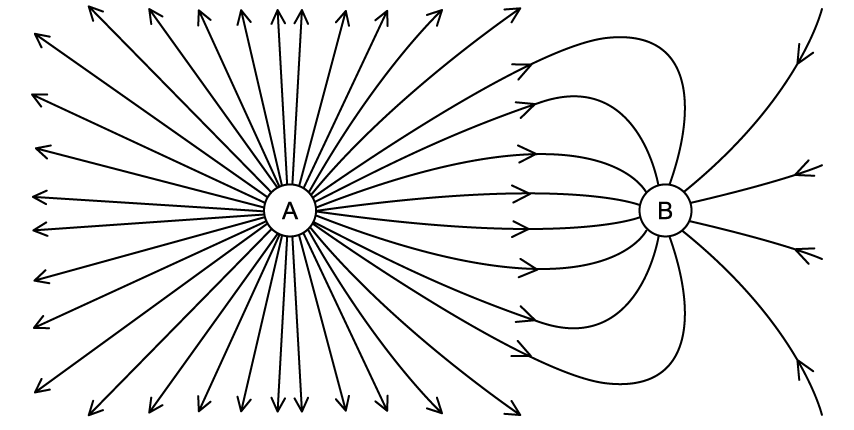

# Exam Questions — Electric Field of a Point Charge
**18. Electric Fields** · Cambridge (CIE) A-LEVEL physics (9702)
> Source: [https://www.savemyexams.com/a-level/physics/cie/25/topic-questions/](https://www.savemyexams.com/a-level/physics/cie/25/topic-questions/) · 5 questions across 1 sets

## Structured Questions (5 questions)

### Q1 — medium — 7 marks

**Q1** [3 marks]

An α-particle is moving directly towards a stationary gold nucleus ($Au_{79}^{197}$).

The α-particle and the gold nucleus may be considered to be solid spheres with the charge and mass concentrated at the centre of each sphere.

The α-particle approaches to 0.75 × 10–14 m from the gold nucleus where it is momentarily stationary.

Calculate the electric field strength the α-particle experiences at the point.

**Q1** [2 marks]

**Extract:**

An α-particle is moving directly towards a stationary gold nucleus (₇₉¹⁹⁷Au). The α-particle and the gold nucleus may be considered to be solid spheres with the charge and mass concentrated at the centre of each sphere. The α-particle approaches to 0.75 × 10⁻¹⁴ m from the gold nucleus where it is momentarily stationary. Calculate the electric field strength the α-particle experiences at the point.
E = 2.02 × 10²¹ V m⁻¹ (electric field strength due to gold nucleus, from part a)

Show that the gold nucleus experiences an electric field strength that is roughly 40 times less than the α–particle.

**Q1** [2 marks]

**Extract:**

An α-particle is moving directly towards a stationary gold nucleus (\$\$\_{79}^{197}A u\$\$). The α-particle and the gold nucleus may be considered to be solid spheres with the charge and mass concentrated at the centre of each sphere. The α-particle approaches to 0.75 × 10^–14^ m from the gold nucleus where it is momentarily stationary.

State the direction that the α–particle will travel in after it is momentarily stationary. Explain why this happens.

### Q2 — easy — 12 marks

**Q2** [2 marks]

Define *electric field strength*.

**Q2** [4 marks]

Fig. 1.1 shows the electric field lines between two charged spheres, A and B.

**Fig. 1.1**

Using Fig. 1.1, state and explain which of the spheres, A or B, has

(i) a negative charge

[2]

(ii) a greater magnitude of charge.

[2]

**Q2** [2 marks]

State the formula for the electric field strength $E$ at the surface of the sphere and state the meaning of any other symbols used.

**Q2** [4 marks]

**Extract:**

The formula for electric field strength at the surface of the sphere is: E = Q/(4πε₀r²) Where ε₀ is the permittivity of free space, Q is the charge on the sphere, and r is the radius of the sphere.

The field strength at the surface of sphere A is 2.6 × 103 V cm–1, and the field strength at the surface of sphere B is 1.3 × 103 V cm–1.

The magnitude of the charge stored on the surface of sphere B is 7.5 µC.

(i) Show that the radius of sphere B is about 7 cm.

[2]

(ii) Calculate the magnitude of the charge stored on the surface of sphere A. Assume both spheres have an equal radius.

[2]

### Q3 — medium — 8 marks

**Q3** [2 marks]

Fig 1.1 shows an isolated conducting sphere of radius *r* is placed in air. It is given a charge –*Q*.

**Fig 1.1**

State assumptions about the charge of the sphere.

**Q3** [3 marks]

The maximum field strength at the surface of the sphere before electrical breakdown (sparking) occurs is –6.2 MV m–1. The sphere has a radius of 40 cm.

Calculate the maximum charge that can be stored on the sphere.

**Q3** [3 marks]

**Extract:**

Fig 1.1 shows an isolated conducting sphere of radius *r* is placed in air. It is given a charge –*Q*.

On Fig 1.2, sketch a graph to show the variation with distance *d* from the centre of the sphere of the electric field strength *E* due to the charge –Q.

**Fig 1.2**

### Q4 — easy — 9 marks

**Q4** [1 mark]

State the relationship between electric field strength $E$ and the distance $r$ from a point charge.

**Q4** [3 marks]

Sphere X is a small conducting sphere that carries a charge of +2.0 × 10−9 C.

This charge may be assumed to act as a point charge situated at the centre of sphere X.

Calculate the electric field strength at a distance of

(i) 2 cm from the centre of sphere X

[2]

(ii) 10 cm from the centre of sphere X.

[1]

**Q4** [3 marks]

**Extract:**

Sphere X is a small conducting sphere that carries a charge of +2.0 × 10^−9^ C. This charge may be assumed to act as a point charge situated at the centre of sphere X. Calculate the electric field strength at a distance of (i) 2 cm from the centre of sphere X (ii) 10 cm from the centre of sphere X.

Coulomb constant, 1/(4πε₀) = 8.99 × 10^9 m F^–1. At 10 cm = 0.1 m: E = (8.99 × 10^9)(2.0 × 10^−9)/0.1^2 = 1800 V m^–1 (1.8 kV m^–1).

Sphere X is placed at a distance of 20 cm from sphere Y, which is identical to sphere X but carries a negative charge.

At the midpoint between the spheres X and Y:

(i) Calculate the magnitude of the electric field strength

[2]

(ii) State the direction of the electric field.

[1]

**Q4** [2 marks]

**Extract:**

Sphere X is a small conducting sphere that carries a charge of +2.0 × 10^−9^ C.
Sphere X is placed at a distance of 20 cm from sphere Y, which is identical to sphere X but carries a negative charge. At the midpoint between the spheres X and Y: (i) Calculate the magnitude of the electric field strength (ii) State the direction of the electric field.

Sphere Y is replaced with a sphere which is positively charged and identical to sphere X.

Explain why the value of electric field strength at the midpoint between the spheres would be zero.

### Q5 — medium — 8 marks

**Q5** [3 marks]

Calculate the distance *d* from a point charge of 6.0 µC where the electric field strength is 96 kV m–1.

**Q5** [3 marks]

**Extract:**

Calculate the distance d from a point charge of 6.0 µC where the electric field strength is 96 kV m^–1^.

d = 0.7496 m = 0.75 m (75 cm)

At some distance $x$, the electric field strength decreases to 10.8 kV m–1.

Determine the value of $x$.

**Q5** [2 marks]

**Extract:**

Calculate the distance d from a point charge of 6.0 µC where the electric field strength is 96 kV m^–1^. (d = 0.75 m)

At some distance x, the electric field strength decreases to 10.8 kV m^–1^. Determine the value of x. (x = 2.2 m)

Fig 1.1 shows the different distances from the 6.0 µC charge in terms of *d.*

**Fig 1.1**

Identify the distance $x$ by placing an **X** on Fig 1.1.
