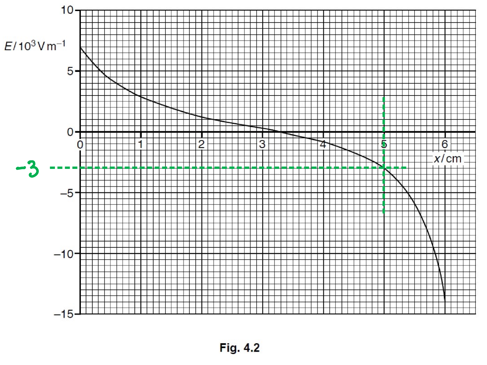
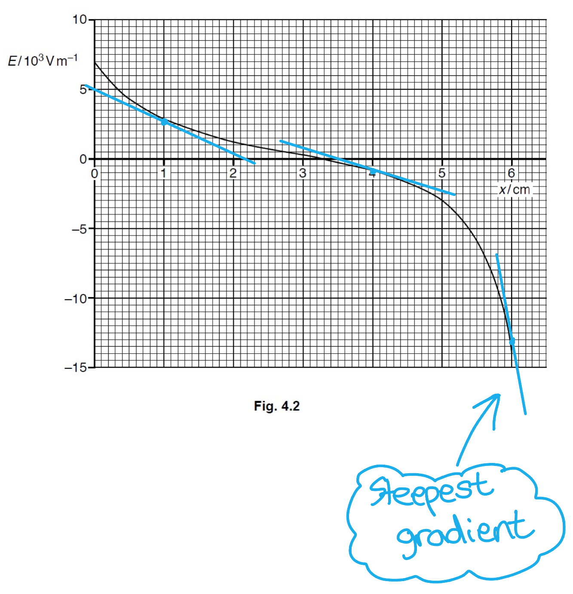
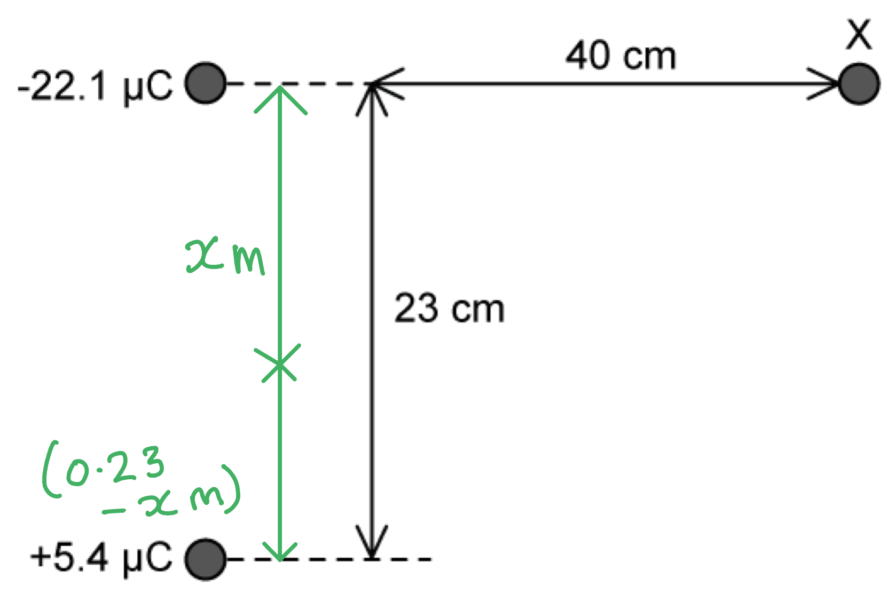
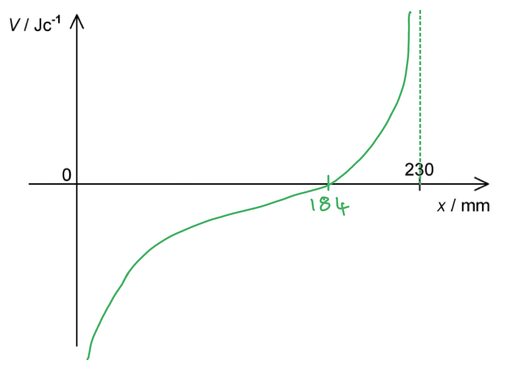
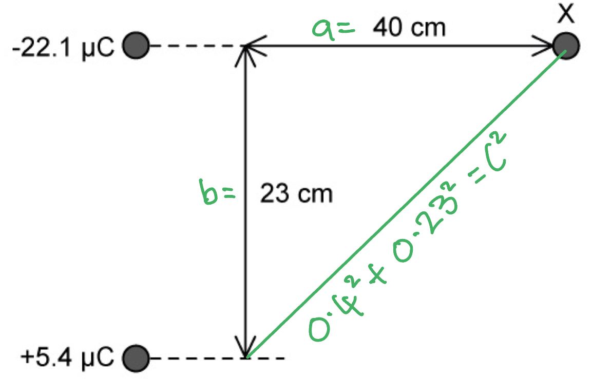
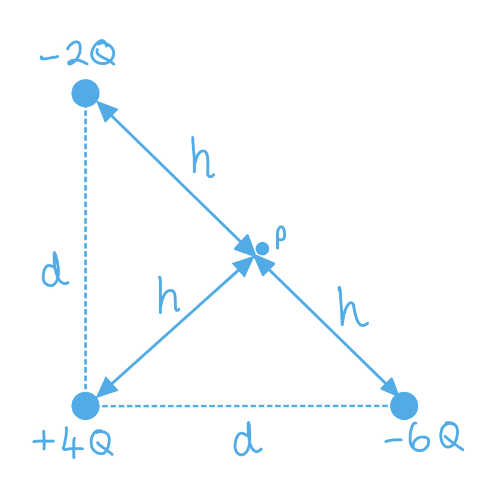
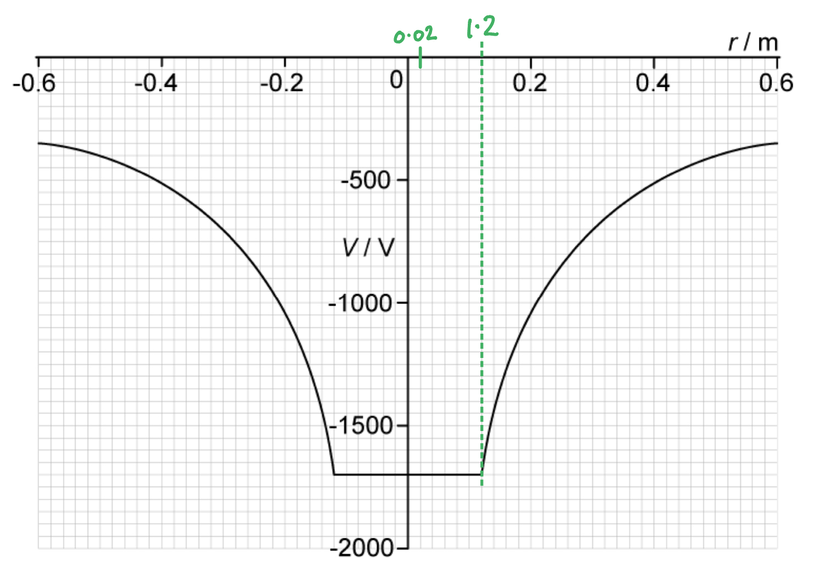
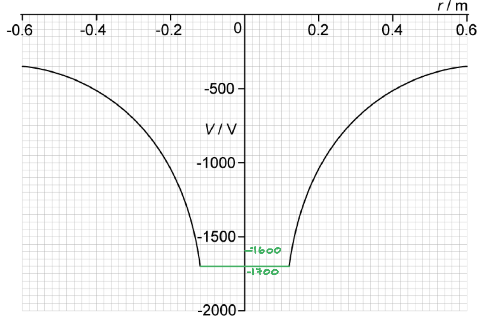

# Mark Schemes — Electric Potential
**18. Electric Fields** · Cambridge (CIE) A-LEVEL physics (9702)

## Structured Questions (7 questions)

### Q1
(i) Use Fig. 4.2 to explain whether the two spheres have charges of the same, or opposite, sign:

**Final answer:** **Any ****one ****from:**

- According to the graph the electric field E close to sphere A is positive and close to sphere B is negative; **[1 mark]**
- The electric fields are in opposite directions; **[1 mark]**
- There is a point on the graph between the spheres where the field strength is zero; **[1 mark]** **AND**
- So the charges on the spheres have the same sign; **[1 mark]**

(ii) Use data from Fig. 4.2 to determine the magnitude of the acceleration of the proton:

List the known quantities:

- Distance from sphere x = 5.0 cm

From the data booklet:

- Elementary charge, $e$ = 1.60 × 10−19 C
- Rest mass of a proton, $m_{p}$ = 1.67 × 10−27 kg

Draw lines on the graph to determine the electric field E at x:

- The electric field is −3.0 × 103 V m−1
- The magnitude of the electric field is therefore, 3.0 × 103 V m−1 **[1 mark]**

Consider the equations needed to calculate the magnitude of the acceleration of the proton:

- Newton's second law: $F=ma$
- Electric force: $F=EQ$

Combine the two equations and rearrange to make acceleration $a$ the subject:

- $EQ=ma$
- $a=\frac{EQ}{m}$** [1 mark]**

Substitute the known quantities into the equation to calculate acceleration $a$:

- `a space equals space fraction numerator open parentheses 3 space cross times space 10 cubed close parentheses space cross times space open parentheses 1.6 space cross times space 10 to the power of negative 19 end exponent close parentheses over denominator 1.67 space cross times space 10 to the power of negative 27 end exponent end fraction`
- `a space equals space 2.87 space cross times space 10 to the power of 11 space straight m space straight s to the power of negative 2 end exponent space equals space 2.9 space cross times space 10 to the power of 11 space straight m space straight s to the power of negative 2 end exponent space open parentheses 2 straight s. straight f. close parentheses` **[1 mark]**

**[Total: 5 marks]**

- *Part (i) is a tricky question:*

  - *The **equilibrium position** is in the **middle** where the **fields cancel out** - that couldn’t happen if they had opposite charges, the field would be in the same direction for all values of x*
  - *Q** represents the **charge of the particle** in the** field**, not the charge of the spheres*
- *In part (ii) think about all the **equations** you know for **force** and combine them*
Electric potential gradient is related to the electric field in that:

- Field strength is equal to potential gradient / the rate of change of electric potential; **[1 mark]**

Therefore, the field strength is a maximum when:

- $x$ = 6 cm; **[1 mark]**

**[Total: 2 marks]**

- *Find the point on the graph where the **gradient** of the **tangent** is the **steepest** by drawing tangents at different points*

### Q2
List the known quantities:

- Speed, *v* = 3.50 × 107 m s–1

From data page:

- Permittivity of free space, $ε_{0}$ = 8.85 × 10–12 F m–1
- Rest mass of proton = 1.67 × 10–27 kg

Calculate the mass of an alpha particle, *m*:

- An alpha particle is a helium nucleus with 2 protons and 2 neutrons
- Total mass = 4 × (1.67 × 10–27) = 6.68 × 10–27 kg **[1 mark]**

Calculate kinetic energy, *E**k*:

- *E**k* =$\frac{1}{2}$*mv*2 =$\frac{1}{2}$ × (6.68 × 10–27) × (3.50 × 107)2 **[1 mark]**
- *E**k* = 4.09 × 10–12 J **[1 mark]**

**[Total: 3 marks]**
List the known quantities:

- Kinetic energy of particle, *E**k* = 4.09 × 10–12 J (from part a)

From data page:

- Permittivity of free space, $ε_{0}$ = 8.85 × 10–12 F m–1
- Charge of an electron, *e* = 1.60 × 10–19 C

Calculate charge of alpha particle and gold nucleus:

- An alpha particle is a helium nucleus with 2 protons and 2 neutrons
- Charge of alpha particle, $Q_{α}$= +2*e* **AND** Charge of gold nucleus, $Q_{gold}$ = +79*e ***[1 mark]**

Calculate the closest distance of approach:

- The kinetic energy lost by the alpha particle = gain in electric potential energy as it approaches the gold nucleus
- Gain in potential energy, *E**P*  =$\frac{Q_{α}Q_{gold}}{4\mathrm{πε}_{0}r}$ = loss in *E**k** ***[1 mark]**
- *E**k** *=$\frac{Q_{α}Q_{gold}}{4\mathrm{πε}_{0}r}$ therefore, *r *=$\frac{Q_{α}Q_{gold}}{4\mathrm{πε}_{0}E_{k}}$
- *r* =`begin mathsize 16px style fraction numerator 2 cross times 79 cross times open parentheses 1.60 cross times 10 to the power of negative 19 end exponent close parentheses squared over denominator 4 straight pi cross times open parentheses 8.85 cross times 10 to the power of negative 12 end exponent close parentheses cross times open parentheses 4.09 cross times 10 to the power of negative 12 end exponent close parentheses end fraction end style` **[1 mark]**
- *r* = 8.89 × 10–15 m = 8.89 fm **[1 mark]**

**[Total: 4 marks]**

> *The equation for electric potential energy is given at the start of your paper on the formula page. This is the energy involved in bringing a charge **q ** from infinity to a distance **r**  from a point charge **Q.*
State what happens to the closest distance of approach:

- The closest distance of approach will increase; **[1 mark]**

Explanation:

- An increased number of protons in polonium will result in a <u>greater repulsive force</u> between the polonium nucleus and the alpha particle; **[1 mark]**

**[Total: 2 marks]**

### Q3
Electric potential at a point is defined as:

- The work done bringing a unit positive charge; **[1 mark]**
- From infinity (to the point); **[1 mark]**

**[Total: 2 marks]**
Calculate the charge stored on the surface of the sphere:

List the known quantities:

- Radius of the sphere, *r* = 12 cm = 0.12 m
- Electric potential, *V* = +220 kV = +220 × 103 V
- Permittivity of free space, $ε_{0}$= 8.85 × 10–12 F m–1 (from the data page)

Use the equation for electric potential:

- Electric potential,  $V=\frac{Q}{4πε_{0}r}$
- Rearrange:  $Q=4πε_{0}rV$ **[1 mark]**

Calculate the charge stored on the surface of the sphere, *Q*:

- Substitute:  $Q$ = 4π × (8.85 × 10–12) × 0.12 × (220 × 103) **[1 mark]**
- Charge stored: * *$Q$* *= 2.9 × 10–6 C (2.9 µC) **[1 mark]**

**[Total: 3 marks]**

> *When carrying out calculations involving charged spheres, we are usually told that we can assume the charge acts as a point charge at the centre of the sphere. This means we may treat the charge **and **the electric potential on the surface to be the same as that of a point charge at the centre of the sphere.*
Calculate the electric potential at a distance of 30 cm from this point charge:

List the known quantities:

- Distance, *d* = 30 cm = 0.3 m
- Charge, *Q* = 2.9 × 10–6 C (from part b)
- Coulomb constant, $\frac{1}{4πϵ_{0}}$ = 8.99 × 109 m F–1

Calculate the electric potential:

- Electric potential:  $V=\frac{Q}{4πϵ_{0}r}$ **[1 mark]**
- Substitute:  `V = \frac{\left(8 . 99 \times 10^{9}\right) \left(2 . 9 \times 10^{- 6}\right)}{0 . 3}` = 86 900 = 87 000 V (87 kV) **[1 mark]**

**[Total: 2 marks]**
List the known quantities:

- Electric potential 30 cm from the charge = 87 kV (from part c)
- Elementary charge, $e$ = 1.60 × 10–19 C (from data page)

(i) State the potential difference between infinity and 30 cm away from the charge:

- The potential is defined as 0 V at infinity
- Hence, potential difference:  Δ*V* = 87 – 0 = 87 kV **[1 mark]**

(ii) Calculate the work done moving the charge:

- Work done:  $\DeltaW=Q\DeltaV$
- $\DeltaW$ = (1.60 × 10–19) × (87 000) **[1 mark]**
- $\DeltaW$ = 1.4 × 10–14 J **[1 mark]**

**[Total: 3 marks]**

> *Remember the definition of potential at a point is the work done per unit of charge in moving a (test) charge from infinity (where potential is 0 V) to that point. *

> *You should be comfortable assigning a value of 0 V to a point infinitely far away, so you can work out the potential difference between infinity and a point in a field very easily, using the equation *$V=\frac{1}{4πε_{0}}\frac{Q}{r}$* to calculate the value of the potential itself any distance **r** from the charge **Q**.*

### Q4
Calculate the distance, in mm, from the −22.1 μC to the point between the two charges, where the resultant electric potential is zero:

List the known quantities:

- Separation, *r *= 23 cm = 0.23 m
- Charge 1, *Q**1* = −22.1 μC =  −22.1 × 10−6 C
- Charge 2, *Q**2* = +5.4 μC = 5.4 × 10−6 C
- $\frac{1}{4πε_{0}}$ = 8.99 × 109 m F−1

Draw a diagram of the situation:

Use the equation for the electric potential to obtain an expression for the electric potential when it is zero:

- $V=\frac{Q}{4πε_{0}r}$
- Potential due to −22.1 μC charge is: `fraction numerator open parentheses negative 22.1 space cross times space 10 to the power of negative 6 end exponent close parentheses over denominator open parentheses 8.99 space cross times space 10 to the power of 9 close parentheses space x end fraction`
- Potential due to +5.4 μC charge is: `fraction numerator open parentheses plus 5.4 space cross times space 10 to the power of negative 6 end exponent close parentheses over denominator open parentheses 8.99 space cross times space 10 to the power of 9 close parentheses space open parentheses 0.23 space minus space x close parentheses end fraction`
- So, `fraction numerator open parentheses negative 22.1 space cross times space 10 to the power of negative 6 end exponent close parentheses over denominator open parentheses 8.99 space cross times space 10 to the power of 9 close parentheses space x end fraction space plus space fraction numerator open parentheses plus 5.4 space cross times space 10 to the power of negative 6 end exponent close parentheses over denominator open parentheses 8.99 space cross times space 10 to the power of 9 close parentheses space open parentheses 0.23 space minus space x close parentheses end fraction space equals space 0` **[1 mark]**

Rearrange the equation to obtain a value for *x*:

- `fraction numerator open parentheses negative 22.1 space cross times space 10 to the power of negative 6 end exponent close parentheses over denominator space x end fraction space equals space fraction numerator open parentheses negative 5.4 space cross times space 10 to the power of negative 6 end exponent close parentheses over denominator space open parentheses 0.23 space minus space x close parentheses end fraction`
- `open parentheses negative 22.1 space cross times space 10 to the power of negative 6 end exponent close parentheses space open parentheses 0.23 space minus space x close parentheses space equals space open parentheses negative 5.4 space cross times space 10 to the power of negative 6 end exponent close parentheses space x`
- `open parentheses negative 5.083 space cross times space 10 to the power of negative 6 end exponent close parentheses space plus space open parentheses 22.1 space cross times space 10 to the power of negative 6 end exponent close parentheses space x space equals space open parentheses negative 5.4 space cross times space 10 to the power of negative 6 end exponent close parentheses space x`
- `open parentheses negative 5.083 space cross times space 10 to the power of negative 6 end exponent close parentheses space equals space open parentheses negative 2.75 space cross times space 10 to the power of negative 5 end exponent close parentheses space x` **[1 mark]**
- So, `x space equals space fraction numerator open parentheses negative 5.083 space cross times space 10 to the power of negative 6 end exponent close parentheses over denominator open parentheses negative 2.75 space cross times space 10 to the power of negative 5 end exponent close parentheses end fraction space equals space 0.184 space straight m space equals space 184 space mm`** [1 mark]**

**[Total: 3 marks]**

> *Electric potential is a scalar quantity, so the sum of the **resultant electric potential = 0**. In the method shown above the quantities from the question are substituted into the equation for electric potential. You could **rearrange and substitute at the end** too, sometimes it is easier to see a rearrangement with **numbers**. *
Draw the graph on Fig. 1.2 and label any relevant points:

List the known quantities:

- When *V *= 0 then *x *= 184 mm (from part (a))

A correctly drawn graph that should score 4 marks would look like this:

- Negative potential between *x *= 0 and *x *= 184 mm; **[1 mark]**
- Positive potential between *x* = 184 mm and *x *= 230 mm; **[1 mark]**
- Asymptotes at *x *= 0 and *x *= 230 mm; **[1 mark]**
- *x = *184* *mm correctly labelled at *V *= 0; **[1 mark]**

**[Total: 4 marks]**
Calculate the electric potential at point X due to the +5.4 μC: List the known quantities:

- Charge, *Q* = +5.4μC = +5.4 × 10−6 C
- Distance between −22.1 μC and +5.4 μC = 0.23 m
- Distance between +5.4 μC and X = 40 cm = 0.4 m
- $\frac{1}{4πε_{0}}$ = 8.99 × 109 m F−1

Use Pythagoras to calculate the distance between X and the +5.4 μC:

- $0.4^{2}+0.23^{2}=c^{2}$
- $c=\sqrt{0.4^{2}+0.23^{2}}=0.46m$ **[1 mark]**

Use the electric potential equation at point P:

- $V=\frac{Q}{4πε_{0}r}$
- `V space equals space open parentheses 8.99 space cross times space 10 to the power of 9 close parentheses space cross times space fraction numerator open parentheses 5.4 space cross times space 10 to the power of negative 6 end exponent close parentheses over denominator 0.46 end fraction` **[1 mark]**
- `V space equals space 105535 space equals space 1.06 space cross times space 10 to the power of 5 space straight V space open parentheses 3 space straight s. straight f. close parentheses` **[1 mark]**

**[Total: 3 marks]**
Calculate the total electric potential at point X:

List the known quantities:

- Potential due to +5.4 μC, *V**2* = 1.06 × 105 V (from part (c))
- Charge, *Q**1** *= −22.1 × 10−6 C
- Distance to point X from −22.1 μC = 0.4 m
- $\frac{1}{4πε_{0}}$ = 8.99 × 109 m F−1

Calculate electric potential due to −22.1 μC:

- `V subscript 1 space equals open parentheses 8.99 space cross times space 10 to the power of 9 close parentheses space fraction numerator open parentheses negative 22.1 space cross times space 10 to the power of negative 6 end exponent close parentheses over denominator 0.4 end fraction`
- $V_{1}=-496697.5=-4.97\times10^{5}V$ **[1 mark]**

Calculate the total potential at point X:

- Total potential = *V**1* + *V**2* **[1 mark]**
- Total potential = (1.06 × 105) + (−4.97 × 105) = −3.91 × 105 V **[1 mark]**

**[Total: 3 marks]**

> *The **signs** of the potentials are really important - a positive charge creates a positive potential and a negative charge creates a negative one. Do **not** ignore these signs when adding potentials together.*

### Q5
The relation between electric field and potential is:

- Field strength = negative electric potential gradient  **OR ** $E=-\frac{\DeltaV}{\Deltar}$; **[1 mark]**

**[Total: 1 mark] **
The particle is:

- Positively charged; **[1 mark]**

**Final answer:** **Any ****one**** from:**

- The field lines are directed away from the particle; **[1 mark]**
- The field lines go from positive to negative; **[1 mark]**
- The field lines show the direction of the (electric) force on a positive charge; **[1 mark]**

**[Total: 2 marks]**
The electric potential between points A and B:

- Decreases; **[1 mark]**

**Final answer:** **Any one**** ****pair**** from:**

- Potential gradient acts in the opposite direction to the field; **[1 mark]**
- Therefore, as distance increases, electrical potential decreases; **[1 mark]**
- Electric potential and distance are inversely proportional **OR** $V\propto\frac{1}{r}$; **[1 mark]**
- Therefore, as distance increases, electrical potential decreases; **[1 mark]**
- Electric potential is the work done per unit charge in bringing a positive test charge from infinity to a point; **[1 mark]**
- Therefore, more work has to be done to bring a positive test charge from infinity to A (than to B); **[1 mark]**

**[Total: 3 marks]**
Show that the particle has the same charge as two protons:

List the known quantities:

- Distance from the particle to A, $r_{1}$ = 0.1 nm = 0.1 × 10−9 m
- Distance from the particle to B, $r_{2}$ = 0.5 nm = 0.5 × 10−9 m
- Potential difference between A and B, $\DeltaV$ = 23 V
- Coulumb constant, $\frac{1}{4πε_{0}}$ = 8.99 × 109 m F−1
- Elementary charge, $e$ = 1.60 × 10−19 C (from the data page)

Use the equation for change in electric potential:

- Electric potential:  $V=\frac{q}{4πε_{0}r}$ (from the data page)
- Change in electric potential:  `increment V space equals space fraction numerator q over denominator 4 straight pi epsilon subscript 0 end fraction open parentheses 1 over r subscript 1 space minus space 1 over r subscript 2 close parentheses` **[1 mark]**

Rearrange the equation and substitute the values to calculate the charge:

- `q space equals space fraction numerator 4 straight pi epsilon subscript 0 increment V over denominator open parentheses 1 over r subscript 1 space minus space 1 over r subscript 2 close parentheses end fraction`
- `q space equals space fraction numerator 23 over denominator open parentheses 8.99 cross times 10 to the power of 9 close parentheses open parentheses fraction numerator 1 over denominator 0.1 cross times 10 to the power of negative 9 end exponent end fraction space minus space fraction numerator 1 over denominator 0.5 cross times 10 to the power of negative 9 end exponent end fraction close parentheses end fraction` **[1 mark]**
- $q=3.2\times10^{-19}C$ **AND**
- The charge of a proton is $e=1.6\times10^{-19}C$, so $q=2e$; **[1 mark]**

**[Total: 3 marks]**

> *The charge *$q$* in the equation refers to the charge producing the field, which in this case is the particle.*

### Q6
List the known quantities:

- Charge on Q1 = −2Q
- Charge on Q2 = +4Q
- Charge on Q3 = −6Q
- Distance from Q1 to Q2 = *d*
- Distance from Q2 to Q3 = *d*

From the data sheet:

- Electric potential, *V* =$\frac{1}{4\mathrm{πε}_{0}}\frac{Q}{r}$

Calculate the distance from each charge to point P, *h*:

- (2*h*)2 = *d*2 + *d*2 **OR** *h*2 = `begin mathsize 16px style open parentheses d over 2 close parentheses squared plus open parentheses d over 2 close parentheses squared end style`
- *h*2 =$\frac{2d^{2}}{4}$
- *h* =$\frac{\sqrt{2}d}{2}$  **[1 mark]**

Calculate the total electric potential at the point P, $V_{p}$ :

- $V_{p}$= $V_{1}+V_{2}+V_{3}$
- $V_{p}$ =  `begin mathsize 16px style open parentheses negative fraction numerator 2 Q over denominator 4 pi epsilon subscript 0 open parentheses bevelled fraction numerator square root of 2 d over denominator 2 end fraction close parentheses end fraction close parentheses plus open parentheses fraction numerator 4 Q over denominator 4 pi epsilon subscript 0 open parentheses bevelled fraction numerator square root of 2 d over denominator 2 end fraction close parentheses end fraction close parentheses plus open parentheses negative fraction numerator 6 Q over denominator 4 pi epsilon subscript 0 open parentheses bevelled fraction numerator square root of 2 d over denominator 2 end fraction close parentheses end fraction close parentheses end style`  **[1 mark]**
- $V_{p}$ =  `open parentheses negative fraction numerator 2 Q over denominator 2 square root of 2 d straight pi straight epsilon subscript 0 end fraction close parentheses plus open parentheses fraction numerator 4 Q over denominator 2 square root of 2 d straight pi straight epsilon subscript 0 end fraction close parentheses plus open parentheses negative fraction numerator 6 Q over denominator 2 square root of 2 d straight pi straight epsilon subscript 0 end fraction close parentheses`
- $V_{p}$= `begin mathsize 16px style open parentheses negative fraction numerator 4 Q over denominator 2 square root of 2 d straight pi straight epsilon subscript 0 end fraction close parentheses end style` =`open parentheses negative fraction numerator 2 Q over denominator square root of 2 d straight pi straight epsilon subscript 0 end fraction close parentheses`  **[1 mark]**

**[Total: 3 marks]**

> *Make sure to label the diagram if this makes it easier to calculate the correct lengths. The key is to realise that P is equidistant from all the charges. Remember that electric potential is scalar so the direction doesn’t matter!*

List the known quantities:

- Length of side of equilateral triangle, *r* = 2.82 fm = 2.82 × 10-15 m

From data sheet:

- Permittivity of free space, $ε_{0}$ = 8.85 × 10-12 F m-1
- Magnitude of the charge of an electron, *e* = 1.6 × 10-19 C

Determine size of charge of each particle, *q*:

- *q *= $\frac{1}{3}$*e ***[1 mark]**

Work done bringing second electron into the triangle, $\DeltaW_{2}$ :

- Work done, ∆*W* = *q*∆*V*
- Electric potential, *V* = $\frac{1}{4\mathrm{πε}_{0}}\frac{Q}{r}$
- ∆*V =*$V_{2}-V_{\infty}$* *– where $V_{2}$ is the electric potential at the second vertex due to the existing electron
- $\DeltaW_{2}$= `1 third e cross times open parentheses fraction numerator 1 third e over denominator 4 straight pi straight epsilon subscript 0 r end fraction minus 0 close parentheses`
- $\DeltaW_{2}$ = $\frac{\frac{e^{2}}{9}}{4\mathrm{πε}_{0}r}$ **[1 mark]**

Calculate the electric potential at the third vertex due to the other two electrons, $V_{3}$:

- $V_{3}$= 2 ×$\frac{q}{4\mathrm{πε}_{0}r}$
- $V_{3}$ = $\frac{\frac{2}{3}e}{4\mathrm{πε}_{0}r}$ **[1 mark]**

Work done bringing third electron into the triangle, $\DeltaW_{3}$:

- $\DeltaW_{3}$ = *q*($V_{3}-V_{\infty}$)
- $\DeltaW_{3}$ =`1 third e cross times open parentheses fraction numerator 2 over 3 e over denominator 4 straight pi straight epsilon subscript 0 r end fraction minus 0 close parentheses`
- $\DeltaW_{3}$ =$\frac{\frac{2}{9}e^{2}}{4\mathrm{πε}_{0}r}$  **[1 mark]**

Calculate total work done in forming the electron:

- $\DeltaW$ =  $\DeltaW_{2}+\DeltaW_{3}$
- $\DeltaW$ =  $\frac{\frac{1}{9}e^{2}}{4\mathrm{πε}_{0}r}+\frac{\frac{2}{9}e^{2}}{4\mathrm{πε}_{0}r}$
- $\DeltaW$ =$\frac{\frac{3}{9}e^{2}}{4\mathrm{πε}_{0}r}$
- $\DeltaW$ =$\frac{1}{4\mathrm{πε}_{0}}\frac{3e^{2}}{9r}$
- $\DeltaW$ =$\frac{1}{4\mathrm{πε}_{0}}\frac{e^{2}}{3r}$  **[1 mark]**

**[Total: 5 marks]**

> *To form the electron, we take each of the three charges from infinity and place them in the corners of the triangle.  When the first electron is brought from infinity to its position there is **no work done** as there are **no other charges**. *

> *When the second electron is brought from infinity into its position it has to do work against the repulsive force of the first electron. *

> *When the third electron is brought from infinity into its position it has to do work against the repulsive force of both the first and second electrons.*
From data page:

- Permittivity of free space, $ε_{0}$= 8.85 × 10−12 F m−1
- Rest mass of electron, $m_{e}$= 9.11 × 10−31 kg
- Elementary charge, *e* = 1.6 × 10−19 C
- Speed of light in free space, *c *= 3.00 × 108 m s−1

Calculate the kinetic energy of the electrons when they leave the electron gun, $E_{k}$ :

- $E_{k}$ = $\frac{1}{2}$m`open parentheses v subscript e close parentheses squared`
- $E_{k}$ =$\frac{1}{2}$ (9.11 × 10−31) × (0.1 × 3.00 × 108)2
- $E_{k}$ = 4.10 × 10−16 J **[1 mark]**

Calculate the potential difference between the anode and the cathode, Δ*V*:

- Work done, Δ*W* = *Q*Δ*V*
- Δ*V* = $\frac{\DeltaW}{Q}$

  - The work done is equal to the gain in kinetic energy
- Δ*V* =$\frac{4.10\times10^{-16}}{1.6\times10^{-19}}$
- Δ*V* = 2562.5 = 2 560 V **[1 mark]**

**[Total: 2 marks]**

### Q7
Electric potential at a point is:

- The work done per unit charge; **[1 mark]**
- In taking a (small) positive (test) charge from infinity to the point; **[1 mark]**

**[Total: 2 marks]**
(i) Determine the radius of the sphere:

Draw lines on the graph to determine the radius:

- Radius of sphere = 0.12 m; **[1 mark]**

(ii) Determine the charge on the sphere:

List the known quantities:

- $\frac{1}{4πε_{0}}$ = 8.99 × 109 m F−1

Draw lines on the graph to determine the electric potential, *V* at the surface of the sphere:

- Electric potential = −1700 V

Use the equation for electric potential:

- $V=\frac{Q}{4πε_{0}r}$
- `Q space equals fraction numerator open parentheses minus close parentheses space 1700 space cross times space 0.12 over denominator open parentheses 8.99 space cross times space 10 to the power of 9 close parentheses space end fraction`** [1 mark]**
- $Q=-2.27\times10^{-8}C$ **[1 mark]**

**[Total: 3 marks]**

> *Take care when **rearranging** the equation and substituting for the constant. *

> $\frac{1}{4πε_{0}}=8.99\times10^{9}$* and not *$4πε_{0}$

> *So, *`Q space equals space V space cross times space open parentheses 4 pi epsilon subscript 0 close parentheses space cross times space r space equals space V space cross times space r space divided by space open parentheses fraction numerator 1 over denominator 4 pi epsilon subscript 0 end fraction close parentheses`
Calculate the electric potential energy *E**p* of the two spheres:

List the known quantities:

- Separation distance, *x* = 0.52 m
- Charge on spheres, *Q* = −2.27 × 10−8 C (from part b)

Use the equation for electric potential energy:

- $E_{p}=\frac{Q^{2}}{4πε_{0}x}$
- `E subscript p space equals space open parentheses 8.99 space cross times space 10 to the power of 9 close parentheses space cross times space fraction numerator open parentheses negative 2.27 space cross times space 10 to the power of negative 8 end exponent close parentheses squared over denominator 0.52 end fraction` **[1 mark]**
- $E_{p}=8.9\times10^{-6}J$ **[1 mark]**

**[Total: 2 marks]**
The subsequent motion of the spheres is:

**Final answer:** **Any ****three ****from:**

- The force between them is repulsive, so the spheres move apart; **[1 mark]**
- The force is in the direction of motion, so there is acceleration and the speed increases; **[1 mark]**
- The potential energy is converted into kinetic energy so the speed increases; **[1 mark]**
- The force decreases with distance, so the acceleration decreases; **[1 mark]**
- Momentum is conserved (at zero) (and the masses are equal) so velocities are always equal and opposite; **[1 mark]**

**[Total: 3 marks]**
