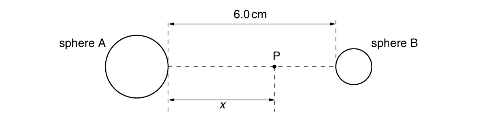
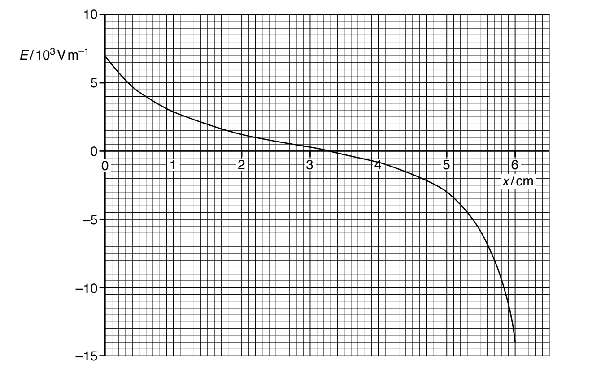
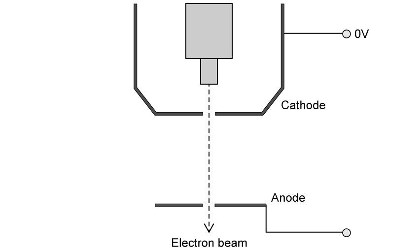
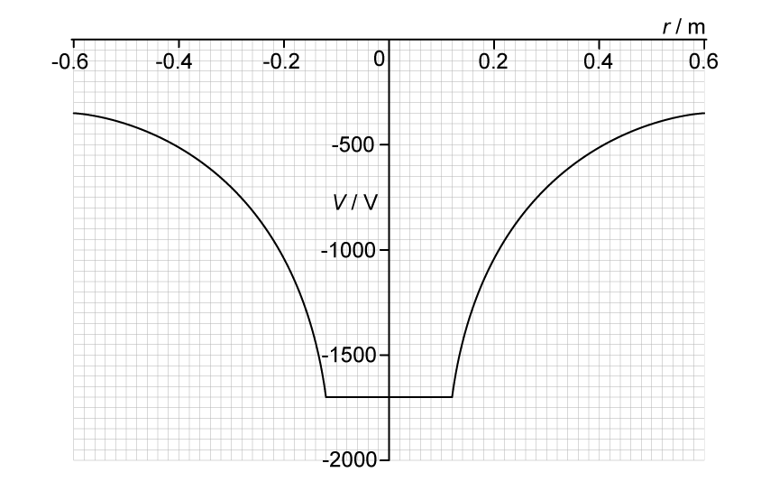

# Exam Questions — Electric Potential
**18. Electric Fields** · Cambridge (CIE) A-LEVEL physics (9702)
> Source: [https://www.savemyexams.com/a-level/physics/cie/25/topic-questions/](https://www.savemyexams.com/a-level/physics/cie/25/topic-questions/) · 7 questions across 1 sets

## Structured Questions (7 questions)

### Q1 — medium — 7 marks

**Q1** [5 marks]

Two charged metal spheres A and B are situated in a vacuum, as illustrated in Fig. 4.1.

**Fig. 4.1**

The shortest distance between the surfaces of the spheres is 6.0 cm.

A movable point P lies along the line joining the centres of the two spheres, a distance *x* from the surface of sphere A.

The variation with distance *x* of the electric field E at point P is shown in Fig. 4.2.

**Fig. 4.2**

(i) Use Fig. 4.2 to explain whether the two spheres have charges of the same, or opposite, sign.

[2]

(ii) A proton is at point P where *x* = 5.0 cm.

Use data from Fig. 4.2 to determine the magnitude of the acceleration of the proton.

acceleration = ................................. m s–2 [3]

*Source: Specimen 2022 Paper 4 Q4B*

**Q1** [2 marks]

**Extract:**

Two charged metal spheres A and B are situated in a vacuum, as illustrated in Fig. 4.1. The shortest distance between the surfaces of the spheres is 6.0 cm. A movable point P lies along the line joining the centres of the two spheres, a distance *x* from the surface of sphere A. The variation with distance *x* of the electric field E at point P is shown in Fig. 4.2.

The electric potential gradient is related to the electric field.

Use data from Fig. 4.2 to state the value of $x$ at which the magnitude of the electric potential gradient is maximum. Give a reason for the value you have chosen.

*Source: Specimen 2022 Paper 4 Q4C*

### Q2 — hard — 9 marks

**Q2** [3 marks]

Calculate the kinetic energy of an $α$ particle travelling at a speed of 3.50 × 107 m s–1.

**Q2** [4 marks]

**Extract:**

Calculate the kinetic energy of an α particle travelling at a speed of 3.50 × 10^7 m s^–1. Ek = 4.09 × 10^–12 J

Calculate the closest distance of approach for a head-on collision between an  $α$ particle travelling at a speed of 3.50 × 107 m s–1 and a gold nucleus for which the proton number is 79.

Assume that the gold nucleus remains stationary during the collision.

**Q2** [2 marks]

**Extract:**

Calculate the kinetic energy of an α particle travelling at a speed of 3.50 × 10^7 m s^–1.

Calculate the closest distance of approach for a head-on collision between an α particle travelling at a speed of 3.50 × 10^7 m s^–1 and a gold nucleus for which the proton number is 79. Assume that the gold nucleus remains stationary during the collision.

The alpha particle is fired towards a polonium nucleus, which contains more protons than the gold nucleus. The $α$ particle is given the same initial kinetic energy as in part (a).

State and explain, without further calculation, any changes that occur to the closest distance of approach. You can ignore any recoil effects.

### Q3 — easy — 10 marks

**Q3** [2 marks]

Define *electric potential *at a point.

**Q3** [3 marks]

The potential on the surface of a charged sphere is +220 kV. The sphere has a radius of 12 cm.

Calculate the charge stored on the surface of the sphere.

The charge may be assumed to act as a point charge situated at the centre of the sphere.

**Q3** [2 marks]

**Extract:**

The potential on the surface of a charged sphere is +220 kV. The sphere has a radius of 12 cm. Calculate the charge stored on the surface of the sphere. The charge may be assumed to act as a point charge situated at the centre of the sphere. [Answer: Q = 2.9 × 10^–6 C (2.9 µC)]

Show that the electric potential at a distance of 30 cm from the point charge is about 87 kV.

**Q3** [3 marks]

**Extract:**

Show that the electric potential at a distance of 30 cm from the point charge is about 87 kV.
V = 86 900 = 87 000 V (87 kV)

A proton is moved from infinity to a point in the electric field produced by the charge.

(i) State the potential difference between infinity and the point 30 cm away from the charge

[1]

(ii) Calculate the work done on the proton to move it from infinity to the point 30 cm away from the charge.

[2]

### Q4 — medium — 13 marks

**Q4** [3 marks]

Two charges are separated by a distance of 23 cm, as shown in Fig. 1.1.

**Fig. 1.1**

Calculate the distance, in mm, from the −22.1 μC to the point between the two charges, where the resultant electric potential is zero.

**Q4** [4 marks]

**Extract:**

Two charges are separated by a distance of 23 cm, as shown in Fig. 1.1.

Calculate the distance, in mm, from the −22.1 μC to the point between the two charges, where the resultant electric potential is zero.

So, x = 0.184 m = 184 mm

Fig. 1.2 shows the axis of an electric potential against distance graph from the −22.1 μC charge to the +5.4 μC charge.

**Fig. 1.2**

Draw the graph on Fig. 1.2 and label any relevant points.

**Q4** [3 marks]

**Extract:**

Two charges are separated by a distance of 23 cm, as shown in Fig. 1.1. Charge 1, Q1 = −22.1 μC = −22.1 × 10^−6 C; Charge 2, Q2 = +5.4 μC = 5.4 × 10^−6 C

Point X lies 40 cm to the right of the −22.1 μC charge, as shown in Fig. 1.3.

**Fig. 1.3**

Calculate the electric potential at point X due to the +5.4 μC.

**Q4** [3 marks]

**Extract:**

Point X lies 40 cm to the right of the \u221222.1 \u03bcC charge, as shown in Fig. 1.3. Calculate the electric potential at point X due to the +5.4 \u03bcC. Known quantities: Charge, Q = +5.4\u03bcC = +5.4 \u00d7 10\u207b\u2076 C; Distance between \u221222.1 \u03bcC and +5.4 \u03bcC = 0.23 m; Distance between +5.4 \u03bcC and X = 40 cm = 0.4 m. V = 105535 = 1.06 \u00d7 10^5 V (3 s.f.)

Calculate the total electric potential at point X.

### Q5 — easy — 9 marks

**Q5** [1 mark]

State the relation between electric field and potential.

**Q5** [2 marks]

Fig. 1.1 shows the electric field lines around a particle with charge *q*.

**Fig. 1.1**

State and explain whether the particle is positively or negatively charged.

**Q5** [3 marks]

**Extract:**

Fig. 1.1 shows the electric field lines around a particle with charge q. State and explain whether the particle is positively or negatively charged. [Mark scheme: The particle is positively charged; the field lines are directed away from the particle]

Two points, A and B, are located on the same field line, as shown in Fig. 1.2.

**Fig. 1.2**

State and explain whether the electric potential increases, decreases, or stays the same from A to B.

**Q5** [3 marks]

**Extract:**

Fig. 1.1 shows the electric field lines around a particle with charge q.

A stationary proton is placed at point A, which is a distance of 0.1 nm from the particle. The proton is released and moves to point B, which is a distance of 0.5 nm from the particle.

The potential difference between A and B is 23 V.

Show that the particle has the same charge as two protons.

### Q6 — hard — 10 marks

**Q6** [3 marks]

Three charges are fixed at the corners of a right-angled triangle as shown in Fig. 1.1. The length of the horizontal and vertical sides are both *d. *

**Fig. 1.1**

Show that the electric potential at point P, halfway between the −2Q and −6Q charge is:

$V_{p}=-\frac{2Q}{\sqrt{2}d\mathrm{πε}_{0}}$

**Q6** [5 marks]

Before the discovery of quarks, scientists speculated that the subatomic particles might be made up of smaller particles.

If an electron was made up of three smaller, identical particles with charge *q *which are brought in from an infinite distance to the vertices of an equilateral triangle, it would have the arrangement shown in Fig. 1.2.

**Fig. 1.2**

Show that the work done in forming an electron consisting of three identical particles, as shown in Fig. 1.2, is:

$ΔW=\frac{1}{4\mathrm{πε}_{0}}\frac{e^{2}}{3r}$

Where:

- The distance *r* is the radius of an electron which is 2.82 fm
- *e* is the charge of an electron
- $ε_{0}$ is the permittivity of free space

**Q6** [2 marks]

Fig. 1.3 shows the structure of an electron gun. Electrons are released from a cathode with zero kinetic energy and are accelerated towards an anode.

**Fig. 1.3**

The electrons leave the electron gun at 10% of the speed of light. Calculate the potential difference between the cathode and the anode.

### Q7 — medium — 10 marks

**Q7** [2 marks]

Define electric potential at a point.

**Q7** [3 marks]

An isolated conducting sphere is charged. Fig. 1.1 shows the variation of the potential *V *due to the sphere with displacement *r *from its centre.

**Fig. 1.1**

Use Fig. 1.1 to determine:

(i) the radius of the sphere

radius = ........................... m [1]

(ii) the charge on the sphere.

charge = .......................... C [2]

**Q7** [2 marks]

**Extract:**

An isolated conducting sphere is charged. Fig. 1.1 shows the variation of the potential V due to the sphere with displacement r from its centre. Determine the charge on the sphere: Q = −2.27 × 10^−8 C

Two spheres are identical to the sphere in **(b) **with the same charge.

The spheres are held in a vacuum so that their centres are separated by a distance of 0.52 m.

Assume that the charge on each sphere is a point charge at the centre of the sphere.

Calculate the electric potential energy *E**p* of the two spheres.

*E**p* = ....................................... J

**Q7** [3 marks]

**Extract:**

Two spheres are identical to the sphere in (b) with the same charge. The spheres are held in a vacuum so that their centres are separated by a distance of 0.52 m. Assume that the charge on each sphere is a point charge at the centre of the sphere.

The two spheres are now released simultaneously so that they are free to move.

Describe and explain the subsequent motion of the spheres.
