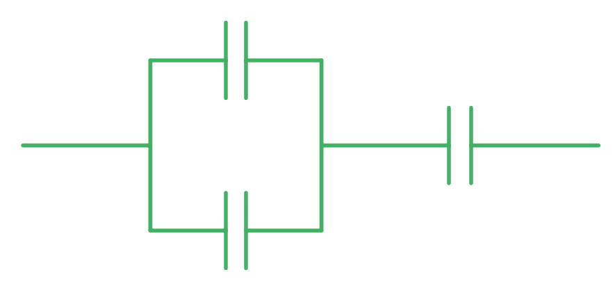
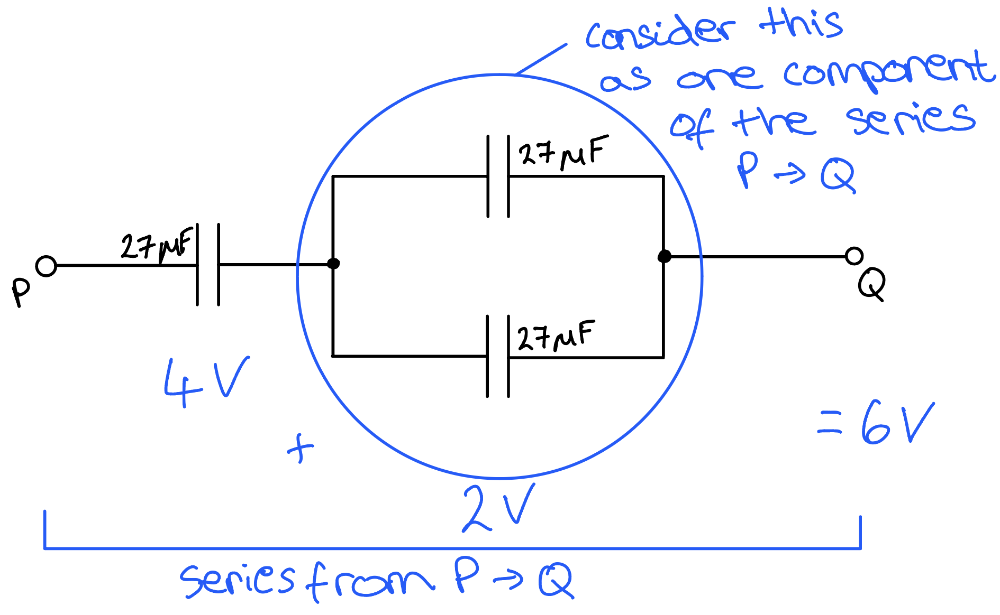
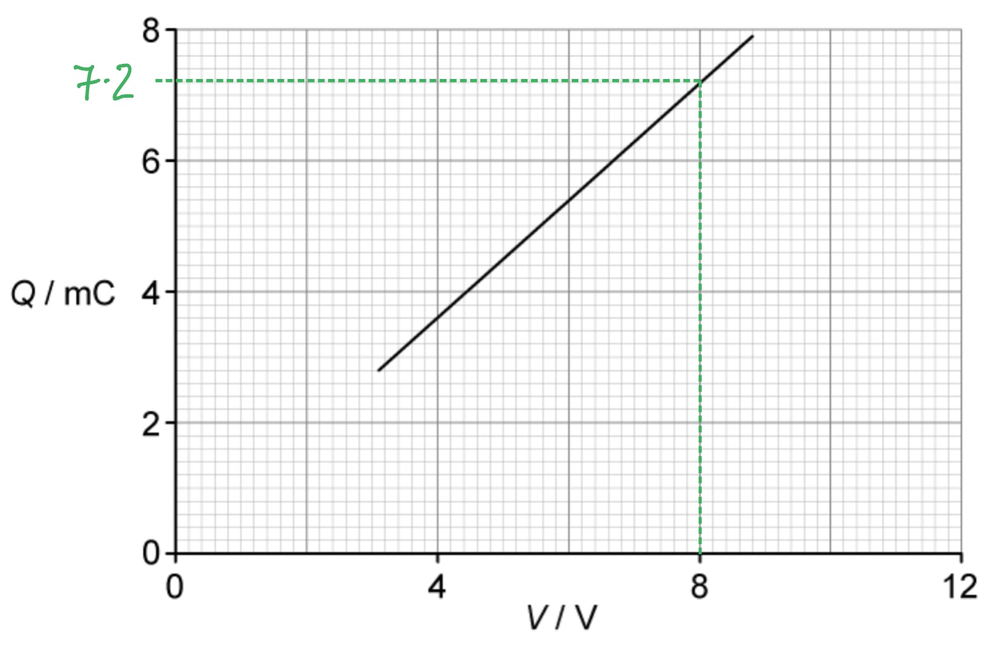
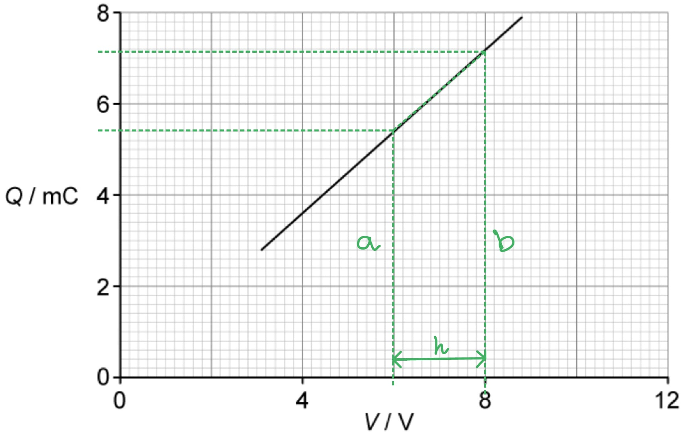

# Mark Schemes — Capacitors & Capacitance
**19. Capacitance** · Cambridge (CIE) A-LEVEL physics (9702)

## Structured Questions (5 questions)

### Q1
List the known quantities:

- Capacitance of capacitor X, $C_{X}$= 25.0 μF
- Capacitance of capacitor Y, $C_{Y}$= 88.5 μF
- Emf of the battery = 6.0 V

A completed table that would score full credit is shown below:

| **Capacitor** | **Capacitance / μF** | **p.d. / V** | **Charge / μC** |
|---|---|---|---|
| **X** | 25.0 | **Final answer:** **6** | **Final answer:** **Q**** = ****CV**  **Final answer:** **Q**** = 25 × 6**  **Final answer:** **Q**** = 150** |
| **Y** | 88.5 | **Final answer:** **6** | **Final answer:** **Q**** = ****CV**  **Final answer:** **Q**** = 88.5 × 6**  **Final answer:** **Q**** = 531** |

- The capacitors are in parallel, so the potential difference across <u>both</u> capacitors *V* = 6 V **[1 mark]**
- Correct quantities substituted into the equation *Q* = *CV* **[1 mark] **and correct value for charge **[1 mark] **for each capacitor

**[Total: 3 marks]**
List the known quantities:

- Capacitance of capacitor X, $C_{X}$= 25.0 μF = 25.0 × 10–6 F
- Capacitance of capacitor Y, $C_{Y}$= 88.5 μF = 88.5 × 10–6 F

Calculate the total capacitance using the given equation:

- The total capacitance, $C_{total}=C_{X}+C_{Y}$*= *(25.0 × 10–6) + (88.5 × 10–6) **[1 mark]**
- $C_{total}$ = 113.5 × 10–6 F (= 1.135 × 10–4 F) **[1 mark]**

**[Total: 2 marks]**
State how the capacitance of capacitor Y changes with an added dielectric material:

- The capacitance will <u>increase</u>; **[1 mark]**

**[Total: 1 mark]**** **

> *Remember that the capacitance **C** of a parallel plate capacitor will increase with the presence of a dielectric material. The dielectric material prevents charge from freely flowing between the plates. *
The quantities represented by the axis of the graph:

- Charge stored, *Q*; **[1 mark]**
- Potential difference, *V*; **[1 mark]**

**[Total: 2 marks]**

### Q2
The relationship between the capacitance of a capacitor and the charge stored is:

- They are <u>directly proportional</u> to each other; **[1 mark]**

**[Total: 1 mark]**
List the known quantities:

- Capacitance, *C* = 300 μF = 300 × 10­–6 F
- Potential difference, *V* = 8 V

Rearrange the equation for capacitance to calculate the charge stored:

- $C=\frac{Q}{V}$
- So, the charge stored *Q* = *CV ***[1 mark]**

Substitute in the values:

- *Q* = (300 × 10–6) × 8 **[1 mark]**
- *Q* = 2.4 × 10–3 C **[1 mark]**

**[Total: 3 marks]**
State the value of the gradient:

- 300 × 10–6 **[1 mark]**

Explanation:

- The gradient / slope of a charge-potential difference graph is equal to the capacitance; **[1 mark]** **OR**
- The capacitance of capacitor X is 300 × 10–6 F / 300 μF **[1 mark]**

**[Total: 2 marks]**
List the known quantities:

- Capacitance of capacitor X, *C**X** *= 300 µF
- Capacitance of capacitor Y, *C**Y** *= 200 µF

State the relationship between the capacitance of capacitors in series:

- $\frac{1}{C_{T}}=\frac{1}{C_{X}}+\frac{1}{C_{Y}}$ **[1 mark]**

Substitute the known quantities into the equation:

- $\frac{1}{C_{T}}=\frac{1}{300}+\frac{1}{200}$ **[1 mark]**

Rearrange the equation to make total capacitance, *C**T*  the subject:

- $\frac{1}{C_{T}}=\frac{1}{120}$
- $120=C_{T}$
- So, $C_{T}=120$ µF** [1 mark]**

**[Total: 3 marks]**

### Q3
The capacitance of a parallel plate capacitor is:

- The ratio of the charge stored to potential (difference) **OR** the charge stored per unit potential (difference); ** [1 mark]**
- Where the charge is the magnitude of the charge on one plate **AND** the potential difference is across the two plates;** [1 mark]**

**[Total: 2 marks]**
Determine an expression for the combined capacitance *C**C* of the two capacitors:

Determine the p.d. across *C**A* and *C**B*:

- p.d. across both capacitors = *E ***[1 mark]**

Determine the total charge, *Q**C* in the circuit:

- $Q_{C}=Q_{A}+Q_{B}$* ***[1 mark]**

Use the equation for p.d. and charge to determine an expression in terms of capacitance:

- $C=\frac{Q}{V}$ so $Q=VC$
- $EC_{C}=EC_{A}+EC_{B}$
- $C_{C}=C_{A}+C_{B}$ **[1 mark]**

**[Total: 3 marks]**
List the known quantities:

- e.m.f., *E* = 8 V
- *C**1* = 18 μF = 18 × 10−6 F
- *C**2* = 51 μF = 51 × 10−6 F

(i) Calculate the combined capacitance of the two capacitors:

Obtain an expression for the total capacitance of the two capacitors in a series circuit:

- $\frac{1}{C_{T}}=\frac{1}{C_{1}}+\frac{1}{C_{2}}$
- $\frac{1}{18}+\frac{1}{51}=0.075$
- $\frac{1}{0.075} = 13.3 \ \\mu \mathrm{F} = 13 \ \\mu \mathrm{F} ( 2 \mathrm{s} . \mathrm{f} . )$ **[1 mark]**

(ii) Calculate the total energy stored in the two capacitors:

- $energy=\frac{1}{2}CV^{2}$ **[1 mark]**
- $e n e r g y = 1 \frac{1}{2} \times ( 13.3 \times 10^{- 6} ) \times 8^{2}$
- $energy=4.16\times10^{-4}J$** [1 mark]**

**[Total: 3 marks]**

### Q4
The functions of capacitors connected in electrical circuits are:

**Final answer:** **Any ****two ****from:**

- To store <u>energy</u>; **[1 mark]**
- In smoothing circuits; **[1 mark]**
- To block direct current; **[1 mark]**
- In oscillators; **[1 mark]**

**[Total: 2 marks]**

*To store **charge **is not an acceptable answer. Yes, a capacitor stores charge but it is not what it is used for in electrical circuits.*
(i) The charge on the positive plate of each capacitor is different because:

**All ****three ****statements required for 1 mark:**

- The potential difference across each capacitor is the same, *E*
- Each capacitor has a different capacitance
- *Q *= *CE*, so for each plate of the capacitor *Q *is different; **[1 mark]**

(ii) Show that the combined capacitance *C**T** *of the three capacitors is given by the expression $C_{T}=C_{A}+C_{B}+C_{C}$:

Obtain an expression for the total charge across the capacitors in parallel:

- $Q_{T}=Q_{A}+Q_{B}+Q_{C}$ **[1 mark]**

Obtain an expression in terms of capacitance and p.d. for the total charge across the capacitors:

- $C_{T}E=C_{A}E+C_{B}E+C_{C}E$ **[1 mark]**
- Therefore,  $C_{T}=C_{A}+C_{B}+C_{C}$

**[Total: 3 marks]**

> *The potential difference across each capacitor is the same **because **they are in parallel. *

> *In part (ii), simplify the expression by **dividing** both sides **by **E** **to obtain the expression required.*
Consider mathematically the combination of capacitors and their combined capacitance:

List the known quantities:

- Capacitance of each capacitor, *C *= 24 μF

Two capacitors in series with one in parallel:

- `C = ( (1)/(1 / 24 + 1 / 24) ) + 24 = 36 mu F`
- Hence, this is the arrangement needed for (i)

Two capacitors in parallel with one in series:

- $C = \frac{1}{( \frac{1}{24 + 24} ) + \frac{1}{24} } = 16 \ \\mu \mathrm{F}$
- Hence, this is the arrangement needed for (ii)

(i) A circuit diagram to show the 3 capacitors connected to obtain a capacitance of 36 μF is:

- Two capacitors are drawn in series with one capacitor drawn in parallel to these; **[1 mark]**

(ii) A circuit diagram to show the 3 capacitors connected to obtain a capacitance of 16 μF is:

- Two capacitors are drawn in parallel with one capacitor in series to these;** [1 mark]**

**[Total: 2 marks]**

> *This question requires a bit of **trial and error** by considering the different combinations of capacitors in a logical order:*

- *All in parallel*
- *All in series*
- *Two in parallel and one in series - then mathematically you will notice this is an answer*
- *Two in series and one in parallel - this is the other answer*

> *You also don't have to do each calculation in one go, break it down into the parallel part and the series part.*

### Q5
Calculate the total capacitance between points P and Q:

List the known quantities:

- Capacitance of each capacitor, *C *= 27 μF

Calculate the capacitance of the parallel combination, *C**P*:

- $C_{P}=C+C$
- $C_{P}=27+27$
- $C_{P}=54\mathrm{μF}$ **[1 mark]**

Calculate the capacitance of the series combination, *C**S*:

- $\frac{1}{C_{S}}=\frac{1}{C_{P}}+\frac{1}{C}$
- $\frac{1}{C_{S}}=\frac{1}{54}+\frac{1}{27}=\frac{1}{18}$
- $C_{S}=18\mathrm{μF}$ **[1 mark]**

**[Total: 2 marks]**

> *You do not need to convert the capacitance from μF into F because the final answer is required in μF.*
Determine the maximum safe potential difference that can be applied between points P and Q:

List the known quantities:

- Max p.d. across each capacitor = 4 V
- Capacitance of each capacitor, *C *= 27 × 10−6 F (From part (a))
- Capacitance across the parallel combination, *C**P* = 54 × 10−6 F (From part (a))

Calculate the safe p.d. across the parallel combination:

- For components in series, the charge across each component is the same

  - Consider the single capacitor as component 1 and the parallel combination as component 2 in the circuit
  - Hence, *Q**1* = *Q**2*
- The total charge from P to Q = charge across the single capacitor

  - $Q_{1}=C_{1}V_{max}$
  - $Q_{1} = ( 27 \times 10^{- 6} ) \times 4$
  - $Q_{1}=1.08\times10^{-4}C$
- So, the p.d. across the parallel combination is:

  - `V _ 2 = Q _ 2 / C _ P = (( 1.08 x 10 ^ - 4 ))/(( 54 x 10 ^ - 6 )) = 2 V` **[1 mark]**

Calculate the p.d. across the series combination:

- p.d. in series combination = p.d. in parallel + p.d. across single
- p.d. in series combination = 2 + 4 = 6 V **[1 mark]**

**[Total: 2 marks]**

> *If you're stuck on how the potential differences compare between the capacitors, this sketch might help:*

The capacitor stores energy but not charge because:

- The charge on each plate of the capacitor is equal (in magnitude) and opposite (in type); **[1 mark]**
- So there is no net charge on the capacitor; **[1 mark]**
- Energy is stored because there is a charge separation / potential difference; **[1 mark]**

**[Total: 3 marks]**
(i) Determine the capacitance on the capacitor:

Draw lines on the graph to obtain a set of coordinates from the graph:

- p.d., *V* = 8 V
- Charge, *Q *= 7.2 mC

Calculate the capacitance:

- $C=\frac{Q}{V}$ **[1 mark]**
- $C=\frac{7.2\times10^{-3}}{8}$
- $C=9\times10^{-4}F=900\mathrm{μF}$ **[1 mark]**

(ii) Determine the loss in energy stored in the capacitor when the potential difference *V *is reduced from 8 V to 6 V:

Draw lines on the graph to identify the area of the trapezium underneath:

- *a *= 5.4 × 10−3 C
- *b *= 7.2 × 10−3 C
- *h *= 2 V

Calculate the area of the trapezium under the graph:

- $A = 1 \frac{1}{2} ( a + b ) h = 1 \frac{1}{2} ( ( 5.4 \times 10^{- 3} ) + ( 7.2 \times 10^{- 3} ) ) \times 2$ **[1 mark]**
- $A=0.0126J=12.6\mathrm{mJ}$ **[1 mark]**

**[Total: 4 marks]**

> *You will be expected to remember the equation for the area of a trapezium (and other simple 2D shapes such as a right-angled triangle and rectangles) in your exam!*
