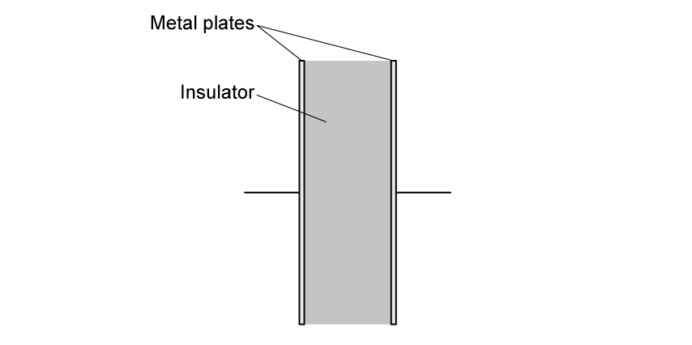
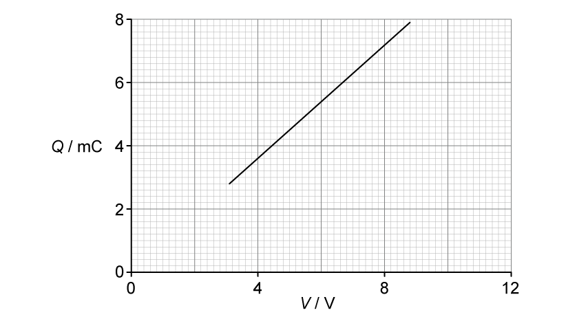

# Exam Questions — Capacitors & Capacitance
**19. Capacitance** · Cambridge (CIE) A-LEVEL physics (9702)
> Source: [https://www.savemyexams.com/a-level/physics/cie/25/topic-questions/](https://www.savemyexams.com/a-level/physics/cie/25/topic-questions/) · 5 questions across 1 sets

## Structured Questions (5 questions)

### Q1 — easy — 8 marks

**Q1** [3 marks]

Two capacitors, X and Y, of capacitance 25 μF and 88.5 μF respectively, are connected in parallel to a battery of emf 6.0 V, as shown in Fig. 1.1

**Fig. 1.1**

The plates of both capacitor** **X and capacitor Y are separated by a vacuum.

Complete Table 1.1 for this circuit.

**Table 1.1**

| **capacitor** | **capacitance / μF** | **p.d. / V** | **charge / μC** |
|---|---|---|---|
| **X** | 25.0 | ** ** | ** ** |
| **Y** | 88.5 | ** ** | ** ** |

**Q1** [2 marks]

**Extract:**

Two capacitors, X and Y, of capacitance 25 μF and 88.5 μF respectively, are connected in parallel to a battery of emf 6.0 V, as shown in Fig. 1.1. Fig. 1.1. The plates of both capacitor X and capacitor Y are separated by a vacuum. Capacitor X: capacitance 25.0 μF; Capacitor Y: capacitance 88.5 μF.

The total capacitance $C_{total}$ for two capacitors $C_{1}$ and $C_{2}$ connected in parallel is given by the equation:

$C_{total}=C_{1}+C_{2}$

Using the equation given, calculate the total capacitance of the circuit shown in Fig. 1.1 in Farads, F.

**Q1** [1 mark]

**Extract:**

Two capacitors, X and Y, of capacitance 25 μF and 88.5 μF respectively, are connected in parallel to a battery of emf 6.0 V, as shown in Fig. 1.1. The plates of both capacitor X and capacitor Y are separated by a vacuum.

A dielectric material is inserted into the space between the plates of capacitor Y in Fig. 1.1.

State how the capacitance of capacitor Y changes with an added dielectric material.

**Q1** [2 marks]

The graph in Fig. 1.2 represents the equation Q = CV.

**Fig. 1.2**

State the quantities represented by each axis.

### Q2 — easy — 9 marks

**Q2** [1 mark]

State the relationship between the capacitance of a capacitor and the charge stored.

**Q2** [3 marks]

A parallel plate capacitor** **X of capacitance 300 μF is fully charged to a potential difference of 8 V.

Calculate the charge stored by X when it is fully charged.

**Q2** [2 marks]

**Extract:**

A parallel plate capacitor X of capacitance 300 μF is fully charged to a potential difference of 8 V.

A graph showing how the charge stored *Q*  by capacitor X varies with the potential difference *V*  across it is shown in Fig. 1.1.

**Fig. 1.1**

State the** **value of the gradient of the line shown in Fig. 1.1.

Give a reason for your answer.

**Q2** [3 marks]

**Extract:**

A parallel plate capacitor X of capacitance 300 μF is fully charged to a potential difference of 8 V.

A parallel plate capacitor Y is placed in series with the parallel plate capacitor X. Capacitor Y has a capacitance of 200 µF.

Calculate the combined capacitance of capacitors X and Y in this arrangement.

### Q3 — medium — 8 marks

**Q3** [2 marks]

Define the capacitance of a parallel plate capacitor.

**Q3** [3 marks]

Two capacitors, of capacitances, *C**A* and *C**B*, are connected in parallel to a power supply of electromotive force (e.m.f.) *E*, as shown in Fig. 1.1.

**Fig. 1.1**

Determine an expression for the combined capacitance *C**C* of the two capacitors.

**Q3** [3 marks]

Two capacitors of capacitances 18 μF and 51 μF, and resistor of resistance 4.5 kΩ, are connected into the circuit of Fig. 1.2.

**Fig. 1.2**

The battery has an e.m.f of 8 V.

(i) Calculate the combined capacitance of the two capacitors.

[1]

(ii) The two-way switch S is initially at position P, so that the capacitors are fully charged.

Use the information in **(c) (i) **to calculate the total energy stored in the two capacitors.

total energy = .................................. J [2]

### Q4 — medium — 7 marks

**Q4** [2 marks]

State two functions of capacitors connected in electrical circuits.

**Q4** [3 marks]

Three capacitors are connected in parallel to a power supply as shown in Fig. 1.1.

**Fig. 1.1**

The capacitors have a capacitance *C**A*, *C**B* and *C**C*. The power supply provides a potential difference *E*.** **

(i) Explain why the charge on the positive plate of each capacitor is different.

[1]

(ii) Use your answer in **(i) **to show that the combined capacitance *C**T** *of the three capacitors is given by the expression.

$C_{T}=C_{A}+C_{B}+C_{C}$

[2]

**Q4** [2 marks]

A student has available three capacitors, each of capacitance 24 μF.

Draw circuit diagrams, one in each case, to show how the student connects the three capacitors to provide a combined capacitance of:

(i) 36 μF

[1]

(ii) 16 μF

[1]

### Q5 — medium — 11 marks

**Q5** [2 marks]

Three capacitors, each of capacitance 27 μF, are connected as shown in Fig. 1.1.

**Fig. 1.1**

Calculate the total capacitance between points P and Q.

capacitance = ..................................... μF

**Q5** [2 marks]

**Extract:**

Three capacitors, each of capacitance 27 μF, are connected as shown in Fig. 1.1. [Fig 1.1: one 27 μF capacitor in series with a parallel combination of two 27 μF capacitors, between points P and Q]. From part (a): Capacitance of each capacitor, C = 27 × 10^−6 F; Capacitance across the parallel combination, C_P = 54 × 10^−6 F; total series capacitance = 18 μF.

The maximum safe potential difference that can be applied across any one capacitor is 4 V.

Determine the maximum safe potential difference that can be applied between points P and Q.

potential difference = ...................................... V

**Q5** [3 marks]

A capacitor consists of an insulator separating two metal plates, as shown in Fig. 1.3.

**Fig. 1.3**

The potential difference between the plates is *V*. The variation with *V *of the magnitude of the charge *Q *on one plate is shown in Fig. 1.4.

**Fig 1.4**

Explain why the capacitor stores energy but not charge.

**Q5** [4 marks]

**Extract:**

A capacitor consists of an insulator separating two metal plates, as shown in Fig. 1.3. The potential difference between the plates is V. The variation with V of the magnitude of the charge Q on one plate is shown in Fig. 1.4.

Use Fig. 1.4 to determine:

(i) the capacitance of the capacitor

capacitance = ................................. μF [2]

(ii) the loss in energy stored in the capacitor when the potential difference *V *is reduced from 8 V to 6 V.

energy = ................................. mJ [2]
