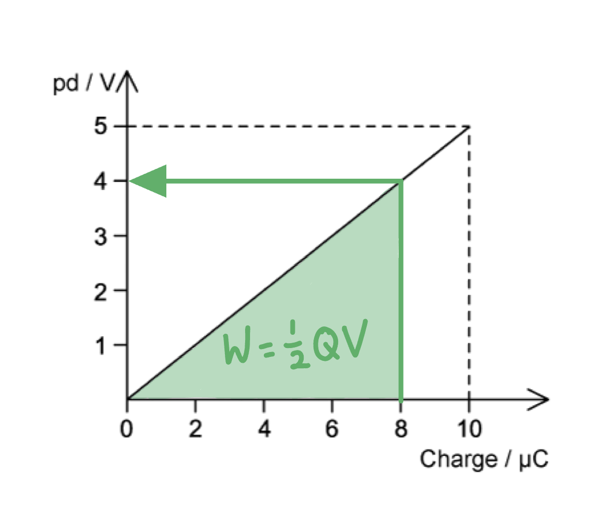
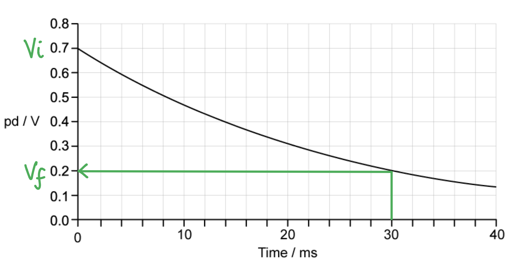
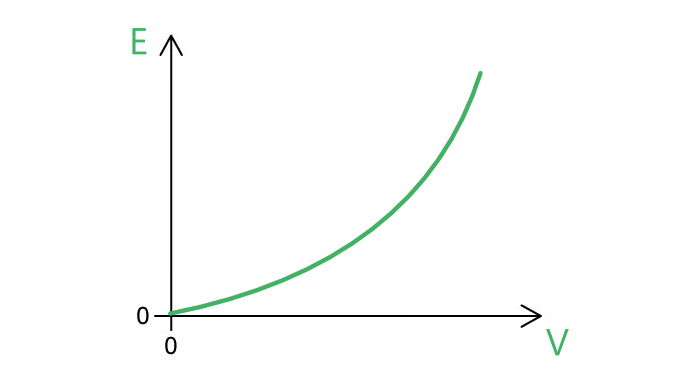
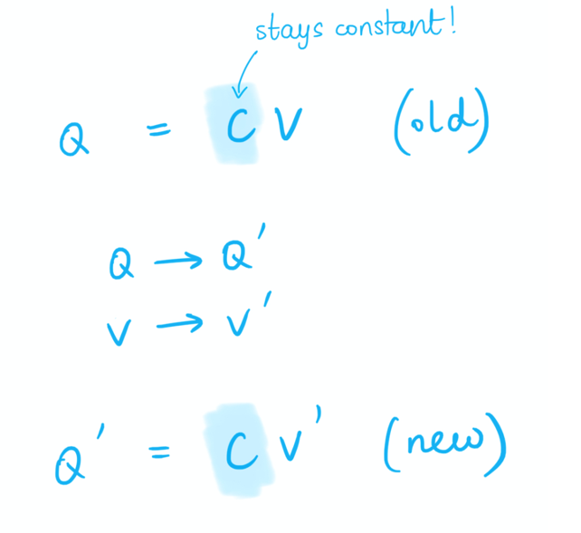
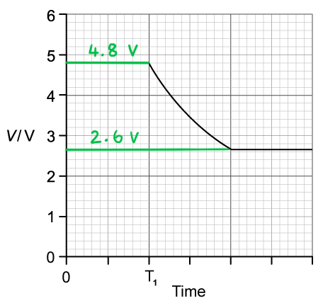
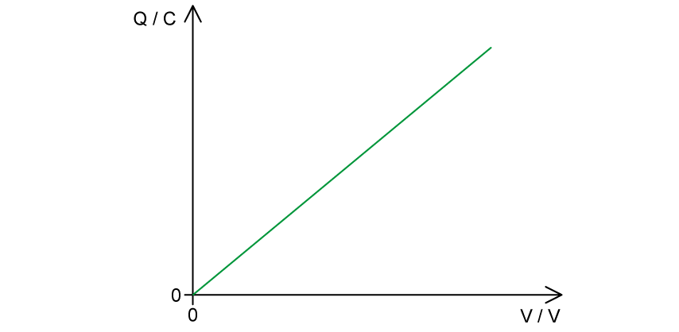
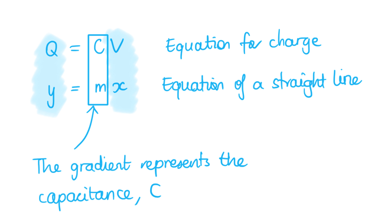

# Mark Schemes — Energy Stored in a Capacitor
**19. Capacitance** · Cambridge (CIE) A-LEVEL physics (9702)

## Structured Questions (7 questions)

### Q1
The change in energy stored in the capacitor is:

List the known quantities:

- Capacitance, *C* = 20 nF = 20 × 10–9 F
- Initial potential difference, *V*1 = 75 V
- Final potential difference, *V*2 = 90 V

Determine the correct energy stored equation:

- $W=\frac{1}{2}CV^{2}$ **[1 mark]**

Calculate the change in energy stored in the capacitor:

- $\Delta W = 1 \frac{1}{2} C ( V_{2}^{2} - V_{1}^{2} ) = 1 \frac{1}{2} \times ( 20 \times 10^{- 9} ) \times ( 90^{2} - 75^{2} )$** [1 mark]**
- $\DeltaW=2.475\times10^{-5}=2.5\times10^{-5}J$** [1 mark]**

**[Total: 3 marks]**
The change in charge on the capacitor is: List the known quantities:

- Capacitance, *C* = 20 nF = 20 × 10–9 F
- Initial potential difference, *V*1 = 75 V
- Final potential difference, *V*2 = 90 V

Determine the equation for the charge, *Q*:

- $C=\frac{Q}{V}\RightarrowQ=CV$ **[1 mark]**

Calculate the change in charge:

- $\Delta Q = C ( V_{2} - V_{1} ) = ( 20 \times 10^{- 9} ) \times ( 90 - 75 )$ **[1 mark]**
- $\DeltaQ=3\times10^{-7}C$ **[1 mark]**

**[Total: 3 marks]**
The capacitance of this capacitor is:

Determine what part of the graph gives the capacitance:

- The gradient of the graph is $\frac{V}{Q}$
- Since $C=\frac{Q}{V}$, the gradient of the graph is $\frac{1}{C}$
- Therefore, $C=\frac{1}{\mathrm{gradient}}$ **[1 mark]**

Calculate the capacitance:

- $\mathrm{gradient}=\frac{V}{Q}=\frac{60}{30\times10^{-6}}$
- $C=\frac{Q}{V}=\frac{30\times10^{-6}}{60}=5.0\times10^{-7}F$ **[1 mark]**

**[Total: 2 marks]**

> *To calculate the gradient, you can use any corresponding values of potential difference and charge from the graph. However, it is better to use a **bigger **gradient triangle.*

> *Watch out for the units on the graph! The capacitance of a capacitor is generally a very small value (i.e. 1 F is a **very** large unit). Therefore, you must include that the charge is in µC.*
The energy stored in the capacitor is 0.9 mJ because:

List the known quantities:

- Potential difference, *V* = 60 V
- Charge stored at potential difference of 60 V, *Q* = 30 µC = 30 × 10–6 C

Calculate the energy stored, *W*:

- $W = \frac{1}{2} Q V$ **[1 mark]**
- `W = \frac{1}{2} \times \left(30 \times 10^{- 6}\right) \times 60` = 9 × 10–4 J = 0.9 mJ **[1 mark]**

**[Total: 2 marks]**

### Q2
List the known quantities:

- Capacitance of capacitor, *C *= 10 × 10−6 F
- Voltage, *V *= 4000 V

Recall the equation for the energy stored in a capacitor, *E*:

- Energy stored in a capacitor, $E=\frac{1}{2}CV^{2}$ **[1 mark]**

Substitute the known quantities into the equation for energy stored in a capacitor:

- $E=\frac{1}{2}\times(10\times10^{-6})\times(4000)^{2}$ **[1 mark]**
- *E *= 80 J **[1 mark]**

**[Total: 3 marks]**
List the known quantities:

- Capacitance of capacitor, *C *= 10 × 10−6 F (From part (a))
- Voltage, *V *= 4000 V (From part (a))

Recall and rearrange the equation for capacitance to make the charge, *q *the subject:

- Capacitance of a capacitor, $C=\frac{Q}{V}$
- So, *Q* = *CV  ***[1 mark]**

Substitute the known quantities into the equation to calculate the maximum charge, *Q*:

- *Q *= (10 × 10−6) × 4000 = 0.04 C **[1 mark]**

**[Total: 2 marks]**
List the known quantities:

- Energy stored at 4000 V, *E *= 80 J

Determine the fractional change in *E *due to change in *V*:

- *E *∝ *V**2* **[1 mark]**
- So, $( \frac{V}{2} )^{2} = \frac{V^{2}}{4}$
- Hence, $\frac{E}{4}\propto\frac{V^{2}}{4}$ **[1 mark]**

State the new value of energy stored in the capacitor, *E*:

- Therefore, $\frac{80}{4}=20$ J **[1 mark]**

**[Total: 3 marks]**

> *Read this question carefully, it says **without substituting** into the equation. Hence, you must show your answer using fractions (also often called **proportionality**).*
When the switch is moved to position B:

- The energy stored in the capacitor is delivered / transferred to the resistor / heart; **[1 mark]**

**[Total: 1 mark]**

> *To answer this question correctly you must look at the circuit. When the switch is moved from A to B the heart now forms part of the circuit so the charge built up in the capacitor is discharged onto the heart. *

### Q3
The energy stored when the charge is 8.0 µC is:

List the known quantities:

- Charge, *Q* = 8.0 µC = 8.0 × 10–6 C

Determine the pd when the charge is 8.0 µC:

- Potential difference = 4 V **[1 mark]**

Calculate the energy stored:

- The energy stored is the **area under** the *V-Q* graph
- $W=\frac{1}{2}QV$
- $W = 1 \frac{1}{2} \times ( 8.0 \times 10^{- 6} ) \times 4$ **[1 mark]**
- $W=1.6\times10^{-5}J=16µJ$ **[1 mark]**

**[Total: 3 marks]**
The capacitance of the capacitor is 2.0 µF because:

List the known quantities:

- Charge on the capacitor, *Q* = 8.0 µC
- Potential difference at 8.0 µC, *V* = 4 V (from part a)

Calculate the capacitance, *C*:

- $C = \frac{Q}{V}$ **[1 mark]**
- $C=\frac{8.0}{4}=2.0µF$ **[1 mark]**

**[Total: 2 marks]**

> *There are multiple ways of calculating the capacitance. You can find *$\frac{1}{\mathrm{gradient}}$* of the graph in Fig 1.1. You can choose any combination of **Q **and the equivalent value of **V** to get **C** e.g. *$\frac{6.0}{3}=2.0µF$*.*
The increase in energy stored in the capacitor as the charge increases from 8.0 µC to 10.0 µC is:

List the known quantities:

- Energy stored at 8.0 µC, *W*8.0 = 1.6 × 10–5 J (from part a)

Determine the pd when the charge is 10.0 µC from graph in Fig 1.1:

- *V*10.0 = 5 V **[1 mark]**

Calculate the energy stored at 10.0 µC:

- $W_{10.0} = 1 \frac{1}{2} Q_{10.0} V_{10.0} = 1 \frac{1}{2} \times ( 10.0 \times 10^{- 6} ) \times 5$
- $W_{10.0}=2.5\times10^{-5}J$ **[1 mark]**

Calculate the increase in energy stored:

- $W_{10.0} - W_{8.0} = ( 2.5 \times 10^{- 5} ) - ( 1.6 \times 10^{- 5} )$
- $W_{10.0}-W_{8.0}=9.0\times10^{-6}J$ **[1 mark]**

**[Total: 3 marks]**
If the capacitance increases:

- The energy stored <u>increases;</u> **[1 mark]**

**[Total: 1 mark]**

### Q4
The rate of change of potential difference:

- Decreases;**[1 mark]**

Because:

**Final answer:** **Any ****two**** from:**

- Current is directly proportional to p.d. (*I ∝ V*), so as p.d. decreases so does the current through the resistor; **[1 mark]**
- If the current decreases, the rate at which charge leaves the capacitor decreases since current = $\frac{\DeltaQ}{\Deltat}$; **[1 mark]**
- The rate of change of charge $( \frac{\Delta Q}{\Delta t} )$ is proportional to the rate of change of potential difference $( \frac{\Delta V}{\Delta t} )$; **[1 mark]**** **

**[Total: 3 marks]**

> *The final point is because **Q** = **CV** therefore, **Q ∝ V.*

List the known quantities:

- Capacitance, *C* = 140 μF = 140 × 10–6 F

Determine the equation for the energy stored in a capacitor:

- $W=\frac{1}{2}CV^{2}$

From the Fig. 1.1 graph:

- Initial potential difference, $V_{i}$= 0.7 V **AND** Final potential difference,  $V_{f}$ = 0.2 V **[1 mark]**

Calculate initial energy stored, $W_{i}$:

- $W_{i}$ = $\frac{1}{2}$× (140 × 10–6) × (0.7)2 = 3.43 × 10–5J

Calculate final energy stored, $W_{f}$:

- $W_{f}$ =$\frac{1}{2}$ × (140 × 10–6) × (0.2)2 = 2.8 × 10–6J

Calculate percentage of energy remaining:

- % energy remaining =$\frac{W_{f}}{W_{i}}$ × 100% **or** $\frac{( V_{f} )^{2}}{( V_{i} )^{2}}$× 100%
- $\frac{W_{f}}{W_{i}}$ = $\frac{2.8\times10^{-6}}{3.43\times10^{-5}}$ × 100% = 8.16 % **OR** $\frac{W_{f}}{W_{i}}$ = $\frac{0.2^{2}}{0.7^{2}}$× 100% = 8.16 %**[1 mark] **

Calculate % energy lost:

- % energy lost = 100% – (% energy remaining)
- 100 – 8.16 = 91.8 = 92% (2 s.f.)** [1 mark]**** **

**[Total: 3 marks]**
List the known quantities:

- Capacitance, *C* = 140 μF = 140 × 10–6 F

From data page:

- Capacitance, *C* = $\frac{Q}{V}$

From Fig. 1.1 graph:

- Change in p.d, = 0.7 – 0.2 = 0.5 V

Calculate the charge:

- *Q* = $C\DeltaV$= (140 × 10–6)× 0.5 **[1 mark]**
- *Q *= 7.0× 10–5C = 70 μC** [1 mark]**** **

**[Total: 2 marks]**
List the known quantities:

- Charge in 1 pulse, *Q* = 7.0 × 10–5C (from part c)
- Minutes in one year = 60 × 24 × 365 = 525 600 mins

Determine the total number of pulses over the 3 years:

- 60 pulses per min × 525 600 min × 3 years = 94 608 000 pulses**[1 mark]**

Calculate the total charge delivered over the 3 years:

- Total charge = (7.0 × 10–5) × 94 608 000 = 6622.56 C** [1 mark]**

Convert to Amp-hours:

- 1 C = 1 A s, therefore, 3600C = 1A h
- Total charge =$\frac{6622.56}{3600}$ = 1.8396 = 1.8 A h** [1 mark]**** **

**[Total: 3 marks]**

### Q5
List the known quantities:

- Initial potential difference across capacitor = 6 V
- Current, *I* = 20 μA = 20 × 10–6 A
- Time elapsed, Δ*t *= 32 s

Calculate the initial charge stored on the capacitor:

- Δ*Q* = *I ×* Δ*t*
- Δ*Q = *(20 × 10–6) × 32 = 6.4 × 10–4 C **[1 mark]**

Calculate the capacitance:

- *C *= $\frac{Q}{V}$= $\frac{6.4\times10^{-4}}{6}$ = 1.1 × 10–4 F **[1 mark]**

**[Total: 2 marks]**

> *When fully charged after 32 s, the potential difference across the capacitor is 6 V and the charge accumulated is 0.64 mC. It is these two final values that are used to calculate the capacitance – make sure that you use values of **Q** and **V** which occur at the **same time** when calculating capacitance. *
A graph that would score two marks should look like:

- A line passing through the origin **AND** horizontal axis labelled as potential difference **AND** vertical axis labelled as energy; **[1 mark]**
- A <u>curved</u> line with increasing gradient (parabolic); **[1 mark]**

**[Total: 2 marks]**

> *It's easy to fall into the pattern of just drawing charging / discharging graphs, but here we're not drawing any variation with time. The relationship between energy and potential difference is:*

$E=\frac{1}{2}CV^{2}$

> *This is in the parabolic format of:*

$y=kx^{2}$

> *so the graph has the distinctive curved shape. *
List the known quantities algebraically:

- The initial potential difference across the capacitor, *V*
- The capacitance of the capacitor = *C*
- The initial charge stored by the capacitor,* Q = CV*
- The initial energy stored by the capacitor, *E = *$\frac{1}{2}$*CV*2

Write an expression for the new charge stored *Q’* at the new potential difference *V’*:

- *Q’* = *C × V’*

Write an expression for the new charge stored in terms of the old charge stored, *Q*:

- The new potential difference is 50% greater than the old potential difference, so *V’ *= 1.5V
- *Q’ = C × *(1.5*V*) = 1.5*CV = *1.5Q **[1 mark]**

Conclusion about charge stored:

- Dennis is correct / justified about the increase in charge stored **OR** this is an increase of 50% in charge stored; **[1 mark]**

Write an expression for the new energy stored *E’* at the new potential difference *V’*:

- *E’* = ½ ×*C × *$V'^{2}$* *

Write an expression for the new energy stored in terms of the old potential difference, *V*:

- *E’* = ½ × *C × *(1.5*V*)2
- *E’* = ½ × *C × *2.25*V*2 = 2.25 × ($\frac{1}{2}$*CV*2) = 2.25 *E ***[1 mark]**

Conclusion about energy stored:

- Dennis is correct/justified about the increase in energy stored / this is an increase of 125% in energy stored (because it has increased from 100% to 225%); **[1 mark]**** **

**[Total: 4 marks]**

> *The technique used in this question – writing ‘new’ quantities in terms of ‘old’ quantities – is very commonly examined. It is powerful because you can directly see how different quantities change in response to proportional increases/decreases. *

> *Make sure you are comfortable with writing two equations in the form ‘old’ and ‘new’, identifying clearly which quantities have changed and which stay constant. For example, if the capacitance **C** stays constant, but the charge stored **Q** and the potential difference **V** changes, then:*

> *New quantities might have risen by some percentage, like 25%, so for example: *

> *V’ = **1.25**V*

### Q6
$T_{1}$ represents:

- The moment the ball begins to fall;** [1 mark]**** **

$T_{2}$ represents

- The moment the ball breaks through the thin metal rod **AND** the point when the capacitor stops discharging;** [1 mark]**

** ****[Total: 2 marks]**

List the known quantities:

- Capacitance, *C* = 85 µF = 85 × 10–6 F
- Distance the ball falls between *T**1*  and *T**2  *= 0.45 m
- Acceleration of free fall, *g*  = 9.81 m s−2

Calculate the charge using the capacitance definition and Fig. 1.2:

- Change in potential difference, Δ*V * = 4.8 – 2.6 = 2.2 V
- Δ*Q* = *C*Δ*V *= (85 × 10–6) × 2.2
- *Q* = 1.87 × 10–4 **[1 mark]**

Calculate the time taken *t*  for the ball to fall 0.45 m:

- The ball is dropped, so initial vertical speed, *u*  = 0 m s−1

  - Use the uniformly accelerated motion equation from the data booklet: $s=ut+\frac{1}{2}at^{2}$
- Substitute the known values: $0.45=0+\frac{1}{2}\times9.81\timest^{2}$

  - Rearrange for *t*
- $t=\sqrt{\frac{2\times0.45}{9.81}}=0.303s$ **[1 mark]**

Calculate the average current:

- Recall that current, $I=\frac{ΔQ}{Δt}$

  - The time in which charge flows is $t=0.303=T_{2}-T_{1}$
- $I=\frac{1.87\times10^{-4}}{0.303}=6.2\times10^{-4}A$ **[1 mark]**

**[Total: 3 marks]**
List the known quantities:

- Resistance, *R* = 2.4 kΩ = 2.4 × 103 Ω

From the Fig. 1.2 graph:

- The maximum potential difference,* V* = 4.8 V **[1 mark]**

Calculate the current:

- *I* = $\frac{V}{R}$ = $\frac{4.8}{2.4\times10^{3}}$ = 2 × 10–3 = 2.0 mA **[1 mark]**

**[Total: 2 marks] **

> *Since **I ∝ V  **for a fixed resistance, the largest possible value of current will occur when the resistor is at its **maximum** possible potential difference.*
List the known quantities:

- Resistance, *R* = 2.4 kΩ = 2.4 × 103 Ω
- Capacitance, *C* = 85 µF = 85 × 10–6 F

Use Fig. 1.2 to work out *V* before and after discharge:

- Potential difference before discharge = 4.8 V
- Potential difference after discharge = 2.6 V

Calculate the energy transferred before and after:

- Recall the equation for energy stored in a capacitor, $E=\frac{1}{2}CV^{2}$
- Energy before discharge =$\frac{1}{2}$ × (85 × 10–6) × 4.82 = 9.792 × 10–4 J **AND** Energy after discharge = $\frac{1}{2}$ × (85 × 10–6) × 2.62 = 2.873 × 10–4 J **[1 mark]**

Calculate the total energy transferred through the resistor:

- Total energy transferred = Energy before discharge – Energy after discharge
- $\DeltaE$ = (9.792 × 10–4) – (2.873 × 10–4) **[1 mark]**
- $\DeltaE$ = 6.919 × 10–4 = 6.9 × 10–4 J **[1 mark]**

**[Total: 3 marks]**

### Q7
A sketch on Fig. 1.1 that would gain full credit is shown below:

- A straight line with a positive gradient through the origin; **[1 mark]**
- Charge / *Q* labelled on the <u>vertical axis</u> **AND** units as coulombs / C; **[1 mark]**
- Potential difference **/** *V* labelled on the <u>horizontal axis</u> **AND **units as volts / V; **[1 mark]**

**[Total: 3 marks]**

> *The equation for charge **Q** = **CV** is linear. This means, that if charge **Q** is plotted on the ‘**y-**axis’ and potential difference **V** is plotted on the ‘**x**-axis’, the graph will be a straight line through the origin, with the gradient representing the capacitance **C**. This is shown below:*

The feature of the graph in part (a) that represents the electric potential energy stored is:

- The area under the line / graph; **[1 mark]**

**[Total: 1 mark]**
List the known quantities:

- Capacitance, *C* = 1200 μF = 1200 × 10–6 F
- Potential difference, *V* = 4.5 V

Substitute the known quantities into the energy stored equation and calculate the energy stored:

- Recall energy stored, *E* = $\frac{1}{2}$*CV*2
- *E* =$\frac{1}{2}$ × (1200 × 10–6) × (4.5)2 **[1 mark]**
- *E* = 1.2 × 10–2 J **[1 mark]**** **

**[Total: 2 marks]**** **

> *There are two equations for energy stored that you need to memorise:*

> *E** = *$\frac{1}{2}$*QV*

> *E **=*$\frac{1}{2}$*CV**2** *

> *Although you could convert **C** and **V** to **Q** using **Q** = **CV** and still get the same final answer, it’s much quicker to use the variables given in the question (in this case, **C** and **V**) to know which equation to use.*
State which student is correct:

- Student B is correct; **[1 mark]**

Explanation:

- When a capacitor is charging / discharging, *Q* <u>is not constant</u> **[1 mark]**
- Capacitance *C* is constant; **[1 mark]**
- Therefore, it cannot be said that *E* ∝ *V ***OR** therefore it is only true that *E* ∝ *V*2 **[1 mark]**

**[Total: 4 marks]**

> *It’s important to note the distinction between the two equations for energy stored by a capacitor:*

> *E** = *$\frac{1}{2}$*QV** = *$\frac{1}{2}$*CV**2**. *

> *As the capacitor charges, the potential difference across the capacitor plates **V** increases, such that the energy stored by the capacitor **E** increases. *

> *However, during this process, the charge stored **Q** is **also changing **– i.e., it is not constant. Therefore, it is incorrect to say that **E** ∝ **V** because **Q** is not constant. *

> *Whereas the equation **E** = *$\frac{1}{2}$*CV**2** shows that **E** ∝ **V**2** for a **constant capacitance** **C**. Therefore, in this case, **Student B** is correct.*
