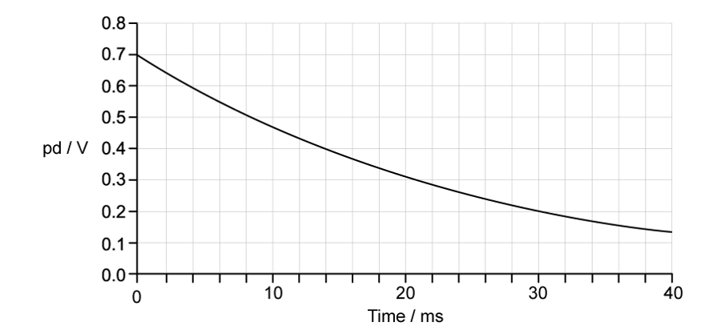
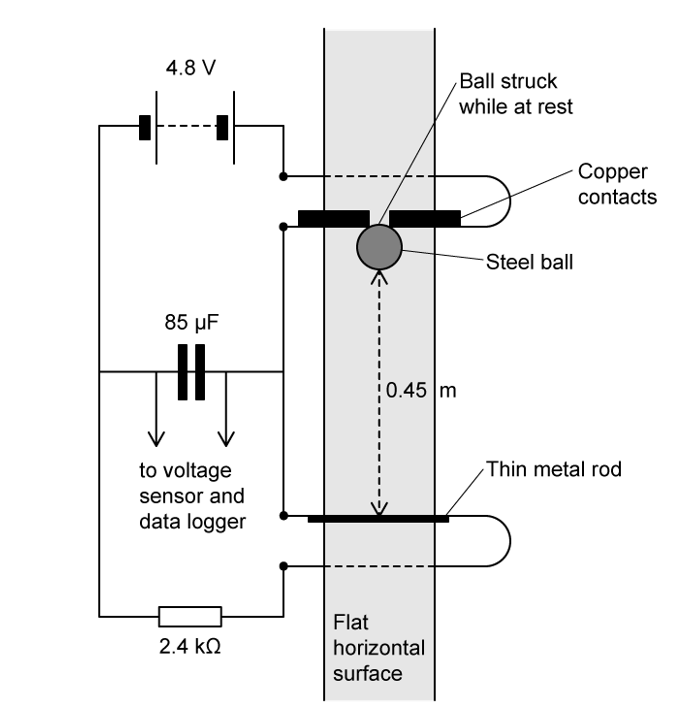
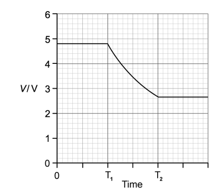

# Exam Questions — Energy Stored in a Capacitor
**19. Capacitance** · Cambridge (CIE) A-LEVEL physics (9702)
> Source: [https://www.savemyexams.com/a-level/physics/cie/25/topic-questions/](https://www.savemyexams.com/a-level/physics/cie/25/topic-questions/) · 7 questions across 1 sets

## Structured Questions (7 questions)

### Q1 — medium — 10 marks

**Q1** [3 marks]

Calculate the change in energy stored in a capacitor of capacitance 20 nF when the potential difference between the plates increases from 75 V to 90 V.

**Q1** [3 marks]

**Extract:**

Calculate the change in energy stored in a capacitor of capacitance 20 nF when the potential difference between the plates increases from 75 V to 90 V.

Calculate the change in charge on the capacitor.

**Q1** [2 marks]

A different capacitor has the following change in potential difference against charge stored graph shown in Fig 1.2.

**Fig 1.2**

Calculate the capacitance of this capacitor.

**Q1** [2 marks]

**Extract:**

A different capacitor has the following change in potential difference against charge stored graph shown in Fig 1.2. Fig 1.2 (potential difference V = 60 V corresponds to charge Q = 30 µC = 30 × 10^–6 C)

Show that the energy stored in the capacitor is 0.9 mJ.

### Q2 — easy — 9 marks

**Q2** [3 marks]

A defibrillator device sends an impulse of electrical energy to maintain a regular heartbeat in a person. The device is powered by a d.c. supply of 4000 V that charges a capacitor of capacitance 10 × 10−6 F. The switch is closed at point A as shown in Fig. 1.1.

**Fig. 1.1**

Calculate the maximum energy stored in the capacitor.

**Q2** [2 marks]

**Extract:**

A defibrillator device sends an impulse of electrical energy to maintain a regular heartbeat in a person. The device is powered by a d.c. supply of 4000 V that charges a capacitor of capacitance 10 × 10^−6^ F. The switch is closed at point A as shown in Fig. 1.1.

Calculate the maximum charge, *Q* stored in the capacitor.

**Q2** [3 marks]

**Extract:**

A defibrillator device sends an impulse of electrical energy to maintain a regular heartbeat in a person. The device is powered by a d.c. supply of 4000 V that charges a capacitor of capacitance 10 × 10^−6^ F. Calculate the maximum energy stored in the capacitor. E = 80 J

Show, without substituting values into the equation $E=\frac{1}{2}CV^{2}$, the energy stored in the capacitor is 20 J when the potential difference is halved.

**Q2** [1 mark]

**Extract:**

A defibrillator device sends an impulse of electrical energy to maintain a regular heartbeat in a person. The device is powered by a d.c. supply of 4000 V that charges a capacitor of capacitance 10 × 10^−6^ F. The switch is closed at point A as shown in Fig. 1.1.

The switch is moved to position B.

State what happens to the energy stored in the capacitor when the switch is moved to position B.

### Q3 — medium — 9 marks

**Q3** [3 marks]

Fig 1.1 shows how the potential difference across a capacitor varies with the charge stored in it.

**Fig 1.1**

Calculate the energy stored when the charge on the capacitor is 8.0 µC.

**Q3** [2 marks]

**Extract:**

Fig 1.1 shows how the potential difference across a capacitor varies with the charge stored in it. Fig 1.1. Calculate the energy stored when the charge on the capacitor is 8.0 µC.
Determine the pd when the charge is 8.0 µC: Potential difference = 4 V

Show that the capacitance of the capacitor is 2.0 µF.

**Q3** [3 marks]

**Extract:**

Fig 1.1 shows how the potential difference across a capacitor varies with the charge stored in it. Fig 1.1. Calculate the energy stored when the charge on the capacitor is 8.0 µC. [Mark scheme: Determine the pd when the charge is 8.0 µC: Potential difference = 4 V. The energy stored is the area under the V-Q graph, W = 1/2 QV = 1/2 × (8.0 × 10^-6) × 4 = 1.6 × 10^-5 J = 16 µJ]

Calculate the increase in energy stored in the capacitor as the charge increases from 8.0 µC to 10.0 µC.

**Q3** [1 mark]

**Extract:**

Fig 1.1 shows how the potential difference across a capacitor varies with the charge stored in it.

State the change in energy stored if the capacitor is replaced with one with a higher capacitance.

### Q4 — medium — 11 marks

**Q4** [3 marks]

Fig 1.1 shows the discharge of a capacitor in a heart pacemaker.

**Fig 1.1**

Explain how the rate of change of potential difference changes as the capacitor discharges.

**Q4** [3 marks]

**Extract:**

Fig 1.1 shows the discharge of a capacitor in a heart pacemaker. Fig 1.1 [graph showing pd/V on y-axis from 0 to 0.8 vs Time/ms on x-axis from 0 to 40; the curve starts at 0.7 V at t=0 and decreases exponentially, reaching 0.2 V at t=30 ms]

The capacitor has a capacitance of 140 μF.

Calculate the energy lost by the capacitor whilst it discharges during the first 30 ms.

Give your answer as a percentage of the initial energy.

**Q4** [2 marks]

**Extract:**

Fig 1.1 shows the discharge of a capacitor in a heart pacemaker.
The capacitor has a capacitance of 140 μF.
From the Fig. 1.1 graph: Initial potential difference, V_i = 0.7 V AND Final potential difference, V_f = 0.2 V

The charge which is lost as the capacitor discharges is used by the pacemaker to produce a single pulse for the heart.

Calculate the charge, in μC, of a single pulse.

**Q4** [3 marks]

**Extract:**

The charge which is lost as the capacitor discharges is used by the pacemaker to produce a single pulse for the heart. Calculate the charge, in μC, of a single pulse. Q = CΔV = (140 × 10^–6) × 0.5 = 7.0 × 10^–5 C = 70 μC

The pacemaker has been designed to operate for a minimum of 3 years, delivering 60 constant pulses per minute.

Calculate the minimum charge of the power supply if it is to operate over the 3 years.

Give your answer in Amp-hours.

### Q5 — hard — 8 marks

**Q5** [2 marks]

Dennis is an electrical engineer and wants to investigate how capacitors store and release charge and energy.

He firstly designs a circuit to determine the capacitance *C *of a capacitor. This circuit is shown in Fig. 1.1. The switch S is held in position A until the capacitor is fully charged to 6 V and is then moved to position B so that it fully discharges through the microammeter and the variable resistor R.

**Fig. 1.1**

While discharging, Dennis continuously adjusts the variable resistor R to keep the current constant until the capacitor is fully discharged. Fig. 1.2 shows how the current *I  *varies during the discharging process.

**Fig. 1.2**

Calculate the capacitance of the capacitor.

**Q5** [2 marks]

Dennis understands that as the capacitor charges, the energy stored in the capacitor increases, as does the potential difference across it.

**Fig. 1.3**

On the axes provided in Fig. 1.3, sketch a graph of how energy stored in the capacitor varies with potential difference.

**Q5** [4 marks]

Dennis disconnects the circuit and increases the e.m.f. of the power supply by 50%.

He states that by doing this, the charge stored in the capacitor will increase by 50% and the energy stored in the capacitor will increase by 125%.

Justify Dennis’s statement with suitable calculations.

### Q6 — hard — 10 marks

**Q6** [2 marks]

Fig. 1.1 shows an experiment carried out to measure the speed of a steel ball when it has been dropped from rest.

**Fig. 1.1**

When the ball is touching the copper contacts, the 85 µF capacitor charges to a potential difference of 4.8 V. When the ball is released, it falls and leaves the copper contacts thus causing the capacitor to discharge through the 2.4 kΩ resistor.

Once the ball has fallen a distance of 0.45 m it splits the thin metal rod causing a break in the circuit and the capacitor stops discharging.

Fig. 1.2 shows how the potential difference across the resistor varies during the experiment.

**Fig. 1.2**

Discuss the significance of the times $T_{1}$ and $T_{2}$.

**Q6** [3 marks]

**Extract:**

Fig. 1.1 shows an experiment carried out to measure the speed of a steel ball when it has been dropped from rest. When the ball is touching the copper contacts, the 85 µF capacitor charges to a potential difference of 4.8 V. When the ball is released, it falls and leaves the copper contacts thus causing the capacitor to discharge through the 2.4 kΩ resistor. Once the ball has fallen a distance of 0.45 m it splits the thin metal rod causing a break in the circuit and the capacitor stops discharging. Fig. 1.2 shows how the potential difference across the resistor varies during the experiment. (Fig 1.2 shows the pd starting at 4.8 V until T1, then discharging down to 2.6 V.)

Calculate the average current that flows through the resistor as the capacitor discharges.

You may ignore air resistance.

**Q6** [2 marks]

**Extract:**

When the ball is touching the copper contacts, the 85 µF capacitor charges to a potential difference of 4.8 V. When the ball is released, it falls and leaves the copper contacts thus causing the capacitor to discharge through the 2.4 kΩ resistor. Once the ball has fallen a distance of 0.45 m it splits the thin metal rod causing a break in the circuit and the capacitor stops discharging. Fig. 1.2 shows how the potential difference across the resistor varies during the experiment. (The maximum potential difference from Fig. 1.2 is 4.8 V.)

Use Fig. 1.2** **to calculate the largest possible value for current in the resistor.

**Q6** [3 marks]

**Extract:**

When the ball is touching the copper contacts, the 85 µF capacitor charges to a potential difference of 4.8 V. When the ball is released, it falls and leaves the copper contacts thus causing the capacitor to discharge through the 2.4 kΩ resistor. Once the ball has fallen a distance of 0.45 m it splits the thin metal rod causing a break in the circuit and the capacitor stops discharging. Fig. 1.2 shows how the potential difference across the resistor varies during the experiment. (Potential difference before discharge = 4.8 V; Potential difference after discharge = 2.6 V)

Calculate the amount of energy transferred through the 2.4 kΩ resistor during the discharging of the capacitor.

### Q7 — easy — 10 marks

**Q7** [3 marks]

A capacitor stores electric charge and electric potential energy. ** **

**Fig. 1.1**

Sketch a graph labelling** **both axes on Fig. 1.1, to show how the charge stored, *Q* by a capacitor varies with the potential difference, *V*.

**Q7** [1 mark]

**Extract:**

A capacitor stores electric charge and electric potential energy. Sketch a graph labelling both axes on Fig. 1.1, to show how the charge stored, Q by a capacitor varies with the potential difference, V. The graph is a straight line with a positive gradient through the origin, with charge Q on the vertical axis and potential difference V on the horizontal axis.

State the feature of the graph in Fig. 1.1 from part (a) that represents the electric potential energy** **stored by the capacitor.

**Q7** [2 marks]

Calculate the energy stored by a capacitor of capacitance 1200 μF that is charged to a potential difference of 4.5 V.

**Q7** [4 marks]

A healthy debate between two physics students concerns the equations for the energy stored by a capacitor.

A transcript of the debate is given below:** **

Student A: “The energy stored *E *by a capacitor is proportional to the potential difference *V*, because *E* = $\frac{1}{2}$*QV*.”

Student B: “Actually, the energy stored *E *by a capacitor is proportional to the *square* of the potential difference, *V*2, because *E *=$\frac{1}{2}$*CV*2.”

State and explain whether Student A or Student B is correct regarding the energy stored by a capacitor.

The equation for capacitance is: *C* = $\frac{Q}{V}$
