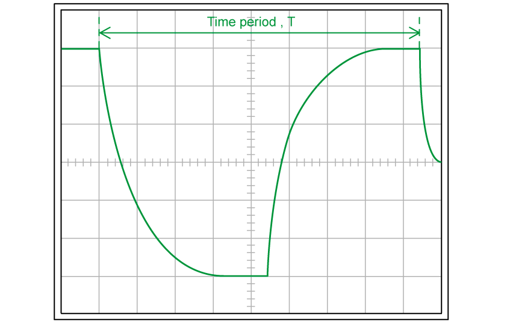
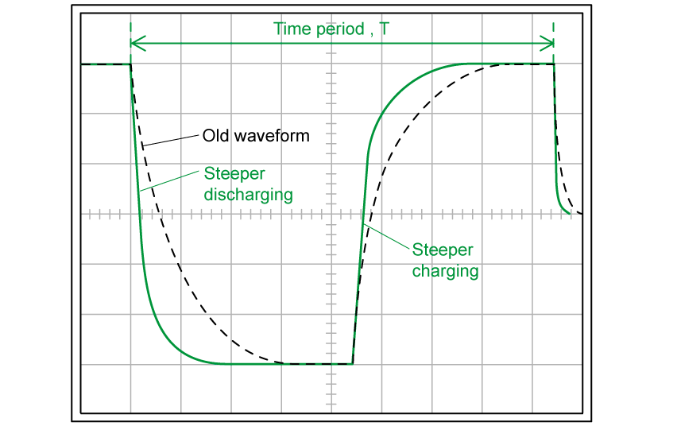
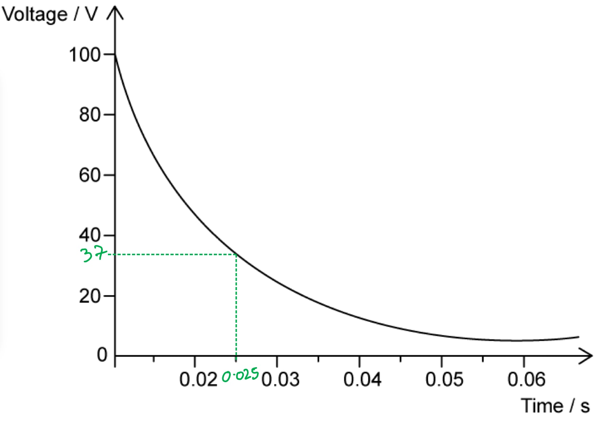
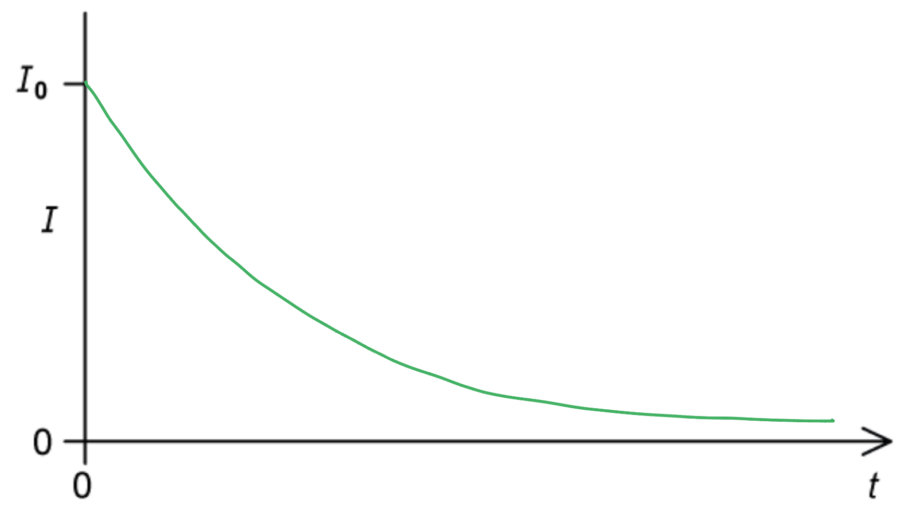
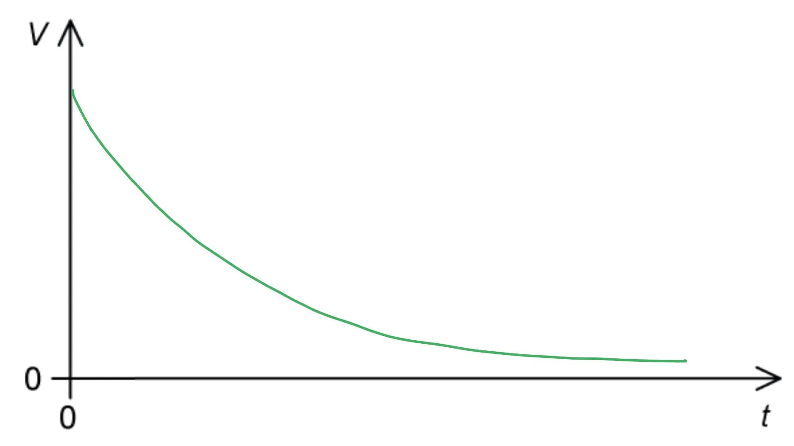
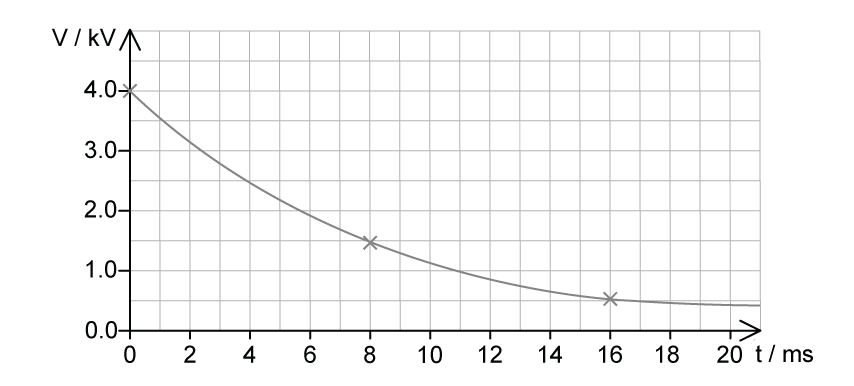

# Mark Schemes — Discharging a Capacitor
**19. Capacitance** · Cambridge (CIE) A-LEVEL physics (9702)

## Structured Questions (7 questions)

### Q1
A diagram that would score 4 marks should look like:

Sketch discharging and charging curves within one time period:

- Discharging exponential curve; **[1 mark]**
- Charging curve; **[1 mark]**
- Within one complete period (8.5 squares); **[1 mark]**
- Within correct peak-to-peak voltage (6 divisions); **[1 mark]**

**[Total: 4 marks]**

> *While the signal generator is at maximum p.d., the capacitor fully charges. This means that, when the signal generator drops to 0 V, the capacitor discharges so the oscilloscope does not receive a p.d. of zero but instead the characteristic capacitor discharge curve. The question tells you that this should drop down to that zero baseline before the signal generator switches back on.*

> *At this point, the capacitor charges and the same concept applies.*
Determine the maximum voltage:

- <u>Using the Y-voltage gain</u>, the maximum/initial voltage across the capacitor is 12 V (2 V div-1 × 6 divisions); **[1 mark]**

Use the time-base to determine the time constant of the capacitor:

- The time constant of the capacitor is the time taken to fall to 37% of its initial voltage
- Therefore, 0.37 × 12 = 4.44 V **[1 mark]**
- <u>Use the time-base</u> (of the oscilloscope) to determine how long the voltage takes to fall to 4.44 V; **[1 mark]**

Calculate the capacitance using the time constant and the resistance of R:

- Divide the time constant *τ*  by the resistance of resistor R (2.2 kΩ) to get the capacitance of the capacitor C (because *τ  = RC *); **[1 mark]**

**[Total: 4 marks]**

> *Wherever possible in the exam, be as specific and as quantitative as possible; note that you are required to state not only what you need (the initial voltage), but also how you intend to get it (using the Y-voltage gain). This is a useful exam technique to bear in mind. *

> *Similarly, the final mark of this question would not be credited with a vague response like “Use the equation **τ** = **RC** to calculate the capacitance”. *
State the effect of altering the time-base of the oscilloscope:

- Decreasing the time-base will stretch the signal horizontally; **[1 mark]**
- This will increase the <u>resolution</u> of time measurements; **[1 mark]**

State how a greater resolution will affect the uncertainty in the measurement:

- A greater resolution will <u>reduce</u> (percentage) <u>*uncertainty*</u> in measurements of time **AND** this will <u>improve</u> the <u>accuracy</u> of determining the <u>time constan</u>t from the oscilloscope; **[1 mark]**

**[Total: 3 marks]**

> *Decreasing** the time base means each square represents a smaller period of time. This is like 'zooming in' on the time line. If the time base is 0.5 ms, then the screen shows 5 ms. If the time base is 0.1 ms, the screen shows 1 ms and therefore is a greater **resolution**.*
Discuss the effects on the circuit:

- The addition of an identical resistor in parallel <u>decreases</u> the total resistance of the circuit; **[1 mark]**
- The initial rate of flow of charge / the initial current is larger when the capacitor charges / discharges / during each charging cycle; **[1 mark]**

Discuss the effects on the shape of the waveform:

- The <u>rate</u> of decrease / increase for discharging / charging curve will be <u>larger</u>; **[1 mark]**
- The time-period of the waveform is unaffected **OR**
- A correct sketch comparing the <u>old waveform</u> to both steeper charging / discharging curves **AND **an unaffected time-period; **[1 mark]**

**[Total: 4 marks]**

> *If the capacitor discharges quicker, it doesn't take much thinking to realise that it **charges** quicker too.*

> *Two resistors of resistance **R**  in parallel have a total resistance of ½**R**. The time constant (**τ  = RC **) therefore halves. If the time constant has halved, then the capacitor charges and discharges quicker, as represented by a steeper curve either way.*

### Q2
The time constant for a capacitor is:

- The time taken for the charge / current / voltage of a (discharging) capacitor to decrease to 37 % of its original value; **[1 mark]**

**[Total: 1 mark]**
List the known quantities:

- Resistance of resistor, *R *= 100 Ω
- Capacitance of capacitor, *C *= 25 μF

Convert the capacitance from μF to F:

- The metric multiplier micro μ means × 10-6
- So, 25 μF = 25 × 10−6 F **[1 mark]**

Substitute the known quantities into the time constant equation to calculate the time constant, *τ*:

- Recall the time constant equation: *τ *= *RC ***[1 mark]**
- *τ *= 100 × (25 × 10−6) = 2.5 × 10−3 s **[1 mark]**

**[Total: 3 marks]**
A graph that would score 1 mark would look like this:

- Horizontal line drawn from 37 V to curve **AND**
- Vertical line drawn from curve to horizontal axis; **[1 mark]**

- 0.025 s **[1 mark]**

  - **Acceptable range 0.024 - 0.026 s**

**[Total: 2 marks]**
List the known quantities:

- Time constant, *τ  *= 0.24 ms
- Capacitance, *C*  = 78 × 10–9 F

Convert the time constant from ms to s:

- 1 ms = 1 × 10–3 s
- 0.24 ms = 0.24 × 10–3 s **[1 mark]**

Rearrange the time constant equation for the resistance, *R*:

- Recall the time constant equation: *τ* = *RC*
- $R=\frac{τ}{C}$ **[1 mark]**

Substitute the values into the resistance equation:

- $R=\frac{0.24\times10^{-3}}{78\times10^{-9}}=3100Ω=3.1\mathrm{kΩ}$ **[1 mark]**

**[Total: 3 marks]**

### Q3
Obtain values from the graph to calculate the area under the line:

- The electric potential energy stored in the capacitor is equal to the **area under** the potential-charge graph
- From Fig 1.1, when p.d.$V=6V$, charge $Q=0.9\times10^{-4}C$
- Energy stored = $\frac{1}{2}\times\mathrm{base}\times\mathrm{height}=\frac{1}{2}VQ$
- Energy stored = `1 half cross times 6 cross times open parentheses 0.9 cross times 10 to the power of negative 4 end exponent close parentheses space equals space 2.7 cross times 10 to the power of negative 4 end exponent space straight J` **[1 mark]**

Estimate the energy* *stored in the capacitor:

- When the capacitor is fully charged, the p.d. across it is $V=12V$

  - Therefore, assuming $V\proptoQ$ remains true, if the p.d. is doubled, the charge will also double
  - So, the energy stored will be quadrupled (×4)
- Energy stored: `E space equals space 4 cross times open parentheses 2.7 cross times 10 to the power of negative 4 end exponent close parentheses space equals space 1.08 cross times 10 to the power of negative 3 end exponent space straight J` **[1 mark]**

**[Total: 2 marks]**
Show that the time constant of the discharge circuit is 4.2 s:

List the known quantities:

- Resistance of Q, $R$ = 280 kΩ = 280 × 103 Ω
- From Fig 1.1, when p.d.$V=6V$, charge $Q=0.9\times10^{-4}C$

Determine the capacitance of the capacitor:

- $C=\frac{Q}{V}$
- $C=\frac{0.9\times10^{-4}}{6}=1.5\times10^{-5}F$

Use the time constant equation:

- The capacitor discharges through resistor Q
- $τ=RC$ **[1 mark]**
- `tau space equals space open parentheses 280 cross times 10 cubed close parentheses cross times open parentheses 1.5 cross times 10 to the power of negative 5 end exponent close parentheses space equals space 4.2 space straight s` **[1 mark]**

**[Total: 2 marks]**
Determine the time *t*aken for the stored energy to decrease from $E$* *to $\frac{E}{4}$:

List the known quantities:

- Time constant, $τ=4.2s$

Consider the relationship between *E *and *V*:

- Energy stored: $E=\frac{1}{2}CV^{2}$
- (Since $C$ is constant) $E\proptoV^{2}$ **[1 mark]**

Obtain the value of *V *using the relationship:

- $\frac{E_{0}}{4}\propto\frac{V_{0}^{2}}{4}$
- $\sqrt{\frac{V_{0}^{2}}{4}}=\frac{V_{0}}{2}$

Use the capacitor discharge equation for *V*:

- $V=V_{0}e^{-\frac{t}{RC}}$** [1 mark]**
- $\frac{V_{0}}{2}=V_{0}e^{-\frac{t}{4.2}}$
- `ln space open parentheses 1 half close parentheses space equals space minus fraction numerator t over denominator 4.2 end fraction` **[1 mark]**
- $t=4.2\times\mathrm{ln}2$
- $t=2.9s$ **[1 mark]**

**[Total: 4 marks]**

> *You must use the relationship *$E\proptoV^{2}$* because *$E=\frac{1}{2}CV^{2}$*. **C **is constant** because this is the **capacitance** of this capacitor. *
When a second identical capacitor is connected in series to the first capacitor:

- The total capacitance of the circuit halves; **[1 mark]**
- The time constant also halves;** [1 mark]**

**[Total: 2 marks]**

> *For two identical capacitors in series, the total capacitance is equal to half of the value of each one, therefore:*

- *For one capacitor: **C**T** = **C*
- *For two capacitors (in series): **C**T** = ½**C*

> *The time constant is given by **τ** = **RC**, therefore:*

- *For one capacitor: **τ** = **RC*
- *For two capacitors (in series): **τ** = ½**RC*

### Q4
List the known quantities:

- Capacitance of capacitor, *C* = 520 μF = 520 × 10−6 F
- e.m.f., *V**0** *= 36 V
- Resistance in wire P, *R *= 2.4 kΩ = 2400 Ω

(i) Calculate the charge *Q**0* on the capacitor at time *t *= 0:

- $Q_{0}=CV_{0}$ **[1 mark]**
- `Q subscript 0 space equals space open parentheses 520 space cross times space 10 to the power of negative 6 end exponent close parentheses space cross times space 36`
- $Q_{0}=0.019C$ **[1 mark]**

(ii) Calculate the current *I**0* in wire X at time *t *= 0:

Use Ohm's Law to calculate *I**0*:

- $V=IR$ so $I_{0}=\frac{V_{0}}{R}$
- $I_{0}=\frac{36}{2400}=0.015A$** [1 mark]**

**[Total: 3 marks]**
Calculate the time constant* τ* of the discharge circuit:

List the known quantities:

- Resistance of the resistor, *R *= 2400 Ω
- Capacitance of the capacitor, *C *= 520 × 10−6 F

Use the time constant equation:

- $τ=RC$ ** [1 mark]**
- `tau space equals space 2400 space cross times space open parentheses 520 space cross times space 10 to the power of negative 6 end exponent close parentheses`
- $τ=1.25s$** [1 mark]**

**[Total: 2 marks]**
(i) A line to show the variation with $t$* *of the current $I$*  *in wire X as the capacitor discharges looks like this:

- An exponential decay curve drawn with an asymptote on the time axis; **[1 mark]**
- Curve has a negative gradient and starts at $I_{0}$; **[1 mark]**

(ii) A line to suggest the variation with $t$* *of the voltmeter reading $V$* *looks like this:

- Curve drawn with the same shape as (i); **[1 mark]**

**[Total: 3 marks]**
There is an induced e.m.f. across wire Y during the discharge of the capacitor because:

- The current in wire X gives rise to a magnetic field; **[1 mark]**
- As the decaying current in wire X changes, the magnetic flux through wire Y changes; **[1 mark]**
- The change in magnetic flux induces an e.m.f. across wire Y; **[1 mark]**

**[Total: 3 marks]**

### Q5
Calculate the potential difference across the capacitor:

List the known quantities:

- Initial voltage, $V_{1}$ = 20 V
- Final energy stored, $W_{2} = \frac{1}{8} W_{1}$

Recall the equation for the energy stored in a capacitor:

- $W = \frac{1}{2} C V^{2}$ **[1 mark]**

Determine the relation between energy stored and voltage:

- Energy stored:  $W \propto V^{2}$  **or ** $\frac{W_{2}}{W_{1}}$ =`\left(\frac{V_{2}}{V_{1}}\right)^{2}` **[1 mark]**

Calculate the final voltage $V_{2}$ after *t* = 15 s:

- `\frac{W_{2}}{W_{1}} = \frac{1}{8} = \left(\frac{V_{2}}{V_{1}}\right)^{2}`
- $\frac{V_{2}}{V_{1}} = \sqrt{\frac{1}{8}}$
- $V_{2}$ =  $\sqrt{\frac{1}{8}} V_{1} = \sqrt{\frac{1}{8}} \times 20 = 5 \sqrt{2}$ = 7.071 = 7.1 V (2 s.f.) **[1 mark]**** **

**[Total: 3 marks]**
Calculate the time constant of this circuit:

List the known quantities:

- Initial potential difference, $V_{0}$ = 20 V
- Final potential difference, *V* = 7.1 V (or $5\sqrt{2}$ V) (from part a)
- Time, *t* = 15 s

From the formulae page:

- Discharge of a capacitor, $x=x_{0}e^{-\frac{t}{RC}}$

Calculate the time constant, $τ$:

- Time constant, $τ$ *= RC*
- Adapt decay of charge equation for voltage: $V=V_{0}e^{-\frac{t}{RC}}$

- Rearranging for `R C space equals space fraction numerator negative t over denominator ln open parentheses V over V subscript 0 close parentheses end fraction` **[1 mark]**
- `tau space equals space R C space equals space fraction numerator negative 15 over denominator ln open parentheses fraction numerator 5 square root of 2 over denominator 20 end fraction close parentheses end fraction` **[1 mark]**
- $τ$* *= 14.43 = 14 s (2 s.f.) **[1 mark]**** **

**[Total: 3 marks]**
Calculate the resistance of the fixed resistor:

List the known quantities:

- Capacitance, *C* = 590 nF = 590 × 10–9 F
- Time constant, $τ$ = 14.43 s (from part b)

Calculate resistance, *R*:

- Time constant, $τ=RC\RightarrowR=\frac{τ}{C}$
- *R* =$\frac{τ}{C}$ = $\frac{14.43}{590\times10^{-9}}$ = 24.46 × 106 Ω **[1 mark]**
- *R* = 24 MΩ **[1 mark]**** **

**[Total: 2 marks]**

### Q6
List the known values:

- Resistance in the charging circuit, *R* = 220 kΩ
- Capacitance, *C *= 20 μF
- Heart tissue resistance, $R_{H}$ = 400 Ω
- p.d. of the power supply, $V_{0}$ = 4.0 kV

Calculate the time constant of the discharging circuit:

- $τ$ = *RC*
- $τ$ = (400) × (20 × 10–6) = 8 × 10–3 s = 8 ms **[1 mark]**

Calculate the voltage across the capacitor after two time constants:

- In the first 20 milliseconds of discharging, two time constants will have passed
- After $t=RC$ (= 8 ms), the p.d. across the capacitor will be $\frac{V_{0}}{e}$ or $0.37V_{0}$

  - *V* = 0.37 × 4.0 = 1.48 kV
- After  $t=2RC$ (= 16 ms), the p.d. across the capacitor will be $\frac{V_{0}}{e^{2}}$ or $0.37^{2}V_{0}$

  - *V* = 0.372 × 4.0 = 0.55 kV

Sketch the graph:

- Correct charging curve with decreasing gradient; **[1 mark]**
- Passing through (8, 1.48) **AND** (16, 0.55); **[1 mark]**

**[Total: 3 marks]**** **

> *It’s useful to know how to calculate the voltage across the charging capacitor in terms of the number of time constants that pass. *

> *In order to do this, you just substitute a multiple of the time constant into the charging equation, e.g., **t =** 2**RC** represents a time of two time-constants:*

$x=x_{0}e^{-\frac{2RC}{RC}}=x_{0}e^{-2}$
List  the known quantities:

- Charge, *Q *= 5.0 mC = 5.0 × 10–3 C
- Time, *t* = 0.3 s
- Maximum voltage, $V_{0}$= 4 kV = 4000 V
- Capacitance *C *= 20 μF = 20 × 10–6 F

Calculate the time constant of the charging circuit:

- $τ = R C$
- `tau equals open parentheses 220 cross times 10 cubed close parentheses cross times open parentheses 20 cross times 10 to the power of negative 6 end exponent close parentheses equals 4.4 space straight s` **[1 mark]**

Calculate the maximum charge:

- The maximum charge $Q_{0} = C V_{0}$
- $Q_{0}$= (20 × 10–6) × 4000 = 0.08 C **[1 mark]**

Rearrange charge equation for time, *t*:

- The charge stored on a charging capacitor, *Q*, is given by `Q = Q_{0} \left(1 - e^{- \frac{t}{R C}}\right)`
- $\frac{Q}{Q_{0}} = 1 - e^{-\frac{t}{RC}}$
- $e^{-\frac{t}{RC}} = 1 - \frac{Q}{Q_{0}}$
- `ln open parentheses e to the power of negative fraction numerator t over denominator R C end fraction end exponent close parentheses equals ln open parentheses 1 minus Q over Q subscript 0 close parentheses`
- `negative fraction numerator t over denominator R C end fraction equals ln open parentheses 1 minus Q over Q subscript 0 close parentheses`
- `t equals negative R C ln open parentheses 1 minus Q over Q subscript 0 close parentheses` **[1 mark]**

Substitute values into equation time *t* equation:

- `t equals negative 4.4 cross times ln open parentheses 1 minus fraction numerator 5.0 cross times 10 to the power of negative 3 end exponent over denominator 0.08 end fraction close parentheses` = 0.28 s **[1 mark]**

**[Total: 4 marks]**
State equation for the voltage *V* of a discharging capacitor:

- $V=V_{0}e^{-\frac{t}{RC}}$

Write equations for the initial energy $E_{0}$ and final energy *E *stored in a discharging capacitor:

- Initial energy stored $E_{0}$*=*$\frac{1}{2}$* C*`open parentheses V subscript 0 close parentheses squared` **AND**
- Final energy stored *E = *$\frac{1}{2}$*C*(*V*)2 =$\frac{1}{2}$*C*($V_{0}e^{-\frac{t}{RC}}$)2 **[1 mark]**

Take the ratio of the two equations and simplify fully:

- $\frac{E}{E_{0}}$= `begin mathsize 16px style fraction numerator begin display style 1 half end style C open parentheses V subscript 0 e to the power of negative begin display style fraction numerator t over denominator R C end fraction end style end exponent close parentheses squared over denominator begin display style 1 half end style C open parentheses V subscript 0 close parentheses squared end fraction end style`

Simplify equations fully:

- $\frac{E}{E_{0}}$= `fraction numerator 1 half C open parentheses V subscript 0 close parentheses squared e to the power of negative fraction numerator 2 t over denominator R C end fraction end exponent over denominator 1 half C open parentheses V subscript 0 close parentheses squared end fraction`  = $e^{-\frac{2t}{RC}}$ **[1 mark]**** **

**[Total: 2 marks]**

> *Remember when raising a power in an exponential expression, the new power is found by **multiplying** the two powers together. E.g  (x**a**)**b** = x**ab** therefore for exponentials, (e**x**)**2** = e**2x**.*

> *As always, remember to show **every** step when answering a 'show that' question.*

### Q7
List the known quantities:

- Capacitance, *C* = 400 μF = 400 × 10–6 F
- Resistance, *R* = 5 kΩ = 5000 Ω

Convert the units for capacitance from μF to F:

- μF = × 10–6 F
- So, 400 μF = 400 × 10–6 F **[1 mark]**

Substitute known quantities and calculate the time constant:

- Recall the time constant equation, $τ$ = *RC*
- $τ$ = *RC* = 5000 × (400 × 10–6) **[1 mark]**
- $τ$ = 2 s **[1 mark]**

**[Total: 3 marks]**

> *Remember to always convert the resistance into Ω and capacitance into F to have the time constant in s.*
The names of each quantity given in the equation are as follows:

- *X *= current **OR **charge **OR **potential difference **AND**
- *X**0* = initial current **OR **initial charge **OR **initial potential difference; **[1 mark]**
- *e *= the exponential function **AND**
- *t = *time; **[1 mark]** ** **
- *R *= resistance **AND**
- *C *= capacitance; **[1 mark]**

**[Total: 3 marks]**
List the known quantities:

- Time constant, $τ$ = *RC *= 2 s (From part (a))
- Initial current, *I**0 *= 0.4 A
- Time, *t *= 3 s

Substitute the known quantities into the equation:

- `X space equals space X subscript 0 e to the power of negative open parentheses fraction numerator t over denominator R C end fraction close parentheses end exponent` $\rightarrow$ `I space equals space I subscript 0 e to the power of negative open parentheses t over tau close parentheses end exponent`
- `I space equals space 0.4 space cross times space e to the power of negative open parentheses 3 over 2 close parentheses end exponent` **[1 mark]**

Calculate the current *I*:

- $I=0.0893=0.09$ A (1 s.f.) **[1 mark]**

**[Total: 2 marks]**
The effect on the time constant of the circuit will be:

- The time constant increases <u>by a factor of ten</u>; **[1 mark]**

Explanation:

- This is because the time constant is (directly) <u>proportional to</u> the resistance; **[1 mark]**

**[Total: 2 marks]**

> *Being able to spot proportionalities and describe them is a crucial skill for A Level physics. *

> *Since the time constant  *$τ$*= **RC**, where **R**  is the resistance and **C** is the capacitance, then you should be able to see that *$τ$* ∝ **R**, if **C** is kept constant. This is the case in this question: but notice that the question specifies the resistance increases by **a factor of ten.** This is a cue to you to be as **quantitative** (numerical) in your answer as well. The time constant must therefore also increase by the same factor, because they are proportional. *

> *In this instance, simply saying ‘the time constant will increase’ **would not gain credit** as a full explanation. *
