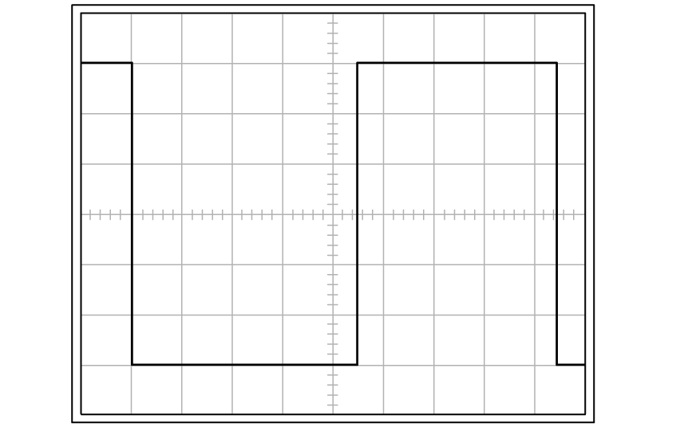
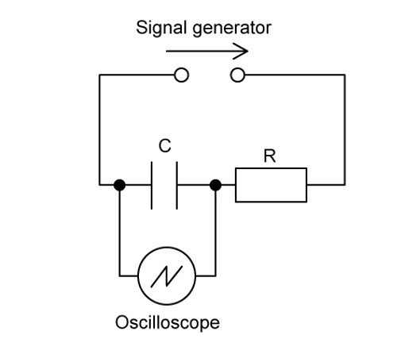
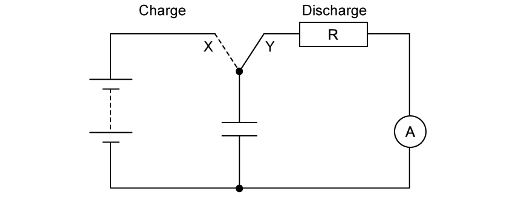
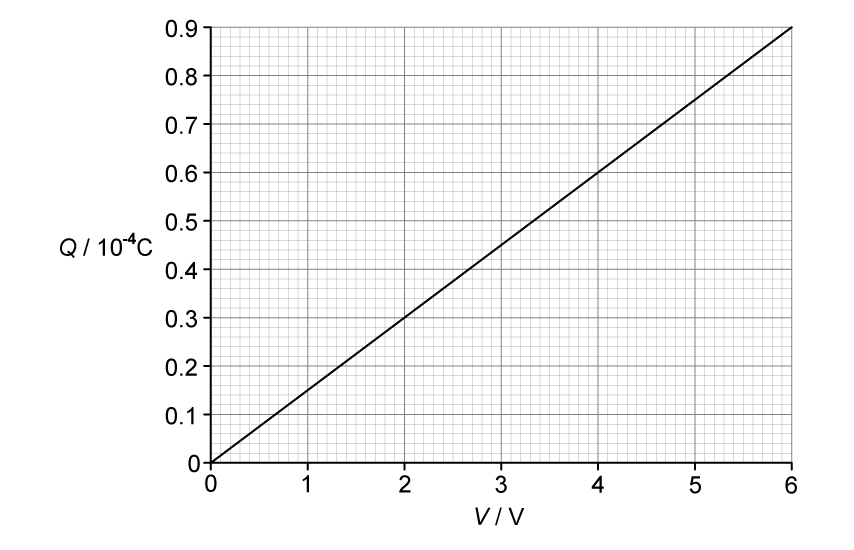
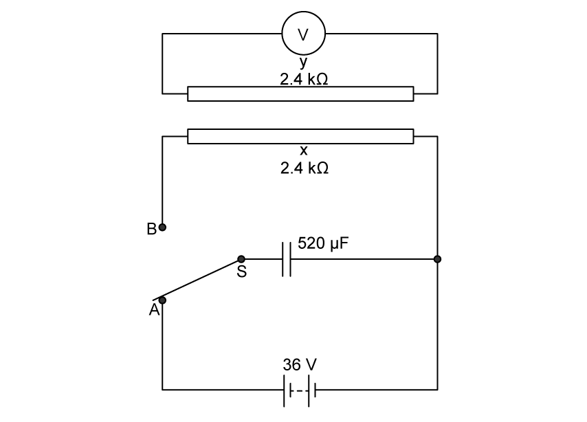
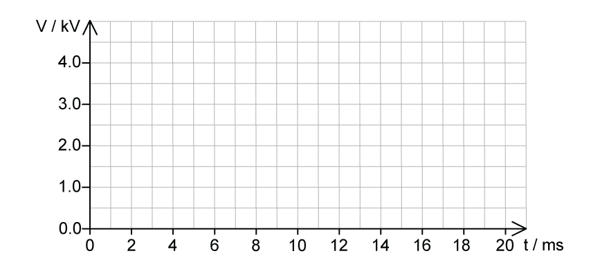
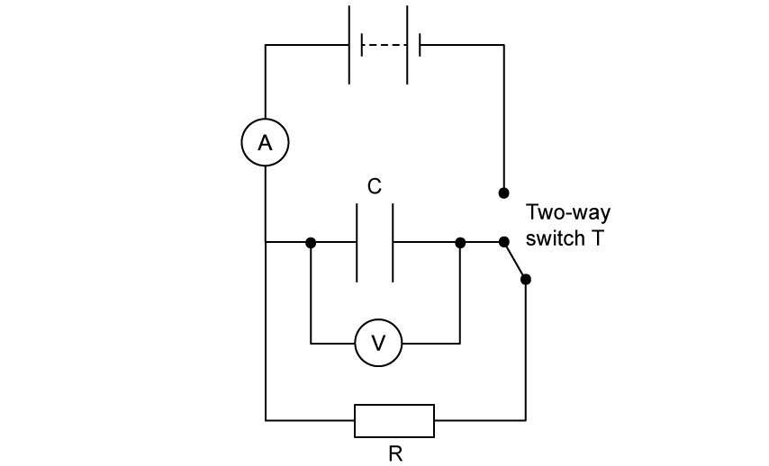

# Exam Questions — Discharging a Capacitor
**19. Capacitance** · Cambridge (CIE) A-LEVEL physics (9702)
> Source: [https://www.savemyexams.com/a-level/physics/cie/25/topic-questions/](https://www.savemyexams.com/a-level/physics/cie/25/topic-questions/) · 7 questions across 1 sets

## Structured Questions (7 questions)

### Q1 — hard — 15 marks

**Q1** [4 marks]

A signal generator is used to produce a square wave, which is an oscillating voltage between 0 V and some maximum. It is connected to an oscilloscope, and the waveform generated is shown in Fig. 1.1.

The Y-voltage gain is set to 2 V div–1 and the time-base is set to 0.5 ms.

**Fig. 1.1**

The signal generator and oscilloscope are then connected to a capacitor **C** and resistor **R**, which has a resistance of 2.2 kΩ, as shown in Fig. 1.1.

**Fig. 1.2**

Sketch the waveform shown by the oscilloscope over one complete period. You may assume the capacitor can fully charge or discharge over the course of half a period of the signal.

**Q1** [4 marks]

**Extract:**

A signal generator is used to produce a square wave, which is an oscillating voltage between 0 V and some maximum. It is connected to an oscilloscope, and the waveform generated is shown in Fig. 1.1. The Y-voltage gain is set to 2 V div^-1 and the time-base is set to 0.5 ms. The signal generator and oscilloscope are then connected to a capacitor C and resistor R, which has a resistance of 2.2 kΩ, as shown in Fig. 1.1.

Describe how the waveform displayed on the oscilloscope in Fig. 1.1 could be used to determine the capacitance of the capacitor C.

Where appropriate, include calculations in your response.

**Q1** [3 marks]

**Extract:**

A signal generator is used to produce a square wave, which is an oscillating voltage between 0 V and some maximum. It is connected to an oscilloscope, and the waveform generated is shown in Fig. 1.1. The Y-voltage gain is set to 2 V div^–1^ and the time-base is set to 0.5 ms. The signal generator and oscilloscope are then connected to a capacitor C and resistor R, which has a resistance of 2.2 kΩ.

Discuss how the settings on the oscilloscope could be adjusted to reduce the uncertainty in determining the time constant.

**Q1** [4 marks]

**Extract:**

A signal generator is used to produce a square wave, which is an oscillating voltage between 0 V and some maximum. It is connected to an oscilloscope, and the waveform generated is shown in Fig. 1.1. The signal generator and oscilloscope are then connected to a capacitor C and resistor R, which has a resistance of 2.2 kΩ, as shown in Fig. 1.2. Sketch the waveform shown by the oscilloscope over one complete period. You may assume the capacitor can fully charge or discharge over the course of half a period of the signal.

The circuit in Fig. 1.2 is now adjusted by placing an identical resistor in parallel with** **R. This changes the waveform displayed by the oscilloscope.

Discuss the effects on the circuit and on the shape of the waveform displayed on the capacitor following the adjustment made to the circuit. You may wish to include a sketch with your answer.

### Q2 — easy — 9 marks

**Q2** [1 mark]

A circuit containing a power supply *V*, a resistor *R *and a capacitor *C  *is constructed in a laboratory as shown in Fig. 1.1.

**Fig. 1.1**

Define the meaning of the time constant for a discharging capacitor.

**Q2** [3 marks]

The resistor, *R * in the experiment is fixed at a resistance of 100 Ω and the capacitor, *C  *has a capacitance of 25 μF and is discharging.

Calculate the time constant of the circuit.

**Q2** [2 marks]

**Extract:**

A circuit containing a power supply V, a resistor R and a capacitor C is constructed in a laboratory as shown in Fig. 1.1. Define the meaning of the time constant for a discharging capacitor. The time constant for a capacitor is: The time taken for the charge / current / voltage of a (discharging) capacitor to decrease to 37 % of its original value.

A different resistor and capacitor are now added to the circuit from Fig. 1.1 in part (a). The capacitor is discharging and the discharge graph is shown in Fig. 1.2.

**Fig. 1.2**

Use the graph to state the value of the time constant for this new circuit.

**Q2** [3 marks]

In a different circuit, a switch is used to charge and discharge the capacitor in the circuit shown in Fig. 1.3. The ammeter is ideal.

**Fig. 1.3**

The time constant of the capacitor is 0.24 ms and the capacitance is 78 × 10–9 F.

Show that the resistance of resistor *R  *is 3.1 kΩ

### Q3 — medium — 10 marks

**Q3** [2 marks]

The variation with potential difference *V *of the charge *Q *on one of the plates of a capacitor is shown in Fig. 1.1.

**Fig. 1.1**

The capacitor is connected to a 12.0 V power supply and two resistors P and Q are shown in Fig. 1.2.

**Fig. 1.2**

The resistance of P is 28 kΩ and the resistance of Q is 280 kΩ.

The switch can be in either position A or position B.

The switch is in position A so that the capacitor is fully charged.

Use Fig. 1.1 to estimate the energy $E$* *stored in the capacitor.

$E$* *= ........................................... J

**Q3** [2 marks]

**Extract:**

The variation with potential difference V of the charge Q on one of the plates of a capacitor is shown in Fig. 1.1. The capacitor is connected to a 12.0 V power supply and two resistors P and Q are shown in Fig. 1.2. The resistance of P is 28 kΩ and the resistance of Q is 280 kΩ. The switch can be in either position A or position B. From Fig 1.1, when p.d. V = 6 V, charge Q = 0.9 × 10^-4 C

The switch is now moved to position B.

Show that the time constant of the discharge circuit is 4.2 s.

**Q3** [4 marks]

**Extract:**

The capacitor is connected to a 12.0 V power supply and two resistors P and Q are shown in Fig. 1.2. The resistance of P is 28 kΩ and the resistance of Q is 280 kΩ. The switch can be in either position A or position B. The switch is in position A so that the capacitor is fully charged. Use Fig. 1.1 to estimate the energy E stored in the capacitor.
The switch is now moved to position B. Show that the time constant of the discharge circuit is 4.2 s.

The fully charged capacitor in **(a) **stores energy $E$.

Determine the time $t$* *taken for the stored energy to decrease from $E$* *to $\frac{E}{4}$.

$t$* *= ......................................... s

**Q3** [2 marks]

**Extract:**

The switch is now moved to position B. Show that the time constant of the discharge circuit is 4.2 s.
The capacitor discharges through resistor Q. τ = RC = (280 × 10^3) × (1.5 × 10^-5) = 4.2 s

A second identical capacitor is connected in series with the first capacitor.

State and explain the change, if any, to the time constant of the discharge circuit.

### Q4 — medium — 11 marks

**Q4** [3 marks]

A capacitor of capacitance 520 μF is connected to a battery of electromotive force (e.m.f.) 36 V in the circuit of Fig. 1.1.

**Fig. 1.1**

The two-way switch is initially at position A.

X and Y are identical long straight wires, each with a resistance of 2.4 kΩ. These wires are parallel to each other. Wire Y is connected to a voltmeter.

At time *t *= 0, switch S is moved to position B so the capacitor discharges through wire X.

(i) Calculate the charge *Q**0* on the capacitor at time *t *= 0.

*Q**0*  = ............................................... C [2]

(ii) Calculate the current *I**0* in wire X at time *t *= 0.

*I**0* = ............................................... A [1]

**Q4** [2 marks]

**Extract:**

A capacitor of capacitance 520 μF is connected to a battery of electromotive force (e.m.f.) 36 V in the circuit of Fig. 1.1. The two-way switch is initially at position A. X and Y are identical long straight wires, each with a resistance of 2.4 kΩ. These wires are parallel to each other. Wire Y is connected to a voltmeter. At time t = 0, switch S is moved to position B so the capacitor discharges through wire X.

Calculate the time constant $τ$ of the discharge circuit.

$τ$ = ......................................................... s

**Q4** [3 marks]

**Extract:**

A capacitor of capacitance 520 μF is connected to a battery of electromotive force (e.m.f.) 36 V in the circuit of Fig. 1.1. The two-way switch is initially at position A. X and Y are identical long straight wires, each with a resistance of 2.4 kΩ. These wires are parallel to each other. Wire Y is connected to a voltmeter. At time t = 0, switch S is moved to position B so the capacitor discharges through wire X. (ii) Calculate the current I0 in wire X at time t = 0.

(i) On Fig. 1.2, sketch a line to show the variation with $t$* *of the current $I$* *in wire X as the capacitor discharges.

**Fig. 1.2**

[2]

(ii) On Fig. 1.3, sketch a line to suggest the variation with $t$* *of the voltmeter reading $V$.

**Fig. 1.3**

[1]

**Q4** [3 marks]

**Extract:**

A capacitor of capacitance 520 μF is connected to a battery of electromotive force (e.m.f.) 36 V in the circuit of Fig. 1.1. The two-way switch is initially at position A. X and Y are identical long straight wires, each with a resistance of 2.4 kΩ. These wires are parallel to each other. Wire Y is connected to a voltmeter. At time t = 0, switch S is moved to position B so the capacitor discharges through wire X.

Explain why there is an induced e.m.f. across wire Y during the discharge of the capacitor.

### Q5 — medium — 8 marks

**Q5** [3 marks]

A 590 nF capacitor is charged fully from a 20 V battery. At time *t = *0 the capacitor begins to discharge through a resistor. When *t* = 15 s the energy remaining in the capacitor is one eighth of the energy it stored at 20 V.

Show that the potential difference across the capacitor when *t *= 15 s is around 7 V.

**Q5** [3 marks]

**Extract:**

A 590 nF capacitor is charged fully from a 20 V battery. At time t = 0 the capacitor begins to discharge through a resistor. When t = 15 s the energy remaining in the capacitor is one eighth of the energy it stored at 20 V. Show that the potential difference across the capacitor when t = 15 s is around 7 V.

V_2 = √(1/8) × 20 = 5√2 = 7.071 = 7.1 V (2 s.f.)

Calculate the time constant of this circuit.

**Q5** [2 marks]

**Extract:**

A 590 nF capacitor is charged fully from a 20 V battery. At time t = 0 the capacitor begins to discharge through a resistor.
Calculate the time constant of this circuit: τ = RC = 14.43 = 14 s (from part b)

Calculate the resistance of the fixed resistor in MΩ.

### Q6 — hard — 9 marks

**Q6** [3 marks]

Pacemakers are devices used to deliver short electrical pulses to a patient who is suffering from a cardiac arrest.

Fig. 1.1 shows a circuit that is used in such a pacemaker.

The capacitor has a capacitance of 20 μF and is connected to a resistor of 220 kΩ. This is connected to a power supply of emf 4.0 kV, but upon changing a two-way switch, it forms a circuit with heart tissue. This has a resistance of 400 Ω.

**Fig. 1.1**

The capacitor is fully charged initially. At $t=0$, the two-way switch connects the capacitor to the heart tissue.

**Fig. 1.2**

On Fig. 1.2, sketch the variation with $t$ of the potential difference (p.d.) $V$ across the capacitor for time $t=0$ to $t=10s$.

**Q6** [4 marks]

**Extract:**

Pacemakers are devices used to deliver short electrical pulses to a patient who is suffering from a cardiac arrest. Fig. 1.1 shows a circuit that is used in such a pacemaker. The capacitor has a capacitance of 20 μF and is connected to a resistor of 220 kΩ. This is connected to a power supply of emf 4.0 kV, but upon changing a two-way switch, it forms a circuit with heart tissue. This has a resistance of 400 Ω.

Show that, when charging from 0 C, the time taken for the charge stored in the capacitor to reach 5.0 mC is approximately 0.3 s.

The equation for the charging of a capacitor is:

$x = x_{0} ( 1 - e^{- \frac{t}{R C}} )$

where $x_{0}$ represents the maximum value of a given quantity.

**Q6** [2 marks]

Pacemaker manufacturers need efficient ways of measuring how quickly the charge and energy are released by capacitors.

One approach uses the ‘exponential factor’ *σ *, which is a ratio of the energy remaining in a capacitor to its initial energy stored.

Show that the exponential factor *σ* is given by:

$σ=e^{-\frac{2t}{RC}}$

### Q7 — easy — 10 marks

**Q7** [3 marks]

After becoming fully charged, a capacitor C is then discharged via a two-way switch, T, through a resistor R of resistance 5 kΩ. The capacitance of the capacitor when fully charged is 400 μF. This is shown in Fig. 1.1. ** **

**Fig. 1.1**

Calculate the time constant of the circuit shown in Fig. 1.1.

**Q7** [3 marks]

The capacitor discharge equation is given by:

$X = X_{0} e^{- ( \frac{t}{R C} )}$

State the name of each quantity given in the equation.

**Q7** [2 marks]

**Extract:**

After becoming fully charged, a capacitor C is then discharged via a two-way switch, T, through a resistor R of resistance 5 kΩ. The capacitance of the capacitor when fully charged is 400 μF. This is shown in Fig. 1.1. Calculate the time constant of the circuit shown in Fig. 1.1. [Answer: τ = RC = 5000 × (400 × 10^–6) = 2 s]
The capacitor discharge equation is given by: X = X_0 e^{-(t/RC)}

The initial current *I**0*  in the capacitor from Fig. 1.1 is 0.4 A.

Calculate the current present in the capacitor after it has been discharging for 3 s.

**Q7** [2 marks]

**Extract:**

After becoming fully charged, a capacitor C is then discharged via a two-way switch, T, through a resistor R of resistance 5 kΩ. The capacitance of the capacitor when fully charged is 400 μF. This is shown in Fig. 1.1. Fig. 1.1. Calculate the time constant of the circuit shown in Fig. 1.1.

The resistor in Fig. 1.1 is replaced with a different resistor with a resistance ten times greater.

All other components are kept the same.

State and explain the effect this has on the time constant of the circuit shown in Fig. 1.1**.**
