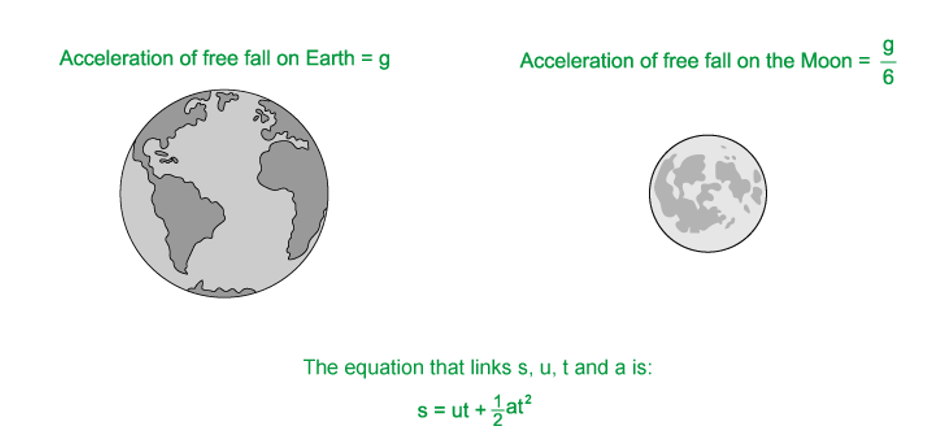
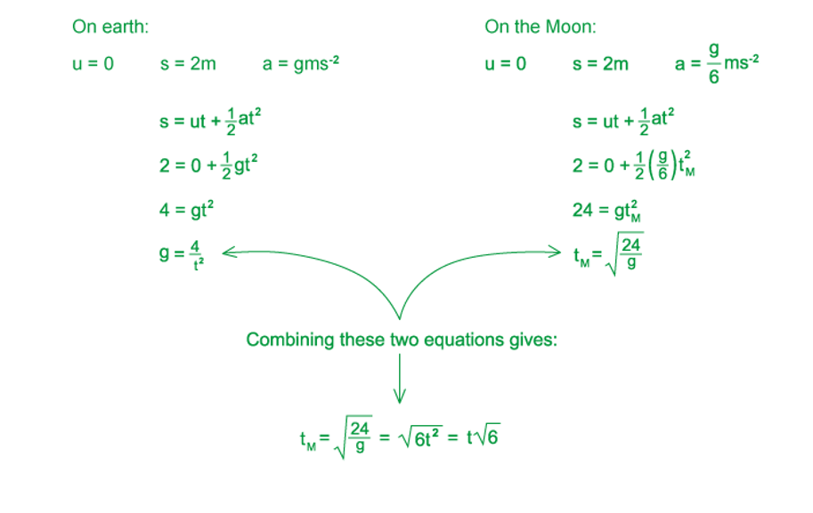
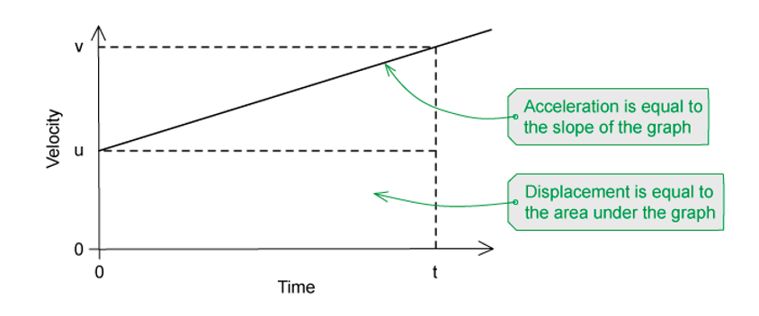
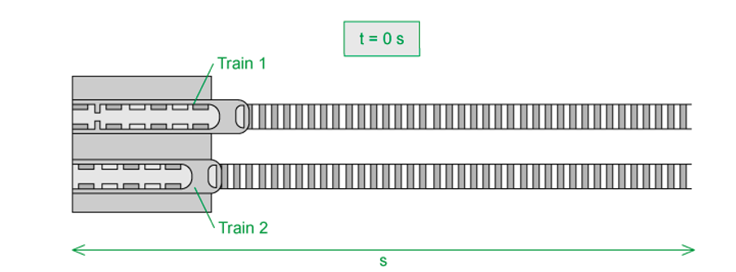
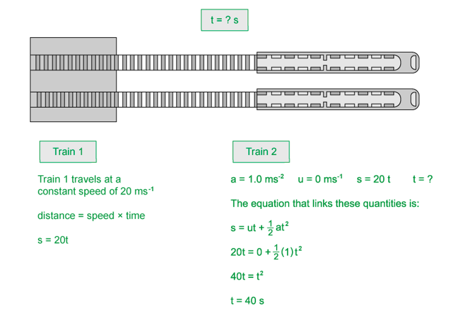
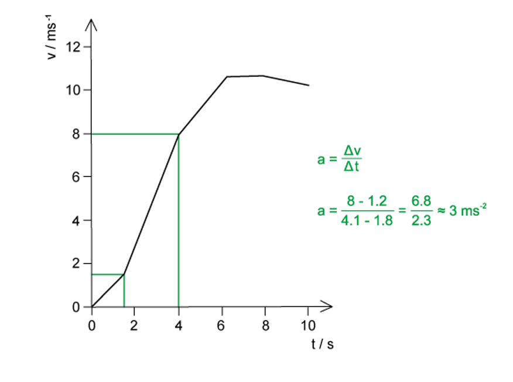
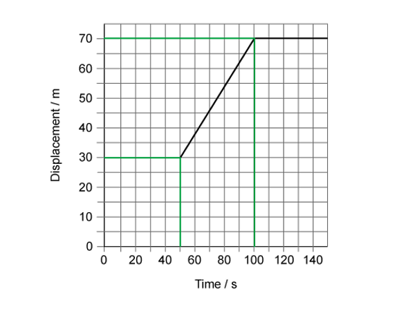
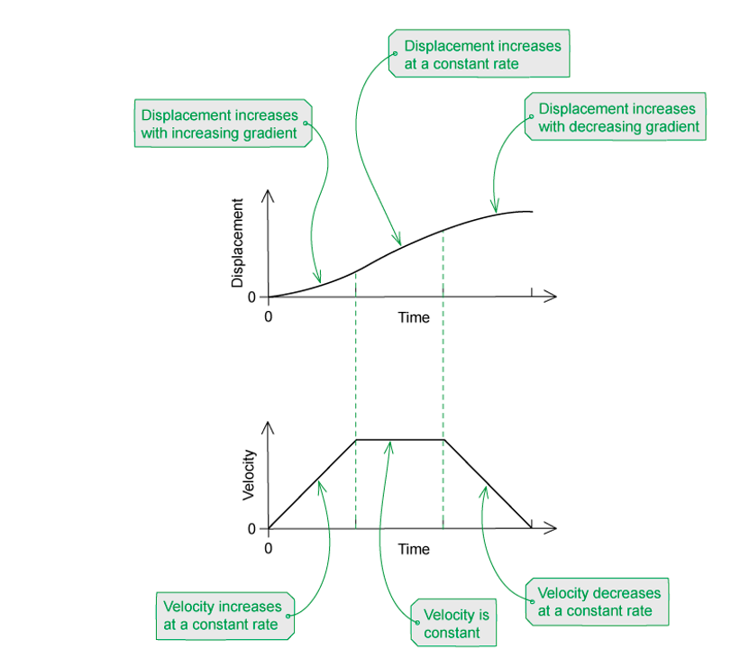
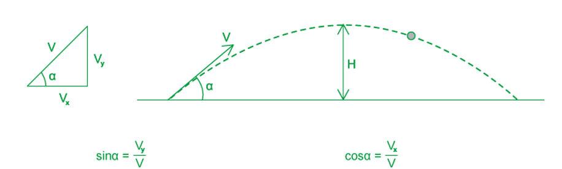
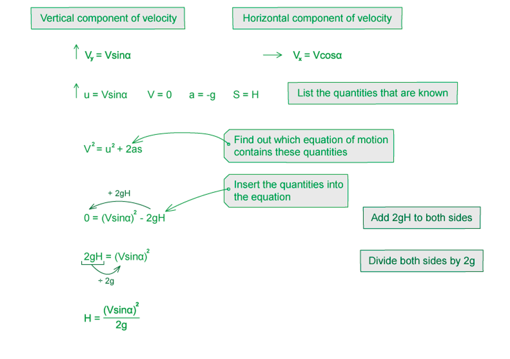

# Mark Schemes — Equations of Motion
**2. Kinematics** · Cambridge (CIE) A-LEVEL physics (9702)

## Multiple Choice Questions (32 questions)

### Q1
**Final answer:** **The correct answer is B**

- List the known quantities:

  - $u=2\times10^{3}\text{m s}^{-1}$
  - $s=400\mathrm{km}=400\times10^{3}\text{m}$
  - $v=6\times10^{3}\text{m s}^{-1}$
  - $a$ = ?
- The equation that links *u*, *v*, *s,* and *a* is

$v^{2}=u^{2}+2as$

- Rearrange to find *a*

$2as=v^{2}-u^{2}$

$a=\frac{v^{2}-u^{2}}{2s}$

- Substitute in known values to calculate *a*

`a space equals space fraction numerator open parentheses 6 cross times 10 cubed close parentheses squared space minus space open parentheses 2 cross times 10 cubed close parentheses squared over denominator 2 cross times open parentheses 400 cross times 10 cubed close parentheses end fraction`

$a=40\text{m s}^{-2}$

`a space equals space 4 cross times 10 to the power of 1 space straight m space straight s to the power of negative 2 end exponent space open parentheses 1 space straight s. straight f. close parentheses`

### Q2
**Final answer:** **The correct answer is C**

- Velocity is equal to change in displacement / time
- Looking at a displacement-time graph we can see

$\frac{Δy}{Δx}=\frac{\Deltas}{t}=\frac{\mathrm{change} \mathrm{in} \mathrm{displacement}}{\mathrm{time}}$

- Therefore, velocity is equal to the slope of the graph

**A** is incorrect because the area under a displacement-time graph is displacement × time which is not a physical quantity that has any use in physics

**B** is incorrect because the area under a velocity-time graph is equal to displacement since displacement = velocity × time

**D** is incorrect because the slope of a velocity-time graph is equal to acceleration since acceleration = change in velocity / time

### Q3
**Final answer:** **The correct answer is ****A**** because:**

- To determine the measurements needed to determine the acceleration of free fall, we will need to consider the equation

  - $s=ut+\frac{1}{2}at^{2}$
- We need to outline the quantities that we know

  - $s=h$ (height)
  - $a=g$ (acceleration of free fall)
  - *  *$t$* *(time)
- Since the falling body will initially be at rest, i.e. *u* = 0 we can simplify this to

  - $h=\frac{1}{2}gt^{2}$
- Rearranging the equation above we can see

  - $g=\frac{2h}{t^{2}}$
- So, the only measurements required are the height and time of the fall

### Q4
**Final answer:** **The correct answer is ****B**** because:**

- At the skier’s maximum height, the speed is at a minimum since gravitational potential is at a maximum and kinetic energy is at a minimum
- The speed does not reach zero since it still has horizontal velocity
- Just before landing, the speed is not zero. Since Y is higher than Z, the person has both potential energy and kinetic energy at Y
- Because of the conservation of energy, kinetic energy is higher at Z so the speed is higher here

**A **is incorrect because this graph shows the skier has maximum kinetic energy (highest *v*) and minimum gravitational energy at the top of the path, which is the opposite to what really happens

**C **is incorrect because the speed doesn’t reach zero as the skier still has horizontal velocity at the top of the path

**D **is incorrect because the change in *v* and *x* is not uniform due to the acceleration due to gravity

### Q5
**Final answer:** **The correct answer is ****D**** because:**

- The acceleration of freefall is downwards and has no effect on horizontal motion
- We can find the horizontal distance travelled using

  - distance = speed × time
  - $s_{H}=vt$ **(1)**
- Since the bullet is fired in a horizontal direction, the vertical component of the velocity is initially zero
- We can find the vertical distance using

  - $s=ut+\frac{1}{2}at^{2}$
- *u *= 0 and *a* = *g*, so

  - $s_{V}=\frac{1}{2}gt^{2}$* ***(2)**
- Combining equations **(1)** and **(2)** leads to

  - $\frac{\mathrm{horizontal} \mathrm{distance} \mathrm{travelled} \mathrm{in} \mathrm{time}t}{\mathrm{vertical} \mathrm{distance} \mathrm{travelled} \mathrm{in} \mathrm{time}t}=\frac{s_{H}}{s_{V}}$
  - $\frac{s_{H}}{s_{V}}=\frac{vt}{\frac{1}{2}gt^{2}}=\frac{2v}{gt}$

### Q6
**Final answer:** **The correct answer is ****B**** because:**

- $Averagespeed=\frac{totaldistance}{totaltime}$
- Let distance travelled for outward flight, which is equal to the distance travelled for inward flight = *d*
- So, the total distance travelled = 2*d*
- For each flight speed, the time will be different since the speed is different for the flights
- Let time for outward flight = $t_{out}=\frac{d}{700}$
- Let time for inward flight = $t_{in}=\frac{d}{300}$
- Total time, $t=t_{out}+t_{in}=\frac{d}{300}+\frac{d}{700}=\frac{d}{210}$
- $Averagespeed=\frac{totaldistance}{totaltime}$
- $Averagespeed=\frac{2d}{d/210}=420\mathrm{km}h^{-1}$

### Q7
**Final answer:** **The correct answer is ****C**** because:**

- Displacement is equal to velocity × time
- This can be found from the area under the velocity - time graph
- Area under the graph =  ½ × base × height = ½ × Δ *v* × Δ *t*
- Displacement =  ½ × 20 × 5 = 50 m

### Q8
**Final answer:** **The correct answer is ****D**** because:**

- There are two clear sections on this displacement-time graph
- At first the object moves with a constant velocity and at a later time it accelerates briefly until reaching a higher velocity, which it continues to travel at for the remainder of the distance

**A **is incorrect because if it was accelerating continuously, the line would curve upwards. Instead, it travels constantly at two different velocities

**B **is incorrect because it starts from a velocity which is equal to the gradient of the line, if it started from rest, the line would be horizontal and curve upwards to show an acceleration

**C **is incorrect because the displacement is proportional to time for the sections of the graph which are straight but it is not proportional the entire time

### Q9
**Final answer:** **The correct answer is ****A**** because:**

- The horizontal and vertical components of velocity and acceleration can be treated independently
- In the absence of air resistance, the horizontal component of velocity is constant while the vertical component of velocity downwards increases at a constant acceleration of 9.81 m s−2 (due to the force of gravity)

**B & D **are incorrect because once the stone has been thrown, it is no longer being acted on by the force that propelled it into the air so there is no horizontal acceleration. The force of gravity causes the stone to decelerate upwards and accelerate downwards at a constant rate meaning the vertical velocity is not constant

**C **is incorrect because the stone has a constant upward **deceleration** followed by a constant downward acceleration

### Q10
**Final answer:** **The correct answer is ****C**** because:**

### Q11
**Final answer:** **The correct answer is ****D**** because:**

- A friction-free horizontal air track means that no work needs to be done against friction, therefore, the kinetic energy does not decrease
- A perfectly elastic buffer means the collision of the glider is perfectly elastic, therefore, both momentum and energy are conserved
- This means the magnitude of the velocity should not decrease, so the height of the peaks on the graph should be the same
- Since the speed remains constant, the time between each collision should be the same, so the gaps between each peak should be the same

**A & B **are incorrect because these graphs show the magnitude of the velocity changes as the peaks are different sizes

**C **is incorrect because this graph shows the time between collisions varies as the gaps between some of the peaks are not the same

### Q12
**Final answer:** **The correct answer is ****A**** because:**

- From P to Q, the weight of the ball causes it to accelerate uniformly. Therefore, the increase in speed is uniform so the gradient is constant
- From Q to R, the motion of the ball is horizontal, so the acceleration of free fall does not affect its motion which is shown on the graph as a horizontal line
- After the collision with the wall, the kinetic energy decreases since the collision is inelastic, this results in a decrease in speed (KE =  ½  *mv**2*)
- Therefore, the ball will take longer to return to the slope, meaning the negative horizontal velocity should be longer

**B** is incorrect because the gradient of the graph in the final section is too steep. Since the gradient represents the acceleration due to gravity, it should be the same as the gradient in the first section.

**C & D **are incorrect because the negative horizontal velocities on these graphs are too short, and the value of the negative velocity in graph D has not decreased.

### Q13
**Final answer:** **The correct answer is ****C ****because:**

- We can use trigonometry to deduce

  - Horizontal (→) component = *u* cos *α*
  - Vertical (↑) component = *u* sin *α*
- Because of gravity, we have to consider the free fall of acceleration, which is equal to *g*
- This only affects the vertical component of velocity, and acts in the opposite direction to the motion
- So, at a time, t, the vertical component of velocity = *u* sin *α* – *gt*
- The horizontal component is not influenced by gravity so is equal to *u* cos *α*

### Q14
**Final answer:** **The correct answer is ****D**** because:**

- First it is a good idea to write down all the quantities that we know

  - Initial velocity, *u* = 7.1 m s–1
  - *a* = 1.62 m s–2
  - the final velocity, *v* = 0 m s–1 (at the maximum height)
  - *t = ?*
- The equation that relates *u, v, a* and *t* is

  - $v=u+at$
  - $v-u=at$
  - $t=\frac{v-u}{a}=\frac{7.1}{1.62}=4.4s$
- It takes 4.4 s for the object to reach its maximum height, and it will take the same time to reach the ground since the acceleration is the same, and the final velocity will be the same, so:

  - Total time = 4.4 × 2 = 8.8 s

### Q15
**Final answer:** **The correct answer is ****D**** because:**

- Acceleration is equal to change in velocity / time
- Looking at a velocity-time graph we can see $\frac{\Deltay}{\Deltax}$ is equal to  $\frac{v-u}{t}$ which is equivalent to $\frac{changeinvelocity}{time}$
- Therefore, acceleration is equal to the slope of the graph

**A **is incorrect because the area under a displacement-time graph is displacement × time which is not a physical quantity that has any use in physics

**B **is incorrect because the area under a velocity-time graph is equal to displacement since displacement = velocity × time

**C **is incorrect because the slope of a displacement-time graph is equal to velocity since velocity = displacement / time

### Q16
**Final answer:** **The correct answer is ****D**** because:**

- Train 2 leaves the station as train 1 passes, so the station can be taken as the origin for the time and distance
- For train 2 to overtake train 1, the distance, *s*, travelled by both trains must be equal and the time, *t*, is how long it takes for this to happen

### Q17
**Final answer:** **The correct answer is ****D ****because:**

- First let’s write out the quantities we have been given

  - *u* = 4 × 105 m s–1
  - *s* = 10 mm = 10 × 10-3 m
  - *v* = $3\times10^{8}\times\frac{1}{10}=3\times10^{7}ms^{-1}$
  - *a* = ?
- The equation that links *u, v, s* and *a* is

  - $v^{2}=u^{2}+2as$
- We need to rearrange this to find *a*

  - $2as=v^{2}-u^{2}$
  - $a=\frac{v^{2}-u^{2}}{2s}$
  - `a equals fraction numerator open parentheses 3 cross times 10 to the power of 7 close parentheses squared minus open parentheses 4 cross times 10 to the power of 5 close parentheses squared over denominator 2 cross times 10 cross times 10 to the power of negative 3 end exponent end fraction equals 4.5 cross times 10 to the power of 16 space straight m space straight s to the power of negative 2 end exponent`

### Q18
**Final answer:** **The correct answer is ****C**** because:**

- Displacement describes an objects change in position, measuring from its starting position to the final position
- The objects both finish at the same position so despite taking different routes, they have the same displacement

**A **is incorrect because the distance travelled by the second object is greater than the first one but it reaches Z in a shorter time, since average speed = total distance / total time its average speed should be greater

**B **is incorrect because the time taken for the second object to reach Z is less than the first and they both have the same displacement, since average velocity = displacement / time the second object has a greater velocity

**D **is incorrect because the first object travels directly from X to Z which is a shorter distance than X to Y to Z

### Q19
**Final answer:** **The correct answer is ****D**** because:**

- As the ball falls further from its starting position, the displacement increases meaning the gradient increases
- Terminal velocity is the maximum velocity reached by the falling sphere, meaning the first section of the graph should curve upwards to show the initial acceleration and the second section should be a straight line to show the constant velocity

**A & B **are incorrect because the gradients of these graphs are negative

**C **is incorrect because the horizontal straight line means the velocity is zero and the ball has stopped moving which is not the case

### Q20
**Final answer:** **The correct answer is ****C**** because:**

- There are two parts to this motion

  - Motion with constant acceleration of 2.5 m s–2
  - Motion with constant speed of 10 m s–1
- If the duration of the acceleration is *t**1* then we want to use an equation to find this, where; *t = t**1*, *a* = 2.5 m s–2, *u* = 0 m s–1, *v* = 10 m s–1

  - $v=u+at$
  - $v-u=at_{1}$
  - $t_{1}=\frac{v-u}{a}=\frac{10}{2.5}=4s$
- If the distance travelled during the acceleration is *s**1* then we want to use a different equation to find this

  - $v^{2}=u^{2}+2as$
  - $v^{2}-u^{2}=2as_{1}$
  - $s_{1}=\frac{v^{2}-u^{2}}{2a}=\frac{10^{2}}{2\times2.5}=20m$
- The remainder of the 200m race is run at a constant speed of 10 m s–1, so the remaining distance is equal to 200 – 20 = 180 m
- If the time taken to cover the remaining distance is *t**2*, then we can use

  - $speed=\frac{distance}{time}$
  - $t_{2}=\frac{180}{10}=18s$
- Total time = *t**1** + t**2* = 4 + 18 = 22 s

### Q21
**Final answer:** **The correct answer is ****C**** because:**

- First, we must write down the variables that we know:

  - *s* = 1000 m
  - *a* = –1.1 m s–2
  - *v* = 0
  - *u* = ?
- The equation that links* s, a, v *and* u *is: Rearrange for *u *and calculate:

  - $v^{2}=u^{2}+2as$

  - $u^{2}=v^{2}-2as$
  - `u squared space equals space 0 space minus space open parentheses 2 cross times negative 1.1 cross times 1000 close parentheses space equals space 2200`
  - $u=\sqrt{2200}=46.9=47ms^{-1}$ (2 s.f.)

### Q22
**Final answer:** **The correct answer is ****D**** because:**

- Let’s consider the quantities we have been given

  - The initial speed of the train is *u*
  - The distance between the red and yellow lights is *x*
  - Final speed of train = 0
- The equation that links *u, s, v* and *a* is

  - $v^{2}=u^{2}+2as$
  - $0=u^{2}+2ax$
  - $u^{2}αx$
- If the initial speed increases by 25 % : 100 % + 25 % = 125 %
- Therefore, new speed unew = 1.25*u*
- So, new distance  `x subscript n e w space end subscript alpha space u squared subscript n e w end subscript equals open parentheses 1.25 u close parentheses squared equals 1.56 u squared equals 1.56 x`** **

### Q23
**Final answer:** **The correct answer is ****A**** because:**

- Acceleration is represented by the gradient of the velocity-time graph
- The steeper the gradient the higher the acceleration, so to find the maximum acceleration we need to estimate the gradient of the steepest line

### Q24
**Final answer:** **The correct answer is ****B**** because:**

- Speed is equal to $\frac{displacement}{time}$  which is given by the gradient of the graph $\frac{\Deltay}{\Deltax}$
- Between 0 – 50 s and 100 – 140 s, when the lines are horizontal, the car is stationary
- Between 50 – 100 s the car is moving with constant speed and is displaced by 70 – 30 = 40 m
- The speed when the car is moving is equal to $\frac{40m}{50s}$ = 0.8 m s-1

### Q25
**Final answer:** **The correct answer is ****B**** because:**

- The gradient of the velocity-time graph gives the acceleration and the area under the graph gives the displacement
- The velocity is always positive, so the displacement is always positive
- The gradient of the displacement-time graph gives the velocity

### Q26
**Final answer:** **The correct answer is ****C**** because:**

- When the golf ball is struck upwards, the force of gravity will always bring it back to the surface
- The force of gravity is much higher on the Earth so the golf ball is pulled towards the surface faster which is why it has a much shorter range than the ball on the Moon
- The shape of the golf ball’s path depends on air resistance – on Earth, gravity pulls the ball down while air resistance opposes its motion leading to a path which is not symmetrical
- On the Moon, however, there is no atmosphere, so there is no air resistance acting on the ball. This means the path of the golf ball will be symmetrical, as shown in C

**A & B **are incorrect because these paths are asymmetrical which implies there is an opposing force acting on the ball, such as air resistance, but since there is no atmosphere on the Moon, this is not possible

**D **is incorrect because the gravity on the Moon is small but it is not zero, so the ball would return to the surface

### Q27
**Final answer:** **The correct answer is ****B ****because:**

- If we take the point when the ball is at rest as the origin and the horizontal surface as its maximum displacement
- The graph shows an increasing and decreasing gradient as the ball accelerates and decelerates with each bounce, which is indicative of a displacement-time graph
- Each time the ball strikes the surface, it loses some energy through sound and heat, which is why its displacement decreases each time but does not come to zero as it does not reach its original height

**A **is incorrect because the acceleration is constant, so the lines would be straight, not curved

**C & D **are incorrect because when the ball hits the surface, its velocity at that moment is zero. So, its kinetic energy at that moment would also be zero. The graph does not reduce to zero, so y cannot be kinetic energy or velocity

### Q28
**Final answer:** **The correct answer is ****D**** because:**

- $Averagespeed=\frac{v+u}{2}$
- `D i s t a n c e space equals space s p e e d space cross times space t i m e space equals space fraction numerator open parentheses v plus u close parentheses t over denominator 2 end fraction`
- D would be correct if it had a plus sign

| **A **is incorrect as | this equation is equal to displacement $s=ut+\frac{1}{2}at^{2}$ |
|---|---|
| **B **is incorrect as | if we combine the equations $s=ut+\frac{1}{2}at^{2}andv=u+at$  $u=v-at$  `s equals open parentheses v minus a t close parentheses t plus 1 half a t squared`  $s=vt-at^{2}+\frac{1}{2}at^{2}$  $s=vt-\frac{1}{2}at^{2}$ |
| **C **is incorrect as | if we take the equation $v^{2}=u^{2}+2as$  $2as=v^{2}-u^{2}$  $s=\frac{v^{2}-u^{2}}{2a}$  we can factorise `open parentheses v squared minus u squared close parentheses equals open parentheses v plus u close parentheses open parentheses v minus u close parentheses` so, `fraction numerator open parentheses v plus u close parentheses open parentheses v minus u close parentheses over denominator 2 a end fraction` |

### Q29
**Final answer:** **The correct answer is ****D**** because:**

- The gradient of a speed-time graph is acceleration
- Between points X and Z the gradient is decreasing so the acceleration is decreasing until the raindrop reaches a steady speed
- Force is directly proportional to acceleration
- The magnitude of the acceleration is lower at Y is less than at X, therefore, the magnitude of the resultant force is lower at Y too

**A **is incorrect because the magnitude of air resistance is beginning to increase around point X so the acceleration is less than 9.81 m s–2

**B **is incorrect because at point Z, it is correct that the force on the raindrop due to air resistance has reached its maximum value but this means the acceleration of the raindrop has reached its **minimum** value as the resultant force is at a minimum

**C **is incorrect because at point Z, it is correct that the force due to air resistance is equal and opposite to the weight of the raindrop but the speed of the raindrop is **not** zero, it has reached a steady speed and is no longer accelerating

### Q30
**Final answer:** **The correct answer is ****C**** because:**

- From the origin to marker M1:
- Initially the ball is at rest, so:

  - *u* = 0 m s-1
  - *t *= *t**1*
  - *s* = *x*
- The equation that links *s, u, t* and *a* is

  - $s=ut+\frac{1}{2}at^{2}$
  - $x=0+\frac{1}{2}at_{1}^{2}$
  - $x=\frac{1}{2}at_{1}^{2}$                   **(1)**
- From the origin to marker M2:

  - u = 0 m s-1
  - t = t2
  - s = x + h
- Using the same equation as before:

  - $s=ut+\frac{1}{2}at^{2}$
  - $x+h=0+\frac{1}{2}at_{2}^{2}$
  - $x+h=\frac{1}{2}at_{2}^{2}$               **(2)**
- If we take equation **(1)** from **(2)**:

  - $x+h-x=\frac{1}{2}at_{2}^{2}-\frac{1}{2}at_{1}^{2}$
  - `h equals 1 half a open parentheses t subscript 2 squared minus t subscript 1 squared close parentheses`
  - `a equals fraction numerator 2 h over denominator open parentheses t subscript 2 squared minus t subscript 1 squared close parentheses end fraction`

### Q31
**Final answer:** **The correct answer is ****C**** because:**

### Q32
**Final answer:** **The correct answer is ****B**** because:**

- Write down all the known information:

  - Initial velocity, *u* = 2.2 m s–1
  - At the maximum height, the final velocity is *v* = 0 m s–1
  - As the ball moves upwards, *a* = -*g* = -9.81 m s-2
  - Maximum height, s = ?
- The equation which relates *u, v, s* and *a* is

  - $v^{2}=u^{2}+2as$
- Rearranging for *s* gives:

  - $2as=v^{2}-u^{2}$
  - $s=\frac{v^{2}-u^{2}}{2a}$
  - $s=\frac{2.2^{2}-0}{2\times9.81}=0.25m$
- This is equivalent to 25 cm
