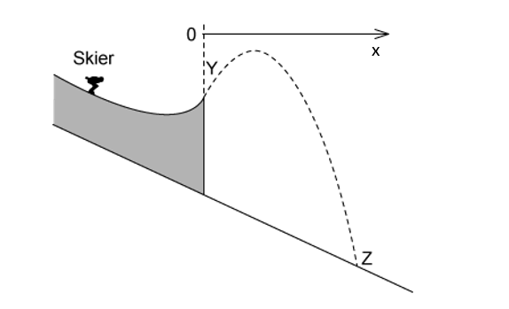
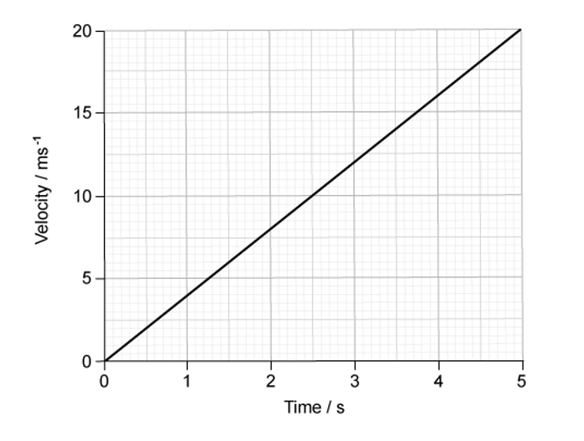
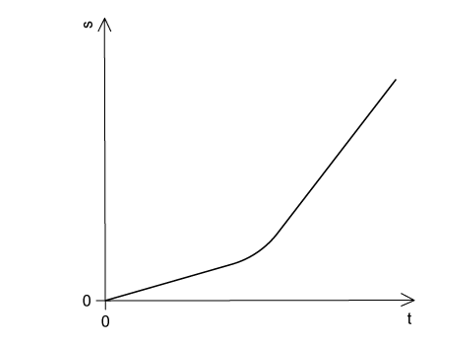
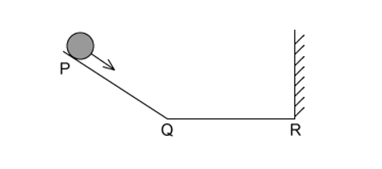
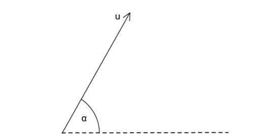
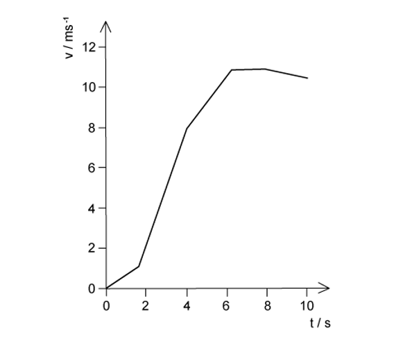
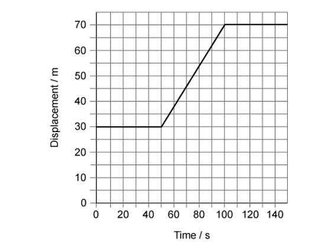
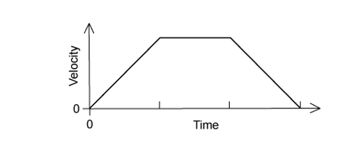
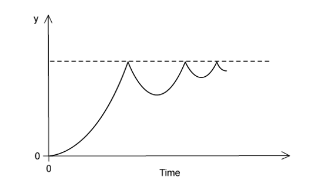
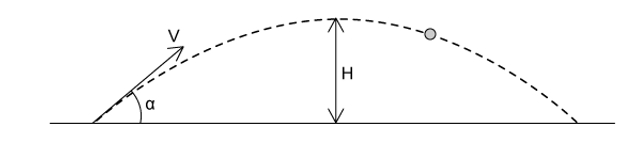

# Exam Questions — Equations of Motion
**2. Kinematics** · Cambridge (CIE) A-LEVEL physics (9702)
> Source: [https://www.savemyexams.com/a-level/physics/cie/25/topic-questions/](https://www.savemyexams.com/a-level/physics/cie/25/topic-questions/) · 32 questions across 1 sets

## Multiple Choice Questions (32 questions)

### Q1 — medium — 1 marks

**Q1** [1 mark]

A spacecraft is launched from Earth's surface and accelerates uniformly in a straight line from an initial speed of $2\times10^{3}\text{m s}^{-1}$ to a final speed of $6\times10^{3}\text{m s}^{-1}$ over a distance of 400 km.

What is the acceleration of the spacecraft?

### Q2 — easy — 1 marks

**Q2** [1 mark]

Which feature of a graph allows velocity to be determined?

### Q3 — easy — 1 marks

**Q3** [1 mark]

An experiment is done to measure the acceleration of free fall of a body from rest.

Which measurements are needed?

### Q4 — hard — 1 marks

**Q4** [1 mark]

The dotted line shows the path of a competitor in a ski-jumping competition.

Ignoring air resistance, which graph best represents the variation of his speed *v* with the horizontal distance *x* covered from the start of his jump at Y before landing at Z?

### Q5 — medium — 1 marks

**Q5** [1 mark]

A bullet is fired horizontally with speed *v* from a rifle. For a short time *t* after leaving the rifle, the only force affecting its motion is gravity. The acceleration of free fall is *g*.

Which expression gives the value of  $\frac{\mathrm{horizontal} \mathrm{distance} \mathrm{travelled} \mathrm{in} \mathrm{time}t}{\mathrm{vertical} \mathrm{distance} \mathrm{travelled} \mathrm{in} \mathrm{time}t}$ ?

### Q6 — hard — 1 marks

**Q6** [1 mark]

An aeroplane travels at an average speed of 700 km h–1 on an outward flight and at 300 km h–1 on the return flight over the same distance.

What is the average speed of the whole flight?

### Q7 — easy — 1 marks

**Q7** [1 mark]

The velocity of an object during the first five seconds of its motion is shown on the graph

What is the displacement of the object in this time?

### Q8 — easy — 1 marks

**Q8** [1 mark]

The variation with time *t* of the displacement *s* moved by a body is shown below.

What can be deduced from the graph about the motion of the body?

### Q9 — medium — 1 marks

**Q9** [1 mark]

A stone is thrown upwards and follows a curved path.

Air resistance is negligible.

Why does the path have this shape?

### Q10 — medium — 1 marks

**Q10** [1 mark]

The acceleration of free fall on the Moon is one-sixth of that on Earth. On Earth it takes time *t* for a stone to fall from rest a distance of 2 m.

What is the time taken for a stone to fall from rest a distance of 2 m on the Moon?

### Q11 — hard — 1 marks

**Q11** [1 mark]

A small glider moves along a friction-free horizontal air track as shown below.

At each end of the air track there is a perfectly elastic buffer.

Which graph represents the variation with time *t* of the velocity *v* of the glider as it moves between the two buffers?

### Q12 — hard — 1 marks

**Q12** [1 mark]

A ball is released from rest on a smooth slope PQR.

It moves down the slope, along a smooth horizontal surface QR and rebounds inelastically at R.

Then it moves back to Q and comes to rest momentarily somewhere on PQ.

Which velocity-time graph represents the motion of the ball?

### Q13 — medium — 1 marks

**Q13** [1 mark]

A projectile is fired at an angle *α* to the horizontal at a speed *u*, as shown.

What are the vertical and horizontal components of its velocity after a time *t*?

Assume that air resistance is negligible. The acceleration of free fall is *g*.

|   | **Vertical component** | **Horizontal component** |
|---|---|---|
| **A**  **B**  **C**  **D** | *u* sin *α*  *u* sin *α* – *gt*  *u* sin *α* – *gt*  *u* cos *α* | *u* cos *α*  *u* cos *α* – *gt*  *u* cos *α*  *u* sin *α* – *gt* |

### Q14 — easy — 1 marks

**Q14** [1 mark]

An object is thrown with velocity 7.1 m s–1 vertically upwards on the Moon. The acceleration due to gravity on the Moon is 1.62 m s–2

What is the time taken for the object to return to its starting point?

### Q15 — easy — 1 marks

**Q15** [1 mark]

Which feature of a graph allows acceleration to be determined?

### Q16 — medium — 1 marks

**Q16** [1 mark]

A train passes through a station at a constant speed of 20 m s–1

A second train is at rest at the station. It begins to leave the station with a uniform acceleration of 1.0 m s–2  just as the first train goes past.

How much time passes before the second train overtakes the first train?

### Q17 — medium — 1 marks

**Q17** [1 mark]

In a cathode-ray tube, an electron is accelerated uniformly in a straight line from a speed of 4 × 105 m s–1 to one tenth of the speed of light over a distance of 10 mm

What is the acceleration of the electron?

### Q18 — easy — 1 marks

**Q18** [1 mark]

An object moves directly from X to Z

In a shorter time, a second object moves from X to Y to Z.

Which statement about the two objects is correct for the journey from X to Z?

### Q19 — medium — 1 marks

**Q19** [1 mark]

A sphere is released and falls. Its initial acceleration reduces until it eventually begins to travel at constant terminal velocity.

Which displacement-time graph best represents the motion of the sphere?

### Q20 — hard — 1 marks

**Q20** [1 mark]

A sprinter runs a 200m race in a straight line. He accelerates from the starting block at a constant acceleration of 2.5 m s–2 to reach his maximum speed of 10 m s–1. He maintains this speed until he crosses the finish line.

Which time does it take the sprinter to run the race?

### Q21 — easy — 1 marks

**Q21** [1 mark]

On a particular railway, a train driver applies the brake of the train at a yellow signal, a distance of 1.0 km from a red signal, where the train stops.

The maximum deceleration of the train is 1.1 m s–2

Assuming uniform deceleration, what is the maximum safe speed of the train at the yellow signal?

### Q22 — hard — 1 marks

**Q22** [1 mark]

In order that a train can stop safely, it will always pass a signal showing a yellow light before it reaches a signal showing a red light.

Drivers apply the brake at the yellow light and this results in a uniform deceleration to stop exactly at the red light. The distance between the red and yellow lights is *x*.

What must be the minimum distance between the lights if the train speed is increased by 25 %, without changing the deceleration of the trains?

### Q23 — medium — 1 marks

**Q23** [1 mark]

The graph shows how the speed *v* of a sprinter changes with time *t* during a 100 m race.

What is the best estimate of the maximum acceleration of the sprinter?

### Q24 — easy — 1 marks

**Q24** [1 mark]

A car at rest in a traffic queue moves forward in a straight line and then comes to rest again. The graph shows how the car’s displacement varies with time

What is the speed of the car while it is moving?

### Q25 — medium — 1 marks

**Q25** [1 mark]

The graph of velocity against time for an object moving in a straight line is shown

What is the corresponding graph of displacement against time?

### Q26 — easy — 1 marks

**Q26** [1 mark]

A golf ball is hit with the same force and direction on the Earth and on the Moon.

Which diagram best represents the shapes of the paths taken by the golf ball?

### Q27 — medium — 1 marks

**Q27** [1 mark]

A ball is released from rest above a horizontal surface and bounces several times.

The graph shows how, for this ball, a quantity *y* varies with time.

What is the quantity *y*?

### Q28 — hard — 1 marks

**Q28** [1 mark]

A body having uniform acceleration *a* increases its velocity from *u* to *v* in time *t*.

Which expression would **not** give a correct value for the body’s displacement during time *t *?

### Q29 — hard — 1 marks

**Q29** [1 mark]

A raindrop falls vertically from rest in air. The variation with time of the speed of the raindrop is shown in the graph.

Which statement about the raindrop is correct?

### Q30 — hard — 1 marks

**Q30** [1 mark]

Two markers *M**1* and *M**2* are set up a vertical distance *h* apart.

A steel ball is released at time zero from a point a distance *x* above *M**1*. The ball reaches *M**1* at time *t**1* and reaches *M**2* at time *t**2*. The acceleration of the ball is constant.

Which expression gives the acceleration of the ball?

### Q31 — hard — 1 marks

**Q31** [1 mark]

A cannon fires a cannonball with an initial speed *v* at an angle α to the horizontal.

Which equation is correct for the maximum height H reached?

### Q32 — easy — 1 marks

**Q32** [1 mark]

A ball is thrown upwards with an initial vertical velocity of 2.2 m s–1.

What is the maximum height reached by the ball?
