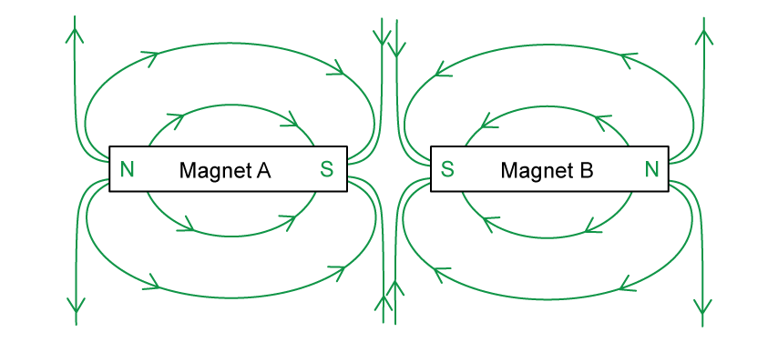
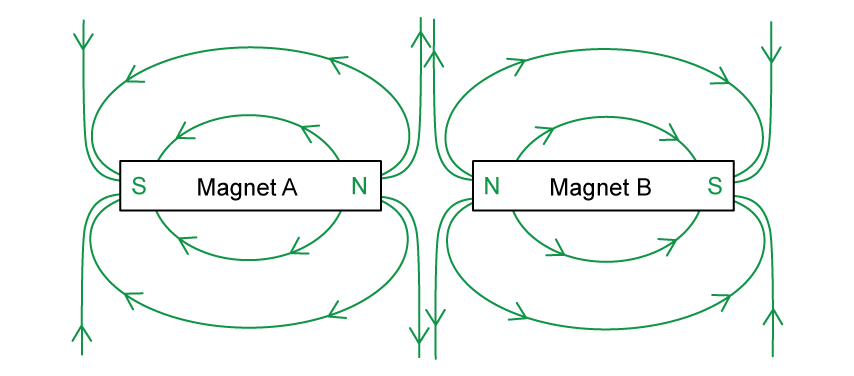
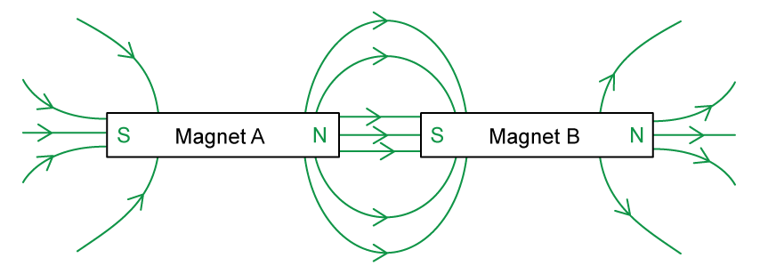
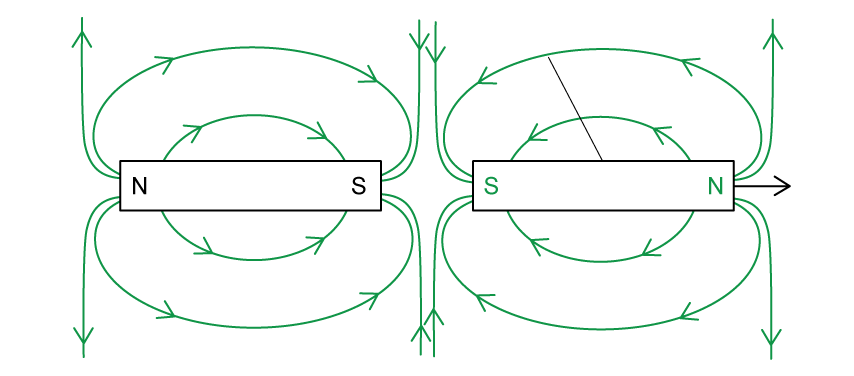
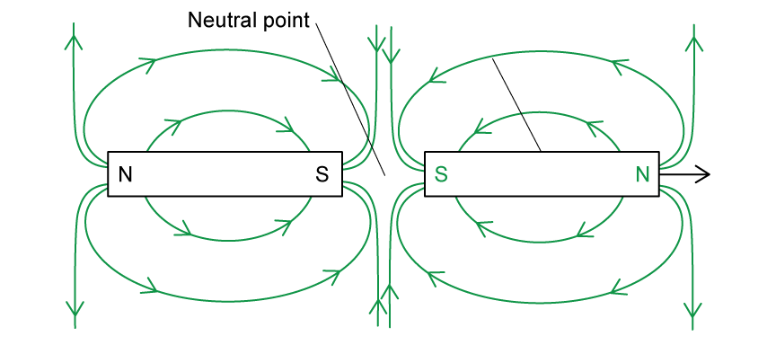
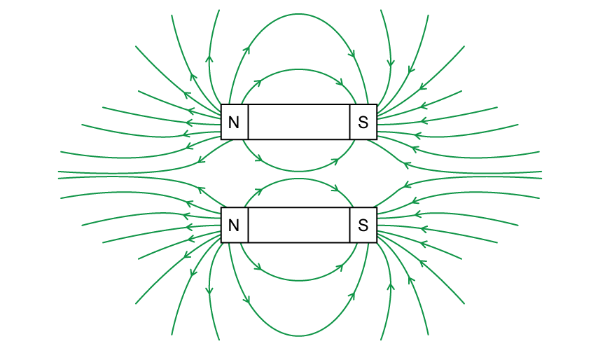
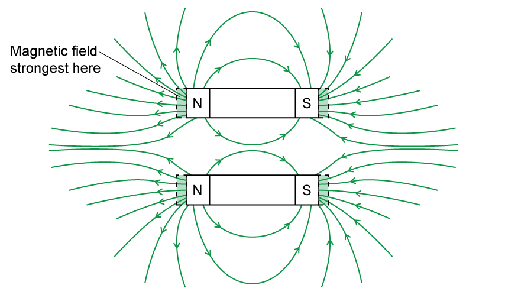
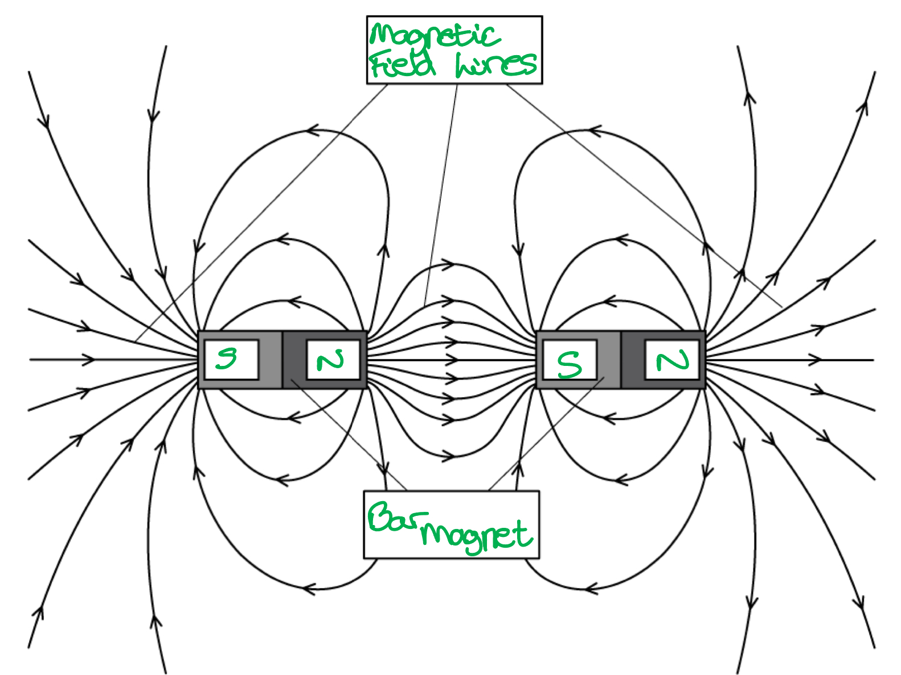
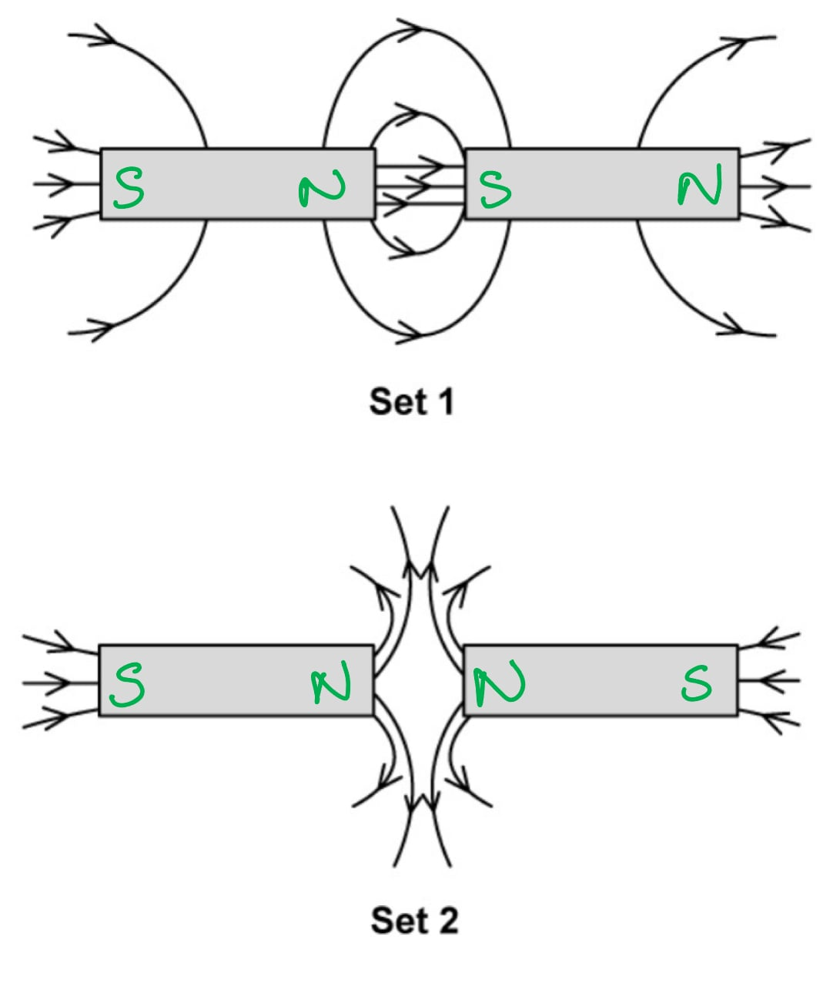

# Mark Schemes — Concept of a Magnetic Field
**20. Magnetic Fields** · Cambridge (CIE) A-LEVEL physics (9702)

## Structured Questions (5 questions)

### Q1
The magnetic field lines are drawn as follows:

Between two S poles:

Between two N poles:

- Magnetic field lines between two like poles (both S poles **OR** both N poles) showing repulsion; **[1 mark]**
- Magnetic field lines are drawn towards S poles and away from N poles; **[1 mark]**

**[Total: 2 marks]**
The magnetic field lines are as follows:

- Magnetic field lines between two opposite poles showing attraction; **[1 mark]**
- Magnetic field lines are drawn towards S poles and away from N poles; **[1 mark]**

**[Total: 2 marks]**
If the strength of magnet A was doubled:

- There would be twice as many field lines; **[1 mark]**
- The field lines would be closer together at the poles; **[1 mark]**

**[Total: 2 marks]**

### Q2
A magnetic field is produced around a bar magnet by:

- The movement of electrons within the atoms of the magnet; **[1 mark]**
- Electrons circulate around atoms, acting like a small current, and set up a magnetic field; **[1 mark]**

**[Total: 2 marks]**
A diagram that would score 3 marks should look like this:

- Magnetic field lines between the two S poles showing repulsion / not connecting; **[1 mark]**
- Magnetic field lines drawn into both S poles and out of both N poles; **[1 mark]**
- Field lines are closer together closer to the magnets;** [1 mark]**

**[Total: 3 marks]**
(i) A neutral point is:

- Where the net magnetic field is zero; **[1 mark]**

(ii) The neutral point is located:

- Between the two south poles of the magnets (in the region where there are no field lines); **[1 mark]**

**[Total: 2 marks]**
A diagram that would score 2 marks should look like this:

- The magnetic field is drawn into the page; **[1 mark]**
- This is represented by a grid of crosses 'X'; **[1 mark]**

**[Total: 2 marks]**

### Q3
A magnetic field is

- The region (of space) where there is a force;** ****[1 mark] **
- On / produced by a magnetic material / magnetic pole; **[1 mark] **

**[Total: 2 marks]**
(i) A stationary charge:

- Will <u>not</u> produce a magnetic field; **[1 mark]**
- Because the charge must be moving (to produce a magnetic field); **[1 mark]**

(ii) A current-carrying wire:

- Will produce a magnetic field; **[1 mark]**
- Because current is the movement of charge / electrons; **[1 mark]**

**[Total: 4 marks]**
A diagram that should score 3 marks would look like this:

- Arrows pointing away from North poles and towards South poles; **[1 mark]**
- Repulsion illustrated by at least one neutral point / space; **[1 mark]**
- Field lines drawn closer together nearer to each magnet; **[1 mark]**

**[Total: 3 marks]**
The strongest region of the magnetic field is:

- At the <u>poles</u> of a magnet<u>;</u>** [1 mark]**
- This is where the field lines are closest together;** [1 mark]**

**[Total: 2 marks]**

### Q4
A correctly labelled diagram that would score 3 marks should look like this:

- Magnetic field lines are correctly labelled; **[1 mark]**
- Bar magnet is correctly labelled; **[1 mark]**
- North and south poles are correctly labelled; **[1 mark]**

**[Total: 3 marks]**
The errors in Fig. 1.2 are as follows:

- The field lines between the south and north poles of the two magnets are not parallel; **[1 mark]**
- The field lines are closer together further away from the magnets; **[1 mark]**
- The field lines go from the north pole of one magnet directly to the south pole of the other without other field lines in between; **[1 mark]**

**[Total: 3 marks]**
The errors in Fig.1.3 are as follows:

- The field lines in the diagram cross; **[1 mark]**
- There are no arrows on the field lines; **[1 mark]**
- Some of the field lines are not continuous / they have a gap in them;** [1 mark]**

**[Total: 3 marks]**
Diagram 1 is:

- A magnetic field going <u>out of</u> the page; **[1 mark]**

Diagram 2 is:

- A magnetic field going <u>into</u> the page; **[1 mark]**

**[Total: 2 marks]**

### Q5
A magnetic field is:

- A field of force; **[1 mark]**
- Created by a moving electric charge; **[1 mark]**
- or permanent magnets; **[1 mark]**

**[Total: 3 marks]**
The correct answer is:

- D; **[1 mark]**

This is because:

**Final answer:** **Any ****two ****from:**

- The magnets are placed north pole to south pole; **[1 mark]**
- The arrows and the field lines go from the north pole to the south pole on the same magnet; **[1 mark]**
- The arrows and the field lines go from the north pole to the south pole between the magnets; **[1 mark]**

**[Total: 3 marks]**
The correct answer is:

- A; **[1 mark]**

This is because:

**Final answer:** **Any ****two ****from:**

- The magnets are placed south pole to south pole; **[1 mark]**
- The arrows and the field lines go from the north pole to the south pole on the same magnet; **[1 mark]**
- The arrows and the field lines go from the north pole to the south pole between the magnets; **[1 mark]**
- There is a neutral point in between the two south poles; **[1 mark]**
- The field lines show repulsion between the two south poles; **[1 mark]**

**[Total: 3 marks]**
A correctly labelled diagram for Set 1 and 2 that would score 2 marks is:

Poles from left to right are labelled:

Set 1

- S - N - S - N; **[1 mark]**

Set 2

- S - N - N - S; **[1 mark]**

**[Total: 2 marks]**
