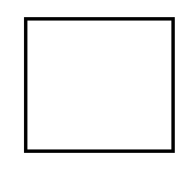
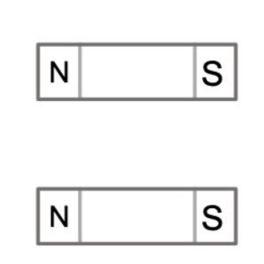
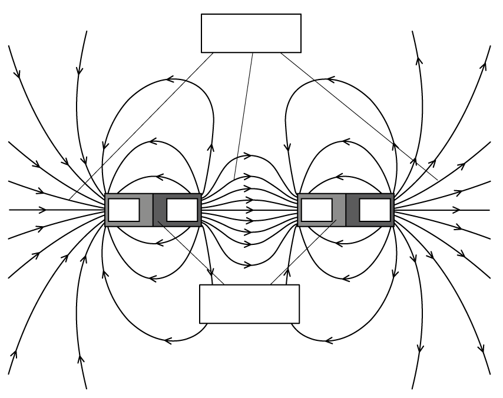
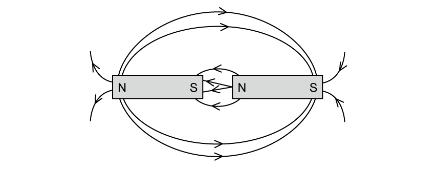
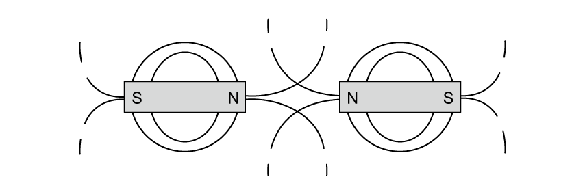
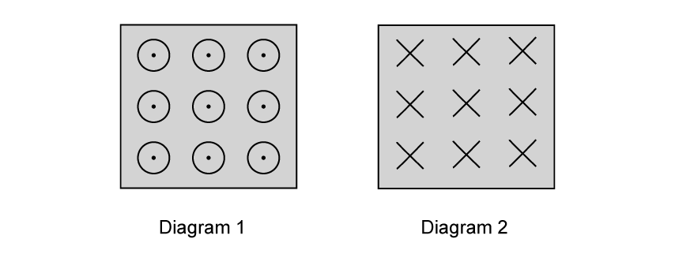
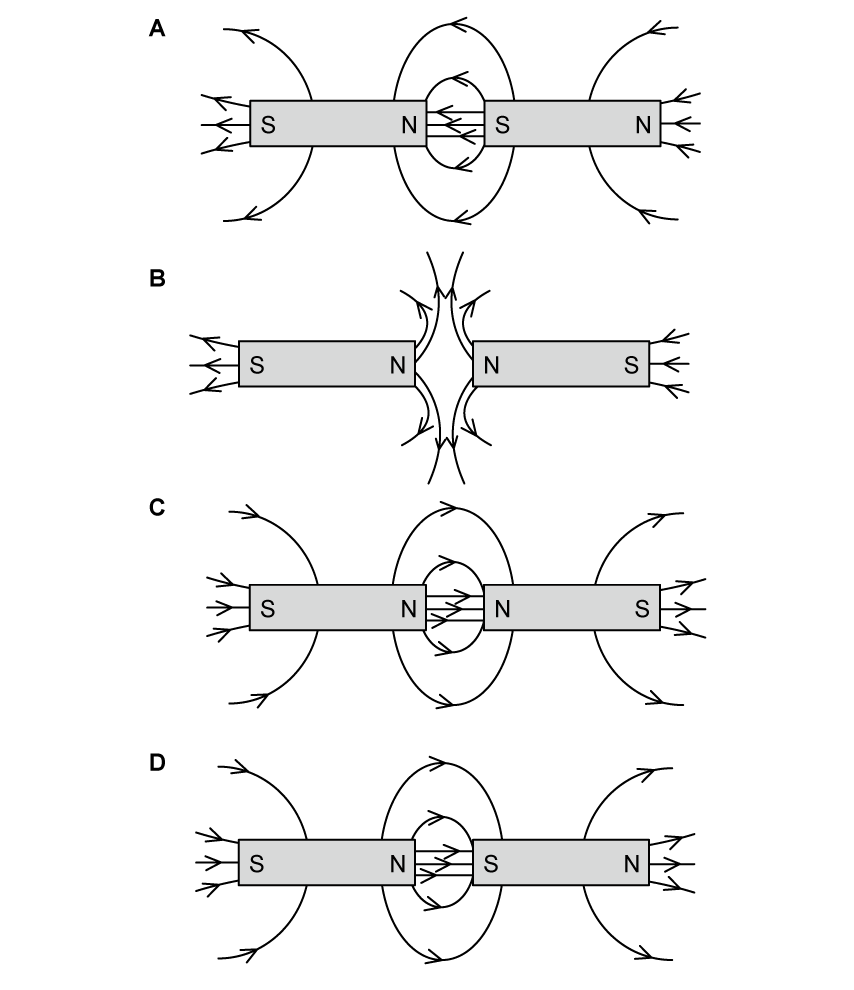
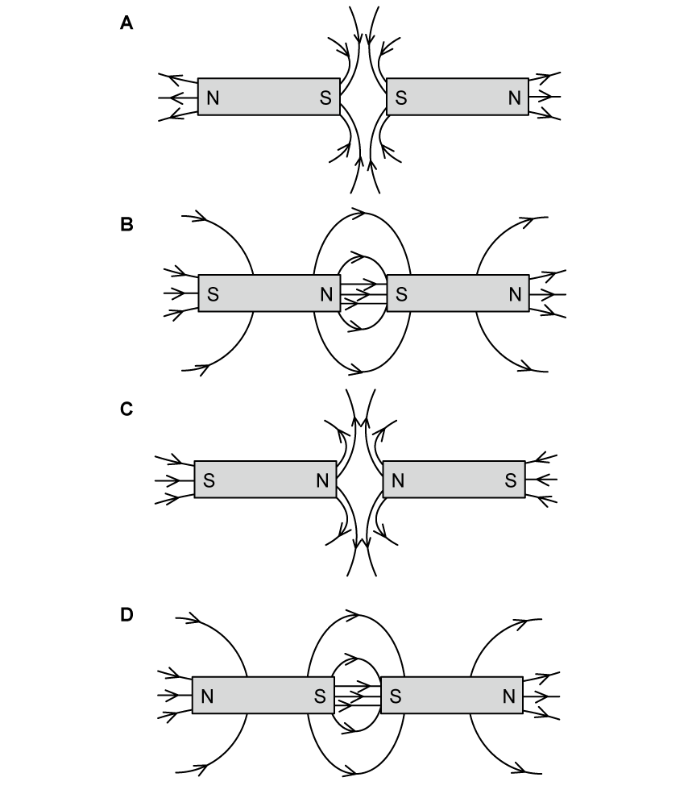

# Exam Questions — Concept of a Magnetic Field
**20. Magnetic Fields** · Cambridge (CIE) A-LEVEL physics (9702)
> Source: [https://www.savemyexams.com/a-level/physics/cie/25/topic-questions/](https://www.savemyexams.com/a-level/physics/cie/25/topic-questions/) · 5 questions across 1 sets

## Structured Questions (5 questions)

### Q1 — medium — 6 marks

**Q1** [2 marks]

Two bar magnets, A and B, are placed next to each other as shown in Fig. 1.1.

**Fig. 1.1**

Magnet A is slowly moved towards magnet B. This causes magnet B to move away from magnet A.

On Fig. 1.1, label the magnetic poles and sketch the magnetic field around the two magnets.

**Q1** [2 marks]

**Extract:**

Two bar magnets, A and B, are placed next to each other as shown in Fig. 1.1.

Magnet A and magnet B are now reorientated and when brought close together come together easily.

On Fig. 1.2, label the magnetic poles and sketch the magnetic field around the two magnets.

**Fig. 1.2**

**Q1** [2 marks]

**Extract:**

Two bar magnets, A and B, are placed next to each other as shown in Fig. 1.1. Magnet A is slowly moved towards magnet B. This causes magnet B to move away from magnet A.

Magnet A is swapped for a magnet which is twice as strong but keeps the same orientation.

Describe how the magnetic field around magnet B would change.

### Q2 — medium — 9 marks

**Q2** [2 marks]

Fig. 1.1 shows a magnet held close to a second magnet which is suspended by a light cotton thread.

**Fig. 1.1**

Describe how a magnetic field is produced around a bar magnet.

**Q2** [3 marks]

**Extract:**

Fig. 1.1 shows a magnet held close to a second magnet which is suspended by a light cotton thread.

Fig. 1.1

Sketch the magnetic field lines around the magnets on Fig. 1.1.

**Q2** [2 marks]

**Extract:**

Fig. 1.1 shows a magnet held close to a second magnet which is suspended by a light cotton thread. Fig. 1.1

(i) Explain the meaning of a neutral point in a magnetic field

[1]

(ii) On Fig. 1.1., identify the location of the neutral point.

[1]

**Q2** [2 marks]

**Extract:**

Fig. 1.1 shows a magnet held close to a second magnet which is suspended by a light cotton thread.

The first magnet is removed leaving only the magnet suspended from the string. As a result, the magnet rotates, so that the north pole faces into the page.

**Fig. 1.2**

On Fig. 1.2, indicate whether the magnetic field is directed into or out of the page using the correct symbol.

### Q3 — medium — 11 marks

**Q3** [2 marks]

Describe what is meant by a magnetic field.

**Q3** [4 marks]

State and explain whether

(i) a stationary charge will produce a magnetic field

[2]

(ii) a current-carrying wire will produce a magnetic field.

[2]

**Q3** [3 marks]

Two magnets are placed on top of each other as shown in Fig 1.1

**Fig. 1.1**

On Fig. 1.1, sketch the magnetic field lines between the two magnets

**Q3** [2 marks]

**Extract:**

Two magnets are placed on top of each other as shown in Fig 1.1

Fig. 1.1

On Fig. 1.1, sketch the magnetic field lines between the two magnets

On Fig. 1.1, indicate a point in the strongest region of the magnetic field. Explain your answer.

### Q4 — easy — 11 marks

**Q4** [3 marks]

The diagram in Fig. 1.1 shows the field lines between two bar magnets.

**Fig. 1.1**

Identify, by labelling the diagram, the following features:

- Magnetic field lines
- Bar magnet
- North Pole
- South Pole

**Q4** [3 marks]

A student has drawn the diagram in Fig 1.2 to show the magnetic field between two attracting bar magnets.

**Fig. 1.2**

Identify the errors in the diagram in Fig. 1.2.

**Q4** [3 marks]

A different student has drawn the diagram in Fig 1.3 to show the magnetic field between two repulsing bar magnets.

**Fig. 1.3**

Identify the errors in the diagram in Fig. 1.3.

**Q4** [2 marks]

Another student has two diagrams in his notes as shown in Fig. 1.4.

**Fig 1.4**

Describe what is shown by diagrams 1 and 2 from Fig. 1.4.

### Q5 — easy — 11 marks

**Q5** [3 marks]

Define a magnetic field.

**Q5** [3 marks]

Several diagrams showing the magnetic field of two magnets placed north pole to south pole are drawn in Fig. 1.1.

**Fig. 1.1**

Identify which diagram correctly shows field lines between two magnets placed north to south.

**Q5** [3 marks]

Several more diagrams showing the magnetic field of two magnets placed south pole to south pole are drawn in Fig. 1.2.

**Fig. 1.2**

Identify which diagram correctly shows field lines between two magnets placed south to south.

**Q5** [2 marks]

In two different sets of magnets both magnets are brought towards each other as shown in Fig. 1.3.

**Fig. 1.3**

Identify, by labelling the diagram correctly, the north and south poles in set 1 and set 2 in Fig. 1.3.
