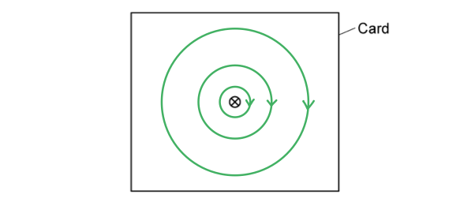
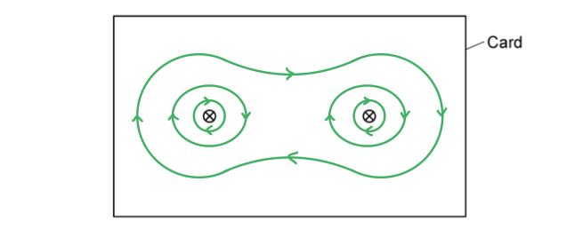
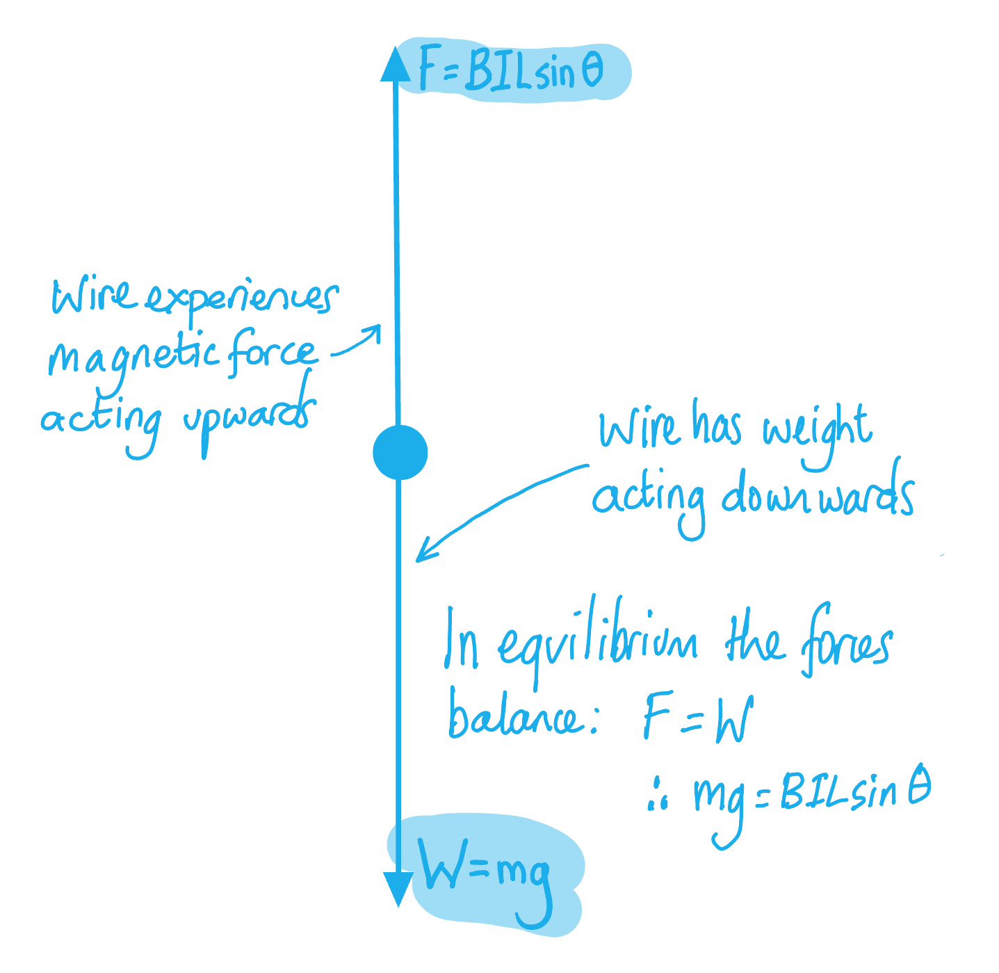

# Mark Schemes — Force on a Current-Carrying Conductor
**20. Magnetic Fields** · Cambridge (CIE) A-LEVEL physics (9702)

## Structured Questions (5 questions)

### Q1
(i) The magnetic field around the wire is as follows:

- At least three circular lines drawn with increasing separation;** [1 mark]**
- Direction of field shown as clockwise; **[1 mark]**

(ii) The magnetic field around the wires is as follows:

- Clockwise magnetic field lines around the wires; **[1 mark]**
- At least 3 circular / elliptical lines drawn around both strips; **[1 mark]**

**[Total: 4 marks]**

> *The direction of the magnetic field lines around a wire is determined by the **right-hand** **grip rule*

- *A cross ⊗ means the wire is travelling **into **the page - like the back of an arrow going away from you*
- *A dot ⊙ means the wire is travelling **out** of the page - like the tip of an arrow coming towards you*
(i) The magnetic force on a current-carrying wire is:

- $F=BIL\mathrm{sin}θ$ **[1 mark]**
- Where *B* = magnetic flux density, *I* = current in the conductor, *L* = length of the conductor and *θ* = the angle between the wire and the field; **[1 mark]**

(ii) The angle *θ* between the wire and the magnetic field for...

1. The maximum force is when:

- *θ* = 90° / the wire and field are <u>perpendicular</u> / sin θ = 1; **[1 mark]**

2. Zero force is when:

- *θ* = 0° / the wire and field are <u>parallel</u> / sin θ = 0; **[1 mark]**

**[Total: 4 marks]**
Calculate the magnetic force acting on the conductor:

List the known quantities:

- Length of conductor, $L$ = 1.2 m
- Current flowing in conductor, $I$* *= 1.5 A
- Magnetic flux density, $B$ = 15 × 10−3 T
- Angle between conductor and field, *θ* = 90°

Use the equation for magnetic force on a current-carrying conductor:

- Magnetic force:  $F=BIL\mathrm{sin}θ\RightarrowF=BIL$ (sin 90° = 1)
- Magnetic force:  $F=(15\times10^{--3})\times1.5\times1.2$ **[1 mark]**
- Magnetic force: * *$F$ = 0.027 N **[1 mark]**

**[Total: 2 marks]**
Calculate the new force acting on the conductor:

List the known quantities:

- Length of conductor, $L$ = 1.2 m
- Current flowing in conductor, $I$* *= 1.5 A
- Magnetic flux density, $B$ = 15 × 10−3 T
- Angle between conductor and field, *θ* = 30°

Calculate the new force acting on the conductor:

- Magnetic force:  $F=BIL\mathrm{sin}θ$
- Magnetic force:  $F=(15\times10^{--3})\times1.5\times1.2\times\mathrm{sin}30^{\circ}$ **[1 mark]**
- Magnetic force: * *$F$ = 0.0135 = 0.014 N **[1 mark]**

**[Total: 2 marks]**

### Q2
The symbols represent:

- *B* = <u>magnetic flux density</u> of external B field; **AND**
- *I* = <u>current</u> in the conductor; **AND**
- *L* = <u>length</u> of the conductor; **[1 mark]**

**[Total: 1 mark]**

> *As well as learning the equations, you also need to learn what the variables stand for and the units they are measured in.*
The angle which would result in the largest force being exerted on the conductor is:

- *θ* = 90o **[1 mark]**

**[Total: 1 mark]**

> *The equation to calculate the size of the force, **F**, on the conductor is:*

> * **F** = **BIL** sin **θ*

> * The magnetic flux density of the magnetic field, **B**, current flowing through the conductor, **I**, and the length of the conductor, **L**, are all constants. **θ** is the angle between the conductor and the B field.*

> * *

> *To achieve the largest value for the force acting on the conductor, **F**, sin** θ** need to be as large as possible. The largest value which sin **θ** can have is 1.*

> *To calculate the size of the angle **θ** you need to find the inverse sine of 1.*

> * θ** = sin**–1** (1) = 90*

> * This means that when the conductor is at 90**o** (**perpendicular**) to the **B** field, the force exerted on it will be largest.*
The angle would result in there being no force exerted on the conductor from the B field:

- *θ* = 0o **[1 mark]**

**[Total: 1 mark]**

> *If no force is exerted on the conductor, then:*

> * **F** = **BIL** sin **θ** = 0*

> *Since we know from the question that **B**, **I **and **L** have non-zero values, it must be that sin **θ** = 0.*

> *To calculate the size of the angle **θ **you need to find the inverse sine of 0.*

> * **θ** = sin**–1** (0) = 0*

> * This means that when the conductor is at 0**o** to the B field (**parallel** to the B field) there will be no force exerted on it.*
To calculate the force acting on the conductor:

List the known quantities and convert to SI units:

- Length of conductor, *L* = 1.2 m
- Current flowing in conductor, *I *= 0.85 A
- Magnetic flux density of B field, *B* = 70 mT = 70 × 10–3 T
- Angle between conductor and B field, *θ* = 30o

Calculate the force acting on the conductor using the magnetic force equation:

- $F=BIL\mathrm{sin}θ$
- $F=(70\times10^{--3})\times0.85\times1.2\times\mathrm{sin}(30)$ **[1 mark]**
- *F* = 0.0357 = 0.036 N **[1 mark]**

**[Total: 2 marks]**

> *This is a topic where there will be some very small numbers (such as the mT in this question) and very large ones. Make sure you always replace prefixes with the correct power of ten before you start calculating.*

### Q3
Magnetic flux density:

- represents the magnetic flux per unit area perpendicular to the field** [1 mark]**

**[Total: 1 mark]**
The relationship between force and magnetic flux density is:

- (Directly) <u>proportional</u>; **[1 mark]**

**[Total: 1 mark] **

> *Magnetic force is *$F=BIL\mathrm{sin}θ$*, and when the conductor and field are perpendicular, then *$\mathrm{sin}90^{\circ}=1$

> *So, the equation becomes *$F=BIL$*, therefore, *$F\proptoB$
Determine the magnitude of the magnetic force acting on the wire when it is carrying current:

List the known quantities:

- Mass of the wire, *m* = 30 g = 0.03 kg
- Acceleration of free fall,* g* = 9.81 m s–2 (from the data page)

For a wire 'floating' in equilibrium in a magnetic field:

- The magnetic force *F* = weight of the wire *W*

Calculate the weight of the wire, W:

- $W=mg=0.03\times9.81$
- *W* = 0.2943 = 0.29 N **[1 mark]**

Determine the size of the force holding the wire in equilibrium:

- When the wire is in equilibrium,* F *= 0.29 N **[1 mark]**

**[Total: 2 marks]**

> *Using Fleming’s left–hand rule you can determine that the force acting on the wire due to the magnetic field acts **upwards**.*

> *As we are told that the wire ‘floats’ in equilibrium (i.e. it is not moving), then the **downwards** force of the weight must equal the **upwards** force produced by the magnetic field.*

Calculate the magnetic flux density:

List the known quantities:

- Force acting on wire due to magnetic field, *F *= 0.2943 N (from part c)
- Current flowing through wire, *I *= 2.0 A (from part c)
- Length of wire in magnetic field, *L* = 15 cm = 0.15 m (from part c)

Recall the magnetic force equation and rearrange for *B*:

- $F=BIL\mathrm{sin}θ$
- The wire and field are perpendicular, hence, *sin θ* = 1
- $F=BIL\RightarrowB=\frac{F}{IL}$ **[1 mark]**

Calculate the magnetic flux density, *B*:

- $B=\frac{0.2943}{2.0\times0.15}$
- *B* = 0.98 T **[1 mark]**

**[Total: 2 marks]**

### Q4
State the vector quantity that describes the number of magnetic field lines per unit area:

- Quantity = Magnetic flux density **AND**
- Unit = <u>Tesla</u> (T); **[1 mark]**

**[Total: 1 mark]**

> *If you asked to 'state' the units, always write the name of the unit, don't just give the symbol (you can do both!)*
The direction of the magnetic force acting on the moving electrons in the wire is:

- Downwards; **[1 mark]**

**[Total: 1 mark]**

> *Fleming's left-hand rule tells us that the **field **(**f**irst finger - **f**ield)  is directed out of the page, the **current **(se**c**ond finger - **c**urrent) is to the right, so the **force **(thu**m**b - **m**otion) points downwards. *
Show that there are about 7 × 1021 free electrons in this section of the wire:

List the known quantities:

- Electron density of copper = 8.4 × 1028 m−3
- Length of section, *L* = 85 mm = 85 × 10−3 m
- Diameter of wire, *d* = 1.1 mm = 1.1 × 10−3 m

Calculate the volume of the section of the wire:

- Volume of a cylinder:  $V = π r^{2} L$ (area of a circle × length)
- `V equals straight pi cross times open parentheses fraction numerator 1.1 cross times 10 to the power of negative 3 end exponent over denominator 2 end fraction close parentheses squared cross times open parentheses 85 cross times 10 to the power of negative 3 end exponent close parentheses equals 8.078 cross times 10 to the power of negative 8 end exponent space straight m cubed` **[1 mark]**

Calculate the number of free electrons in the section of wire:

- Number of free electrons = electron density × volume **[1 mark]**
- Number of free electrons = `\left(8 . 4 \times 10^{28}\right) \times \left(8 . 078 \times 10^{- 8}\right) = 6 . 8 \times 10^{21} = 7 \times 10^{21}` **[1 mark]**

**[Total: 3 marks]**

> *When you have a 'show that' question, remember that you must finish with the value given in the question. This will usually involve rounding to less significant figures that you ordinarily would.*
Determine the magnetic flux density:

List the known quantities:

- Force on each electron, *F* = 5.5 × 10−24 N
- Number of free electrons in the section of wire, *n* = 6.8 × 1021 (from part c)
- Current, $I$ = 0.42 A
- Length of wire section, *L* = 85 mm = 85 × 10−3 m

Recall the magnetic flux density equation and rearrange for flux density, B:

- $F=BIL\RightarrowB=\frac{F}{IL}$ **[1 mark]**

Determine the net force acting on the wire:

- In the section of wire, *n* electrons each experience a force *F*
- Therefore, the net force is `n F space equals space open parentheses 6.8 cross times 10 to the power of 21 close parentheses cross times open parentheses 5.5 cross times 10 to the power of negative 24 end exponent close parentheses space`

Substitute in the known values to calculate *B*:

- `B space equals space fraction numerator open parentheses 6.8 cross times 10 to the power of 21 close parentheses cross times open parentheses 5.5 cross times 10 to the power of negative 24 end exponent close parentheses space over denominator 0.42 cross times open parentheses 85 cross times 10 to the power of negative 3 end exponent close parentheses end fraction`** [1 mark]**
- `B space equals space 1.0 space straight T space open parentheses 2 space straight s. straight f. close parentheses` **[1 mark]**

**[Total: 3 marks]**

### Q5
The symbols represent:

- *B* = <u>magnetic flux density</u> of external *B* field; **[1 mark]**
- *I* = <u>current</u> in the conductor; **[1 mark]**
- *L* = <u>length</u> of the conductor, **[1 mark]**

**[Total: 3 marks]**
The angle which would result in the largest force being exerted on the conductor is:

- *θ* = 90° **[1 mark]**

**[Total: 1 mark]**

> *The equation to calculate the size of the force, **F**, on the conductor is: *

> *         F** = **BIL** sin**(θ**) *

> *The magnetic flux density of the magnetic field, **B**, current flowing through the conductor, **I**, and the length of the conductor, **L**, are all constants. **θ** is the angle between the conductor and the **B** field. *

> *To achieve the largest value for the force acting on the conductor, **F**, sin** θ** need to be as large as possible. The largest value which sin **θ** can have is 1. *

> *To calculate the size of the angle **θ** you need to find the inverse sine of 1.** *

> *         θ** = sin**–1**(1) = 90 *

> *This means that when the conductor is at 90° (**perpendicular**) to the **B** field, the force exerted on it will be largest.*
The angle would result in there being no force exerted on the conductor from the B field:

- *θ* = 0° **[1 mark]**

**[Total: 1 mark]**

> *If no force is exerted on the conductor, then: *

> *         F** = **BIL** sin**(θ**) = 0 *

> *Therefore, sin **θ** = 0, as **B**, **I** and **L** will all have values corresponding to the magnetic flux density of the **B** field, the current flowing in the conductor and the length of the conductor respectively. *

> *To calculate the size of the angle **θ **you need to find the inverse sine of 0. *

> *         θ** = sin**–1**(0) = 0 *

> *This means that when the conductor is at 0° to the **B** field (**parallel** to the **B** field) there will be no force exerted on it.*
List the known quantities:

- Length of conductor, *L* = 1.5 m
- Current flowing in conductor, *I *= 0.76 A
- Magnetic flux density of B field, *B* = 40 mT = 40 × 10–3 T
- Angle between conductor and B field, *θ* = 45°

Calculate the force acting on the conductor:

- *F* = *BIL* sin*(θ*)
- *F* = (40 × 10–3) × (0.76) ×  (1.5) × sin (45°) **[1 mark]**
- *F* = 0.03224 = 0.032 N **[1 mark]**

**[Total: 2 marks]**
