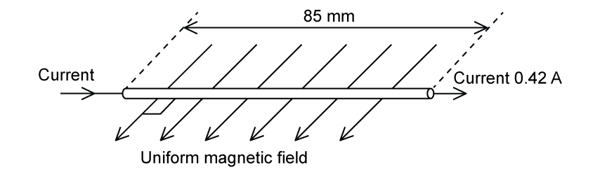

# Exam Questions — Force on a Current-Carrying Conductor
**20. Magnetic Fields** · Cambridge (CIE) A-LEVEL physics (9702)
> Source: [https://www.savemyexams.com/a-level/physics/cie/25/topic-questions/](https://www.savemyexams.com/a-level/physics/cie/25/topic-questions/) · 5 questions across 1 sets

## Structured Questions (5 questions)

### Q1 — easy — 12 marks

**Q1** [4 marks]

A long straight wire passes through a piece of card. There is a current in the wire, as shown in Fig. 1.1a.

**Fig. 1.1a**

The current in the wire produces a magnetic field around the wire.

(i) Fig. 1.1b shows the view of the card from above. On Fig. 1.1b, draw the magnetic field around the wire.

Show the direction of the magnetic field by drawing an arrow on each field line.

**Fig. 1.1b**

[2]

(ii) Two identical wires with the same current pass through a different piece of card.

On Fig. 1.1c, draw the magnetic field around the wires.

**Fig. 1.1c**

[2]

**Q1** [4 marks]

The current-carrying wire is placed in a uniform magnetic field.

(i) State the equation, and define all the variables, for the force on a current-carrying wire in a uniform magnetic field at different angles.

[2]

(ii) Describe how the wire should be placed to experience

1.  the maximum force due to the magnetic field

2.  no force due to the magnetic field.

[2]

**Q1** [2 marks]

A current-carrying conductor placed at right angles to a uniform magnetic field which has a magnetic flux density of 15 × 10−3 T.

The conductor has a length of 1.2 m and a current of 1.5 A flowing through it.

Calculate the magnetic force acting on the conductor.

**Q1** [2 marks]

**Extract:**

A current-carrying conductor placed at right angles to a uniform magnetic field which has a magnetic flux density of 15 × 10^−3 T. The conductor has a length of 1.2 m and a current of 1.5 A flowing through it.

The conductor is then rotated so that it is at an angle of 30° to the magnetic field.

Calculate the new force acting on the conductor.

### Q2 — medium — 5 marks

**Q2** [1 mark]

Fig. 1.1 shows a current-carrying conductor at an angle *θ* to an external B field.

**Fig. 1.1**

The force acting on the current-carrying conductor when it lies at different angles to the field can be calculated using the equation

$F=BIL\mathrm{sin}θ$

State what the symbols *B*,* I* and *L* represent.

**Q2** [1 mark]

**Extract:**

Fig. 1.1 shows a current-carrying conductor at an angle *θ* to an external B field. The force acting on the current-carrying conductor when it lies at different angles to the field can be calculated using the equation F = B I L sin θ

State the angle, *θ*, between the conductor and the B field which would result in the largest force being exerted on the conductor.

**Q2** [1 mark]

**Extract:**

Fig. 1.1 shows a current-carrying conductor at an angle *θ* to an external B field. The force acting on the current-carrying conductor when it lies at different angles to the field can be calculated using the equation F = B I L sin θ

State the angle, *θ*, between the conductor and the B field which would result in there being no force exerted on the conductor from the B field.

**Q2** [2 marks]

**Extract:**

Fig. 1.1 shows a current-carrying conductor at an angle θ to an external B field. The force acting on the current-carrying conductor when it lies at different angles to the field can be calculated using the equation F = B I L sin θ

The conductor in the diagram in part (a) has a length of 1.2 m and a current of 0.85 A flowing through it. The conductor is placed at 30o to the B field, which has a magnetic flux density of 70 mT.

Calculate the force acting on the conductor.

### Q3 — medium — 6 marks

**Q3** [1 mark]

Define magnetic flux density.

**Q3** [1 mark]

State the relationship between force and magnetic flux density when a current-carrying conductor is placed perpendicularly to an external magnetic field.

**Q3** [2 marks]

Fig. 1.1 shows a wire of length 15 cm and mass 30 g which has a current of 2.0 A flowing through it. When the wire is placed perpendicular to a uniform magnetic field it 'floats' in equilibrium in the magnetic field.

Determine the magnitude of the magnetic force acting on the wire when it is carrying current.

**Q3** [2 marks]

**Extract:**

Fig. 1.1 shows a wire of length 15 cm and mass 30 g which has a current of 2.0 A flowing through it. When the wire is placed perpendicular to a uniform magnetic field it 'floats' in equilibrium in the magnetic field. Determine the magnitude of the magnetic force acting on the wire when it is carrying current.
For a wire 'floating' in equilibrium in a magnetic field: The magnetic force F = weight of the wire W. W = m g = 0.03 × 9.81 = 0.2943 N. When the wire is in equilibrium, F = 0.29 N.

Calculate the magnetic flux density required to keep the wire ‘floating’ in equilibrium.

### Q4 — medium — 8 marks

**Q4** [1 mark]

State the vector quantity that describes the number of magnetic field lines per unit area and its associated unit.

**Q4** [1 mark]

Fig. 1.1 shows a current-carrying copper wire placed at right angles to an external magnetic field.

**Fig. 1.1**

The section of wire shown in the diagram has a length of 85 mm, a diameter of 1.1 mm, and a current of 0.42 A.

State the direction of the magnetic force acting on the moving electrons in the wire.

**Q4** [3 marks]

**Extract:**

The section of wire shown in the diagram has a length of 85 mm, a diameter of 1.1 mm, and a current of 0.42 A.

Copper contains 8.4 × 1028 free electrons per cubic metre.

Show that there are about 7 × 1021 free electrons in this section of the wire.

**Q4** [3 marks]

**Extract:**

The section of wire shown in the diagram has a length of 85 mm, a diameter of 1.1 mm, and a current of 0.42 A.
Number of free electrons in the section of wire = 6.8 × 10^21 (from part c, shown to be about 7 × 10^21).

The average magnetic force acting on one electron is 5.5 × 10−24 N.

Use your answer from part (c) to determine the magnetic flux density of the magnetic field.

### Q5 — easy — 7 marks

**Q5** [3 marks]

A current-carrying conductor at an angle *θ* to an external *B* field in Fig. 1.1. ** **

**Fig. 1.1**

*F* = *BIL *sin(*θ*) is used to calculate the force acting on the current-carrying conductor at different angles, *θ*, to the *B* field.

State what the symbols *B*, *I* and *L *represent.

**Q5** [1 mark]

**Extract:**

A current-carrying conductor at an angle *θ* to an external *B* field in Fig. 1.1. *F* = *BIL* sin(*θ*) is used to calculate the force acting on the current-carrying conductor at different angles, *θ*, to the *B* field.

State the angle *θ* between the conductor and the *B* field which would result in the largest force being exerted on the conductor.

**Q5** [1 mark]

**Extract:**

A current-carrying conductor at an angle *θ* to an external *B* field in Fig. 1.1. *F* = *BIL *sin(*θ*) is used to calculate the force acting on the current-carrying conductor at different angles, *θ*, to the *B* field.

State the angle *θ* between the conductor and the B field which would result in there being no force exerted on the conductor from the B field.

**Q5** [2 marks]

**Extract:**

A current-carrying conductor at an angle *θ* to an external *B* field in Fig. 1.1. Fig. 1.1. *F* = *BIL* sin(*θ*) is used to calculate the force acting on the current-carrying conductor at different angles, *θ*, to the *B* field.

The conductor in Fig. 1.1 has a length of 1.5 m and has a current of 0.76 A flowing through it. The conductor is placed at 45° to the B field, which has a magnetic flux density of 40 mT.

Calculate the force acting on the conductor.
