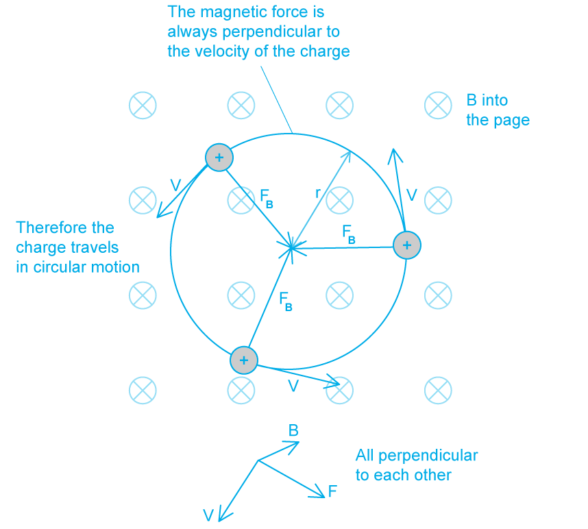
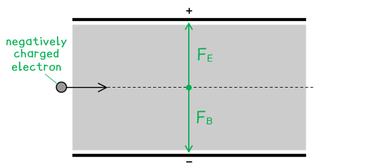
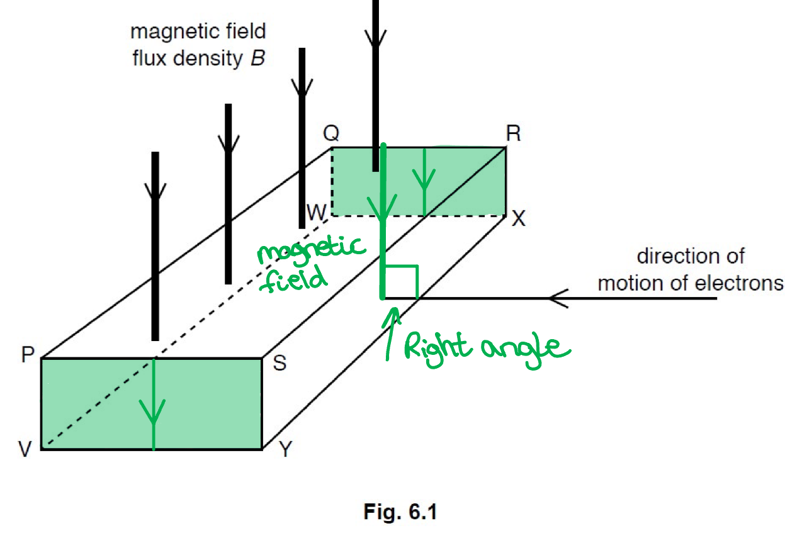
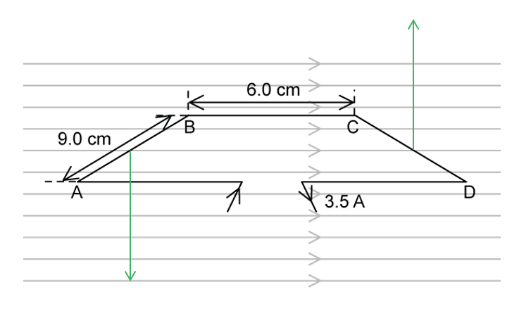
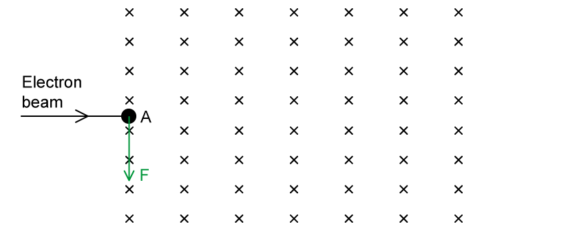
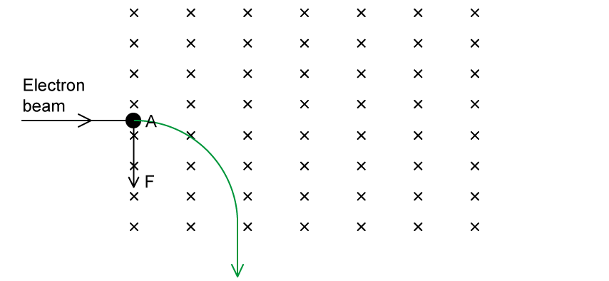

# Mark Schemes — Force on a Moving Charge
**20. Magnetic Fields** · Cambridge (CIE) A-LEVEL physics (9702)

## Structured Questions (5 questions)

### Q1
The speed of the proton is:

- The <u>same</u> (at P and Q); **[1 mark]**

This is because:

- The magnetic force is always at right angles / perpendicular to the velocity; **[1 mark]**

**EITHER**

- The velocity (of the proton) changes only in direction; **[1 mark]**
- The speed / magnitude of the velocity (of the proton) does not change; **[1 mark]**

**OR**

- Work done = force × displacement in the direction of the force (i.e. the radius of the circular path);
- The radius does not change, so, no work is done (by the magnetic force on the charge); **[1 mark]**
- Therefore, the kinetic energy, and hence speed (of the proton) does not change; **[1 mark]**

**[Total: 3 marks]**

> *To get full marks in this question you must either consider one of two explanations 1. vectors, or 2. energy*

> *Explanation 1 (vectors) is arguably the easier route as you only need to consider the difference between velocity and speed in circular motion*

> *Explanation 2 (energy) is a little more involved, but thinking in terms of energy might suit the way your brain works better, so go for this one if it makes more sense to you. Here we need to consider the work done on the charge while it is in the magnetic field. We're only interested in the displacement in the **direction** of the force. Since the path of the proton is circular, the force is directed towards the centre of the circle, so a change in displacement would be equivalent to a change in **radius**. Always link this back to the kinetic energy, since the work done is simply equal to the **change** in kinetic energy. If no work is done, then there is no change in kinetic energy i.e. it remains constant.*
The path is circular because:

- It experiences a (magnetic) force when it moves in the magnetic field; **[1 mark]**
- The (magnetic) force is always at right angles / perpendicular to the velocity of the proton; **[1 mark]**** **

**[Total: 2 marks]**** **

> *A charged particle in a magnetic field always moves perpendicular to the direction of the field and the velocity of the charge in circular motion.*

State the equations for centripetal force and the magnetic force on a moving charge:

- Centripetal force: * *$F=\frac{mv^{2}}{r}$
- Force on a moving charge:  $F=qvB\mathrm{sin}θ$

Determine the value of sin *θ*:

- The proton is moving at right angles to the direction of the magnetic field, so *θ* = 90⁰
- So, sin 90° = 1, hence $F=qvB$ **[1 mark]**

Equate the magnetic and centripetal forces:

- Since the magnetic force is the force that keeps the proton moving in a circle, this is equal to its centripetal force
- $F=\frac{mv^{2}}{R}=qvB$ **[1 mark]**

Rearrange to make radius *R* the subject and simplify:

- $mv^{2}=RqvB$
- $\frac{mv^{2}}{qvB}=R$
- `fraction numerator m v to the power of up diagonal strike 2 end exponent over denominator q up diagonal strike v B end fraction space equals space R`
- $R=\frac{mv}{qB}$* ***[1 mark]**** **

**[Total: 3 marks]**

> *This is a very common derivation that you will be expected to know. *
Show that the radius of the path is 16 cm:

List the known quantities:

- Speed of the proton at P, *v* = 3.2 × 106 m s–1
- Magnetic flux density, *B* = 0.21 T

From the data page:

- Rest mass of proton, *m**p* = 1.67 × 10–27 kg
- Elementary charge, *e = q* = 1.60 × 10–19 C

Substitute and calculate the value of *R*:

- Radius: * *$R=\frac{mv}{qB}$ (from part c)
- $R=\frac{(1.67\times10^{-27})\times(3.2\times10^{6})}{(1.6\times10^{-19})\times0.21}$ **[1 mark]**
- So, *R *= 0.159 m = 0.16 m = 16 cm **[1 mark]**** **

**[Total: 2 marks]**

> *This is a simple substitution question, but you must make sure you use the correct values for proton mass and charge from the data page and write the answer in the correct form. If you are stuck on where to start, have a look at the previous subparts. These are more often than not linked and guiding you through the question!*

### Q2
The direction of the missing quantities are:

(i) Force = 0 / no direction; **[1 mark]**

(ii) Force = 0 / no direction; **[1 mark]**

(iii) Magnetic field lines / * B *is into the page; **[1 mark]**

(iv) Magnetic field lines /  *B* is out of the page; **[1 mark]**

(v) Force, *F* is into the page; **[1 mark]**** **

**[Total: 5 marks]**

> *You must remember that there is only a force on a charge in a magnetic field if the current is at **right angles** to the magnetic field. You will need Fleming's left-hand rule for this question!*
(i) State the direction of the magnetic field:

- For the net force to be zero, the magnetic force FB must act in the opposite direction to the electric force FE
- The negatively charged electron will be attracted to the positively charged (top) plate
- Therefore, the magnetic force will be directed downwards / towards the negative (bottom) plate; **[1 mark]**

(ii) Determine the magnitude of the magnetic field:

List the known quantities:

- Electric field strength, *E* = 2.6 × 103 N C–1
- Speed of electron, *v *= 3.0 × 105 m s–1

Recall the equation for the force on a charge in an electric field:

- Electric force: * *$E=\frac{F_{E}}{q}\RightarrowF_{E}=Eq$ **[1 mark]**

Calculate the electric force on the electron:

- *F*E* *= (2.6 × 103) × (1.6 × 10–19)
- *F*E* *= 4.16 × 10–16 N **[1 mark]**
- The magnitude of the magnetic and electric forces are the same, i.e. *F*B = *F*E

Recall the equation for the force on a moving charge in a magnetic field:

- Magnetic force:  $F_{B}=qvB\mathrm{sin}θ$
- The motion of the electron and the magnetic field are perpendicular, so sin 90° = 1
- Therefore, $F_{B}=qvB$* ***[1 mark]**

Rearrange the equation and calculate magnetic flux density, *B*:

- $F_{B}=qvB\RightarrowB=\frac{F_{B}}{qv}$
- $B=\frac{4.16\times10^{-16}}{(1.6\times10^{-19})\times(3.0\times10^{5})}=8.7\times10^{-3}T$ **[1 mark]**

**[Total: 5 marks]*** *

> *The tricky part of this question is realising that the quantity given 2.6 × 10**3** N C**–1** is the equivalent to *$\frac{F}{q}$* for the electric field. Look first at the units N C**–1**, so it must be *$\frac{\mathrm{Force}}{\mathrm{Charge}}$*.*
A proton moving with the same speed through the plates would experience:

- The same / zero net force; **[1 mark]**

This is because:

- The <u>magnitude</u> of the charge of the proton is the same (as the electron); **AND**
- The magnetic field strength and velocity are unchanged (hence, there would be no change in force); **[1 mark]**

**[Total: 2 marks]*** *

> *Looking at the variables in the equation** F** = **qvB, **it is possible to see that there would also be a zero net force on the proton, as the magnitudes of **q**, **v** and **B** are all unchanged.*
The motion of the electron would be:

- Different / deflected (compared to (b)); **[1 mark]**

This is because:

- From $F_{B}=qvB$, magnetic force is directly proportional to speed `open parentheses F subscript B space proportional to space v close parentheses`
- (Since *B *and *q *are unchanged) magnetic force $F_{B}$ will half; **[1 mark]**
- Hence, the magnetic and electric forces will not be balanced, so, the electron will deflect (upwards); **[1 mark]**** **

**[Total: 3 marks]**

### Q3
(i) Consider the position of the magnetic field in relation to the current:

- The hall voltage states that the magnetic field is applied perpendicular to the current

Therefore the two faces between which the Hall voltage is produced are:

- PSVY <u>and</u> QRWX; **[1 mark]**

(ii) Consider the deflection of an electron in the field:

- An electron moving in the magnetic field will be deflected towards face QRXW; **[1 mark]**
- Hence, the negative electrons will build up and create an overall surplus negative charge
- (On the other face PSVY, there will be a surplus of positive charge) so PSVY is more positive; **[1 mark]**

**[Total: 3 marks]**

- *In part (i) **draw** lines on the **diagram **to identify the faces perpendicular to the current and parallel to the magnetic field*

  - *Don't be fooled by** PQRS** this face is **parallel **to the current*

- *In part (ii) consider Fleming's Left-Hand Rule:*

  - *The magnetic field is represented by the first finger and acts down the page*
  - *The current is represented by the second finger and acts across the page to the right in the opposite direction to the electron flow*
  - *The thumb represents the subsequent motion of the electrons which will move into the page and toward face QRWX*
(i) Thickness *t* is equal to:

- PV **or** SY **or** RX **or** QW; **[1 mark]**

(ii) State and explain the effect, if any, of this change on the polarity of the Hall voltage:

- The negative and positive charges would deflect in opposite directions; **[1 mark]**
- So there is no change in the polarity (of the Hall voltage); **[1 mark]**

**[Total: 3 marks]**

- *Part (i) requires you to consider the length through which the Hall voltage acts:*

  - *t** stands for the **thickness** of the **conductor*
  - *The **Hall voltage** acts between PSYV and QRXW, so the distance PQ is the **length** of the block*
  - *So, the thickness of the conductor is as **thick** as the block:*
  
    - *PV / SY / RX / QW*

- *Part (ii) is a little difficult to understand:*

  - *Using the same convention as part a, ii, under the influence of the **same magnetic field*
  - *The **positive charge** carriers would move in the **opposite direction** to that of the electrons*
  - *So the positive and negative charges will still **build up on the same sides**, as with the electrons*
  - *So, the** electric field** remains in the **same direction*

### Q4
(i) When the field and motion are parallel:

- Force = 0 / no direction; **[1 mark]**

(ii) When the field and motion are opposed:

- Force = 0 / no direction; **[1 mark]**

(iii) When the force is to the left and the motion is down:

- Magnetic field / *B *is into the page; **[1 mark]**

(iv) When the force is up and the motion is to the right:

- Magnetic field / *B* is out of the page; **[1 mark]**

(v) When the motion is to the left and the field is down:

- Force / *F* is into the page; **[1 mark]**** **

**[Total: 5 marks]**

> *You must remember that there is only a force on a charge in a magnetic field if the current is at **right angles** to the magnetic field. You will need Fleming's left-hand rule for this question!*
The direction of the force on each side is...

(i) Side AB

- Arrow pointing down; **[1 mark]**

(ii) Side CD

- Arrow pointing up; **[1 mark]**

**[Total: 2 marks]**
(i) Calculate the force on side AB:

List the known quantities:

- Length, *L* = 9.0 cm = 0.09
- Magnetic field strength, *B* = 0.75 T
- Current, *I* = 3.5 A
- Angle between wire and field, *θ* = 90°

Use the equation for force on a current-carrying conductor:

- Magnetic force:  $F=BIL\mathrm{sin}θ\RightarrowF=BIL$ (sin 90° = 1)
- $F=0.75\times3.5\times0.09$ **[1 mark]**
- $F$ = 0.236 = 0.24 N **[1 mark]**

(ii) Calculate the force on side BC:

- Magnetic force:  $F=BIL\mathrm{sin}θ\RightarrowF=0$ (sin 0° = 0)
- $F$ = 0 N **[1 mark]**

**[Total: 3 marks]**
(i) When the current is switched on:

- The loop rotates in an anti-clockwise direction; **[1 mark]**

(ii) The effect on the magnetic force when...

**1.  **the magnetic flux density is halved

- $F=BIL\RightarrowF\proptoB$
- The force will halve
**OR**
- $F=\frac{1}{2}\times0.24=0.12N$ **[1 mark]**

**2. ** the length of the wire is increased by a factor of 4

- $F=BIL\RightarrowF\proptoL$
- The force will increase by a factor of 4
**OR**
- $F=4\times0.24=0.96N$ **[1 mark]**

**3. ** the current is reduced by 20%

- $F=BIL\RightarrowF\proptoI$
- The force will reduce by 20%
**OR**
- $F=0.8\times0.24=0.19N$ **[1 mark]**

**[Total: 4 marks]**

### Q5
(i) The thumb represents the:

- Motion / Force; **[1 mark]**

(ii) The first finger represents the:

- Magnetic field; **[1 mark]**

(iii) The second finger represents the:

- Current; **[1 mark]**

**[Total: 3 marks]**

> *It is important not to get mixed up with what each finger represents. An easy way to remember this is:*

- *Thu**M**b = **M**otion / force*
- *F**irst finger = (magnetic) **F**ield*
- *Se**C**ond finger = **C**urrent*
(i) The magnetic field is acting:

- Into the page; **[1 mark]**

(ii) The force and motion of the electron are as follows:

**1.** The force on the electron

- Arrow perpendicular to electron beam; **[1 mark]**
- Pointing downwards; **[1 mark]**

**2.** The motion of the electron

- Moves in a circular arc; **[1 mark]**
- Leaves the field pointing downwards; **[1 mark]**

**[Total: 5 marks]**

> *We can use Fleming’s left–hand rule to determine the direction of the force acting on the electron, however, as we have an isolated charge the second finger gives the direction of the **velocity** of a **positive** charge.*

> *As we have a **negatively-charged** electron we reverse the direction of the velocity*

- *The second finger (motion) will point to the left (since the electron, or negative charge, is moving to the right)*
- *The first finger (field) points into the page*
- *Hence the thumb (force) will point downwards*

> *When the electron is in the magnetic field the force acting on it will be perpendicular to the direction in which it is moving. This causes the electron to move in a **circular path**.*

> *The force exerted on the electron from the magnetic field will point towards the centre of the circular path, hence in this example, the circular arc is directed downwards*
(i) The symbols represent the following quantities:

- *B* = magnetic flux density of the field; **[1 mark]**
- *q* = charge of the particle; **[1 mark]**
- *v *= velocity of the particle; **[1 mark]**

(ii) The force that causes the charge to move in a circular orbit is the:

- Centripetal force; **[1 mark]**

The equation to calculate the centripetal force is:

- $F=\frac{mv^{2}}{r}$ **[1 mark]**
- Where *m* = mass of the charge, *v* = velocity, and *r* = radius of the orbit; **[1 mark]**

**[Total: 6 marks]**
(i) Use the equations from **(c)** to derive the equation for radius:

- Magnetic force on a charge:  $F=Bqv$
- Centripetal force:  $F=\frac{mv^{2}}{r}$

Equate the two expressions of force:

- Equate:  $Bqv=\frac{mv^{2}}{r}$ **[1 mark]**
- Rearrange:  $r=\frac{mv^{2}}{Bqv}$ **[1 mark]**
- Simplify:  $r=\frac{mv}{Bq}$ **[1 mark]**

(ii) Calculate the radius of the circular orbit of the electron:

List the known quantities:

- Mass of an electron, *m* = 9.11 × 10–31 kg
- Charge of an electron, *q* = 1.60 × 10–19 C
- Magnetic flux density, *B* = 3.2 × 10–3 T
- Speed of the electron, *v* = 3.0 × 106 m s–1

Use the equation from part (i):

- $r=\frac{mv}{Bq}$
- `r space equals space fraction numerator open parentheses 9.11 cross times 10 to the power of negative 31 end exponent close parentheses cross times open parentheses 3.0 cross times 10 to the power of 6 close parentheses over denominator open parentheses 3.2 cross times 10 to the power of negative 3 end exponent close parentheses cross times open parentheses 1.60 cross times 10 to the power of negative 19 end exponent close parentheses end fraction` **[1 mark]**
- $r$ = 5.3 × 10–3 m **[1 mark]**

**[Total: 5 marks]**
