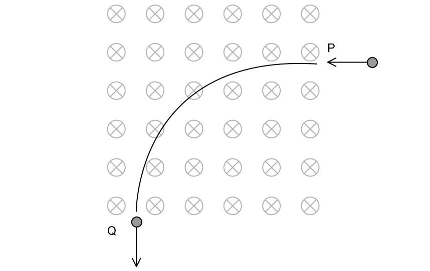
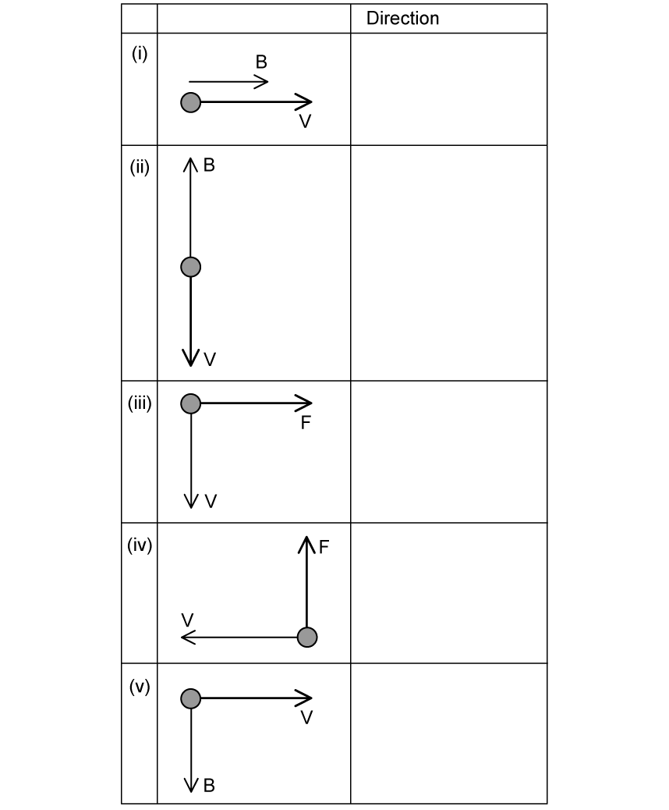
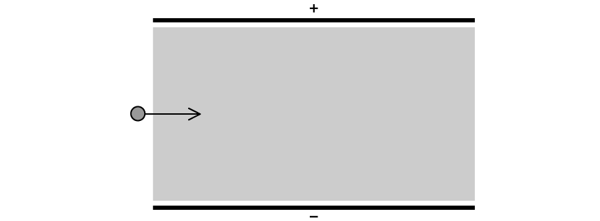
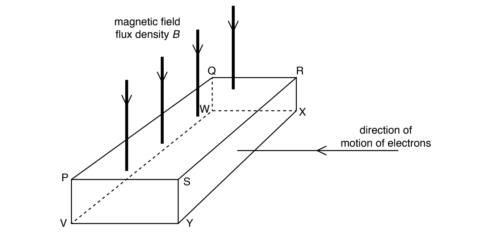
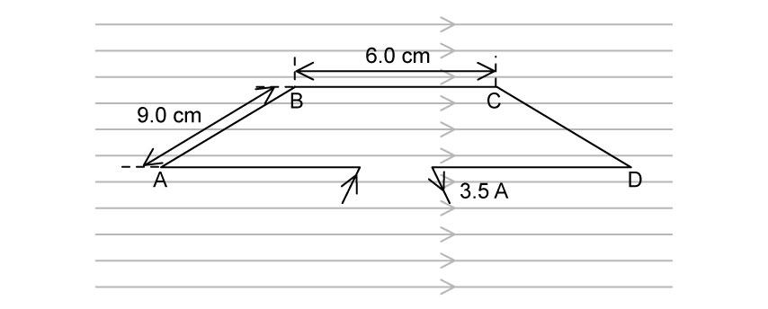
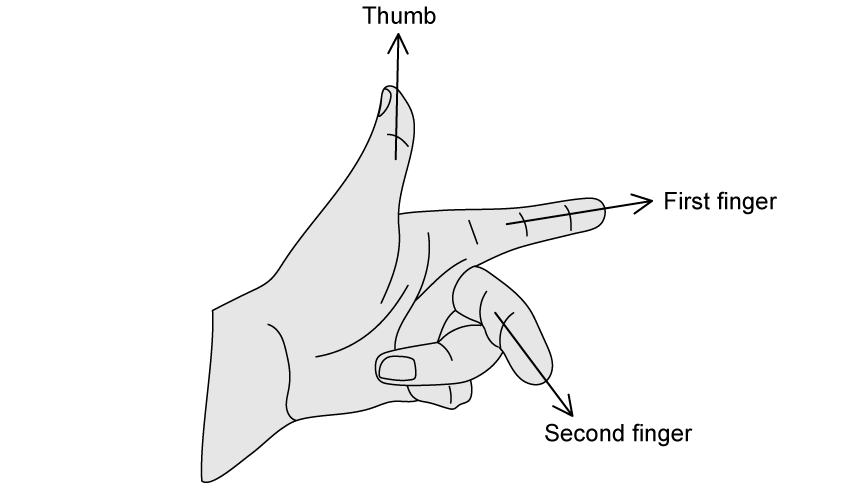

# Exam Questions — Force on a Moving Charge
**20. Magnetic Fields** · Cambridge (CIE) A-LEVEL physics (9702)
> Source: [https://www.savemyexams.com/a-level/physics/cie/25/topic-questions/](https://www.savemyexams.com/a-level/physics/cie/25/topic-questions/) · 5 questions across 1 sets

## Structured Questions (5 questions)

### Q1 — medium — 10 marks

**Q1** [3 marks]

A proton of mass *m* and electric charge *q* enters a region of magnetic field at point P and exits at point Q, as shown in Fig. 1.1.

The speed of the proton at P is *v. *The path followed by the proton is a quarter of a circle.

**Fig. 1.1**

State whether the speed *v* is the same, more than, or less than, the speed of the proton at Q. Explain your answer.

**Q1** [2 marks]

**Extract:**

A proton of mass *m* and electric charge *q* enters a region of magnetic field at point P and exits at point Q, as shown in Fig. 1.1. The speed of the proton at P is *v.* The path followed by the proton is a quarter of a circle.

Explain why the path of the proton is circular.

**Q1** [3 marks]

**Extract:**

A proton of mass *m* and electric charge *q* enters a region of magnetic field at point P and exits at point Q, as shown in Fig. 1.1. The speed of the proton at P is *v.* The path followed by the proton is a quarter of a circle.

Show that the radius of the circular path is given by

$R=\frac{mv}{qB}$

where *B* is the magnetic flux density.

**Q1** [2 marks]

**Extract:**

Show that the radius of the circular path is given by R = mv/(qB) where B is the magnetic flux density.

The speed of the proton at P is *v* = 3.2 × 106 m s–1 and the magnetic flux density is 0.21 T.

Show that the radius of the path is 16 cm.

### Q2 — medium — 15 marks

**Q2** [5 marks]

Positive charges are seen passing through different magnetic fields.

Determine the direction of the missing quantity between *B*, *v* and *F* for each:

**Q2** [5 marks]

Fig. 1.1 shows two parallel plates. The magnitude of the electric field between the plates is 2.6 × 103 N C–1 and is directed from the top plate to the bottom plate.

The shaded region represents a region of magnetic field that is perpendicular to the page.

**Fig. 1.1**

An electron enters the region between the plates with a speed of 3.0 × 105 m s–1 and experiences zero net force as it travels through to the other side.

(i) State the direction of the magnetic field

[1]

(ii) Determine the magnitude of the magnetic field.

[4]

**Q2** [2 marks]

**Extract:**

Fig. 1.1 shows two parallel plates. The magnitude of the electric field between the plates is 2.6 × 10^3 N C^–1 and is directed from the top plate to the bottom plate. The shaded region represents a region of magnetic field that is perpendicular to the page. An electron enters the region between the plates with a speed of 3.0 × 10^5 m s^–1 and experiences zero net force as it travels through to the other side.

Suggest whether a proton moving with the same speed through the plates experiences zero net force. Explain your answer.

**Q2** [3 marks]

**Extract:**

Fig. 1.1 shows two parallel plates. The magnitude of the electric field between the plates is 2.6 × 10^3 N C^–1 and is directed from the top plate to the bottom plate. The shaded region represents a region of magnetic field that is perpendicular to the page. An electron enters the region between the plates with a speed of 3.0 × 10^5 m s^–1 and experiences zero net force as it travels through to the other side.

Another electron enters the region between the plates at half the speed of the electron in (b).

Suggest whether the motion of the electron would be different to the motion of the electron in (b). Explain your answer.

### Q3 — medium — 6 marks

**Q3** [3 marks]

A thin slice of conducting material has its faces PQRS and VWXY normal to a uniform magnetic field of flux density *B*, as shown in Fig. 6.1.

**Fig. 6.1**

Electrons enter the slice at right angles to face SRXY.

A potential difference, the Hall voltage *V*H, is produced between two faces of the slice.

(i) Use letters from Fig. 6.1 to identify the two faces between which the Hall voltage is produced.

.......................................... and .......................................... [1]

(ii) State and explain which of the two faces named in** (a)(i)** is the more positive.

[2]

*Source: Specimen 2022 Paper 4 Q6A*

**Q3** [3 marks]

**Extract:**

A thin slice of conducting material has its faces PQRS and VWXY normal to a uniform magnetic field of flux density *B*, as shown in Fig. 6.1. Electrons enter the slice at right angles to face SRXY. A potential difference, the Hall voltage *V*~H~, is produced between two faces of the slice.

The Hall voltage $V_{H}$ is given by the expression

$V_{H}=\frac{BI}{ntq}$

(i) Use the letters in Fig. 6.1 to identify the distance *t*.

[1]

(ii) The negative charge carriers (electrons) are replaced by positive charge carriers moving in the same direction towards the slice.

State and explain the effect, if any, of this change on the polarity of the Hall voltage.

[2]

*Source: Specimen 2022 Paper 4 Q6B*

### Q4 — easy — 14 marks

**Q4** [5 marks]

Positive charges are seen passing through different magnetic fields.

In Table 1.1, state the direction of the missing quantity between *B*, *v* and *F* in each scenario

**Table 1.1**

**Q4** [2 marks]

Fig. 1.1 shows a rectangular wire loop ABCD with width 6.0 cm and length 9.0 cm in a uniform magnetic field of strength 0.75 T.

The current in the loop is 3.5 A.

**Fig. 1.1**

Draw arrows on Fig. 1.1 to show the direction of the force on

(i) side AB

[1]

(ii) side CD

[1]

**Q4** [3 marks]

**Extract:**

Fig. 1.1 shows a rectangular wire loop ABCD with width 6.0 cm and length 9.0 cm in a uniform magnetic field of strength 0.75 T. The current in the loop is 3.5 A.

Calculate the magnitude of the force acting on

(i) side AB

[2]

(ii) side BC

[1]

**Q4** [4 marks]

**Extract:**

Fig. 1.1 shows a rectangular wire loop ABCD with width 6.0 cm and length 9.0 cm in a uniform magnetic field of strength 0.75 T. The current in the loop is 3.5 A.
Calculate the force on side AB: Length, L = 9.0 cm = 0.09; Magnetic field strength, B = 0.75 T; Current, I = 3.5 A; Angle between wire and field, θ = 90°. F = B I L = 0.75 × 3.5 × 0.09; F = 0.236 = 0.24 N

(i) When the current is switched off the loop does not move.

Describe the motion of the loop once the current is switched on.

[1]

(ii) Determine the effect on the magnitude of the magnetic force on side CD if

**1.**  the magnetic flux density is halved

**2.**  the length of the wire is increased by a factor of 4

**3.**  the current is reduced by 20%

[3]

### Q5 — easy — 19 marks

**Q5** [3 marks]

When the force, the magnetic field and the current are all mutually perpendicular to each other, the directions of each can be represented by Fleming’s left–hand rule, as shown in Fig. 1.1.

**Fig. 1.1**

State what is represented by the direction of

(i) the thumb

[1]

(ii) the first finger

[1]

(iii) the second finger

[1]

**Q5** [5 marks]

**Extract:**

When the force, the magnetic field and the current are all mutually perpendicular to each other, the directions of each can be represented by Fleming's left–hand rule, as shown in Fig. 1.1.

The thumb represents Motion / Force; the first finger represents the Magnetic field; the second finger represents the Current.

Fig. 1.2 shows a magnetic field.

**Fig. 1.2**

(i) State whether the magnetic field is acting into or out of the page.

[1]

(ii) An electron enters the magnetic field at point A, as shown in Fig. 1.3.

On Fig. 1.3, draw

**1.**  an arrow on the electron to show the direction of the force

**2.**  the path of the electron through the magnetic field

**Fig. 1.3**

[4]

**Q5** [6 marks]

When a moving charge enters a magnetic field the magnetic field produces a force on the charge, which can be calculated using

$F=Bqv$

(i) State the meaning of the quantities *B*, *q* and *v*.

[3]

(ii) When in the field, the charge begins to move in a circular orbit.

State the name and equation of the force that causes the charge to move in a circular orbit.

[3]

**Q5** [5 marks]

**Extract:**

When a moving charge enters a magnetic field the magnetic field produces a force on the charge, which can be calculated using F = B q v

Magnetic force on a charge: F = B q v
Centripetal force: F = mv²/r

When the electron enters the magnetic field, its speed is 3.0 × 106 m s–1. The magnetic field has a magnetic flux density of 3.2 × 10–3 T.

(i) Using the equations in **(c)**, show that the radius of the circular orbit of the charged object inside the magnetic field is equal to

$r=\frac{mv}{Bq}$

[3]

(ii) Calculate the radius of the circular orbit of the electron

Mass of an electron = 9.11 × 10–31 kg

Charge of an electron = 1.60 × 10–19 C

[2]
