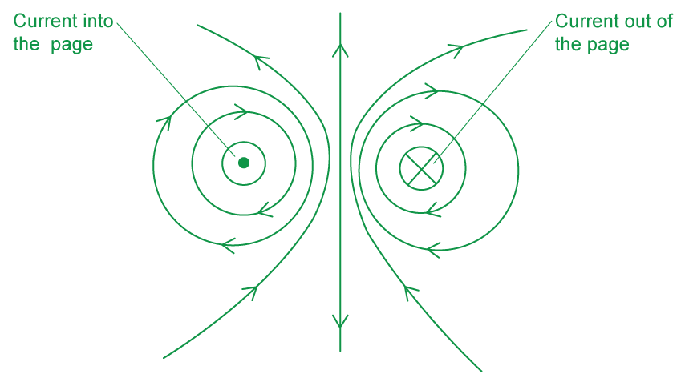
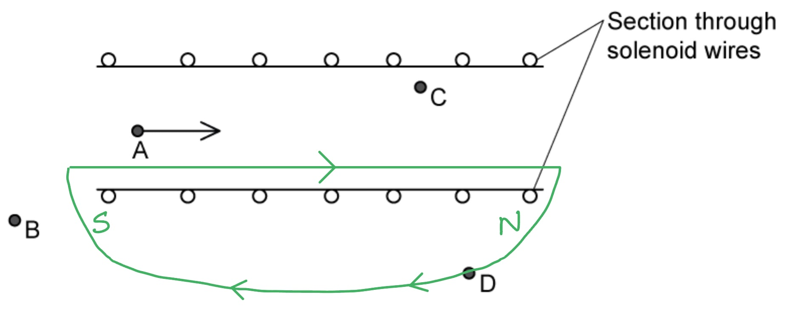
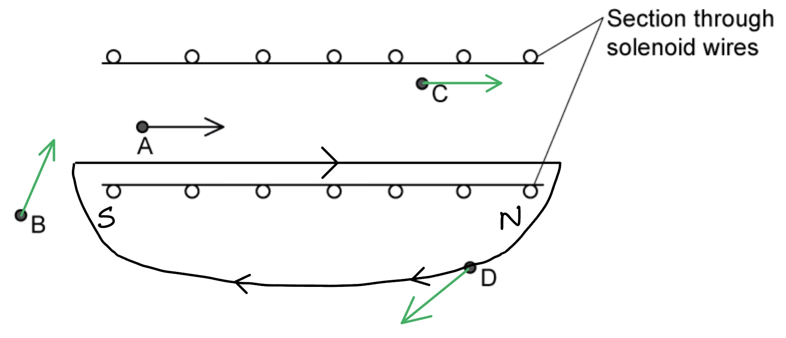
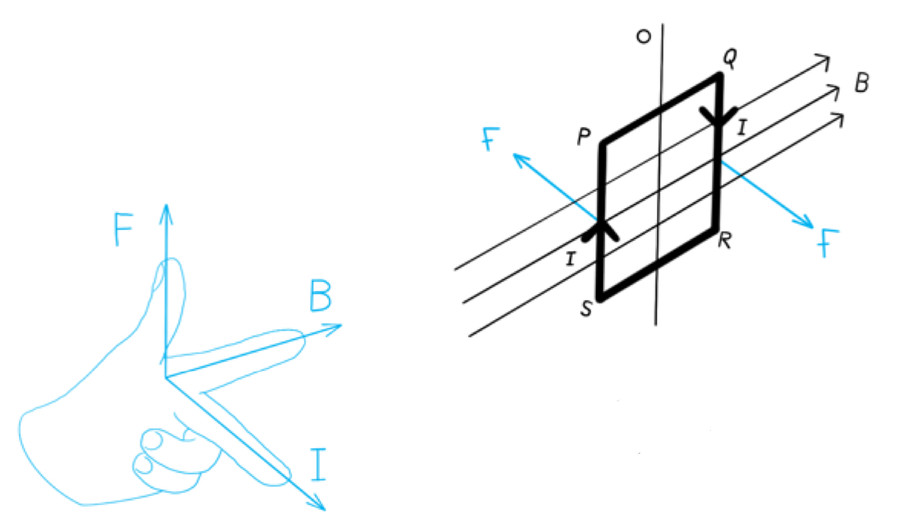
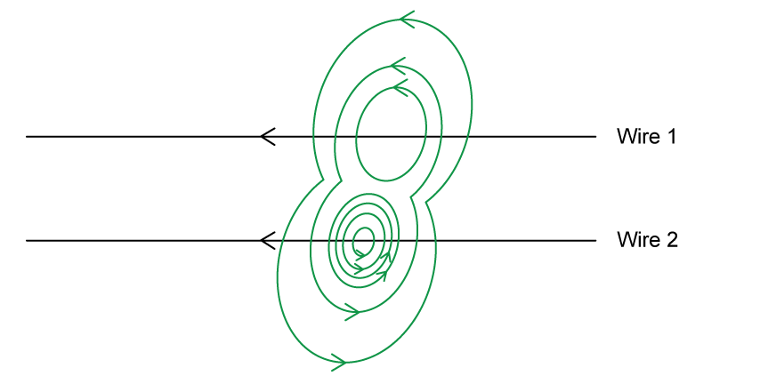
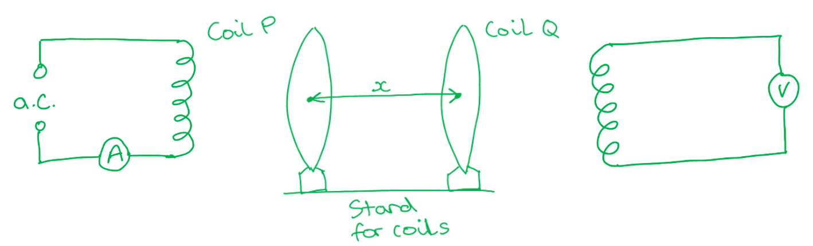
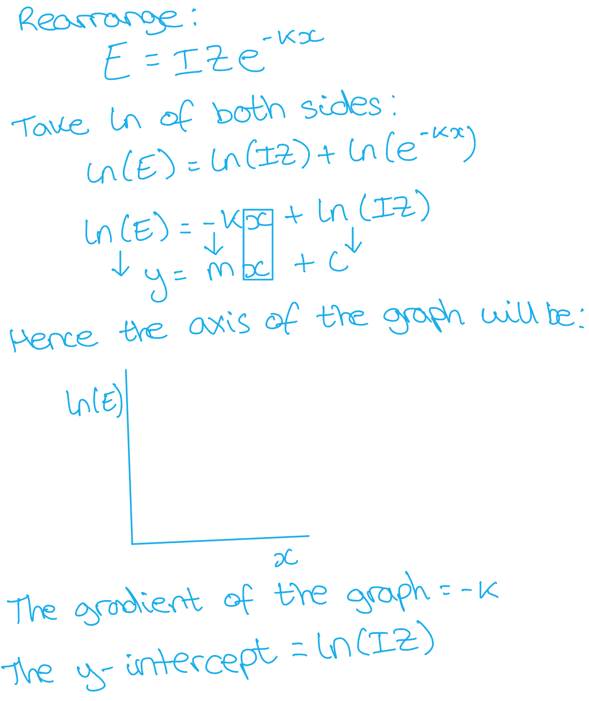
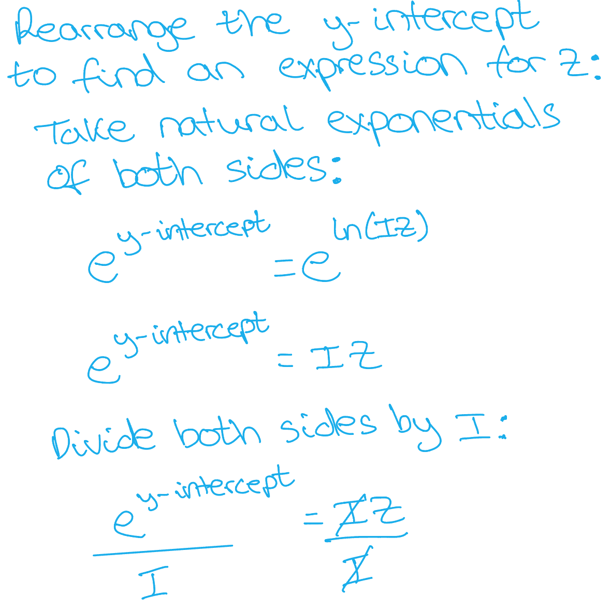
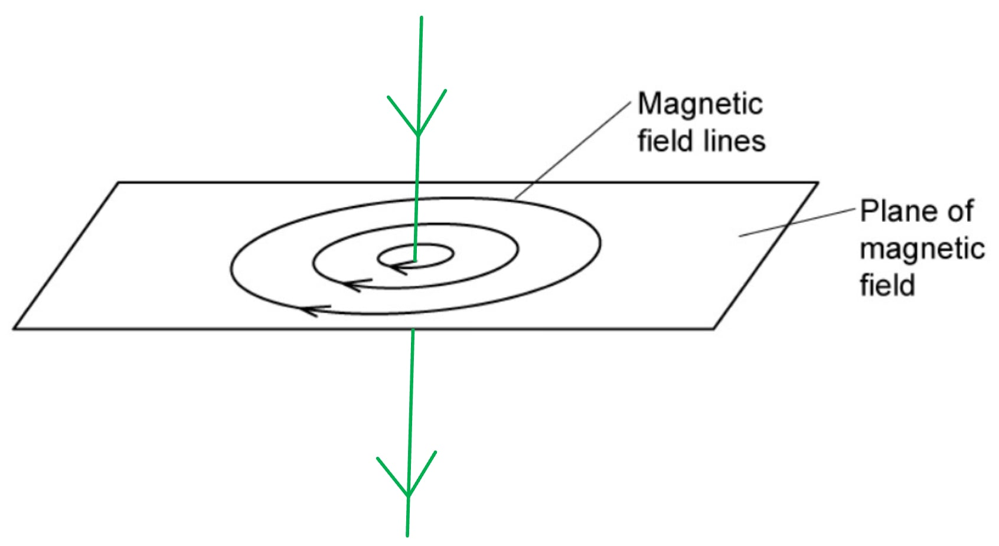
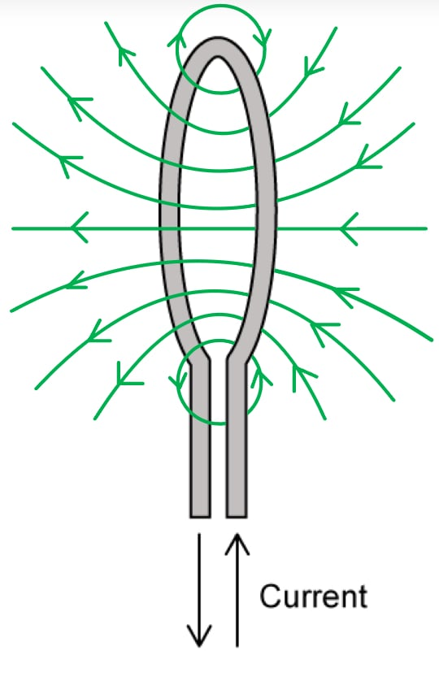

# Mark Schemes — Magnetic Fields Due to Currents
**20. Magnetic Fields** · Cambridge (CIE) A-LEVEL physics (9702)

## Structured Questions (5 questions)

### Q1
The conditions that must be satisfied for a copper wire, placed in a magnetic field, to experience a magnetic force are:

- Current: There must be current in the wire; **[1 mark]**
- Angle: The wire must be at a non-zero angle / not parallel to the magnetic field; **[1 mark]**

**[Total: 2 marks]**
Explain why the wires exert a magnetic force on each other:

Draw two parallel current-carrying wires with current travelling in the opposite directions:

- The current in the wire creates a magnetic field around the wire; **[1 mark]**
- Each wire is present in the magnetic field created by the other; **[1 mark]**
- For each wire, the current / wire is perpendicular to the magnetic field due to the other wire, so it experiences a magnetic force; **[1 mark]**

**[Total: 3 marks]**
Draw a field line on the diagram to indicate the direction of the magnetic field within the solenoid:

- The direction of a magnetic field goes from north to south
- For the field to go from A to the right

  - The south pole must be on the left side
  - The north pole on the right side

Draw arrows on the diagram to indicate the direction of the magnetic field at B, C and D:

- Arrow from B pointing diagonally upwards and to the right at about 45°; **[1 mark]**
- Arrow from C pointing horizontally to the right; **[1 mark]**
- Arrow from D pointing diagonally downwards and to the left at about 45°; **[1 mark]**

**[Total: 3 marks]**

> *Draw the **arrows parallel** to the **field line** to ensure their direction is correct.*
Draw lines on the diagram to observe the density of the magnetic field lines at each point:

(i) The magnitude of the flux density of the magnetic field at A and C is:

- Equal; **[1 mark]**

(ii) The magnitude of the flux density of the magnetic field at A and D is:

- A is greater than D; **[1 mark]**

**[Total: 2 marks]**

> *The magnetic flux density describes the **density** and **direction** of the **magnetic field lines** that run through an area. *

> *The magnetic flux density in the **centre** of the solenoid is **bigger** than outside.*

### Q2
Determine the force, in terms of *F*, that acts on the second wire:

- Force on first wire:  $F=BIl$** ****[1 mark]**** **

Write an expression for the force on the second wire:

- Force on second wire:  $F_{2} = ( 4 B ) \times ( 0.75 I ) \times l = 3 B I l$
- Force on second wire:  $F_{2}=3F$  **[1 mark]**** **

**[Total: 2 marks]**** **
The magnitude of the force on each of sides SP and QR is:

- *F*/4 (= *BIL*/4) on each side; **[1 mark]**

Explanation:

- The sides SP and QR are perpendicular to the magnetic field lines; **[1 mark]**
- (Hence) the (magnetic) forces are equal and opposite; **[1 mark]**
- The forces form a couple / allow the coil to rotate about O; **[1 mark]**

**[Total: 4 marks]**** **

> *The directions of the forces are found through Fleming’s left-hand rule*

> * *
The difference in motion between wire 1 and wire 2 in this arrangement is:

- Wire 2 rotates three times as fast as wire 1; **[1 mark]**
- Because it has a force *F**2* = 3*F*; **[1 mark]**** **

**[Total: 2 marks]**** **
A diagram that should score 4 marks would look like this:

- Field lines are drawn as concentric circles around each wire; **[1 mark]**
- The field lines around wire 2 are four times closer together than around wire 1; **[1 mark]**
- The outer field lines around wires 1 and 2 join together (to show attraction); **[1 mark]**
- The arrows on the field lines go anti-clockwise around the wires; **[1 mark]**

**[Total: 4 marks]**

> *The currents are in the same direction, so the two wires are attracted towards each other. *

> *F**2** > **F**1**  so the magnetic field surrounding wire 2 is bigger than that surrounding wire 1. Hence, the field lines are 4 times closer together. *

> *The right-hand grip rule should be used to determine the direction of the magnetic field. The thumb should be positioned in the same direction as the current where the fingers show the direction of the magnetic field at right angles to the wire. *

**Final answer:** ** **

### Q3
Plan a laboratory experiment to test the relationship between *E* and *x*. Draw a diagram showing the arrangement of your equipment. Explain how the results could be used to determine values for *k* and *Z*.

**Each point from the list can score ****one mark**** up to a ****maximum of 15 marks**** (****but read the guidance below in blue****):**

***Defining the problem:***

- *x *is the independent variable and *E *is the dependent variable **OR**** **vary *x *and measure *E*; **[1 mark]**
- The r.m.s current $I_{rms}$ / peak current $I_{0}$* *in coil P is the <u>control variable;</u> **[1 mark]**

***Methods of data collection:***

- A diagram of the apparatus that includes labels for coils P, Q and distance *x* **AND** coils P and Q supported by a stand; **[1 mark]**

- Circuit diagram 1: an a.c. power supply / signal generator connected to coil P in series with an ammeter **AND**
- Circuit diagram 2: a voltmeter / CRO connected to coil Q; **[1 mark]**

- A method to determine *x *e.g. use a ruler to measure the distance *x *between the coils; **[1 mark]**
- A method to measure *x *from the <u>centre</u> of the two coils e.g. measure the width of each coil and divide by 2, then add to the separation of the coils; **[1 mark]**

***Method of analysis:***

- Plot a graph of ln *E* against x; **[1 mark]**
- The gradient of the graph is −*k*; **[1 mark]**
- The y-intercept = ln *IZ*  **or ** $Z = e^{y} \text{short} \text{dash} i n t e r c e p \frac{t}{I}$; **[1 mark]**

***Additional detail including safety procedures:***

**Final answer:** **Any ****six ****from:**

- Do not touch the <u>hot</u> coil / use gloves to position the <u>hot</u> coil; **[1 mark]**
- Use a large current / a large number of turns / an iron core to produce a large magnetic field / induced e.m.f; **[1 mark]**
- Use a high frequency a.c. to produce a large induced e.m.f; **[1 mark]**
- Keep the number of <u>turns</u> on each coil <u>constant</u> / frequency of the a.c. <u>constant</u>; **[1 mark]**
- A method to check that the current is constant** **e.g. use a variable resistor to keep the ammeter reading constant; **[1 mark]**
- Take repeat measurements of *x *for <u>different</u> parts of the coil <u>and</u> take the average; **[1 mark]**
- A method to position the ruler horizontally to measure *x *as described e.g. use a spirit level; **[1 mark]**
- A method to keep the coils parallel e.g. adjust coil Q until the maximum reading is obtained; **[1 mark]**
- Taking logs of the given equation leads to ln *E* = −*k*x + ln (*IZ*); **[1 mark]**
- This relationship is valid if a straight line is produced when the graph of ln *E* against *x* is plotted; **[1 mark]**

**An example of an answer which would score 15 marks is:**** **

<u>Method</u>

1. Set up the apparatus as shown in the diagram below **[1] [2]**. Use a ruler to measure the horizontal distance *x *between the two coils **[3]**.
2. The distance *x* must be measured from the centre of coil P to the centre of coil Q. This centre can be located by measuring the width of both coils, dividing by 2 and then *x* can be obtained by adding these half widths to the separation of the coils **[4]**. A spirit level should be used with a ruler to ensure *x *is measured horizontally** ****[5]****.**
3. The independent variable is* x *and the dependent variable is *E* **[6]**. The current in coil P, the number of turns on each coil and the frequency of the a.c. must be kept constant throughout **[7]**.
4. For different values of *x*, repeat measurements of *x *should be taken at different points on the coil and then calculate an average **[8]**.
5. Connect coil P to a high frequency a.c. to induce a large e.m.f which will in turn, generate a large magnetic field **[9]**** **and induce a current in coil Q.
6. To ensure the coils are parallel, adjust coil Q until the maximum reading is obtained **[10]**

<u>Analysis:</u>

1. Plot a graph using the mean values of ln *E* against *x ***[11]**
2. Taking logs of the equation $E=IZe^{-kx}$ leads to $\mathrm{ln}E=-kx+\mathrm{ln}IZ$ **[12]**.** **This relationship is valid if a straight line is produced when the graph of ln *E* against *x* is plotted **[13]****.**
3. Comparing this to the equation of a straight line, y = mx + c

  - Gradient = −*k *
  - y-intercept = ln *IZ*
4. Determine a value for *k* using *k* = −gradient and *Z* using $Z = e^{y} \text{short} \text{dash} i n t e r c e p \frac{t}{I}$ **[14]**.

<u>Safety considerations:</u>

- The coils will get very hot, so gloves should be worn during handling **[15]**

**[Total: 15 marks]**

> *Question 1 in paper 5 assesses your **planning skills**. Your answer must comment on each of the following aspects for a maximum of **15 marks**:*

- *Defining the problem*
- *Methods of data collection*
- *Method of analysis*
- *Additional detail including safety considerations*

> *Defining the problem**:*

- *State the **independent, dependent** and **control variables** of the experiment*

> *Methods of data collection**:*

- *Describe the method used to change the independent variable*
- *Describe how the independent and dependent variables are measured*
- *Describe how the control variables are kept constant*
- *Use a **diagram** to describe the arrangement of the apparatus and the procedures to be followed*

> *Method of analysis**:*

- *Describe how the data should be used to reach a conclusion*
- *Include details of derived quantities derived from graphs plotted*

> *Additional details including safety considerations**:*

> *Marks are available for additional information. How the marks are awarded will depend on the experiment. They could be for describing how additional variables can be kept constant, a circuit needed to make a particular measurement, a description of initial experiments.*

> *Marks for safety considerations will be awarded for:*

- *Assessing the risks of the experiment*
- *Describing precautions that should be taken to keep risks to a minimum*

- *The experiment asks you to test the relationship between **E **and **x**.*
- *To determine the graph needed, rearrange the equation and match to *$y=mx+c$

### Q4
The rule used to determine the direction of the current is:

- The right-hand grip rule; **[1 mark]**

**[Total: 1 mark]**
(i) The current passing through both of the wires is:

- Opposite each other; **[1 mark]**

(ii) The two wires are:

- Repulsed from each other; **[1 mark]**

**[Total: 2 marks]**

> *We can tell if the wires repel because none of the magnetic field lines will be connected together. *
The diagram shows that the wires are attracted towards each other because:

- Some of the magnetic field lines from both wires are connected; **[1 mark]**
- The current in both wires is travelling in the same direction, so the wires are attracted towards each other; **[1 mark]**

**[Total: 2 marks]**
If the direction of the current in both wires was reversed then the diagram will be different:

- The current direction will show a '`times`' and not an 'x' in both wires; **[1 mark]**
- Hence, the arrows in the magnetic field lines will face in the opposite direction / anti-clockwise; **[1 mark]**

**[Total: 2 marks]**

### Q5
A correctly ticked table that would score 4 marks should look like this:

| **Object** |   |
|---|---|
| Wooden Blocks |   |
| Straight Wires | **✓ ****[1 mark]** |
| Bar Magnet | **✓ ****[1 mark]** |
| Iron Screws |   |
| Circular Coils | **✓ ****[1 mark]** |
| Water Bath |   |
| Solenoid | **✓ ****[1 mark]** |

- One mark given for each correctly ticked object

**[Total: 4 marks]**
A correctly drawn object with the current direction indicated that would score 2 marks should look like this:

- Straight wire drawn down the page with a ruler through the centre of the concentric circles; **[1 mark]**
- Current arrows pointing straight down the page; **[1 mark]**

**[Total: 2 marks]**** **

> *Remember to use the right hand thumb rule to determine the direction of the current. The fingers curl in the direction of the magnetic field lines. *
The object is a:

- solenoid; **[1 mark]**

The current passes:

- From the left-hand side of the solenoid to the right-hand side; **[1 mark]**

**[Total: 2 marks]**

> *Remember that the right-hand grip rule here has the current in the fingers, following the flow of the coils. The thumb points toward the north pole of the solenoid, so the magnetic field inside the solenoid runs in the direction the thumb points (from south end to north end). *
Correctly drawn field lines around the coil that would score 4 marks should look like this:

- Field lines drawn as curves with bigger curves at the top and bottom of the coil; **[1 mark]**
- Complete circular loop(s) are drawn at the top and bottom of the coil; **[1 mark]**
- The field lines get closer together towards the centre of the coil; **[1 mark]**
- The arrows on the field lines point from the right-hand side to the left-hand side; **[1 mark]**

**[Total: 4 marks]**

> *Remember also in this situation the current will flow in the same direction as the fingers in the right-hand grip rule. *
