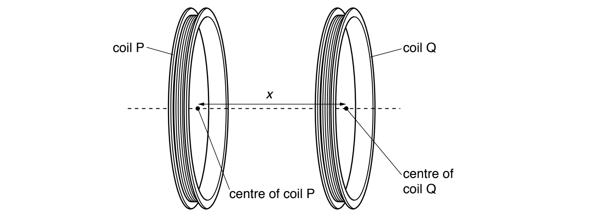

# Exam Questions — Magnetic Fields Due to Currents
**20. Magnetic Fields** · Cambridge (CIE) A-LEVEL physics (9702)
> Source: [https://www.savemyexams.com/a-level/physics/cie/25/topic-questions/](https://www.savemyexams.com/a-level/physics/cie/25/topic-questions/) · 5 questions across 1 sets

## Structured Questions (5 questions)

### Q1 — medium — 10 marks

**Q1** [2 marks]

State and describe the conditions that must be satisfied for a copper wire, placed in a magnetic field, to experience a magnetic force.

**Q1** [3 marks]

Two long parallel current-carrying wires are placed near to each other in a vacuum.

Explain why these wires exert a magnetic force on each other. You may draw a labelled diagram if you wish.

**Q1** [3 marks]

A long air-cored solenoid is connected to a power supply so that the solenoid creates a magnetic field. Fig. 1.1 shows a cross-section through the middle of the solenoid.

**Fig. 1.1**

The direction of the magnetic field at point A is indicated by the arrow. The other points are labelled B, C and D.

On Fig. 1.1, draw arrows to indicate the direction of the magnetic field at each of the points B, C and D.

**Q1** [2 marks]

**Extract:**

A long air-cored solenoid is connected to a power supply so that the solenoid creates a magnetic field. Fig. 1.1 shows a cross-section through the middle of the solenoid. The direction of the magnetic field at point A is indicated by the arrow. The other points are labelled B, C and D.

Compare the magnitude of the flux density of the magnetic field:

(i) At A and C

[1]

(ii) At A and D.

[1]

### Q2 — medium — 12 marks

**Q2** [2 marks]

A section of a straight current-carrying wire is placed at right angles to a uniform magnetic field of flux density $B$. When the current in the wire is $I$, the magnetic force that acts on a length $l$ of the wire is $F$.

A second wire of the same length is placed at right angles to a uniform magnetic field of flux density $4B$ when the current is $0.75I$*.*

Determine the force, in terms of $F$, that acts on the second wire.

**Q2** [4 marks]

Wire 1 is bent into a square coil.

The coil is mounted on an axle O and is placed with its plane parallel to the flux lines of its uniform magnetic field* B*, as shown in Fig. 1.2.

**Fig. 1.2**

The current, *I*, is switched on and flows through sides** **PQRS.

State the magnitude of the force on sides SP and QR in Fig. 1.2 and explain your answer.

**Q2** [2 marks]

**Extract:**

A second wire of the same length is placed at right angles to a uniform magnetic field of flux density 4B when the current is 0.75I. Force on second wire: F2 = (4B) x (0.75I) x l = 3BIl = 3F.

Wire 1 is bent into a square coil. The coil is mounted on an axle O and is placed with its plane parallel to the flux lines of its uniform magnetic field B. The current, I, is switched on and flows through sides PQRS. The forces form a couple / allow the coil to rotate about O.

Wire 2 is also bent into a square coil and mounted on an axle with its plane parallel to the flux lines of its uniform magnetic field 4*B*. It has the same arrangement as wire 1 in Fig. 1.1.

Explain the difference in motion between wire 1 and wire 2 in this arrangement.

**Q2** [4 marks]

**Extract:**

A section of a straight current-carrying wire is placed at right angles to a uniform magnetic field of flux density \$\$B\$\$. When the current in the wire is \$\$I\$\$, the magnetic force that acts on a length \$\$l\$\$ of the wire is \$\$F\$\$. A second wire of the same length is placed at right angles to a uniform magnetic field of flux density \$\$4 B\$\$ when the current is \$\$0 . 75 I\$\$.

The two wires are placed parallel with their currents flowing in the same direction as shown in Fig. 1.1.

**Fig. 1.1**

Sketch the correct magnetic field lines on Fig. 1.1.

### Q3 — medium — 15 marks

**Q3** [15 marks]

A circular coil P carrying an alternating current produces a changing magnetic field. When a second similar coil Q is placed with its centre a distance *x* from the centre of coil P, as shown in Fig. 1.1, an electromotive force (e.m.f.) *E* is induced in coil Q.

**Fig. 1.1**

It is suggested that *E* is related to *x* by the relationship

$E=IZe^{-kx}$

where *I* is the current in coil P, and *k* and *Z* are constants.

Plan a laboratory experiment to test the relationship between *E* and *x*.

Draw a diagram showing the arrangement of your equipment.

Explain how the results could be used to determine values for *k* and *Z*.

In your plan you should include:

•    the procedure to be followed

•    the measurements to be taken

•    the control of variables

•    the analysis of the data

•    any safety precautions to be taken.

*Source: Specimen 2022 Paper 5 Q1A*

### Q4 — easy — 7 marks

**Q4** [1 mark]

Some students are trying to figure out the direction of the current in a straight horizontal wire.

State the name of the rule used to determine the direction of the current.

**Q4** [2 marks]

Fig. 1.1 shows the magnetic field lines surrounding two current carrying wires.

**Fig. 1.1**

(i) Identify the relative direction of the current passing through both of the wires.

[1]

(ii) State whether the wires are attracted or repulsed from each other.

[1]

**Q4** [2 marks]

Fig. 1.2 shows the magnetic field lines around two wires that are attracted towards each other.

**Fig. 1.2**

Explain how the diagram in Fig. 1.2 shows they are attracted towards each other.

**Q4** [2 marks]

**Extract:**

Fig. 1.2 shows the magnetic field lines around two wires that are attracted towards each other. Fig. 1.2. Explain how the diagram in Fig. 1.2 shows they are attracted towards each other.
The diagram shows that the wires are attracted towards each other because: Some of the magnetic field lines from both wires are connected; The current in both wires is travelling in the same direction, so the wires are attracted towards each other.

Describe how the diagram in Fig. 1.2 from part (c) would look different if the direction of the current in both the wires is reversed.

### Q5 — easy — 12 marks

**Q5** [4 marks]

Magnetic field patterns can be observed around certain objects. Table 1.1 lists different objects.

**Table 1.1 **

| **Object** |   |
|---|---|
| Wooden Blocks |   |
| Straight Wires |   |
| Bar Magnet |   |
| Iron Screws |   |
| Circular Coils |   |
| Water Bath |   |
| Solenoid |   |

Identify the objects around which a magnetic field is created by placing a tick mark (✓) next them.

**Q5** [2 marks]

Fig. 1.1 shows the magnetic field lines and the plane of the magnetic field.

**Fig 1.1**

Sketch on the diagram the object creating the magnetic field and the direction of the current flowing.

**Q5** [2 marks]

The magnetic field lines surrounding a different object are shown in Fig. 1.2.

**Fig. 1.2**

State the name of the object and the direction of the current passing through it.

**Q5** [4 marks]

Fig. 1.3 shows the current passing through a single circular coil.

**Fig. 1.3**

Sketch the field lines around the coil.
